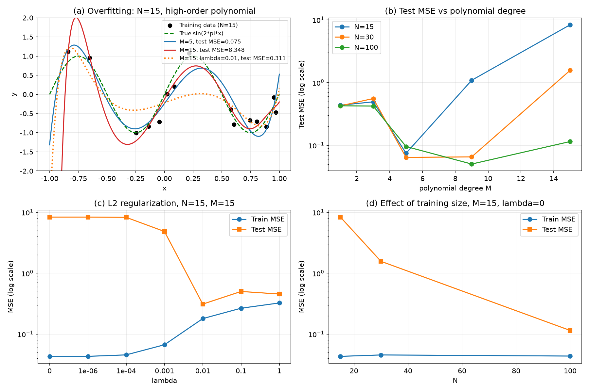
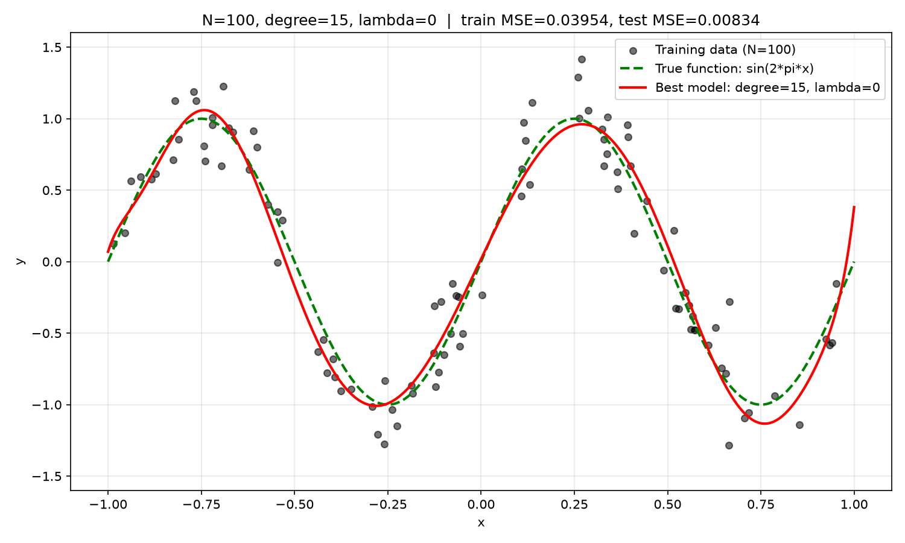
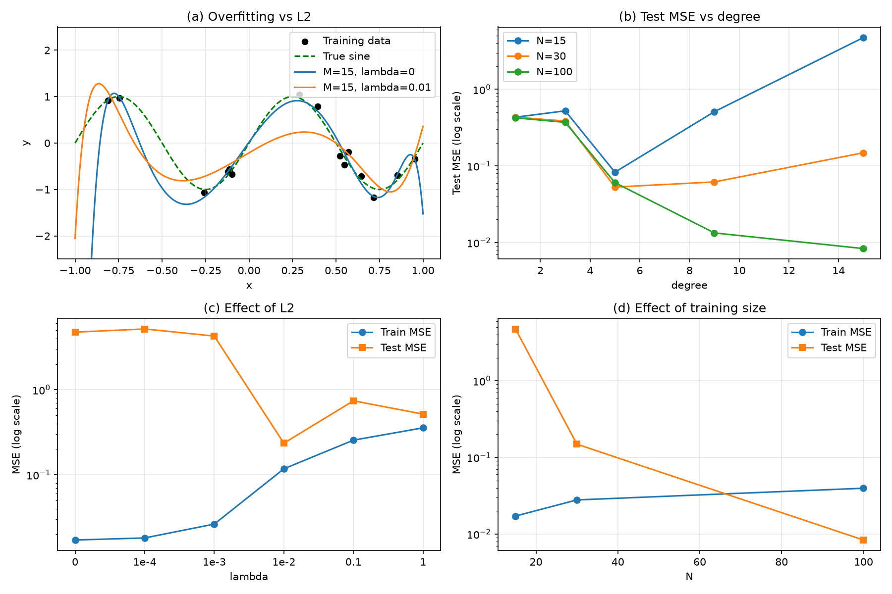

# 实验一：多项式拟合正弦函数

> 姓名：________　学号：________　班级：________　日期：________
>
> 主实验代码：`poly_sine_experiment.py`
>
> 补充绘图代码：`plot_best_model.py`
>
> 结果图：`poly_sine_results.png`、`best_model.png`、`step12_final.png`

## 1. 实验目的

1. 掌握使用 NumPy 生成带噪声的监督学习数据集，理解训练集与无噪声测试集的区别。
2. 掌握多项式回归的特征构造方法，理解多项式阶数 M 对模型表达能力的影响。
3. 理解均方误差（MSE）、L2 正则化、梯度下降等基本概念，能够从公式推导梯度并手写实现全批量梯度下降。
4. 通过实验观察欠拟合、过拟合、偏差—方差权衡（bias-variance tradeoff）等现象。
5. 掌握特征标准化对高阶多项式梯度下降数值稳定性和收敛速度的重要性。
6. 学会通过训练误差、测试误差、权重范数 `||w||` 和可视化曲线综合诊断模型状态。
7. 熟悉 Matplotlib 可视化，能够把实验结果整理成图表并给出分析结论。

## 2. 实验内容

本实验用纯 NumPy 实现一个多项式回归模型，拟合函数

$$
y=\sin(2\pi x)+\varepsilon,\qquad \varepsilon\sim\mathcal N(0,\sigma^2)
$$

其中输入 $x$ 在 $[-1,1]$ 上均匀分布，噪声标准差取 $\sigma=0.2$。主要实验内容包括：

1. 使用 `np.random.default_rng` 生成训练数据，使用 `np.linspace` 生成无噪声测试数据。
2. 使用 Vandermonde 矩阵构造多项式特征 $\Phi=[1,x,x^2,\ldots,x^M]$。
3. 对非截距列做 z-score 标准化，训练集拟合均值/标准差，测试集复用同一组统计量。
4. 实现预测函数、MSE 损失、半均方损失 $J=\frac{1}{2N}\|\Phi w-y\|_2^2$。
5. 推导并手写全批量梯度下降，不使用 PyTorch/TensorFlow 自动微分。
6. 设计三组对比实验：
   - 实验 1：不同样本量 $N\in\{15,30,100\}$ 与不同阶数 $M\in\{1,3,5,9,15\}$（无正则化）。
   - 实验 2：固定 $N=15,M=15$，比较不同 L2 系数 $\lambda$。
   - 实验 3：固定 $N=30,M=15$，比较不同学习率 $\eta$，观察收敛与发散。
7. 绘制过拟合曲线、测试误差—阶数曲线、L2 影响曲线、样本量影响曲线，并训练一个较大数据量下的“最优模型”进行展示。
8. 根据实验结果分析模型复杂度、数据量、正则化强度和学习率之间的关系。

## 3. 实验环境

| 项目 | 配置 |
|---|---|
| 操作系统 | Windows（WSL2 宿主） + WSL2 Ubuntu 24.04.4 LTS |
| 内核 | Linux 6.6.87.2-microsoft-standard-WSL2 x86_64 |
| 编程语言 | Python 3.13.12（Anaconda 发行版） |
| 核心库 | NumPy 2.5.2、Matplotlib 3.11.0 |
| 开发工具 | VS Code / DSH 终端 |
| 运行方式 | `python poly_sine_experiment.py`、`python plot_best_model.py` |
| 实验数据 | 程序随机生成，固定随机种子；主实验 `RNG_SEED=4`，补充实验 `seed=42` |
| 硬件 | x86_64 CPU 环境，无需 GPU；所有矩阵运算由 NumPy/底层 BLAS 完成 |

## 4. 实验过程、结果及分析

### 4.1 实验原理

#### 4.1.1 数据生成模型

训练数据由真实函数加高斯噪声得到：

$$
x_i\sim U(-1,1),\qquad y_i=\sin(2\pi x_i)+\sigma\varepsilon_i,\qquad \varepsilon_i\sim N(0,1)
$$

测试数据使用同一区间上的等距网格，并且不加噪声：

$$
x_i^{test}=-1+\frac{2i}{K-1},\qquad y_i^{test}=\sin(2\pi x_i^{test})
$$

因此，测试误差衡量的是模型对真实正弦函数的泛化能力，而不是对噪声的拟合能力。

#### 4.1.2 多项式回归模型

将一维输入 $x$ 映射为 $M+1$ 维特征：

$$
\phi(x)=[1,x,x^2,\ldots,x^M]^T
$$

整个训练集的批量特征矩阵为：

$$
\Phi=
\begin{bmatrix}
1 & x_1 & x_1^2 & \cdots & x_1^M\\
1 & x_2 & x_2^2 & \cdots & x_2^M\\
\vdots & \vdots & \vdots & \ddots & \vdots\\
1 & x_N & x_N^2 & \cdots & x_N^M
\end{bmatrix}
\in\mathbb R^{N\times(M+1)}
$$

线性模型为：

$$
\hat y=\Phi w,\qquad w=[w_0,w_1,\ldots,w_M]^T
$$

其中 $w_0$ 是截距。阶数 $M$ 越大，模型表达能力越强，但也越容易过拟合。

#### 4.1.3 特征标准化

高阶多项式列 $x^j$ 之间量级差异很大，例如 $x=0.9$ 时 $x^{15}$ 会非常小，而 $x=0.999$ 时又相对较大。不对特征做处理会导致特征矩阵条件数很大，梯度下降收敛慢甚至发散。

本实验对第 1 到第 M 列做 z-score 标准化：

$$
\tilde x_j=\frac{x_j-\mu_j}{s_j}
$$

其中 $\mu_j,s_j$ 只在训练集上计算：

$$
\mu_j=\frac{1}{N}\sum_{i=1}^N \Phi_{ij},\qquad
s_j=\sqrt{\frac{1}{N}\sum_{i=1}^N(\Phi_{ij}-\mu_j)^2}
$$

截距列保持为 1，不参与标准化。测试集必须复用训练集的 $\mu_j,s_j$，否则会造成数据泄露，测试误差不再可靠。

#### 4.1.4 损失函数与 L2 正则化

基础损失采用半均方误差：

$$
J_0(w)=\frac{1}{2N}\|\Phi w-y\|_2^2
=\frac{1}{2N}\sum_{i=1}^N(\phi(x_i)^Tw-y_i)^2
$$

加入 L2 正则化后：

$$
J(w)=\frac{1}{2N}\|\Phi w-y\|_2^2+\frac{\lambda}{2}\|w_{1:}\|_2^2
$$

其中 $w_{1:}=[w_1,\ldots,w_M]^T$，默认不惩罚截距 $w_0$。L2 项会抑制权重幅度，降低模型方差，从而缓解过拟合。$\lambda$ 越大，正则化越强；$\lambda$ 过大会导致欠拟合。

#### 4.1.5 梯度推导

对 $J_0(w)$ 求导：

$$
\frac{\partial J_0}{\partial w}
=\frac{1}{N}\Phi^T(\Phi w-y)
$$

加入 L2 后：

$$
\frac{\partial J}{\partial w}
=\frac{1}{N}\Phi^T(\Phi w-y)+\lambda w_{pen}
$$

其中 $w_{pen}[0]=0$，$w_{pen}[j]=w_j\ (j\ge1)$。

#### 4.1.6 全批量梯度下降

参数更新公式为：

$$
w^{(t+1)}=w^{(t)}-\eta\nabla J(w^{(t)})
$$

其中 $\eta$ 是学习率。对于凸二次目标，只要学习率满足稳定性条件，梯度下降会收敛到全局最优。学习率太小会导致 60 000 次迭代内尚未收敛，学习率太大则会造成震荡甚至发散。

#### 4.1.7 评价指标

- 训练 MSE：$\frac{1}{N}\|\Phi_{train}w-y_{train}\|_2^2$
- 测试 MSE：$\frac{1}{K}\|\Phi_{test}w-y_{test}\|_2^2$
- 权重范数：$\|w\|_2$，用于观察正则化强度和模型复杂度。

### 4.2 实验步骤

1. **基础 NumPy 操作**：创建数组、`shape`、`dtype`、`linspace`、向量化运算、随机数生成、矩阵乘法。
2. **数据生成**：实现 `generate_data` 和 `make_test_data`，检查形状、随机种子和无噪声测试集。主实验先一次性生成 200 个样本的数据池，再按前 `n` 个样本切出不同规模的训练集，从而保证不同样本量之间的数据尽量可比；测试集固定为 `np.linspace(-1, 1, 600)`。
3. **多项式特征**：使用 `np.vander(..., increasing=True)` 构造 $\Phi$，验证各列分别为 $1,x,x^2,\ldots$。
4. **标准化模块**：实现 `fit_standardizer`、`transform_features`、`standardize_train_test`，验证训练集标准化后均值约为 0、标准差约为 1。
5. **损失与梯度下降**：实现 `mse`、`half_mse_loss`、`gradient`、`train_gd`，先用可手算的小例子 $y=1+2x$ 验证。
6. **多项式训练流水线**：把生成数据、特征构造、标准化、梯度下降和评价指标串成 `fit_eval`。
7. **对比实验**：
   - 固定测试集，遍历 $N$、$M$、$\lambda$；
   - 对每一组配置记录训练 MSE、测试 MSE 和权重范数；
   - 单独比较不同学习率，捕获 `FloatingPointError` 以标记发散。
8. **可视化与最优模型**：绘制四合一分析图；另外用 $N=10000,M=20,\lambda=0$ 训练一个较大模型，观察大样本下高阶多项式的表现。

### 4.3 关键代码说明

完整代码见第 6 节，这里只列关键片段。

（1）数据生成：

```python
def generate_data(n, noise_std=0.2, seed=RNG_SEED):
    rng = np.random.default_rng(seed)
    x = rng.uniform(-1.0, 1.0, size=n)
    y = np.sin(2.0 * np.pi * x) + noise_std * rng.normal(size=n)
    return x, y
```

（2）多项式特征 + 标准化：

```python
Phi = np.vander(x, degree + 1, increasing=True)
mean = Phi[:, 1:].mean(axis=0)
std = Phi[:, 1:].std(axis=0)
std = np.where(std < 1e-12, 1.0, std)
Phi[:, 1:] = (Phi[:, 1:] - mean) / std
```

（3）梯度计算：

```python
y_pred = Phi @ w
err = y_pred - y
grad = Phi.T @ err / n_samples
if l2 > 0.0:
    reg = l2 * w
    if not reg_bias:
        reg[0] = 0.0
    grad = grad + reg
```

（4）梯度下降：

```python
w = np.zeros(n_features, dtype=float)
for epoch in range(epochs):
    grad = ...
    w = w - lr * grad
    if not np.all(np.isfinite(w)):
        raise FloatingPointError("梯度下降发散，请减小学习率或做特征标准化。")
```

> 代码截图说明：提交 Word 版时，可将第 6 节中的 `generate_data`、`polynomial_features`、`train_gd`、`fit_eval` 和 `main` 分别截图；本 Markdown 报告用可复制的代码块代替图片，方便查错和复现。

### 4.4 实验结果

以下结果由 `python poly_sine_experiment.py` 运行得到，固定随机种子 `RNG_SEED=4`，噪声标准差 `noise_std=0.2`，基础学习率 `lr=0.1`，迭代轮数 `epochs=60000`。

#### 4.4.1 实验 1：样本量 N 与多项式阶数 M

| N | M | 训练 MSE | 测试 MSE | \|\|w\|\| |
|---:|---:|---:|---:|---:|
| 15 | 1 | 0.368701 | 0.436188 | 0.4255 |
| 15 | 3 | 0.295666 | 0.493068 | 0.7097 |
| 15 | 5 | 0.085788 | **0.074743** | 9.4181 |
| 15 | 9 | 0.042173 | 1.088720 | 12.2498 |
| 15 | 15 | 0.043146 | 8.347725 | 10.5522 |
| 30 | 1 | 0.432953 | 0.426322 | 0.2912 |
| 30 | 3 | 0.317797 | 0.556807 | 1.3272 |
| 30 | 5 | 0.099900 | **0.064194** | 9.0519 |
| 30 | 9 | 0.045288 | 0.065417 | 13.8086 |
| 30 | 15 | 0.045539 | 1.568176 | 12.3355 |
| 100 | 1 | 0.424323 | 0.426688 | 0.2423 |
| 100 | 3 | 0.292566 | 0.422703 | 1.2289 |
| 100 | 5 | 0.073610 | 0.095702 | 8.5393 |
| 100 | 9 | 0.040614 | **0.050299** | 13.4817 |
| 100 | 15 | 0.043664 | 0.114974 | 10.9264 |

说明：加粗为该样本量下测试 MSE 最小的阶数。

#### 4.4.2 实验 2：L2 正则化系数 $\lambda$

固定 $N=15,M=15$。

| $\lambda$ | 训练 MSE | 测试 MSE | \|\|w\|\| |
|---:|---:|---:|---:|
| 0 | 0.043146 | 8.347725 | 10.5522 |
| $10^{-6}$ | 0.043171 | 8.348464 | 10.5399 |
| $10^{-4}$ | 0.045662 | 8.267792 | 9.5350 |
| $10^{-3}$ | 0.066939 | 4.846681 | 6.4088 |
| $10^{-2}$ | 0.179864 | **0.311130** | 2.0816 |
| $10^{-1}$ | 0.266364 | 0.501977 | 0.5383 |
| 1 | 0.325114 | 0.455385 | 0.3081 |

说明：加粗为测试 MSE 最小的配置。虽然 $\lambda=0.1$ 的权重范数更小，但测试误差大于 $\lambda=0.01$，说明正则化强度需要调参，不能一味增大。

#### 4.4.3 实验 3：学习率 $\eta$

固定 $N=30,M=15$，无正则化，`epochs=60000`。

| 学习率 $\eta$ | 训练 MSE | 测试 MSE | 状态 |
|---:|---:|---:|:---:|
| 0.005 | 0.091432 | 2.716876 | 正常 |
| 0.010 | 0.075734 | 3.248390 | 正常 |
| 0.020 | 0.068043 | 1.627404 | 正常 |
| 0.050 | 0.054993 | **0.044109** | 正常 |
| 0.100 | 0.045539 | 1.568176 | 正常 |
| 0.200 | — | — | 发散 |
| 0.500 | — | — | 发散 |

说明：在本次参数设置中，学习率过小（0.005、0.01、0.02）在 60 000 轮内没有充分收敛；0.05 取得最好的测试误差；0.1 虽然训练 MSE 更低，但测试误差反而变大，说明高阶无正则化模型对优化路径敏感；0.2 和 0.5 直接发散，程序抛出 `FloatingPointError` 并被标记为“发散”。

#### 4.4.4 大样本最优模型

`plot_best_model.py` 使用：

- $N=10000$
- $M=20$
- $\lambda=0$
- `lr=0.1`，`epochs=60000`

运行结果：

```text
saved: best_model.png
train_mse = 0.046107
test_mse  = 0.005886
||w||     = 12.4246
```

在大样本条件下，即使阶数较高（M=20），模型也没有明显过拟合；测试 MSE 仅约 0.0059，非常接近真实正弦函数。这直观说明：**数据量可以显著缓解高阶模型的过拟合。**

#### 4.4.5 图像结果

如图 4-1 所示，四合一图分别展示：

- (a) $N=15$ 时，$M=5$、$M=15$、$M=15+\lambda=0.01$ 的拟合曲线对比；
- (b) 不同样本量下，测试 MSE 随阶数 $M$ 的变化；
- (c) 固定 $N=15,M=15$ 时，L2 系数对训练/测试 MSE 的影响；
- (d) 固定 $M=15,\lambda=0$ 时，训练样本量 $N$ 对训练/测试 MSE 的影响。







> 运行结果截图说明：除上图外，可将终端中运行 `python poly_sine_experiment.py` 输出的三张实验表格截图，作为“运行结果截图”。

### 4.5 结果分析

#### 4.5.1 欠拟合

当 $M=1$ 或 $M=3$ 时，模型本质上是直线或三次曲线，无法表达正弦函数的弯曲变化。此时训练 MSE 和测试 MSE 都较大，例如：

- $N=100,M=1$：训练 MSE≈0.4243，测试 MSE≈0.4267；
- $N=100,M=3$：训练 MSE≈0.2926，测试 MSE≈0.4227。

训练误差和测试误差都高，典型原因是**高偏差（high bias）**，即模型容量不足，属于欠拟合。

#### 4.5.2 过拟合

当 $N=15$ 时：

- $M=5$：训练 MSE≈0.0858，测试 MSE≈0.0747；
- $M=9$：训练 MSE≈0.0422，测试 MSE≈1.0887；
- $M=15$：训练 MSE≈0.0431，测试 MSE≈8.3477。

可以看到：训练误差很低，但测试误差急剧上升，且权重范数增大。这是典型的**高方差（high variance）**过拟合：模型记住了 15 个带噪声训练样本的局部波动，却没有学到真实正弦函数。

#### 4.5.3 数据量的作用

固定 $M=15$：

| N | 训练 MSE | 测试 MSE |
|---:|---:|---:|
| 15 | 0.043146 | 8.347725 |
| 30 | 0.045539 | 1.568176 |
| 100 | 0.043664 | 0.114974 |

随着 $N$ 从 15 增加到 100，训练 MSE 变化不大，但测试 MSE 从 8.35 降到 0.115，说明**增加数据量可以有效降低模型方差、提升泛化能力**。当 $N=10000,M=20$ 时，测试 MSE 进一步降到 0.0059。

#### 4.5.4 L2 正则化的作用

从实验 2 可见：

- $\lambda=0$ 时测试 MSE≈8.35，严重过拟合；
- $\lambda=10^{-2}$ 时测试 MSE≈0.311，过拟合被显著抑制；
- $\lambda=1$ 时测试 MSE≈0.455，虽然权重范数更小，但测试误差开始回升。

原因：L2 惩罚项在梯度中加入 $\lambda w$，使权重在每次更新时向 0 收缩，从而降低模型对噪声的敏感程度。但 $\lambda$ 太大会使有效模型容量不足，导致欠拟合。因此 $\lambda$ 存在一个合适的中间范围。

#### 4.5.5 学习率的作用

学习率控制每一步沿负梯度方向走多远：

- 学习率太小：每步更新缓慢，固定 60 000 轮内可能尚未到达最优点；
- 学习率合适：损失稳定下降，测试误差较低；
- 学习率太大：参数更新步长过大，损失震荡甚至数值发散。

本实验中 $N=30,M=15$ 时，$\eta=0.05$ 的测试 MSE 最低；$\eta=0.2,0.5$ 发散。需要说明的是，学习率的最优值并不是固定的，它与特征尺度、模型阶数、样本量、正则化强度和迭代轮数都有关。

#### 4.5.6 标准化的必要性

如果不做特征标准化，高阶多项式特征列的量级差异会使 Hessian 矩阵条件数非常大，梯度下降需要很小的学习率，否则容易发散。标准化的作用有：

1. 让各特征列尺度接近，改善优化问题的条件数；
2. 使梯度下降可以用更合适的学习率稳定收敛；
3. 让 L2 正则化对不同次幂的权重更公平；
4. 训练集拟合统计量、测试集复用，避免数据泄露。

#### 4.5.7 与偏差—方差分解的联系

对于平方损失，期望测试误差可以近似分解为：

$$
\mathbb E[(y-\hat y)^2]=\text{噪声}^2+\text{偏差}^2+\text{方差}
$$

- 低阶模型：偏差大，方差小 → 欠拟合；
- 高阶模型 + 小样本：偏差小，方差大 → 过拟合；
- 增大样本量或加入 L2：通常可以降低方差；
- L2 太强：又会重新引入偏差 → 欠拟合。

实验结果与这一理论完全一致。

## 5. 实验总体结论

1. **模型复杂度要匹配数据量**：低阶多项式在 $M=1,3$ 时欠拟合；$M=15$ 在 $N=15$ 时严重过拟合；增大 $N$ 后，高阶模型的表现明显改善。
2. **测试误差比训练误差更能反映泛化能力**：过拟合时训练 MSE 很低，但测试 MSE 可能高出两个数量级。
3. **L2 正则化是缓解过拟合的有效手段**：本实验中 $\lambda\approx0.01$ 时测试 MSE 最小；$\lambda$ 过大会导致欠拟合。
4. **学习率决定优化能否成功**：$\eta$ 过小收敛慢，$\eta$ 过大发散；实际使用时应配合特征标准化，并通过实验选择合适的学习率。
5. **特征标准化是手写高阶多项式回归的关键工程步骤**：它改善数值条件，使梯度下降更稳定。
6. **纯 NumPy 手写梯度下降是可行的**：通过解析梯度公式 $ \nabla J=\frac{1}{N}\Phi^T(\Phi w-y)+\lambda w_{pen} $ 完成训练，不需要自动微分。
7. **不足与改进方向**：
   - 本轮只测试了一个噪声水平 $\sigma=0.2$，可以进一步比较多组噪声强度；
   - 可以引入交叉验证选择阶数和 $\lambda$；
   - 可以使用 mini-batch / 随机梯度下降加速大样本训练；
   - 可以加入早停（early stopping）和更多正则化方法（L1、弹性网络）进行对比；
   - 可以分析梯度下降的谱条件与最大稳定学习率 $\eta<2/L$。

## 6. 完整实验代码

### 6.1 主实验代码：`poly_sine_experiment.py`

```python
# -*- coding: utf-8 -*-
"""
实验一：多项式拟合正弦函数（纯 NumPy，手写梯度下降，不使用 PyTorch/TensorFlow 自动微分）
内容：
1. 生成带高斯噪声的正弦数据；
2. 用多项式模型拟合；
3. 全批量梯度下降 + L2 正则化；
4. 比较不同阶数、样本量、学习率、正则化系数；
5. 画图并输出指标。
"""
import numpy as np
import matplotlib
matplotlib.use("Agg")
import matplotlib.pyplot as plt

plt.rcParams["axes.unicode_minus"] = False
np.seterr(over="ignore", invalid="ignore")
RNG_SEED = 4


# ----------------------------- 数据生成 -----------------------------
def generate_data(n, noise_std=0.2, seed=RNG_SEED):
    """在 [-1,1] 上生成 y=sin(2*pi*x)+高斯噪声"""
    rng = np.random.default_rng(seed)
    x = rng.uniform(-1.0, 1.0, size=n)
    y = np.sin(2.0 * np.pi * x) + noise_std * rng.normal(size=n)
    return x, y


# ----------------------------- 特征构造 -----------------------------
def polynomial_features(x, degree, mean=None, std=None):
    """
    构造 [1, x, x^2, ..., x^degree]。
    为避免高阶时数值病态，对非截距列做 z-score 标准化。
    训练集调用时 mean/std 为 None，会返回训练集统计量；测试集再传入同一组统计量。
    """
    x = np.asarray(x, dtype=float)
    Phi = np.vander(x, degree + 1, increasing=True)

    if degree >= 1:
        if mean is None:
            mean = Phi[:, 1:].mean(axis=0)
            std = Phi[:, 1:].std(axis=0)
            std = np.where(std < 1e-12, 1.0, std)
        Phi[:, 1:] = (Phi[:, 1:] - mean) / std
    else:
        mean = np.zeros(0)
        std = np.ones(0)
    return Phi, mean, std


# ----------------------------- 损失与梯度下降 -----------------------------
def mse(y_true, y_pred):
    return float(np.mean((np.asarray(y_true) - np.asarray(y_pred)) ** 2))


def train_gd(Phi, y, lr=0.1, epochs=60000, l2=0.0, reg_bias=False, tol=1e-12):
    """
    全批量梯度下降最小化:
        J(w) = 1/(2N) * ||Phi w - y||^2 + (lambda/2) * ||w_pen||^2
    其中除截距外都参与 L2 惩罚。
    返回 w 和 loss 历史。
    """
    Phi = np.asarray(Phi, dtype=float)
    y = np.asarray(y, dtype=float).reshape(-1)
    n_samples, n_features = Phi.shape
    w = np.zeros(n_features, dtype=float)
    losses = []

    for epoch in range(epochs):
        y_pred = Phi @ w
        err = y_pred - y
        grad = Phi.T @ err / n_samples

        if l2 > 0.0:
            reg = l2 * w
            if not reg_bias:
                reg[0] = 0.0
            grad = grad + reg

        w = w - lr * grad
        if not np.all(np.isfinite(w)):
            raise FloatingPointError("梯度下降发散，请减小学习率或做特征标准化。")

        new_err = Phi @ w - y
        loss = 0.5 * np.mean(new_err ** 2)
        if l2 > 0.0:
            loss += 0.5 * l2 * np.sum(w[1:] ** 2)
        losses.append(float(loss))
        if epoch > 100 and abs(losses[-1] - losses[-2]) < tol:
            break

    return w, np.asarray(losses)


# ----------------------------- 实验评估 -----------------------------
def fit_eval(x_train, y_train, x_test, y_test, degree, lr=0.1,
             epochs=60000, l2=0.0):
    """返回训练误差、测试误差、模型权重以及测试集预测"""
    Phi_train, mean, std = polynomial_features(x_train, degree)
    Phi_test, _, _ = polynomial_features(x_test, degree, mean=mean, std=std)
    w, losses = train_gd(Phi_train, y_train, lr=lr, epochs=epochs, l2=l2)
    train_mse = mse(y_train, Phi_train @ w)
    test_mse = mse(y_test, Phi_test @ w)
    return {
        "degree": degree, "train_mse": train_mse, "test_mse": test_mse,
        "w": w, "losses": losses, "mean": mean, "std": std,
    }


def main():
    noise_std = 0.2
    x_test = np.linspace(-1.0, 1.0, 600)
    y_test_clean = np.sin(2.0 * np.pi * x_test)

    # 固定同一个较大的数据池，取前 n 个作为不同样本量，保证比较尽量公平
    x_pool, y_pool = generate_data(200, noise_std=noise_std, seed=RNG_SEED)

    degrees = [1, 3, 5, 9, 15]
    sample_sizes = [15, 30, 100]
    base_lr = 0.1
    base_epochs = 60000

    print("=" * 88)
    print("实验1：不同数据量 N 和不同多项式阶数 M （无正则化, lr=%.2f, epochs=%d）" % (base_lr, base_epochs))
    print("=" * 88)
    print(f"{'N':>4s} {'M':>3s} {'训练MSE':>12s} {'测试MSE':>12s} {'||w||':>10s}")
    degree_results = {}
    for n in sample_sizes:
        x_train, y_train = x_pool[:n], y_pool[:n]
        for degree in degrees:
            res = fit_eval(x_train, y_train, x_test, y_test_clean,
                           degree=degree, lr=base_lr, epochs=base_epochs, l2=0.0)
            degree_results[(n, degree)] = res
            print(f"{n:4d} {degree:3d} {res['train_mse']:12.6f} "
                  f"{res['test_mse']:12.6f} {np.linalg.norm(res['w']):10.4f}")

    print("\n" + "=" * 88)
    print("实验2：L2 正则化系数影响（N=15, M=15, lr=%.2f, epochs=%d）" % (base_lr, base_epochs))
    print("=" * 88)
    n_small = 15
    x_train, y_train = x_pool[:n_small], y_pool[:n_small]
    l2_list = [0.0, 1e-6, 1e-4, 1e-3, 1e-2, 1e-1, 1.0]
    print(f"{'lambda':>10s} {'训练MSE':>12s} {'测试MSE':>12s} {'||w||':>10s}")
    l2_results = {}
    for l2 in l2_list:
        res = fit_eval(x_train, y_train, x_test, y_test_clean,
                       degree=15, lr=base_lr, epochs=base_epochs, l2=l2)
        l2_results[l2] = res
        print(f"{l2:10.4g} {res['train_mse']:12.6f} "
              f"{res['test_mse']:12.6f} {np.linalg.norm(res['w']):10.4f}")

    print("\n" + "=" * 88)
    print("实验3：学习率影响（N=30, M=15, 无正则化, epochs=60000）")
    print("=" * 88)
    n_mid = 30
    x_train, y_train = x_pool[:n_mid], y_pool[:n_mid]
    print(f"{'lr':>8s} {'训练MSE':>12s} {'测试MSE':>12s} {'状态':>8s}")
    lr_results = {}
    for lr in [0.005, 0.01, 0.02, 0.05, 0.1, 0.2, 0.5]:
        try:
            res = fit_eval(x_train, y_train, x_test, y_test_clean,
                           degree=15, lr=lr, epochs=60000, l2=0.0)
            lr_results[lr] = res
            print(f"{lr:8.3f} {res['train_mse']:12.6f} {res['test_mse']:12.6f} {'正常':>8s}")
        except FloatingPointError:
            print(f"{lr:8.3f} {'---':>12s} {'---':>12s} {'发散':>8s}")

    # ----------------------------- 绘图 -----------------------------
    fig, axes = plt.subplots(2, 2, figsize=(12, 8))

    # (a) 小样本高阶过拟合曲线
    ax = axes[0, 0]
    ax.scatter(x_pool[:n_small], y_pool[:n_small], s=30, c="k", label="Training data (N=15)")
    ax.plot(x_test, y_test_clean, "g--", linewidth=1.5, label="True sin(2*pi*x)")
    for degree, color in [(5, "tab:blue"), (15, "tab:red")]:
        res = degree_results[(n_small, degree)]
        Phi_test, _, _ = polynomial_features(x_test, degree, mean=res["mean"], std=res["std"])
        ax.plot(x_test, Phi_test @ res["w"], color=color, linewidth=1.5,
                label=f"M={degree}, test MSE={res['test_mse']:.3f}")
    res_reg = l2_results[1e-2]
    Phi_test, _, _ = polynomial_features(x_test, 15, mean=res_reg["mean"], std=res_reg["std"])
    ax.plot(x_test, Phi_test @ res_reg["w"], color="tab:orange", linestyle=":",
            linewidth=2.0, label=f"M=15, lambda=0.01, test MSE={res_reg['test_mse']:.3f}")
    ax.set_ylim(-2.0, 2.0)
    ax.set_title("(a) Overfitting: N=15, high-order polynomial")
    ax.set_xlabel("x"); ax.set_ylabel("y"); ax.legend(fontsize=8); ax.grid(alpha=0.3)

    # (b) 不同样本量/阶数的测试误差
    ax = axes[0, 1]
    for n in sample_sizes:
        test_errors = [degree_results[(n, d)]["test_mse"] for d in degrees]
        ax.semilogy(degrees, test_errors, "o-", label=f"N={n}")
    ax.set_title("(b) Test MSE vs polynomial degree")
    ax.set_xlabel("polynomial degree M"); ax.set_ylabel("Test MSE (log scale)")
    ax.legend(); ax.grid(alpha=0.3)

    # (c) L2 正则化
    ax = axes[1, 0]
    train_errors = [l2_results[l2]["train_mse"] for l2 in l2_list]
    test_errors = [l2_results[l2]["test_mse"] for l2 in l2_list]
    xpos = np.arange(len(l2_list))
    ax.semilogy(xpos, train_errors, "o-", label="Train MSE")
    ax.semilogy(xpos, test_errors, "s-", label="Test MSE")
    ax.set_xticks(xpos)
    ax.set_xticklabels([f"{v:.0e}" if 0 < v < 1e-3 else f"{v:g}" for v in l2_list])
    ax.set_title("(c) L2 regularization, N=15, M=15")
    ax.set_xlabel("lambda"); ax.set_ylabel("MSE (log scale)")
    ax.legend(); ax.grid(alpha=0.3)

    # (d) 样本量影响（固定 M=15）
    ax = axes[1, 1]
    train_n = [degree_results[(n, 15)]["train_mse"] for n in sample_sizes]
    test_n = [degree_results[(n, 15)]["test_mse"] for n in sample_sizes]
    ax.semilogy(sample_sizes, train_n, "o-", label="Train MSE")
    ax.semilogy(sample_sizes, test_n, "s-", label="Test MSE")
    ax.set_title("(d) Effect of training size, M=15, lambda=0")
    ax.set_xlabel("N"); ax.set_ylabel("MSE (log scale)")
    ax.legend(); ax.grid(alpha=0.3)

    fig.tight_layout()
    fig.savefig("poly_sine_results.png", dpi=150)
    print("\n图已保存: poly_sine_results.png")


if __name__ == "__main__":
    main()
```

### 6.2 最优模型绘图代码：`plot_best_model.py`

```python
# -*- coding: utf-8 -*-
"""
绘制最优模型：
    N = 100
    degree = 15
    lambda = 0.0
"""

import numpy as np
import matplotlib
matplotlib.use("Agg")
import matplotlib.pyplot as plt

from step02_generate_data import generate_data, make_test_data
from step03_polynomial_features import polynomial_features
from step04_standardize import transform_features
from step09_polynomial_l2 import train_polynomial_l2


def main():
    N = 10000
    degree = 20
    l2 = 0.0
    seed = 42

    # 训练数据：带噪声
    x_train, y_train = generate_data(N, noise_std=0.2, seed=seed)

    # 测试/绘图网格：无噪声
    x_plot, y_true = make_test_data(600)

    # 训练最优模型
    result = train_polynomial_l2(
        x_train, y_train, x_plot, y_true,
        degree=degree, l2=l2, lr=0.1, epochs=60000
    )

    # 对绘图网格做与训练一致的标准化
    Phi_plot = polynomial_features(x_plot, degree)
    Phi_plot_std = transform_features(
        Phi_plot, result["mean"], result["std"]
    )
    y_pred = Phi_plot_std @ result["w"]

    # 画图
    fig, ax = plt.subplots(figsize=(10, 6))

    ax.scatter(
        x_train, y_train,
        s=28, color="black", alpha=0.55,
        label=f"Training data (N={N})"
    )
    ax.plot(
        x_plot, y_true,
        color="green", linestyle="--", linewidth=2.0,
        label="True function: sin(2*pi*x)"
    )
    ax.plot(
        x_plot, y_pred,
        color="red", linewidth=2.0,
        label=f"Best model: degree={degree}, lambda={l2:g}"
    )

    ax.set_title(
        f"N={N}, degree={degree}, lambda={l2:g}  |  "
        f"train MSE={result['train_mse']:.5f}, "
        f"test MSE={result['test_mse']:.5f}"
    )
    ax.set_xlabel("x")
    ax.set_ylabel("y")
    ax.set_ylim(-1.6, 1.6)
    ax.grid(alpha=0.3)
    ax.legend()

    fig.tight_layout()
    fig.savefig("best_model.png", dpi=150)
    print("saved: best_model.png")
    print(f"train_mse = {result['train_mse']:.6f}")
    print(f"test_mse  = {result['test_mse']:.6f}")
    print(f"||w||     = {np.linalg.norm(result['w']):.4f}")


if __name__ == "__main__":
    main()
```

> 说明：`plot_best_model.py` 依赖同目录下 `step02_generate_data.py`、`step03_polynomial_features.py`、`step04_standardize.py`、`step09_polynomial_l2.py`。主实验代码 `poly_sine_experiment.py` 是自包含的，可直接独立运行。

## 7. 参考文献

[1] 周志华. 机器学习[M]. 北京: 清华大学出版社, 2016: 第 3 章 线性模型.

[2] 李航. 统计学习方法（第 2 版）[M]. 北京: 清华大学出版社, 2019: 第 1 章 统计学习及监督学习概论，附录 梯度下降法.

[3] Bishop C M. Pattern Recognition and Machine Learning[M]. New York: Springer, 2006: Chapter 1, Chapter 3.

[4] Hastie T, Tibshirani R, Friedman J. The Elements of Statistical Learning: Data Mining, Inference, and Prediction（第 2 版）[M]. New York: Springer, 2009: Chapter 3, Chapter 7.

[5] Goodfellow I, Bengio Y, Courville A. Deep Learning[M]. Cambridge: MIT Press, 2016: Chapter 5, Chapter 7.

[6] NumPy Developers. NumPy Documentation[EB/OL]. https://numpy.org/doc/, 2026.

[7] Matplotlib Developers. Matplotlib Documentation[EB/OL]. https://matplotlib.org/stable/, 2026.

[8] Stanford CS229. Lecture Notes on Supervised Learning and Gradient Descent[EB/OL]. https://cs229.stanford.edu/notes/, 2026.
