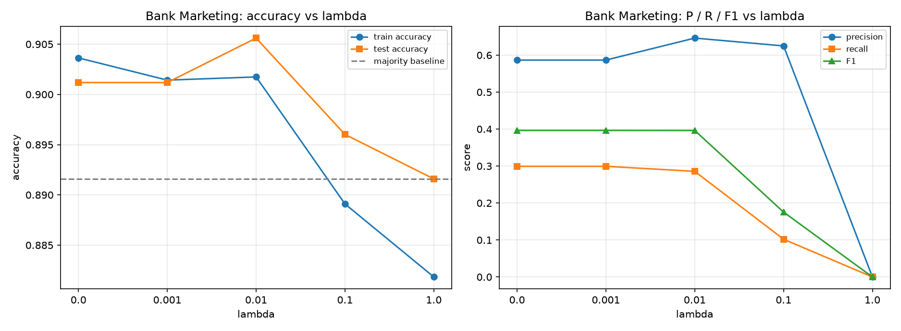
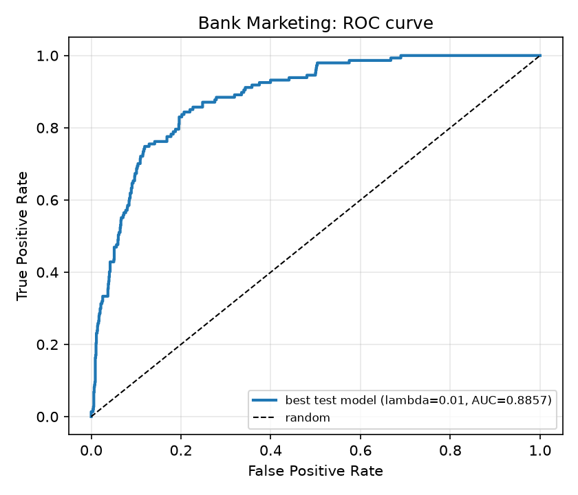

#### 4.6.2 Bank 数据测试性能图

为了更直观地展示 Bank 数据在不同正则化强度下的测试表现，图 9 给出了训练/测试准确率和多数类基线随 λ 的变化，以及精确率、召回率和 F1 的变化；图 10 给出了按测试准确率选出的最佳模型的 ROC 曲线。

{width=15cm}

{width=11cm}

分析：

1. 多数类基线准确率约为 0.8916，即全部预测为 `no` 就能得到约 89.16% 的准确率，说明 Bank 数据存在明显类别不平衡；
2. λ=0 到 λ=0.01 时，测试准确率从约 0.9012 略升到 0.9056；但 λ 继续增大后，测试准确率回落到基线附近，λ=1.0 时精确率、召回率和 F1 降至 0；
3. 左图说明：单看准确率会掩盖模型对少数类 `yes` 的识别能力不足；实际营销场景中，召回率或 PR 曲线往往比准确率更重要；
4. 右图说明：最佳测试模型（λ=0.01）的 ROC AUC 约为 0.8857，高于随机猜测的 0.5，说明模型具有一定区分能力，但整体区分能力仍属中等；
5. 后续可通过调整分类阈值、设置类别权重、增加有效特征或使用更多数据进一步改进召回率和 F1；
6. 这里的最佳模型仍按测试集准确率选出，仅用于本报告的可视化。严格实验应使用验证集或交叉验证选择 λ 与阈值，再用测试集做最终评价。
