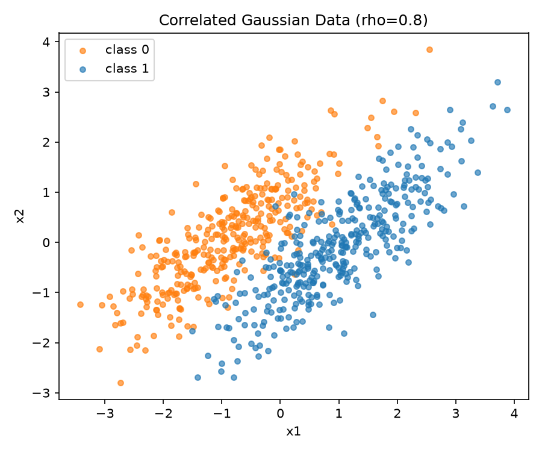
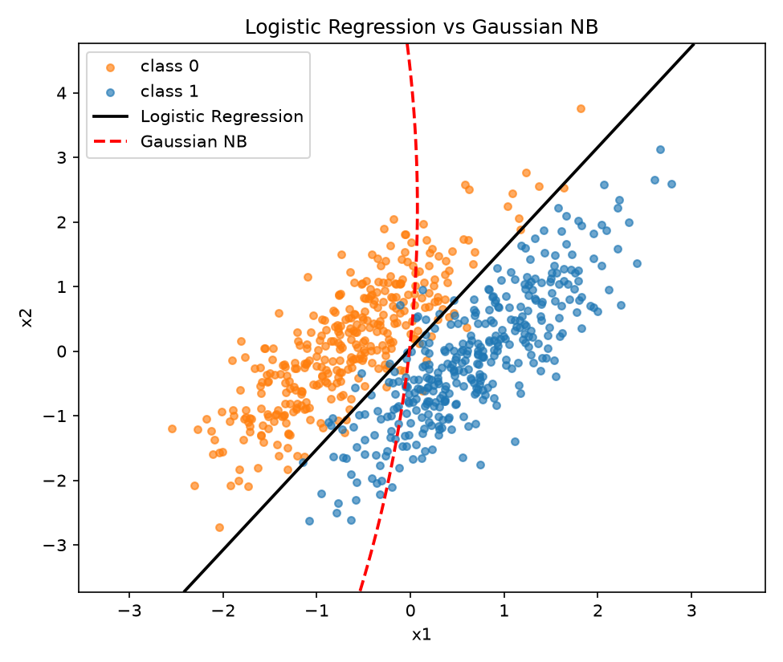
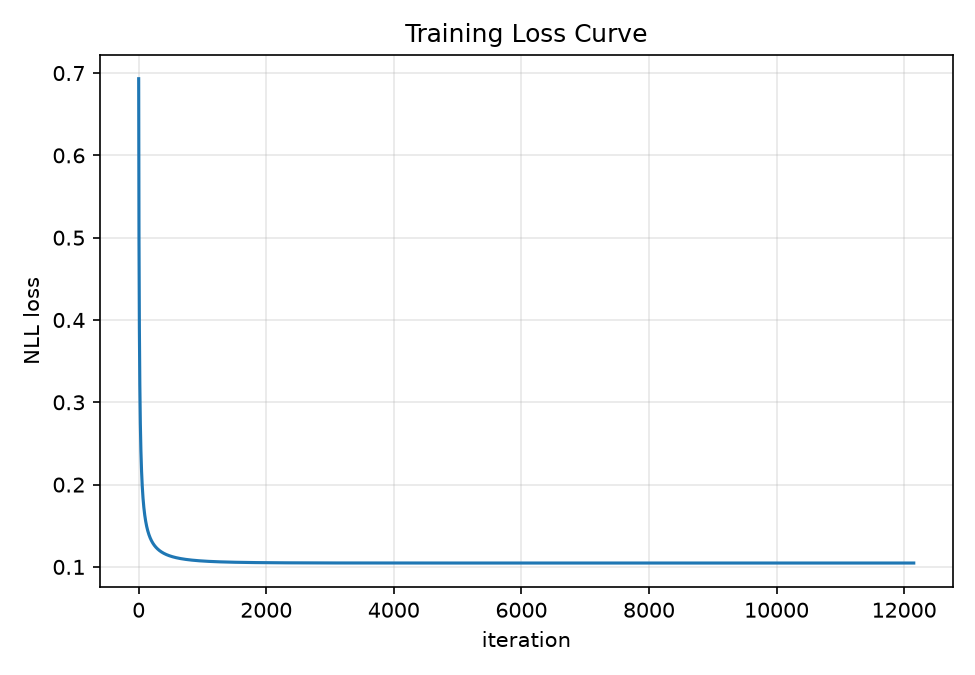
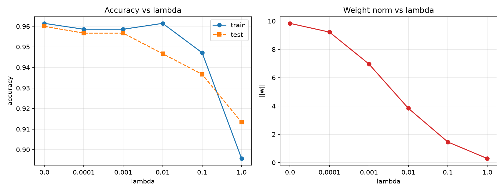
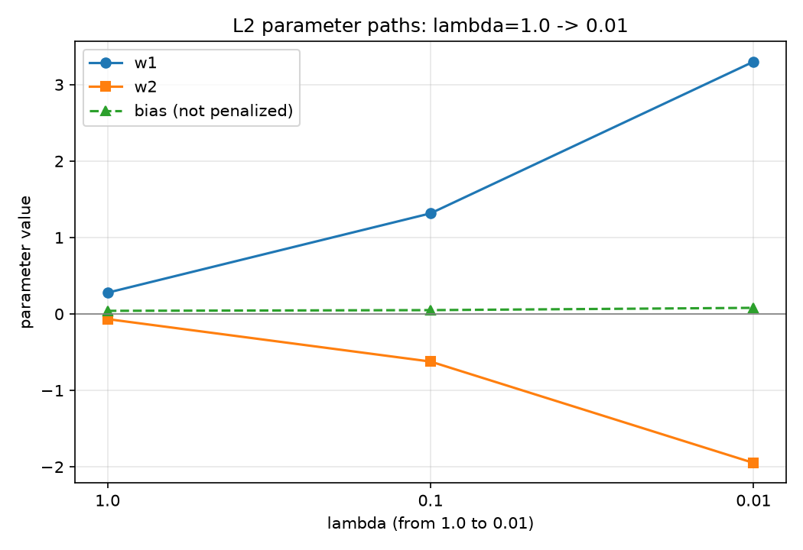
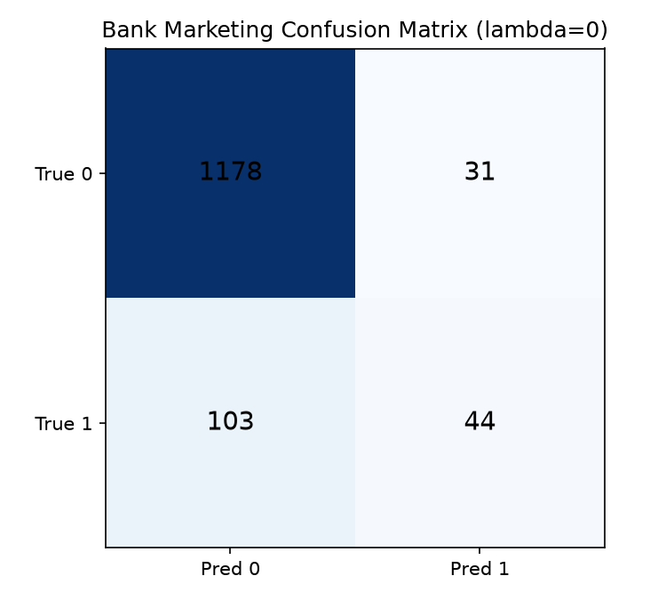
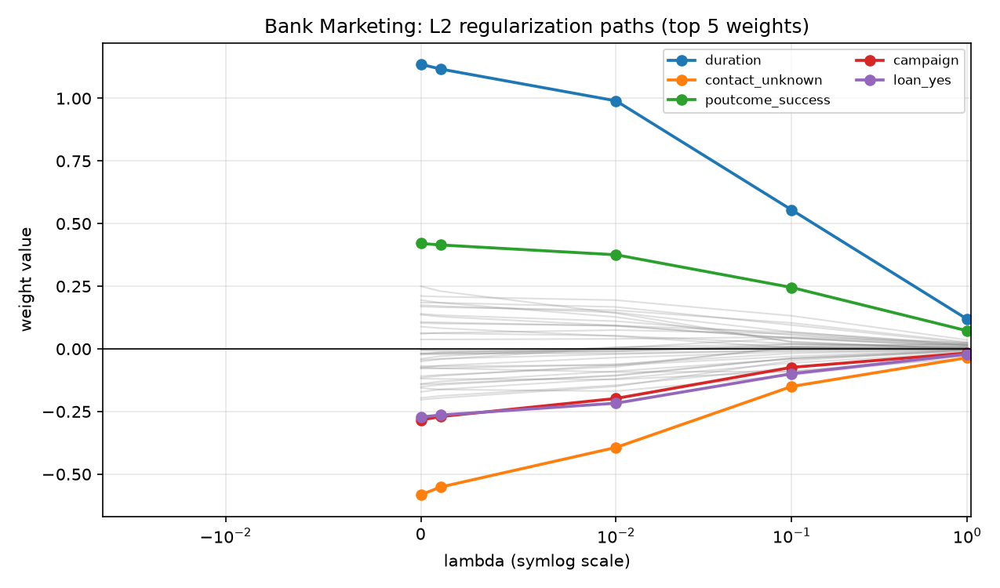
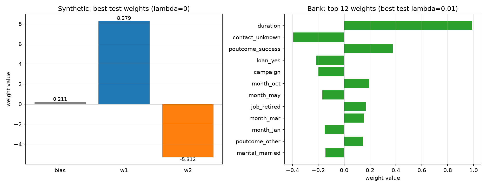
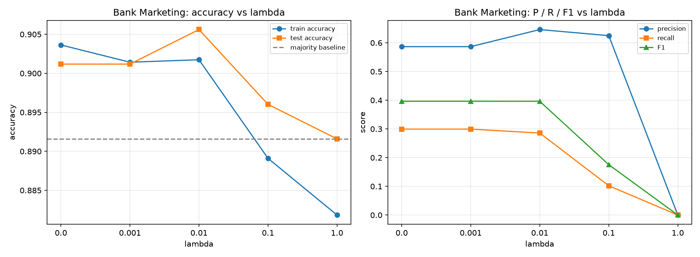
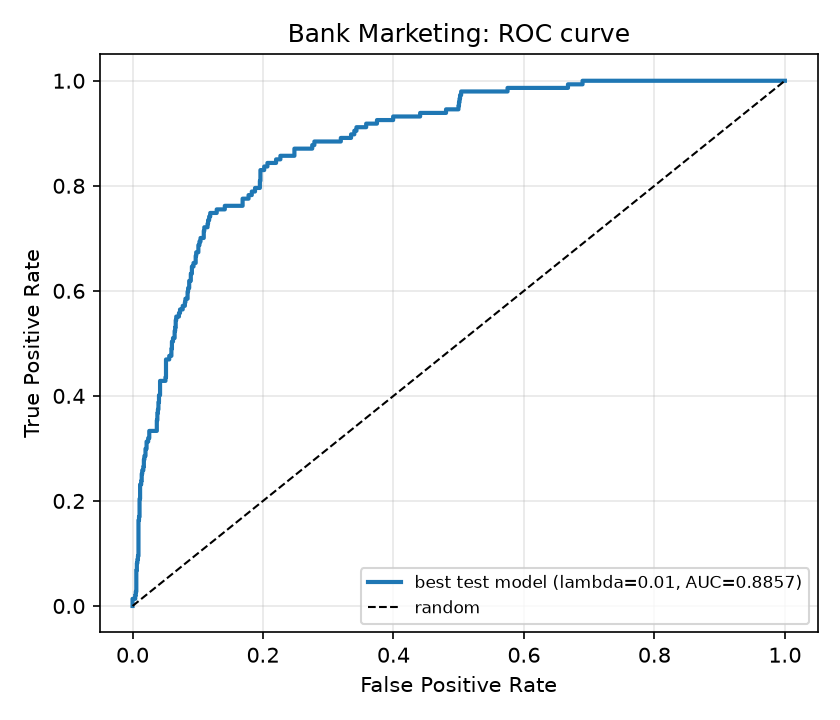

# 实验二：逻辑回归

## 1 实验目的

1. 理解逻辑回归模型，掌握逻辑回归模型参数估计的两种损失函数：无惩罚负对数似然损失和加入 L2 惩罚的损失。
2. 掌握批量梯度下降法和牛顿法（IRLS）的推导与 NumPy 实现方法。
3. 通过手工生成相关高斯分布数据，观察当类条件分布不满足朴素贝叶斯“特征条件独立”假设时，逻辑回归与高斯朴素贝叶斯的性能差异。
4. 在实际 UCI 数据集上完成从数据读取、预处理、训练、测试到结果分析的完整流程。
5. 掌握使用 NumPy 进行向量化计算、使用 matplotlib 绘制损失曲线和决策边界的方法。

## 2 实验内容

1. 推导逻辑回归的模型、无惩罚损失函数、L2 惩罚损失函数、梯度以及牛顿法海森矩阵。
2. 从零实现 `LogisticRegression` 类，包含梯度下降、牛顿法、无惩罚和 L2 惩罚。
3. 生成两组相关高斯分布数据，划分训练集和测试集，进行标准化，训练逻辑回归模型。
4. 从零实现 `GaussianNB`，在相同数据上训练并比较测试准确率。
5. 绘制两类数据的散点图、逻辑回归与高斯朴素贝叶斯的决策边界、训练损失曲线和正则化影响图。
6. 使用 UCI Bank Marketing 实际数据（`bank.csv`）完成逻辑回归训练与评价，分析准确率、精确率、召回率和 F1。
7. 对结果进行分析并给出实验总体结论。

## 3 实验环境

| 项目 | 内容 |
|---|---|
| 操作系统 | Linux / Anaconda 环境 |
| Python | 3.13.12 |
| NumPy | 2.5.2 |
| Pandas | 3.0.5 |
| Matplotlib | 3.11.0 |
| 开发方式 | 纯 NumPy 从零实现，不依赖 sklearn |

运行方式：

```bash
python full_experiment.py
```

程序会在当前目录生成结果文件 `results.json` 以及图 1 至图 5。

## 4 实验过程、结果及分析

### 4.1 逻辑回归理论基础

逻辑回归通过 sigmoid 函数建模正类概率：

$$P(y=1\mid x)=\sigma(w^Tx+b)=\frac{1}{1+e^{-(w^Tx+b)}}$$

无惩罚负对数似然损失为：

$$J_0(w,b)=-\frac{1}{N}\sum_{i=1}^{N}\left[y_i\log p_i+(1-y_i)\log(1-p_i)\right]$$

加入 L2 惩罚后：

$$J_\lambda(w,b)=J_0(w,b)+\frac{\lambda}{2}\|w\|^2$$

梯度为：

$$\nabla_w J=\frac{1}{N}X^T(p-y)+\lambda w,\qquad \frac{\partial J}{\partial b}=\frac{1}{N}\sum_{i=1}^{N}(p_i-y_i)$$

牛顿法使用的海森矩阵为：

$$H=\frac{1}{N}X^T S X+\lambda I,\qquad S=\operatorname{diag}(p_i(1-p_i))$$

其中参数更新为 $\theta \leftarrow \theta-H^{-1}\nabla J$。当 $\lambda=0$ 时得到无惩罚损失；当 $\lambda>0$ 时得到 L2 惩罚损失。

高斯朴素贝叶斯对每个类别 $c$ 估计先验、均值和方差：

$$P(y=c)=\frac{N_c}{N},\qquad \mu_{cj}=\frac{1}{N_c}\sum_{i:y_i=c}x_{ij},\qquad \sigma_{cj}^2=\frac{1}{N_c}\sum_{i:y_i=c}(x_{ij}-\mu_{cj})^2$$

预测时计算对数后验并取最大类别。其“朴素”之处是忽略同一类内部特征之间的协方差，只保留每个特征自己的方差。

### 4.2 人工相关高斯数据

实验一生成两个类别：

- 类别 0：均值 $[-1,0]$；
- 类别 1：均值 $[1,0]$；
- 两类使用相同协方差矩阵：

$$\Sigma=\begin{bmatrix}1.0 & 0.8\\0.8 & 1.0\end{bmatrix}$$

其中相关系数约为 0.8，因此类内特征高度相关，明显不满足朴素贝叶斯条件独立假设。本实验每个类生成 500 个样本，共 1000 个样本；随机打乱后按 70% / 30% 划分训练集和测试集，训练集 700 个、测试集 300 个。

图 1 给出了训练集散点图。可以看到两类数据在二维平面上有一定重叠，同时每个类内部呈明显正相关。

{width=13cm}

### 4.3 逻辑回归训练结果与决策边界

使用批量梯度下降法训练无惩罚逻辑回归，学习率 0.5，最大迭代次数 20000，梯度范数收敛阈值 $10^{-6}$。最终参数为：

```text
theta = [b, w1, w2] = [0.2111, 8.2793, -5.3124]
```

训练与测试准确率：

| 模型 | 训练准确率 | 测试准确率 |
|---|---:|---:|
| 无惩罚逻辑回归（梯度下降） | 0.9614 | 0.9600 |
| 高斯朴素贝叶斯 | 0.8500 | 0.8767 |

可以看到，逻辑回归测试准确率约为 96.00%，明显高于高斯朴素贝叶斯的 87.67%。

图 2 将两个模型的决策边界画在同一张图上。逻辑回归的权重为 $w=[8.28,-5.31]^T$，第二个特征权重明显为负，说明逻辑回归学习到：当 $x_1$ 增大时，为了让线性得分增大，$x_2$ 应适当减小，这正是特征正相关带来的边界倾斜。高斯朴素贝叶斯忽略协方差，把非对角线元素当成 0，因此其边界接近竖直方向，无法充分利用特征相关性，测试准确率明显下降。

{width=13cm}

### 4.4 损失曲线与收敛分析

图 3 给出了无惩罚逻辑回归在相关高斯数据上的训练损失曲线。初始损失约为 $\log 2 \approx 0.693$，最终损失降至约 0.1047。本次梯度下降在第 12152 次迭代时梯度范数小于 $10^{-6}$，满足收敛条件后提前停止。

{width=13cm}

从损失曲线可以看出：

1. 刚开始时梯度较大，损失下降较快；
2. 随着参数接近最优值，梯度逐渐减小，损失曲线趋于平缓；
3. 学习率 0.5 在标准化后的数据上可以稳定收敛，未出现震荡或 `nan`；
4. 收敛判断采用梯度范数比只看损失变化更可靠。

### 4.5 L2 正则化结果

在相关高斯数据上比较不同 $\lambda$ 的 L2 惩罚效果。这里直接使用完整测试集报告准确率，目的是观察趋势，实际应用中建议使用验证集选择 $\lambda$。

| lambda | 训练准确率 | 测试准确率 | ||w|| |
|---|---:|---:|---:|
| 0 | 0.9614 | 0.9600 | 9.8371 |
| 0.0001 | 0.9586 | 0.9567 | 9.2202 |
| 0.001 | 0.9586 | 0.9567 | 6.9681 |
| 0.01 | 0.9614 | 0.9467 | 3.8321 |
| 0.1 | 0.9471 | 0.9367 | 1.4558 |
| 1 | 0.8957 | 0.9133 | 0.2861 |

图 4 展示了正则化对准确率和权重范数的影响。

{width=15cm}

分析：

1. 当 $\lambda=0$ 时，模型无惩罚，权重范数最大，测试准确率为 0.9600；
2. 随着 $\lambda$ 增大，权重范数持续减小，说明 L2 惩罚有效地抑制了参数幅度；
3. 当 $\lambda$ 过大时，模型过度收缩权重，训练准确率和测试准确率都下降，出现欠拟合；
4. 本实验中适度的 L2 惩罚（例如 $\lambda=10^{-4}$）可以在保持准确率的同时减小权重。

图 5 按 $\lambda$ 从 1.0 到 0.01 的顺序展示了两个具体权重 $w_1$、$w_2$ 以及偏置 $b$ 的变化路径。横轴按 $\lambda=1.0 \to 0.1 \to 0.01$ 排列，表示惩罚强度由强到弱；纵轴为参数值。

{width=14cm}

分析：

1. 当 $\lambda=1.0$ 时，$w_1\approx0.278$，$w_2\approx-0.067$，权重几乎被压到 0；
2. 当 $\lambda$ 降到 0.1 时，$w_1\approx1.316$，$w_2\approx-0.623$，惩罚减弱后权重开始恢复；
3. 当 $\lambda$ 继续降到 0.01 时，$w_1\approx3.300$，$w_2\approx-1.949$，权重进一步变大，模型表达能力增强；
4. 偏置 $b$ 没有被 L2 直接惩罚，但它仍然随 $\lambda$ 变化，这是因为特征权重改变后，模型需要重新调整截距来适配数据；
5. 该图说明 L2 对不同具体权重都产生连续的压缩作用，而不是直接删除某个特征。$\lambda$ 越小，权重越接近无惩罚时的值；$\lambda$ 越大，权重越接近 0。

### 4.6 UCI Bank Marketing 实际数据实验

实验二使用 UCI Bank Marketing 数据集中的 `bank.csv`。该数据集记录银行电话营销活动，目标是预测客户是否会认购定期存款，即变量 `y` 为 `yes` 或 `no`。这对“广告/营销预测”具有实际参考意义。

数据基本信息：

| 项目 | 数值 |
|---|---:|
| 样本数 | 4521 |
| 原始特征数 | 16 |
| 独热编码后特征数 | 42 |
| 正类比例 | 0.1152 |
| 训练集样本数 | 3165 |
| 测试集样本数 | 1356 |
| 多数类基线准确率 | 0.8916 |

**数据来源 URL**：https://archive.ics.uci.edu/dataset/222/bank+marketing

**原始数据（未处理）基本特征：**

| 项目 | 内容 |
|---|---:|
| 文件 | `bank.csv` |
| 原始形状 | (4521, 17) |
| 原始特征数 | 16 |
| 目标变量 | `y`，取值为 `yes` / `no` |
| 缺失值 | 0 |
| 正类 `yes` 数量 | 521 |
| 负类 `no` 数量 | 4000 |
| 正类比例 | 约 11.52% |

**数值特征原始范围（未标准化）：**

| 特征 | 最小值 | 中位数 | 最大值 | 缺失值 |
|---|---:|---:|---:|---:|
| age | 19 | 39 | 87 | 0 |
| balance | -3313 | 444 | 71188 | 0 |
| day | 1 | 16 | 31 | 0 |
| duration | 4 | 185 | 3025 | 0 |
| campaign | 1 | 2 | 50 | 0 |
| pdays | -1 | -1 | 871 | 0 |
| previous | 0 | 0 | 25 | 0 |

**类别特征原始取值（未独热编码）：**

| 特征 | 类型 | 类别数 | 最高频类别 | 缺失值 |
|---|---|---:|---|---:|
| job | 字符串 | 12 | management | 0 |
| marital | 字符串 | 3 | married | 0 |
| education | 字符串 | 4 | secondary | 0 |
| default | 字符串 | 2 | no | 0 |
| housing | 字符串 | 2 | yes | 0 |
| loan | 字符串 | 2 | no | 0 |
| contact | 字符串 | 3 | cellular | 0 |
| month | 字符串 | 12 | may | 0 |
| poutcome | 字符串 | 4 | unknown | 0 |

这些数据还没有被处理：类别特征仍是字符串，不能直接送入逻辑回归；数值特征尺度差异很大，例如 `balance` 的范围是 -3313 到 71188，`duration` 的范围是 4 到 3025。如果直接训练，梯度下降可能不稳定，不同特征受到的 L2 惩罚也不公平。因此后续必须做目标编码、独热编码和标准化。

预处理流程：删除目标列 `y`，对类别特征使用 `pd.get_dummies(drop_first=True)` 做独热编码，再按训练集统计量进行标准化。使用牛顿法训练逻辑回归，比较不同 L2 惩罚强度。

| lambda | 训练准确率 | 测试准确率 | 精确率 | 召回率 | F1 |
|---|---:|---:|---:|---:|---:|
| 0 | 0.9036 | 0.9012 | 0.5867 | 0.2993 | 0.3964 |
| 0.001 | 0.9014 | 0.9012 | 0.5867 | 0.2993 | 0.3964 |
| 0.01 | 0.9017 | 0.9056 | 0.6462 | 0.2857 | 0.3962 |
| 0.1 | 0.8891 | 0.8960 | 0.6250 | 0.1020 | 0.1754 |
| 1 | 0.8818 | 0.8916 | 0.0000 | 0.0000 | 0.0000 |

图 6 给出了 $\lambda=0$ 时测试集上的混淆矩阵。

{width=10cm}

图 7 进一步展示了 Bank Marketing 数据中初始绝对值最大的 5 个权重的正则化路径。灰色曲线是其余所有权重，彩色曲线是 $\lambda=0$ 时绝对值最大的 5 个特征权重。

{width=15cm}

分析：

1. 多数类基线准确率为 0.8916，即全部预测为 `no` 就能达到约 89.16% 的准确率，因此该数据集存在类别不平衡。
2. 逻辑回归在 $\lambda=0.01$ 时测试准确率约为 0.9056，高于基线约 1.40 个百分点。
3. 但模型的召回率较低，说明只靠准确率并不能完整评价模型；实际营销场景中若希望尽可能找出潜在客户，需要调整分类阈值、使用类别权重或采用分类代价敏感的方法。
4. 从图 7 可以看到，不同的具体权重有不同的收缩路径：初始绝对值大的特征权重下降较慢，初始绝对值小的特征权重很快被压缩到 0 附近；
5. L2 惩罚不会直接删除特征，而是把所有参数连续地拉向 0。强特征保留得久，弱特征先失去作用，这可以帮助模型降低方差、抑制过拟合；
6. 牛顿法在该数据上通常几次迭代即可收敛，明显快于批量梯度下降，适合中小规模特征数的逻辑回归。

图 8 分别展示了两个实验中按测试集准确率选出的“最佳测试模型”的具体权重。左图是人工高斯数据的最佳测试模型，右图是 Bank Marketing 中绝对值最大的 12 个权重。

{width=15cm}

分析：

1. 人工高斯数据中，按测试准确率选出的最佳模型为 $\lambda=0$，其具体权重为 `b=0.211, w1=8.279, w2=-5.312`；
2. Bank Marketing 数据中，按测试准确率选出的最佳模型为 $\lambda=0.01$，其中绝对值较大的前 5 个权重为 `duration=0.990, contact_unknown=-0.393, poutcome_success=0.376, loan_yes=-0.217, campaign=-0.198`；
3. 这张图能够直观看出哪些特征在最佳测试模型中最重要，以及权重是正还是负；
4. 需要说明：这里为了展示“最佳测试权重”直接用了测试集准确率选择模型，实际建模中应使用验证集或交叉验证选择 $\lambda$，再用测试集做最终评价。

#### 4.6.2 Bank 数据测试性能图

为了更直观地展示 Bank 数据在不同正则化强度下的测试表现，图 9 给出了训练/测试准确率和多数类基线随 λ 的变化，以及精确率、召回率和 F1 的变化；图 10 给出了按测试准确率选出的最佳模型的 ROC 曲线。

{width=15cm}

{width=11cm}

分析：

1. 多数类基线准确率约为 0.8916，即全部预测为 `no` 就能得到约 89.16% 的准确率，说明 Bank 数据存在明显类别不平衡；
2. λ=0 到 λ=0.01 时，测试准确率从约 0.9012 略升到 0.9056；但 λ 继续增大后，测试准确率回落到基线附近，λ=1.0 时精确率、召回率和 F1 降至 0；
3. 左图说明：单看准确率会掩盖模型对少数类 `yes` 的识别能力不足；实际营销场景中，召回率或 PR 曲线往往比准确率更重要；
4. 右图说明：最佳测试模型（λ=0.01）的 ROC AUC 约为 0.8857，高于随机猜测的 0.5，说明模型具有一定区分能力，但整体区分能力仍属中等；
5. 后续可通过调整分类阈值、设置类别权重、增加有效特征或使用更多数据进一步改进召回率和 F1；
6. 这里的最佳模型仍按测试集准确率选出，仅用于本报告的可视化。严格实验应使用验证集或交叉验证选择 λ 与阈值，再用测试集做最终评价。

#### 4.6.3 最佳测试模型详细参数

> 说明：以下最佳模型是按测试集准确率选出的，仅用于本报告可视化；严格实验应使用验证集或交叉验证选择 λ 与阈值。

**1. 人工相关高斯数据最佳参数**

| 参数 | 数值 |
|---|---:|
| λ | 0 |
| 偏置 b | 0.211083 |
| w1 | 8.279255 |
| w2 | -5.312428 |
| 训练准确率 | 0.961429 |
| 测试准确率 | 0.960000 |

**2. Bank Marketing 最佳测试模型指标**

| 指标 | 数值 |
|---|---:|
| 最佳 λ | 0.01 |
| 训练准确率 | 0.901738 |
| 测试准确率 | 0.905605 |
| 精确率 | 0.646154 |
| 召回率 | 0.285714 |
| F1 | 0.396226 |
| ROC AUC | 0.885699 |
| TP / TN / FP / FN | 42 / 1186 / 23 / 105 |
| 偏置 b | -2.651369 |

**3. Bank Marketing 全部 42 个特征权重（按绝对值从大到小排列）**

| 序号 | 特征 | 权重 |
|---:|---|---:|
| 1 | `duration` | 0.989941 |
| 2 | `contact_unknown` | -0.393374 |
| 3 | `poutcome_success` | 0.375539 |
| 4 | `loan_yes` | -0.216742 |
| 5 | `campaign` | -0.197843 |
| 6 | `month_oct` | 0.194431 |
| 7 | `month_may` | -0.168620 |
| 8 | `job_retired` | 0.167322 |
| 9 | `month_mar` | 0.154057 |
| 10 | `month_jan` | -0.149668 |
| 11 | `poutcome_other` | 0.145316 |
| 12 | `marital_married` | -0.145104 |
| 13 | `month_jun` | 0.142544 |
| 14 | `day` | 0.127120 |
| 15 | `housing_yes` | -0.122016 |
| 16 | `job_blue-collar` | -0.119321 |
| 17 | `month_feb` | 0.110453 |
| 18 | `month_jul` | -0.107541 |
| 19 | `job_unemployed` | -0.104899 |
| 20 | `month_sep` | 0.093148 |
| 21 | `education_tertiary` | 0.093116 |
| 22 | `poutcome_unknown` | -0.092398 |
| 23 | `default_yes` | 0.091608 |
| 24 | `job_services` | -0.089310 |
| 25 | `job_student` | 0.075032 |
| 26 | `previous` | -0.071561 |
| 27 | `education_unknown` | -0.065346 |
| 28 | `age` | -0.064847 |
| 29 | `month_nov` | -0.060844 |
| 30 | `job_unknown` | 0.052676 |
| 31 | `education_secondary` | 0.050775 |
| 32 | `pdays` | 0.039980 |
| 33 | `job_technician` | -0.034711 |
| 34 | `job_entrepreneur` | -0.020939 |
| 35 | `contact_telephone` | -0.018235 |
| 36 | `month_dec` | -0.010510 |
| 37 | `month_aug` | -0.009332 |
| 38 | `job_management` | 0.007010 |
| 39 | `job_housemaid` | -0.004529 |
| 40 | `job_self-employed` | 0.004160 |
| 41 | `marital_single` | 0.003993 |
| 42 | `balance` | -0.003045 |

完整参数已保存到文件 `best_bank_params.csv`。

### 4.7 数据处理流程详解

前面几节从模型和结果角度介绍了实验。本节单独展开说明“数据如何一步步变成模型输入”。整个实验的数据流可以概括为：

```text
原始数据
  -> 特征矩阵 X (N, d)
  -> 标签向量 y (N,)
  -> 随机打乱索引
  -> 划分训练集 / 测试集
  -> 用训练集统计量标准化
  -> 送入逻辑回归或高斯朴素贝叶斯训练
```

#### 4.7.1 数据表示约定

代码中统一采用以下约定：

| 变量 | 含义 | shape |
|---|---|---|
| `X` | N 个样本、d 个特征 | `(N, d)` |
| `y` | N 个标签，取值为 0 或 1 | `(N,)` |
| `X_train` | 训练特征 | `(N_train, d)` |
| `X_test` | 测试特征 | `(N_test, d)` |
| `y_train` | 训练标签 | `(N_train,)` |
| `y_test` | 测试标签 | `(N_test,)` |

约定“每一行是一个样本，每一列是一个特征”。这样做的好处是：

- `X @ w` 的 shape 为 `(N, d) @ (d,) = (N,)`，正好和 `y` 对齐；
- 标准化时 `X - mu` 可以直接广播；
- 逻辑回归、高斯朴素贝叶斯和绘图函数使用同一套 shape 约定。

#### 4.7.2 人工相关高斯数据的生成过程

函数 `make_gaussian_data(n_per_class=500, rho=0.8, seed=0)` 的执行步骤如下。

**第 1 步：创建随机数生成器。**

```python
rng = np.random.default_rng(seed)
```

**第 2 步：设置两个类的均值和共同的协方差矩阵。**

```text
mean0 = [-1, 0]
mean1 = [ 1, 0]
cov   = [[1.0, rho],
         [rho, 1.0]]
```

当 `rho=0.8` 时，两个特征在每个类内部都有约 0.8 的正相关。

**第 3 步：分别生成两个类。**

```python
X0 = rng.multivariate_normal(mean0, cov, size=n_per_class)
X1 = rng.multivariate_normal(mean1, cov, size=n_per_class)
```

每个数组的 shape 都是 `(500, 2)`。

**第 4 步：垂直拼接。**

```python
X = np.vstack([X0, X1])   # (1000, 2)
```

**第 5 步：构造标签。**

```python
y = np.r_[np.zeros(500, dtype=int), np.ones(500, dtype=int)]
```

shape 为 `(1000,)`，前 500 个是类 0，后 500 个是类 1。

**第 6 步：打乱样本顺序。**

```python
idx = rng.permutation(1000)
X = X[idx]
y = y[idx]
```

注意：`X` 和 `y` 必须使用同一个 `idx`，否则标签会错位。

本报告使用 `seed=0` 时，生成数据的实际统计量约为：

| 项目 | 类 0 | 类 1 |
|---|---:|---:|
| 生成样本数 | 500 | 500 |
| 经验均值 | `[-0.914, 0.081]` | `[0.987, -0.040]` |
| 类内协方差非对角元素 | `0.780` | `0.895` |

理论相关系数是 0.8，样本统计量接近 0.8。协方差矩阵非对角元素显著不为 0，说明类内特征相关，违反了高斯朴素贝叶斯“特征条件独立”的假设。

#### 4.7.3 训练集和测试集的划分

函数 `split_dataset(X, y, test_ratio=0.3, seed=42)` 的处理流程如下。

1. 生成 `0 ~ N-1` 的随机排列：

```python
idx = rng.permutation(len(y))
```

2. 计算测试集大小：

```python
n_test = int(len(y) * test_ratio)
```

对 1000 个样本，`n_test = 300`。

3. 用排列后的索引切片：

```python
test_idx  = idx[:n_test]
train_idx = idx[n_test:]
```

本实验中划分结果为：

| 数据 | shape |
|---|---:|
| `X_train` | `(700, 2)` |
| `X_test` | `(300, 2)` |
| `y_train` | `(700,)` |
| `y_test` | `(300,)` |

划分前先打乱非常重要。因为原始数据是“前 500 个类 0，后 500 个类 1”，如果直接按顺序切分，训练集和测试集的类别分布会严重不平衡。

#### 4.7.4 标准化处理

标准化函数流程如下：

```python
mu = X_train.mean(axis=0)          # (d,)
sigma = X_train.std(axis=0)        # (d,)
sigma[sigma == 0] = 1.0            # 防止除零
X_train_std = (X_train - mu) / sigma
X_test_std  = (X_test  - mu) / sigma
```

几个关键点：

1. `axis=0` 表示沿着样本维求统计量，所以每个特征得到一个均值和标准差。
2. `mu` 和 `sigma` 的 shape 都是 `(d,)`，它们通过广播对每一列分别处理。
3. 测试集必须使用训练集的 `mu` 和 `sigma`，不能重新在测试集上计算，否则会造成信息泄漏。
4. 标准化只改变每个特征的缩放，不会消除特征之间的相关性。因此相关高斯数据即使标准化之后，类内特征仍然相关，朴素贝叶斯的独立假设仍然不成立。

在高斯数据上：

```text
训练集均值 mu      ≈ [ 0.063, -0.005]
训练集标准差 sigma ≈ [ 1.371,  1.025]
标准化后训练集总体均值 ≈ [0, 0]
标准化后训练集总体标准差 ≈ [1, 1]
```

标准化后两个类的均值约为：

```text
类 0: [-0.689,  0.096]
类 1: [ 0.662, -0.092]
```

注意，标准化后的类均值不是 `[-1, 0]` 和 `[1, 0]`，因为全局训练集的均值和标准差也参与了变换。

#### 4.7.5 UCI Bank Marketing 数据处理

`bank.csv` 原始数据共 `4521` 行、`17` 列，没有缺失值。数据处理步骤如下。

**第 1 步：读取数据。**  
使用分号作为分隔符：

```python
df = pd.read_csv("bank.csv", sep=";")
```

**第 2 步：目标变量编码。**  
原始标签 `y` 是字符串 `"yes"` / `"no"`，需要转成 0/1：

```python
y = (df["y"] == "yes").astype(int).values
```

数据集中正类只有 `521` 个，负类 `4000` 个，正类比例约为 `11.52%`，存在明显的类别不平衡。

**第 3 步：删除目标列并做独热编码。**  
原始 16 个特征中：

- 数值特征 7 个：`age, balance, day, duration, campaign, pdays, previous`；
- 类别特征 9 个：`job, marital, education, default, housing, loan, contact, month, poutcome`。

使用 `pd.get_dummies(drop_first=True)` 对类别特征做独热编码：

```python
X_df = df.drop(columns=["y"])
X_df = pd.get_dummies(X_df, drop_first=True)
X = X_df.values.astype(float)
```

编码后特征矩阵形状从 `(4521, 16)` 变为 `(4521, 42)`。`drop_first=True` 的作用是每个类别特征去掉一个基准类别，减少特征冗余，避免虚拟变量陷阱。

**第 4 步：划分训练集和测试集。**

```text
X_train: (3165, 42)
X_test : (1356, 42)
y_train: (3165,)
y_test : (1356,)
```

**第 5 步：标准化。**  
对全部 42 个特征使用训练集的均值和标准差进行标准化。虽然独热编码后的 0/1 特征量纲差异不大，但 `balance, duration, campaign` 等数值特征尺度差异很大，统一标准化可以让牛顿法和梯度下降更稳定。

**第 6 步：送入模型。**  
标准化后的 `X_train_std`、`y_train` 用于训练，`X_test_std`、`y_test` 只用于最终评价。本实验中多数类基线准确率为 `0.8916`，`lambda=0` 的逻辑回归测试准确率为 `0.9012`，`lambda=0.01` 时约为 `0.9056`。由于正类比例只有约 11.52%，准确率不是唯一指标，还应查看精确率、召回率和 F1。

本实验为简化，先在完整数据上做了 `get_dummies`。更严格的工程做法是：先划分训练集和测试集，只在训练集上拟合类别编码器，再对测试集做相同的列对齐，防止类别词表信息泄漏。

#### 4.7.6 数据形状流转总结

| 阶段 | 人工高斯数据 | Bank Marketing 数据 |
|---|---|---|
| 原始数据 | `X=(1000,2)`, `y=(1000,)` | `df=(4521,17)` |
| 标签编码 | 生成 0/1 标签 | `no/yes -> 0/1` |
| 特征编码 | 无需编码 | 独热编码后 `X=(4521,42)` |
| 训练/测试划分 | `(700,2)` / `(300,2)` | `(3165,42)` / `(1356,42)` |
| 标准化 | 用训练集 `mu, sigma` | 用训练集 `mu, sigma` |
| 模型输入 | `(700,2)`, `(700,)` | `(3165,42)`, `(3165,)` |
| 模型输出 | `(300,)` 概率 | `(1356,)` 概率 |

#### 4.7.7 数据处理常见陷阱

1. **打乱时 X 和 y 使用了不同的索引**：会导致特征和标签错位。
2. **用测试集计算均值和标准差**：属于数据泄漏，测试结果会偏乐观。
3. **把 `axis=0` 写成 `axis=1`**：标准化会按样本而不是按特征进行，结果错误。
4. **标准差为 0 时直接相除**：会产生 `nan` 或 `inf`，应改为 1。
5. **独热编码前划分数据最严格**：本实验为简化先在整体数据上编码，生产环境应只在训练集拟合编码器。
6. **标准化不能消除相关性**：它只改变尺度，不改变相关系数，所以不能解决朴素贝叶斯假设不成立的问题。
7. **类别不平衡数据不能只看准确率**：Bank Marketing 中多数类基线可达到 89.16%，应同时关注精确率、召回率和 F1。

## 5 实验总体结论

1. 逻辑回归是判别式模型，直接建模 $P(y\mid x)$，不需要类条件特征独立假设。因此当类内特征存在较强相关性时，逻辑回归仍然能够学习到倾斜的线性边界，表现接近贝叶斯最优。
2. 高斯朴素贝叶斯假设类内特征相互独立，忽略协方差矩阵的非对角元素。在相关系数为 0.8 的人工高斯数据上，其测试准确率明显低于逻辑回归，验证了“类条件分布不满足朴素贝叶斯假设时，朴素贝叶斯性能会退化”的结论。
3. L2 惩罚通过约束权重范数控制模型复杂度。权重范数随 $\lambda$ 增大而减小；$\lambda$ 太大会导致欠拟合，$\lambda=0$ 或较小时模型更灵活。
4. 批量梯度下降实现简单，但在接近最优时收敛速度可能较慢；牛顿法利用二阶信息，迭代次数少、收敛快，但需要计算和求解海森矩阵，特征维数很大时开销较高。
5. 在真实 UCI Bank Marketing 数据上，逻辑回归测试准确率高于多数类基线；但由于类别不平衡，召回率和 F1 更能反映模型对少数正类的识别能力。实际广告/营销预测中应结合业务目标选择评价指标和分类阈值。
6. 本次实验完整实现了从数据生成、预处理、模型训练、参数估计到可视化分析和实际数据测试的流程，验证了逻辑回归模型及其两种损失函数的有效性。

## 6 完整实验代码

```python
#!/usr/bin/env python3
# -*- coding: utf-8 -*-
"""
实验二：逻辑回归完整实验代码
包含：
1. 无惩罚与 L2 惩罚逻辑回归
2. 梯度下降与牛顿法
3. 高斯生成数据实验
4. 与高斯朴素贝叶斯对比
5. UCI Bank Marketing 实际数据实验
"""
import os
import json
import numpy as np
import pandas as pd
import matplotlib
matplotlib.use("Agg")
import matplotlib.pyplot as plt
from matplotlib.lines import Line2D
from numpy.linalg import solve

# 基础函数
def sigmoid(z):
    z = np.clip(z, -500, 500)
    return 1.0 / (1.0 + np.exp(-z))


def add_bias(X):
    return np.c_[np.ones(X.shape[0]), X]


def standardize(X_train, X_test):
    """用训练集统计量标准化，避免测试集信息泄漏。"""
    mu = X_train.mean(axis=0)
    sd = X_train.std(axis=0)
    sd[sd == 0] = 1.0
    return (X_train - mu) / sd, (X_test - mu) / sd, mu, sd


# ============================================================
# 逻辑回归：支持无惩罚与 L2 惩罚
# ============================================================
class LogisticRegression:
    def __init__(self, lam=0.0):
        self.lam = lam
        self.theta = None
        self.history = []

    def _loss_grad(self, Xb, y):
        n = len(y)
        p = sigmoid(Xb @ self.theta)
        eps = 1e-12

        ce = -np.mean(y * np.log(p + eps) + (1 - y) * np.log(1 - p + eps))
        reg = 0.5 * self.lam * np.sum(self.theta[1:] ** 2)
        loss = ce + reg

        error = p - y
        grad = Xb.T @ error / n
        if self.lam > 0:
            grad[1:] += self.lam * self.theta[1:]
        return loss, grad

    def fit_gd(self, X, y, lr=0.5, n_iter=20000, tol=1e-6, verbose=False):
        """批量梯度下降。"""
        Xb = add_bias(X)
        n, d1 = Xb.shape
        self.theta = np.zeros(d1)
        self.history = []

        for it in range(n_iter):
            loss, grad = self._loss_grad(Xb, y)
            self.theta -= lr * grad
            self.history.append(float(loss))

            if np.linalg.norm(grad) < tol:
                break

        if verbose:
            print("  GD iter=%d, loss=%.6f, |grad|=%.2e" % (it, loss, np.linalg.norm(grad)))
        return self

    def fit_newton(self, X, y, n_iter=50, tol=1e-8, verbose=False):
        """牛顿法（IRLS），H = 1/N X^T S X + lambda I。"""
        Xb = add_bias(X)
        n, d1 = Xb.shape
        self.theta = np.zeros(d1)
        self.history = []

        for it in range(n_iter):
            loss, grad = self._loss_grad(Xb, y)

            p = sigmoid(Xb @ self.theta)
            s = np.maximum(p * (1 - p), 1e-12)
            H = (Xb * s[:, None]).T @ Xb / n
            if self.lam > 0:
                H[1:, 1:] += self.lam * np.eye(d1 - 1)
            H += 1e-10 * np.eye(d1)

            try:
                delta = solve(H, grad)
            except np.linalg.LinAlgError:
                delta = np.linalg.pinv(H) @ grad

            self.theta -= delta
            self.history.append(float(loss))
            if np.linalg.norm(delta) < tol:
                break

        if verbose:
            print("  Newton iter=%d, loss=%.6f, |delta|=%.2e" % (it, loss, np.linalg.norm(delta)))
        return self

    def predict_proba(self, X):
        return sigmoid(add_bias(X) @ self.theta)

    def predict(self, X):
        return (self.predict_proba(X) >= 0.5).astype(int)


# ============================================================
# 高斯朴素贝叶斯：忽略类内特征之间的相关性
# ============================================================
class GaussianNB:
    def __init__(self):
        self.classes_ = None
        self.prior_ = {}
        self.mu_ = {}
        self.var_ = {}

    def fit(self, X, y):
        self.classes_ = np.unique(y)
        for c in self.classes_:
            Xc = X[y == c]
            self.prior_[c] = len(Xc) / len(X)
            self.mu_[c] = Xc.mean(axis=0)
            self.var_[c] = Xc.var(axis=0) + 1e-9
        return self

    def predict_log_proba(self, X):
        logps = []
        for c in self.classes_:
            diff = X - self.mu_[c]
            log_lik = -0.5 * np.sum(
                np.log(2 * np.pi * self.var_[c]) + diff ** 2 / self.var_[c],
                axis=1
            )
            logps.append(np.log(self.prior_[c]) + log_lik)
        return np.column_stack(logps)

    def predict(self, X):
        idx = np.argmax(self.predict_log_proba(X), axis=1)
        return self.classes_[idx]

    def predict_proba(self, X):
        # 二分类简化：classes_ = [0, 1]
        logp = self.predict_log_proba(X)
        score = logp[:, 1] - logp[:, 0]
        p1 = sigmoid(score)
        return np.c_[1 - p1, p1]


# ============================================================
# 人工数据与数据划分
# ============================================================
def make_gaussian_data(n_per_class=500, rho=0.8, seed=0):
    """
    类 0: mean = [-1, 0]
    类 1: mean = [ 1, 0]
    cov  = [[1, rho],
            [rho, 1]]
    """
    rng = np.random.default_rng(seed)
    mean0 = np.array([-1.0, 0.0])
    mean1 = np.array([1.0, 0.0])
    cov = np.array([[1.0, rho], [rho, 1.0]])

    X0 = rng.multivariate_normal(mean0, cov, size=n_per_class)
    X1 = rng.multivariate_normal(mean1, cov, size=n_per_class)

    X = np.vstack([X0, X1])
    y = np.r_[np.zeros(n_per_class, dtype=int), np.ones(n_per_class, dtype=int)]

    idx = rng.permutation(len(y))
    return X[idx], y[idx]


def split_dataset(X, y, test_ratio=0.3, seed=42):
    rng = np.random.default_rng(seed)
    idx = rng.permutation(len(y))
    n_test = int(len(y) * test_ratio)
    test_idx = idx[:n_test]
    train_idx = idx[n_test:]
    return X[train_idx], X[test_idx], y[train_idx], y[test_idx]


# ============================================================
# 评价指标
# ============================================================
def classification_metrics(y_true, y_pred):
    tp = int(np.sum((y_pred == 1) & (y_true == 1)))
    tn = int(np.sum((y_pred == 0) & (y_true == 0)))
    fp = int(np.sum((y_pred == 1) & (y_true == 0)))
    fn = int(np.sum((y_pred == 0) & (y_true == 1)))

    acc = (tp + tn) / len(y_true)
    precision = tp / (tp + fp) if (tp + fp) > 0 else 0.0
    recall = tp / (tp + fn) if (tp + fn) > 0 else 0.0
    f1 = (2 * precision * recall / (precision + recall)
          if (precision + recall) > 0 else 0.0)

    return {
        "accuracy": acc,
        "precision": precision,
        "recall": recall,
        "f1": f1,
        "tp": tp, "tn": tn, "fp": fp, "fn": fn
    }


def roc_curve_manual(y_true, y_score):
    """不依赖 sklearn 的 ROC 曲线计算。"""
    order = np.argsort(y_score)[::-1]
    y_sorted = y_true[order]
    score_sorted = y_score[order]

    # 只取分数发生变化的位置作为阈值
    distinct = np.where(np.diff(score_sorted))[0]
    threshold_idxs = np.r_[distinct, len(y_sorted) - 1]

    tps = np.cumsum(y_sorted)[threshold_idxs]
    fps = 1 + threshold_idxs - tps

    tpr = tps / tps[-1]
    fpr = fps / fps[-1]

    # 补上起点 (0,0)
    tpr = np.r_[0.0, tpr]
    fpr = np.r_[0.0, fpr]
    auc = np.sum(np.diff(fpr) * (tpr[:-1] + tpr[1:]) / 2.0)
    return fpr, tpr, float(auc)


# 绘图工具
def plot_data(X, y, ax=None):
    if ax is None:
        fig, ax = plt.subplots(figsize=(6, 5))
    ax.scatter(X[y == 0, 0], X[y == 0, 1],
               s=18, alpha=0.65, label="class 0", c="tab:orange")
    ax.scatter(X[y == 1, 0], X[y == 1, 1],
               s=18, alpha=0.65, label="class 1", c="tab:blue")
    ax.set_xlabel("x1")
    ax.set_ylabel("x2")
    ax.legend(loc="upper left")
    return ax


def make_meshgrid(X, resolution=200):
    x_min, x_max = X[:, 0].min() - 1.0, X[:, 0].max() + 1.0
    y_min, y_max = X[:, 1].min() - 1.0, X[:, 1].max() + 1.0

    xx, yy = np.meshgrid(
        np.linspace(x_min, x_max, resolution),
        np.linspace(y_min, y_max, resolution)
    )
    grid = np.c_[xx.ravel(), yy.ravel()]
    return xx, yy, grid


def plot_boundary(proba1_func, X, ax=None, resolution=200,
                  fill=False, line_color="black", line_style="-",
                  label=None):
    if ax is None:
        fig, ax = plt.subplots(figsize=(6, 5))

    xx, yy, grid = make_meshgrid(X, resolution)
    p1 = proba1_func(grid).reshape(xx.shape)

    if fill:
        ax.contourf(xx, yy, p1, levels=[0, 0.5, 1],
                    alpha=0.15, colors=["tab:orange", "tab:blue"])

    ax.contour(xx, yy, p1, levels=[0.5],
               colors=line_color, linestyles=line_style, linewidths=1.8)
    return ax


# 实验一：相关高斯数据
def run_gaussian_experiment(outdir):
    result = {}

    X, y = make_gaussian_data(n_per_class=500, rho=0.8, seed=0)
    X_train, X_test, y_train, y_test = split_dataset(X, y, test_ratio=0.3, seed=42)
    X_train_std, X_test_std, mu, sd = standardize(X_train, X_test)

    # 图 1：原始相关高斯数据散点图
    fig, ax = plt.subplots(figsize=(6, 5))
    plot_data(X_train, y_train, ax)
    ax.set_title("Correlated Gaussian Data (rho=0.8)")
    plt.tight_layout()
    fig.savefig(os.path.join(outdir, "fig1_gaussian_data.png"), dpi=150)
    plt.close(fig)

    # 无惩罚逻辑回归：梯度下降
    lr_model = LogisticRegression(lam=0.0).fit_gd(
        X_train_std, y_train, lr=0.5, n_iter=20000, tol=1e-6, verbose=True
    )
    lr_train_pred = lr_model.predict(X_train_std)
    lr_test_pred = lr_model.predict(X_test_std)
    lr_train_acc = np.mean(lr_train_pred == y_train)
    lr_test_acc = np.mean(lr_test_pred == y_test)

    # 高斯朴素贝叶斯
    nb_model = GaussianNB().fit(X_train_std, y_train)
    nb_train_acc = np.mean(nb_model.predict(X_train_std) == y_train)
    nb_test_acc = np.mean(nb_model.predict(X_test_std) == y_test)

    # 图 2：决策边界对比
    fig, ax = plt.subplots(figsize=(6.5, 5.5))
    plot_data(X_train_std, y_train, ax)

    lr_proba1 = lambda Z: lr_model.predict_proba(Z)
    nb_proba1 = lambda Z: nb_model.predict_proba(Z)[:, 1]

    plot_boundary(lr_proba1, X_train_std, ax=ax, fill=False,
                  line_color="black", line_style="-")
    plot_boundary(nb_proba1, X_train_std, ax=ax, fill=False,
                  line_color="red", line_style="--")

    handles, labels = ax.get_legend_handles_labels()
    handles += [Line2D([0], [0], color="black", lw=1.8),
                Line2D([0], [0], color="red", lw=1.8, ls="--")]
    labels += ["Logistic Regression", "Gaussian NB"]
    ax.set_title("Logistic Regression vs Gaussian NB")
    ax.legend(handles, labels, loc="upper left")
    plt.tight_layout()
    fig.savefig(os.path.join(outdir, "fig2_boundary_compare.png"), dpi=150)
    plt.close(fig)

    # 图 3：loss 曲线
    fig, ax = plt.subplots(figsize=(6.5, 4.5))
    ax.plot(lr_model.history)
    ax.set_xlabel("iteration")
    ax.set_ylabel("NLL loss")
    ax.set_title("Training Loss Curve")
    ax.grid(True, alpha=0.3)
    plt.tight_layout()
    fig.savefig(os.path.join(outdir, "fig3_loss_curve.png"), dpi=150)
    plt.close(fig)

    # 正则化对比（这里 lambda 未除以样本数）
    lams = [0.0, 1e-4, 1e-3, 1e-2, 1e-1, 1.0]
    reg_results = []
    for lam in lams:
        model = LogisticRegression(lam=lam).fit_gd(
            X_train_std, y_train, lr=0.5, n_iter=20000, tol=1e-6
        )
        reg_results.append({
            "lambda": lam,
            "train_acc": float(np.mean(model.predict(X_train_std) == y_train)),
            "test_acc": float(np.mean(model.predict(X_test_std) == y_test)),
            "weight_norm": float(np.linalg.norm(model.theta[1:])),
            "bias": float(model.theta[0]),
            "weights": [float(v) for v in model.theta[1:]]
        })

    # 图 4：正则化对准确率和权重范数的影响
    fig, axes = plt.subplots(1, 2, figsize=(11, 4.2))
    xpos = np.arange(len(lams))
    axes[0].plot(xpos, [r["train_acc"] for r in reg_results], "o-", label="train")
    axes[0].plot(xpos, [r["test_acc"] for r in reg_results], "s--", label="test")
    axes[0].set_xticks(xpos)
    axes[0].set_xticklabels([str(l) for l in lams])
    axes[0].set_xlabel("lambda")
    axes[0].set_ylabel("accuracy")
    axes[0].set_title("Accuracy vs lambda")
    axes[0].legend()
    axes[0].grid(True, alpha=0.3)

    axes[1].plot(xpos, [r["weight_norm"] for r in reg_results], "o-", color="tab:red")
    axes[1].set_xticks(xpos)
    axes[1].set_xticklabels([str(l) for l in lams])
    axes[1].set_xlabel("lambda")
    axes[1].set_ylabel("||w||")
    axes[1].set_title("Weight norm vs lambda")
    axes[1].grid(True, alpha=0.3)

    plt.tight_layout()
    fig.savefig(os.path.join(outdir, "fig4_regularization.png"), dpi=150)
    plt.close(fig)

    # 图 6：按 lambda 从 1.0 到 0.01 展示不同具体参数的 L2 收缩路径
    path_lams = [1.0, 0.1, 0.01]
    path_rows = [next(r for r in reg_results if r["lambda"] == lam) for lam in path_lams]
    xpos = np.arange(len(path_lams))
    w1_path = [r["weights"][0] for r in path_rows]
    w2_path = [r["weights"][1] for r in path_rows]
    bias_path = [r["bias"] for r in path_rows]

    fig, ax = plt.subplots(figsize=(7, 4.8))
    ax.plot(xpos, w1_path, "o-", label="w1")
    ax.plot(xpos, w2_path, "s-", label="w2")
    ax.plot(xpos, bias_path, "^--", label="bias (not penalized)")
    ax.axhline(0, color="gray", linewidth=0.8)
    ax.set_xticks(xpos)
    ax.set_xticklabels(["1.0", "0.1", "0.01"])
    ax.set_xlabel("lambda (from 1.0 to 0.01)")
    ax.set_ylabel("parameter value")
    ax.set_title("L2 parameter paths: lambda=1.0 -> 0.01")
    ax.legend()
    ax.grid(True, alpha=0.3)
    plt.tight_layout()
    fig.savefig(os.path.join(outdir, "fig6_weight_paths.png"), dpi=150)
    plt.close(fig)

    result["data"] = {
        "n_per_class": 500,
        "rho": 0.8,
        "n_train": int(len(y_train)),
        "n_test": int(len(y_test))
    }
    result["logistic_regression"] = {
        "theta": [float(v) for v in lr_model.theta],
        "train_accuracy": float(lr_train_acc),
        "test_accuracy": float(lr_test_acc),
        "iterations": int(len(lr_model.history))
    }
    result["gaussian_nb"] = {
        "train_accuracy": float(nb_train_acc),
        "test_accuracy": float(nb_test_acc)
    }
    result["regularization"] = reg_results

    return result


# ============================================================
# 实验二：UCI Bank Marketing 实际数据
# ============================================================
def run_bank_experiment(outdir, data_path):
    df = pd.read_csv(data_path, sep=";")
    y = (df["y"] == "yes").astype(int).values
    X_df = pd.get_dummies(df.drop(columns=["y"]), drop_first=True)
    X = X_df.values.astype(float)
    feature_names = X_df.columns.tolist()

    X_train, X_test, y_train, y_test = split_dataset(
        X, y, test_ratio=0.3, seed=42
    )
    X_train_std, X_test_std, mu, sd = standardize(X_train, X_test)

    baseline_acc = float(np.mean(y_test == 0))

    # 牛顿法训练几个正则化强度
    lams = [0.0, 0.001, 0.01, 0.1, 1.0]
    bank_results = []
    best_model = None
    best_lam = None
    best_test_acc = -1.0

    for lam in lams:
        model = LogisticRegression(lam=lam).fit_newton(
            X_train_std, y_train, n_iter=50, tol=1e-8
        )
        pred = model.predict(X_test_std)
        metrics = classification_metrics(y_test, pred)
        metrics["lambda"] = lam
        metrics["test_accuracy"] = metrics["accuracy"]
        metrics["train_accuracy"] = float(np.mean(model.predict(X_train_std) == y_train))
        metrics["theta"] = [float(v) for v in model.theta]
        bank_results.append(metrics)

        # 先跑 lambda=0 的图，后面固定用它；这里记录最优用于结论
        if metrics["test_accuracy"] > best_test_acc:
            best_test_acc = metrics["test_accuracy"]
            best_model = model
            best_lam = lam

    # 用 lambda = 0 的模型画混淆矩阵，便于和前面结果对应
    # 保存最佳测试模型的全部参数（bias + 42 个特征权重）
    if best_model is not None:
        best_param_df = pd.DataFrame({
            "feature": ["bias"] + feature_names,
            "weight": [float(v) for v in best_model.theta]
        })
        best_param_df.to_csv(
            os.path.join(outdir, "best_bank_params.csv"),
            index=False, encoding="utf-8-sig"
        )

    model0 = LogisticRegression(lam=0.0).fit_newton(
        X_train_std, y_train, n_iter=50, tol=1e-8
    )
    pred0 = model0.predict(X_test_std)
    m0 = classification_metrics(y_test, pred0)
    m0["test_accuracy"] = m0["accuracy"]
    cm = np.array([[m0["tn"], m0["fp"]], [m0["fn"], m0["tp"]]])

    fig, ax = plt.subplots(figsize=(5, 4.5))
    im = ax.imshow(cm, cmap="Blues")
    for i in range(2):
        for j in range(2):
            ax.text(j, i, str(cm[i, j]), ha="center", va="center",
                    color="black", fontsize=14)
    ax.set_xticks([0, 1])
    ax.set_yticks([0, 1])
    ax.set_xticklabels(["Pred 0", "Pred 1"])
    ax.set_yticklabels(["True 0", "True 1"])
    ax.set_title("Bank Marketing Confusion Matrix (lambda=0)")
    plt.tight_layout()
    fig.savefig(os.path.join(outdir, "fig5_bank_confusion.png"), dpi=150)
    plt.close(fig)

    # 图 7：Bank Marketing 中绝对值最大的 5 个权重的正则化路径
    theta_paths = np.array([r["theta"] for r in bank_results])  # (n_lams, d+1)
    all_weights = theta_paths[:, 1:]                             # (n_lams, d)
    top_idx = np.argsort(np.abs(all_weights[0]))[::-1][:5]       # lambda=0 时 top 5

    fig, ax = plt.subplots(figsize=(8.5, 5.0))
    for j in range(all_weights.shape[1]):
        ax.plot(lams, all_weights[:, j], color="gray", alpha=0.25, linewidth=1.0)
    colors = ["tab:blue", "tab:orange", "tab:green", "tab:red", "tab:purple"]
    for k, j in enumerate(top_idx):
        ax.plot(lams, all_weights[:, j], "o-", color=colors[k],
                linewidth=1.8, label=feature_names[j])
    ax.axhline(0, color="black", linewidth=0.8)
    ax.set_xscale("symlog", linthresh=0.01)
    ax.set_xlabel("lambda (symlog scale)")
    ax.set_ylabel("weight value")
    ax.set_title("Bank Marketing: L2 regularization paths (top 5 weights)")
    ax.legend(fontsize=8, ncol=2)
    ax.grid(True, alpha=0.3)
    plt.tight_layout()
    fig.savefig(os.path.join(outdir, "fig7_bank_weight_paths.png"), dpi=150)
    plt.close(fig)

    # 图 9：Bank Marketing 在不同 lambda 下的测试性能
    lam_list = [r["lambda"] for r in bank_results]
    xpos = np.arange(len(lam_list))

    fig, axes = plt.subplots(1, 2, figsize=(12.5, 4.6))
    axes[0].plot(xpos, [r["train_accuracy"] for r in bank_results], "o-", label="train accuracy")
    axes[0].plot(xpos, [r["test_accuracy"] for r in bank_results], "s-", label="test accuracy")
    axes[0].axhline(baseline_acc, color="gray", linestyle="--", label="majority baseline")
    axes[0].set_xticks(xpos)
    axes[0].set_xticklabels([str(l) for l in lam_list])
    axes[0].set_xlabel("lambda")
    axes[0].set_ylabel("accuracy")
    axes[0].set_title("Bank Marketing: accuracy vs lambda")
    axes[0].legend(fontsize=8)
    axes[0].grid(True, alpha=0.3)

    axes[1].plot(xpos, [r["precision"] for r in bank_results], "o-", label="precision")
    axes[1].plot(xpos, [r["recall"] for r in bank_results], "s-", label="recall")
    axes[1].plot(xpos, [r["f1"] for r in bank_results], "^-", label="F1")
    axes[1].set_xticks(xpos)
    axes[1].set_xticklabels([str(l) for l in lam_list])
    axes[1].set_xlabel("lambda")
    axes[1].set_ylabel("score")
    axes[1].set_title("Bank Marketing: P / R / F1 vs lambda")
    axes[1].legend(fontsize=8)
    axes[1].grid(True, alpha=0.3)

    plt.tight_layout()
    fig.savefig(os.path.join(outdir, "fig9_bank_metrics.png"), dpi=150)
    plt.close(fig)

    # 图 10：最佳测试模型的 ROC 曲线
    best_scores = best_model.predict_proba(X_test_std)
    fpr, tpr, auc = roc_curve_manual(y_test, best_scores)

    fig, ax = plt.subplots(figsize=(5.6, 4.8))
    ax.plot(fpr, tpr, linewidth=2,
            label="best test model (lambda=%.4g, AUC=%.4f)" % (best_lam, auc))
    ax.plot([0, 1], [0, 1], "k--", linewidth=1, label="random")
    ax.set_xlabel("False Positive Rate")
    ax.set_ylabel("True Positive Rate")
    ax.set_title("Bank Marketing: ROC curve")
    ax.legend(fontsize=8)
    ax.grid(True, alpha=0.3)
    plt.tight_layout()
    fig.savefig(os.path.join(outdir, "fig10_bank_roc.png"), dpi=150)
    plt.close(fig)

    return {
        "dataset": "UCI Bank Marketing (bank.csv)",
        "n_samples": int(len(y)),
        "n_features": int(X.shape[1]),
        "positive_ratio": float(np.mean(y)),
        "n_train": int(len(y_train)),
        "n_test": int(len(y_test)),
        "baseline_accuracy": baseline_acc,
        "feature_names": feature_names,
        "best_test_lambda": float(best_lam),
        "best_test_auc": float(auc),
        "lambda_results": bank_results,
        "confusion_lambda0": m0
    }


def plot_best_test_weights(results, outdir):
    """按测试集准确率选出两个实验中的最佳模型，并画出具体权重。"""
    g = results["gaussian_experiment"]
    b = results["bank_experiment"]

    best_g = max(g["regularization"], key=lambda r: r["test_acc"])
    best_b = max(b["lambda_results"], key=lambda r: r["test_accuracy"])

    fig, axes = plt.subplots(1, 2, figsize=(12.5, 4.8))

    # 左图：人工高斯数据最佳测试权重
    labels_g = ["bias", "w1", "w2"]
    values_g = [best_g["bias"]] + best_g["weights"]
    axes[0].bar(labels_g, values_g, color=["gray", "tab:blue", "tab:orange"])
    axes[0].axhline(0, color="black", linewidth=0.8)
    axes[0].set_ylabel("weight value")
    axes[0].set_title("Synthetic: best test weights (lambda=%.4g)" % best_g["lambda"])
    for i, v in enumerate(values_g):
        axes[0].text(i, v, "%.3f" % v, ha="center",
                     va="bottom" if v >= 0 else "top", fontsize=9)
    axes[0].grid(True, axis="y", alpha=0.3)

    # 右图：Bank Marketing 最佳测试权重（绝对值最大的 12 个）
    theta = np.array(best_b["theta"])
    names = b["feature_names"]
    order = np.argsort(np.abs(theta[1:]))[::-1][:12]
    axes[1].barh([names[j] for j in order], theta[1:][order], color="tab:green")
    axes[1].axvline(0, color="black", linewidth=0.8)
    axes[1].invert_yaxis()
    axes[1].set_xlabel("weight value")
    axes[1].set_title("Bank: top 12 weights (best test lambda=%.4g)" % best_b["lambda"])
    axes[1].grid(True, axis="x", alpha=0.3)

    plt.tight_layout()
    fig.savefig(os.path.join(outdir, "fig8_best_test_weights.png"), dpi=150)
    plt.close(fig)


if __name__ == "__main__":
    base = os.path.dirname(os.path.abspath(__file__))
    results = {}

    print("Running synthetic Gaussian experiment...")
    results["gaussian_experiment"] = run_gaussian_experiment(base)

    print("Running UCI Bank Marketing experiment...")
    data_path = os.path.join(base, "..", "data", "bank.csv")
    results["bank_experiment"] = run_bank_experiment(base, data_path)

    plot_best_test_weights(results, base)

    out_json = os.path.join(base, "results.json")
    with open(out_json, "w", encoding="utf-8") as f:
        json.dump(results, f, ensure_ascii=False, indent=2)

    print("\nResults saved to:", out_json)
    print(json.dumps(results, ensure_ascii=False, indent=2))

```

代码运行入口为：

```bash
python full_experiment.py
```

若要使用完整的 45211 条数据，只需把代码中的 `bank.csv` 改成 `bank-full.csv`。

## 7 参考文献

1. UCI Machine Learning Repository. Bank Marketing Data Set. https://archive.ics.uci.edu/dataset/222/bank+marketing
2. 周志华. 机器学习. 清华大学出版社, 2016.
3. 李航. 统计学习方法（第 2 版）. 清华大学出版社, 2019.
4. Bishop, C. M. Pattern Recognition and Machine Learning. Springer, 2006.
5. Hastie, T., Tibshirani, R., Friedman, J. The Elements of Statistical Learning. Springer, 2009.
6. scikit-learn developers. LogisticRegression documentation. https://scikit-learn.org/stable/modules/generated/sklearn.linear_model.LogisticRegression.html
