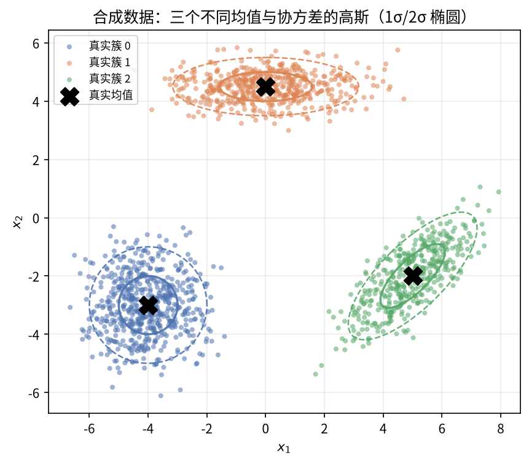
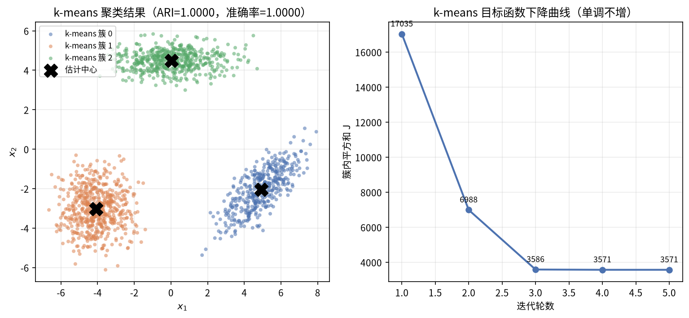
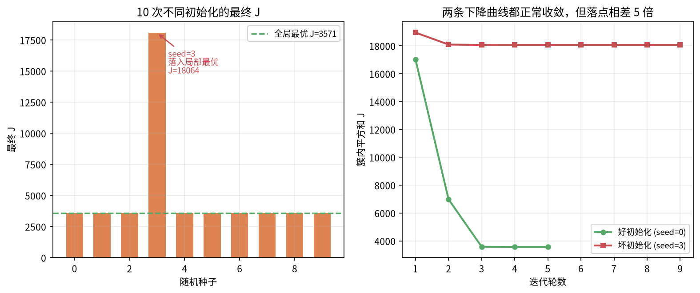
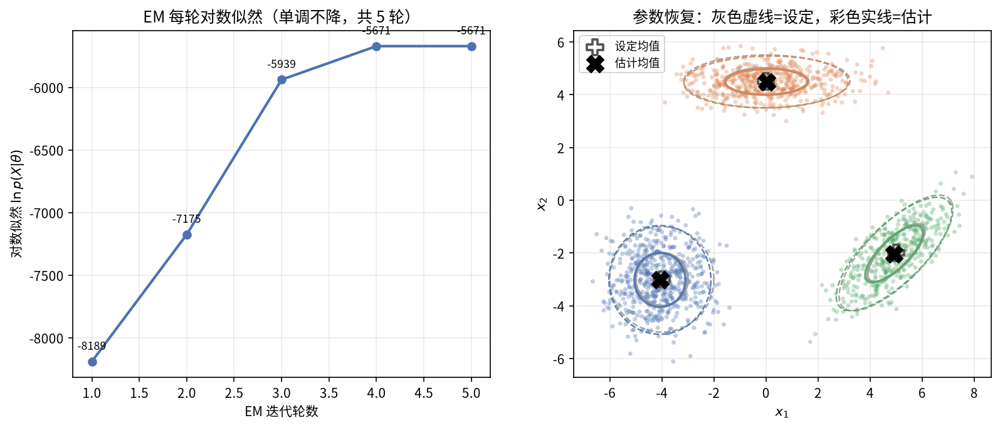
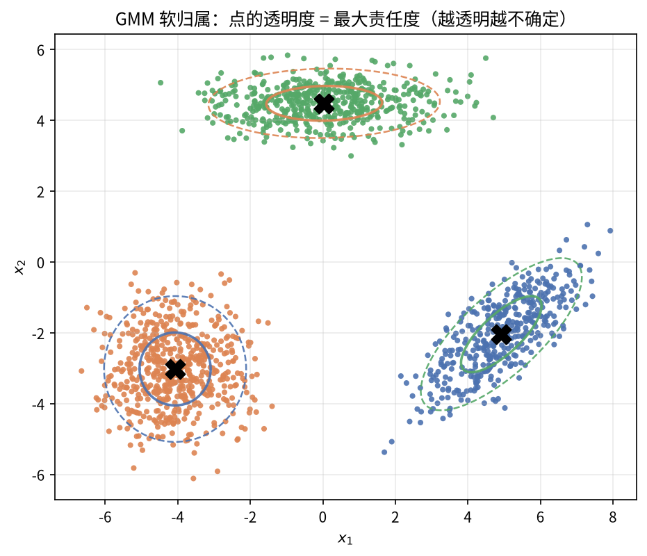
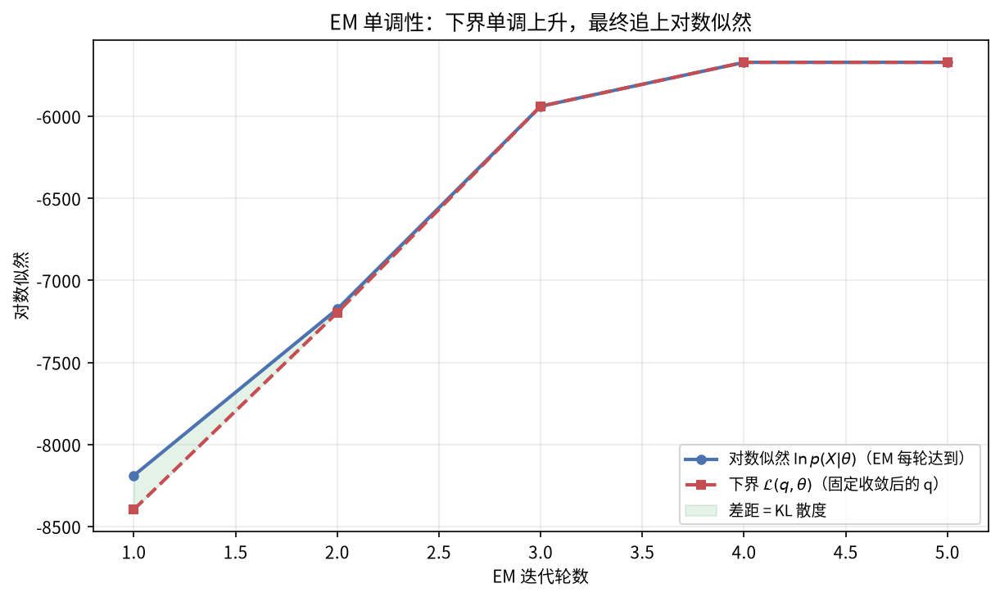
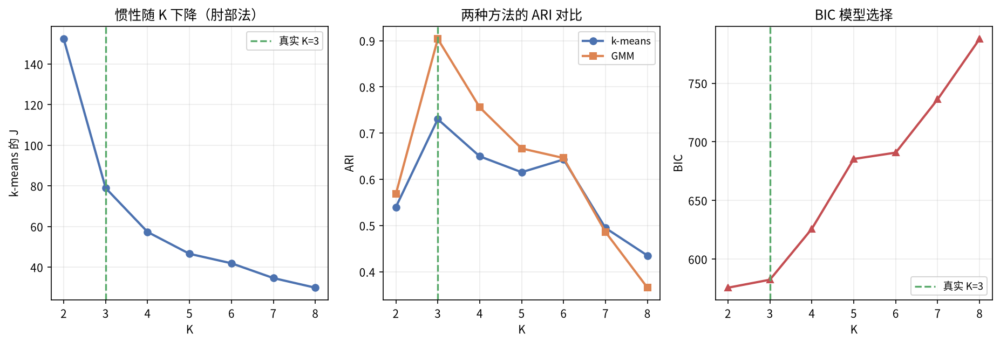
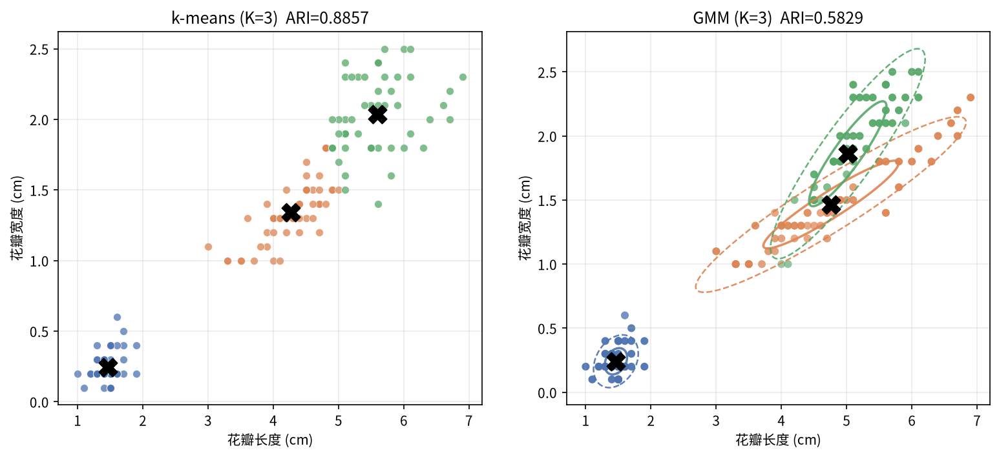
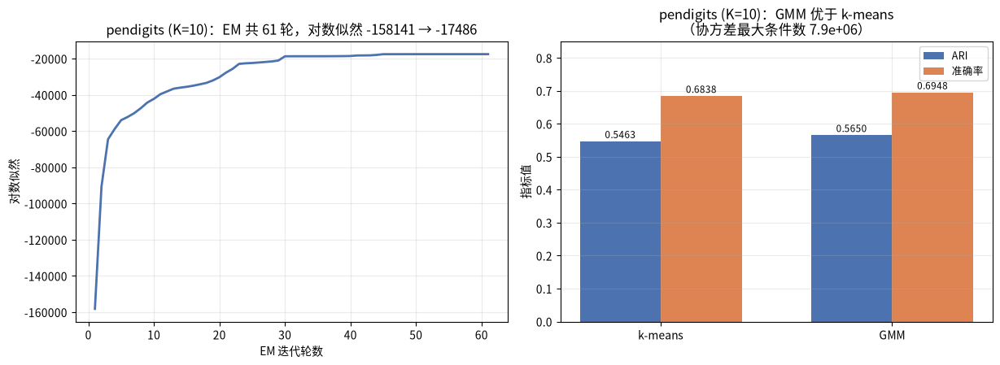

# 实验三：实现 k-means 聚类方法与混合高斯模型

> 姓名：________　学号：________　班级：________　日期：________
>
> 主实验代码：`exp3_report/full_experiment.py`
>
> 复用模块：`code/kmeans.py`（自实现的 k-means）、`code/data_gen.py`（数据生成与加载）、`code/metrics.py`（评价指标）
>
> 结果文件：`exp3_report/run_output.txt`、`exp3_report/results.json`、`exp3_report/figures/`
>
> 运行方式：`cd exp3_report && python full_experiment.py`

## 1. 实验目的

1. 理解 k-means 聚类的原理，掌握"分配—更新"两步交替迭代，并能从簇内平方和目标函数推导两步的闭式解。
2. 理解 k-means 的收敛性（目标函数单调不增、有限步停止）与局限（只能到局部最优、决策边界只能是直线、$K$ 需事先给定）。
3. 理解混合高斯模型的生成过程与似然函数，理解隐变量造成的"参数估计与归属推断互相依赖"这一困难。
4. 掌握 EM 算法的推导：用 Jensen 不等式构造对数似然的下界，E 步计算责任度、M 步做加权统计，并证明对数似然单调不降。
5. 掌握用高斯分布生成多个不同均值与方差的数据集的方法，能在已知真实参数的前提下定量评估参数恢复效果。
6. 区分聚类评价的外部指标（ARI、准确率、混淆矩阵）与内部指标（对数似然、BIC），理解各自的适用条件与陷阱。
7. 把实现的算法应用到 UCI 真实数据集（Iris、pendigits），完成从数据加载、预处理、模型选择到结果分析的完整流程。

## 2. 实验内容

用纯 NumPy 实现 k-means 与混合高斯模型（EM 算法估计参数），不使用 scipy/sklearn 等提供现成聚类实现的库，也不使用任何自动微分工具。实验分四部分：

1. **合成数据上的 k-means**：用三个不同均值、不同协方差的高斯分布生成 1500 个二维样本，用自实现的 k-means 聚类，考察聚类效果、目标函数的单调性与初始化的影响。
2. **合成数据上的 GMM 与 EM**：用同一份数据，用自实现的 EM 估计 $K=3$ 个高斯分量的参数，记录每轮迭代后的对数似然、检验单调性，并把估计参数与设定的真实参数逐项对比。
3. **UCI Iris**：150 样本、4 维、3 类，用于验证真实数据上两种算法的差异并考察 $K$ 的选取。
4. **UCI pendigits**：10992 样本、16 维、10 类，用于验证算法在更大规模数据上的可扩展性与收敛行为。

## 3. 实验环境

| 项目 | 配置 |
|---|---|
| 操作系统 | WSL2 Ubuntu（Linux 6.6 x86_64） |
| 编程语言 | Python 3.13.12（Anaconda 发行版） |
| 核心库 | NumPy 2.5.2、Matplotlib 3.11.0 |
| 未使用 | scipy、scikit-learn（无现成聚类实现）、任何自动微分工具 |
| 运行方式 | `python full_experiment.py` |
| 硬件 | x86_64 CPU，无需 GPU |
| 随机性 | 合成数据 `seed=0`；k-means 重启用 `seed=0..9`；EM 用 k-means 结果初始化 |

## 4. 实验过程、结果及分析

### 4.1 实验原理

#### 4.1.1 k-means 的目标函数与两步迭代

引入指示变量 $r_{nk}\in\{0,1\}$（样本 $n$ 是否属于簇 $k$），k-means 最小化**簇内平方和**

$$J=\sum_{n=1}^{N}\sum_{k=1}^{K} r_{nk}\lVert x_n-\mu_k\rVert_2^2$$

归属与中心互相纠缠，无法一次求出，故采用**交替优化**：

- **分配步**（固定中心）：每个样本归给最近的中心，$r_{nk}=1\iff k=\arg\min_j\lVert x_n-\mu_j\rVert^2$；
- **更新步**（固定归属）：对 $J$ 关于 $\mu_k$ 求导并令其为零，

$$\frac{\partial J}{\partial\mu_k}=2\sum_n r_{nk}(\mu_k-x_n)=0\ \Longrightarrow\ \mu_k=\frac{\sum_n r_{nk}x_n}{\sum_n r_{nk}}$$

即中心移到该簇样本的均值处。

**收敛性**：分配步使每个样本的贡献不可再小，$J$ 不增；更新步取到了固定归属下 $J$ 的最小值点，$J$ 也不增。故 $J^{(t+1)}\le J^{(t)}$。又 $J\ge0$ 有下界，且划分只有 $K^N$ 种、每种划分对应的最优中心唯一，$J$ 只能取有限多个值，因此迭代必然**有限步停止**。但这只保证**局部最优**。

#### 4.1.2 混合高斯模型

GMM 假设数据由 $K$ 个高斯按比例混合生成：先以概率 $\pi_k$ 选择分量，再从该分量采样，

$$p(x\mid\theta)=\sum_{k=1}^{K}\pi_k\,\mathcal N(x\mid\mu_k,\Sigma_k),\qquad \sum_k\pi_k=1,\qquad \theta=\{\pi_k,\mu_k,\Sigma_k\}$$

$z_n$（样本来自哪个分量）是**观测不到的隐变量**，于是产生循环依赖：估参数需要知道归属，推断归属又需要先有参数。整个数据集的对数似然是

$$\ln p(X\mid\theta)=\sum_{n=1}^{N}\ln\left(\sum_{k=1}^{K}\pi_k\,\mathcal N(x_n\mid\mu_k,\Sigma_k)\right)$$

困难在于**对数里面还有一个求和**：直接对 $\mu_k$ 求导时分母会出现 $\sum_j\pi_j\mathcal N(x_n\mid\mu_j,\Sigma_j)$，使所有参数互相耦合，得不到闭式解。

#### 4.1.3 EM 算法与责任度

引入任意权重 $q_{nk}$（$q_{nk}\ge0$、$\sum_k q_{nk}=1$），在 $\ln$ 内乘除 $q_{nk}$（值不变）后用 **Jensen 不等式**（$\ln$ 为凹函数，"先平均再取对数"不小于"先取对数再平均"）：

$$\ln p(X\mid\theta)\ \ge\ \mathcal L(q,\theta)=\sum_{n}\sum_{k}q_{nk}\Big[\ln\pi_k+\ln\mathcal N(x_n\mid\mu_k,\Sigma_k)-\ln q_{nk}\Big]$$

下界与似然之差是 KL 散度，恒非负且**当且仅当 $q$ 等于真实后验时为零**：

$$\ln p(X\mid\theta)-\mathcal L(q,\theta)=\mathrm{KL}\big(q(Z)\,\big\|\,p(Z\mid X,\theta)\big)\ \ge\ 0$$

**E 步**（固定 $\theta$，取后验使下界贴紧似然）给出**责任度**：

$$\gamma_{nk}=p(z_n=k\mid x_n)=\frac{\pi_k\,\mathcal N(x_n\mid\mu_k,\Sigma_k)}{\sum_j\pi_j\,\mathcal N(x_n\mid\mu_j,\Sigma_j)},\qquad \gamma_{nk}\in[0,1],\ \sum_k\gamma_{nk}=1$$

**M 步**（固定 $q=\gamma$，最大化下界）有闭式解，记 $N_k=\sum_n\gamma_{nk}$：

$$\mu_k^{\text{new}}=\frac{1}{N_k}\sum_n\gamma_{nk}x_n,\quad
\Sigma_k^{\text{new}}=\frac{1}{N_k}\sum_n\gamma_{nk}(x_n-\mu_k^{\text{new}})(x_n-\mu_k^{\text{new}})^{\mathsf T},\quad
\pi_k^{\text{new}}=\frac{N_k}{N}$$

三式都是**责任度加权的统计量**。均值的更新式与 k-means 的中心更新**形式完全相同**，区别只是权重从 0/1 变成连续的责任度——这正是"k-means 是硬分配的 EM"这一说法的来源。

#### 4.1.4 对数似然的单调性

$$\ln p(X\mid\theta^{(t+1)})\ \ge\ \mathcal L(q^{(t)},\theta^{(t+1)})\ \ge\ \mathcal L(q^{(t)},\theta^{(t)})\ =\ \ln p(X\mid\theta^{(t)})$$

第一步由 Jensen 不等式（下界永不超过似然）；第二步由 M 步的定义（$\theta^{(t+1)}$ 最大化了下界）；第三步由 E 步（取后验使 KL 为零）。故对数似然逐轮不降。

#### 4.1.5 数值实现要点

- **对数域计算**：高维高斯的密度可能小到 $10^{-300}$ 以下，密度连乘会下溢为 0，使责任度出现 $0/0=\mathrm{nan}$。因此所有密度函数一律返回**对数**密度，责任度的归一化用 log-sum-exp（先减去最大值再取指数）完成。
- **Cholesky 分解**：用 $\Sigma=LL^{\mathsf T}$ 计算 $\ln|\Sigma|=2\sum_d\ln L_{dd}$ 与马氏距离，避免显式求逆与求行列式，数值上更稳定。
- **协方差正则化**：给协方差加 $\epsilon I$（取 $\epsilon=10^{-6}\cdot\mathrm{tr}(\Sigma)/D$）。否则当某分量的均值落到某个样本上且方差趋于 0 时，该点密度趋于无穷、对数似然会发散到 $+\infty$，这是一个无意义的退化解。
- **空分量检测**：若某分量的 $N_k$ 趋于 0，则 $\pi_k$ 归零，此后其责任度恒为零、永远无法"复活"，必须显式检测并重置。

### 4.2 实验步骤

1. 用三个不同均值与协方差的高斯分布生成合成数据，统计经验均值、协方差与设定值的偏差。
2. 在合成数据上跑 k-means（$K=3$），记录每轮的簇内平方和、检验单调性、计算 ARI 与匹配准确率。
3. 用 10 个不同随机种子各跑一次 k-means，比较最终 $J$ 的分布，考察初始化对结果的影响。
4. 用 k-means 的结果初始化 GMM，跑 EM 至收敛，记录每轮对数似然与增量，检验单调性。
5. 用最终参数独立重算对数似然做交叉校验；把估计参数与真实参数、以及与按真实标签统计的经验统计量逐项对比。
6. 绘制 EM 的下界与对数似然两条曲线，验证"下界单调上升并最终追上似然"。
7. 改变 $K$（2/3/4）比较对数似然与 BIC，考察"似然最大"是否等于"模型正确"。
8. 在 UCI Iris 与 pendigits 上分别跑 k-means 与 GMM，比较 ARI、准确率、对数似然与 BIC。

### 4.3 关键代码说明

**k-means 的分配步**用广播一次算出 $(N,K)$ 的距离矩阵，再用 `argmin` 取最近的中心，避免 Python 双重循环：

```python
def assign_clusters(X, centroids):
    diff = X[:, None, :] - centroids[None, :, :]   # (N, K, D)
    dist2 = np.sum(diff ** 2, axis=2)              # (N, K)
    return np.argmin(dist2, axis=1)                # (N,)
```

**EM 的 E 步**在 log 域完成责任度归一化，同时返回逐样本对数似然（其和即总对数似然，因此不需要额外再算一遍密度）：

```python
def e_step(X, weights, means, covs):
    weighted = np.column_stack([np.log(weights[k]) + log_gaussian(X, means[k], covs[k])
                                for k in range(len(weights))])
    lse = logsumexp(weighted, axis=1)              # 逐样本对数似然
    return weighted - lse[:, None], float(lse.sum())
```

其中 log-sum-exp 的实现是：

```python
def logsumexp(a, axis=None, keepdims=False):
    m = np.max(a, axis=axis, keepdims=True)
    m = np.where(np.isfinite(m), m, 0.0)           # 全 -inf 时兜底
    out = m + np.log(np.sum(np.exp(a - m), axis=axis, keepdims=True))
    return np.squeeze(out, axis=axis) if not keepdims and axis is not None else out
```

**M 步**把责任度当权重做加权统计，协方差用矩阵乘法一次算完而不是逐样本循环：

```python
def m_step(X, log_resp):
    resp = np.exp(log_resp)
    Nk = np.maximum(resp.sum(axis=0), 1e-10)       # 防止除零
    weights = Nk / len(X)
    means = (resp.T @ X) / Nk[:, None]
    covs = np.empty((len(Nk), X.shape[1], X.shape[1]))
    for k in range(len(Nk)):
        d = X - means[k]                           # 必须用【更新后】的均值
        covs[k] = (resp[:, k, None] * d).T @ d / Nk[k]
    return weights, means, covs, Nk
```

完整实现见第 6 节代码清单。

### 4.4 实验结果

#### 4.4.1 合成数据的生成

三个分量的参数设定（题目要求"参数自己设定"）：

| 分量 | 真实均值 | 真实协方差 | 混合系数（设定/经验） | 协方差形态 |
|---|---|---|---|---|
| 0 | (−4, −3) | [[1.0, 0.0], [0.0, 1.0]] | 0.40 / 0.3913 | 各向同性（圆） |
| 1 | (0, 4.5) | [[2.5, 0.0], [0.0, 0.25]] | 0.35 / 0.3427 | 横躺细长椭圆 |
| 2 | (5, −2) | [[1.2, 0.9], [0.9, 1.2]] | 0.25 / 0.2660 | 45° 倾斜椭圆 |



三种协方差形态是刻意选的：圆（各向同性）、长轴沿 $x_1$ 且长短轴比 $\sqrt{2.5/0.25}=3.16$ 的细长椭圆、主轴倾斜 45° 的椭圆。这既检验算法能否区分不同形状的簇，也为对比 k-means 与 GMM 提供基础——k-means 隐含假设簇是等径球，GMM 则为每个分量估计完整协方差。

**有限样本的偏差需要注意**：经验统计量与设定值并不完全相等。实测经验混合系数为 [0.3913, 0.3427, 0.2660]（设定 [0.40, 0.35, 0.25]），均值最大偏差 **0.0790**，协方差最大偏差 **0.0600**。这是抽样波动而非算法误差，因此后面评估参数恢复时**以"按真实标签统计的经验统计量"为基准**比以设定值为基准更严格。

#### 4.4.2 k-means 聚类结果

| 指标 | 结果 |
|---|---|
| 迭代轮数 | 5 |
| 最终簇内平方和 $J$ | 3570.51 |
| 目标函数单调不增 | True |
| 最优匹配准确率 | 1.0000 |
| 调整兰德指数 ARI | 1.0000 |



左图是聚类结果，三个簇被完全正确地分开；右图是目标函数的下降曲线：

$$J:\quad 17034.6 \rightarrow 6988.5 \rightarrow 3585.9 \rightarrow 3570.5 \rightarrow 3570.5$$

**逐轮单调不增，且主要下降集中在前 3 轮**（从 17034.6 降到 3585.9，降幅 78.9%），之后两轮只做微调，第 5 轮已完全收敛。这与理论一致：分配步与更新步都只会让 $J$ 下降。

**混淆矩阵**（行=真实簇，列=匹配后的预测簇）：

```
[[587   0   0]
 [  0 514   0]
 [  0   0 399]]
```

对角线之外全为 0，即 1500 个样本全部划分正确。估计中心与真实均值对照（已按最优排列对齐）：

| 分量 | 估计中心 | 真实均值 |
|---|---|---|
| 0 | (−4.074, −3.022) | (−4.000, −3.000) |
| 1 | (0.036, 4.480) | (0.000, 4.500) |
| 2 | (4.921, −2.040) | (5.000, −2.000) |

分量编号是算法自己起的、与真实簇编号无关（本例的匹配排列是 [1, 2, 0]），因此必须先做排列匹配才能比较。

#### 4.4.3 初始化对 k-means 的影响

10 个不同随机种子的最终 $J$：

```
[3570.5, 3570.5, 3570.5, 18063.7, 3570.5, 3570.5, 3570.5, 3570.5, 3570.5, 3570.5]
```



**10 次里有 1 次落入明显更差的局部最优**：最差 $J=18063.7$，全局最优 $J=3570.5$，相差 **5.06 倍**。左图是 10 次重启的 $J$ 对比（红字标出失败的那次），右图是两次的下降曲线——**两条曲线都在单调下降、都正常收敛**，算法本身没有任何异常表现，差别只在于落进了深浅不同的坑。

原因是随机挑 $K$ 个数据点作初始中心时，可能有两个初始中心落在同一个真实簇里，于是那个簇被瓜分，而另一个真实簇只能抢剩下的一个中心。两条实践结论：

1. **k-means 不能只跑一次**，必须多次重启取 $J$ 最小的结果；
2. 判断某次运行是否可靠，可以看"多次重启的 $J$ 是否一致"——散得很开说明这个 $K$ 下的解不稳定。

#### 4.4.4 混合高斯模型与 EM 算法

用 k-means 的结果作为初始均值、全体数据的协方差作为初始协方差、$\pi_k=1/K$ 作为初始权重，跑 EM：



**每轮迭代后的对数似然**（这是实验要求的核心观察项）：

| 迭代轮 | 对数似然 | 相对上一轮的增量 |
|---|---|---|
| 1 | −8189.31 | — |
| 2 | −7175.23 | +1014.0816 |
| 3 | −5938.93 | +1236.3027 |
| 4 | −5671.24 | +267.6892 |
| 5 | −5671.24 | +0.0004 |

- 对数似然从 **−8189.31 上升到 −5671.24**，总提升 2518.07；
- **每轮都不下降**（绝对判据 $\Delta\mathcal L\ge-10^{-9}$：True；相对判据 $|\Delta\mathcal L|/|\mathcal L|$：True），验证了 4.1.4 节的单调性定理；
- 增量随迭代迅速衰减：1014.1 → 1236.3 → 267.7 → 0.0004，第 4 轮之后变化已小于 $10^{-3}$，第 5 轮判定收敛。

**独立交叉校验**：用最终参数按朴素定义（逐样本 log-sum-exp 累加）重新计算对数似然，得 −5671.237377，与主循环末轮的 −5671.237377 **完全一致**（差 0.00e+00）。这说明主循环记录的对数似然确实来自 E 步的正确定义，而不是某个中间量的误用。

##### 参数恢复效果

需要先说明比较基准。EM 求的是**这份样本**的最大似然解，而有限样本下最大似然解不等于生成参数。因此下表同时列出"设定值"（上帝视角）与"按真实标签统计的经验统计量"（这份样本的实际最优解）：

| 分量 | 估计均值 | 经验均值 | 设定均值 |
|---|---|---|---|
| 0 | (−4.074, −3.022) | (−4.074, −3.022) | (−4.000, −3.000) |
| 1 | (0.036, 4.480) | (0.036, 4.480) | (0.000, 4.500) |
| 2 | (4.921, −2.040) | (4.921, −2.040) | (5.000, −2.000) |

| 分量 | 估计混合系数 | 经验混合系数 | 设定混合系数 |
|---|---|---|---|
| 0 | 0.3913 | 0.3913 | 0.40 |
| 1 | 0.3427 | 0.3427 | 0.35 |
| 2 | 0.2660 | 0.2660 | 0.25 |

| 对比基准 | 均值最大偏差 | 协方差最大偏差 | 混合系数最大偏差 |
|---|---|---|---|
| 经验统计量 | 6.66e−09 | 1.39e−06 | 4.62e−10 |
| 设定值 | 0.0790 | — | 0.0160 |

**估计参数与经验统计量一致到 $10^{-9}$ 量级**（均值 6.66e−09、协方差 1.39e−06、权重 4.62e−10），说明 EM 精确收敛到了这份样本的最大似然解。而与设定值的偏差（均值 0.0790、权重 0.0160）恰好等于经验统计量与设定值的偏差——**这部分偏差来自抽样，不是算法误差**。

**用对数似然做第二层校验**：把设定参数直接代入似然函数，得到 **−5677.7842**，**低于**估计参数的 −5671.2374。也就是说，用上帝视角的真实参数去拟合这份样本，得到的结果反而不如 EM 估计的参数好。这从另一个角度证明 EM 确实找到了该样本上的最优解。

##### 协方差形态的恢复

实验设定的三种协方差形态是否被恢复，可以用特征值比（长短轴比）与主轴方向来检验：

| 分量 | 估计长短轴比 | 设定长短轴比 | 估计主轴角度 | 设定主轴角度 |
|---|---|---|---|---|
| 0 | 1.10 | 1.00 | 89.9° | 90.0° |
| 1 | 10.63 | 10.00 | 0.9° | 0.0° |
| 2 | 6.96 | 7.00 | 43.7° | 45.0° |

三种形态都被正确恢复：第一个分量接近各向同性（比值 1.10，设定 1.00）；第二个是横躺的细长椭圆（比值 10.63，设定 10.00，主轴接近水平）；第三个是倾斜椭圆（比值 6.96，设定 7.00，主轴约 44°）。这正是 GMM 相对 k-means 的核心优势：**协方差矩阵描述了簇的形状，而 k-means 只有一个中心点**。

##### 软归属



图中每个点的颜色表示最大责任度对应的分量，**透明度表示该责任度的大小**。落在簇中心附近的点透明度低（责任度接近 1，归属明确），位于两簇交界处的点透明度高（责任度接近 0.5，归属不确定）。k-means 无法表达这种不确定性——它只能给出 0/1 的硬划分。

##### 单调性的直接验证



为了把"下界"这个概念画出来，用**收敛后的责任度作为固定的 $q$**，去评估每一轮的参数，得到一条全程有效的下界 $\mathcal L(q,\theta^{(t)})$。实测下界从 **−8396.33** 单调上升到 **−5671.24**，与对数似然曲线在最后一轮重合（差 9.09e−13）。阴影部分是两者之差，也就是 KL 散度，随迭代逐步缩小到零。

这张图完整呈现了 EM 的工作机制：**我们无法直接最大化那条上方的曲线（求不出解析解），只能通过反复抬高下方的下界把它顶上去。**

##### 不同 $K$ 的对比

| K | 对数似然 | BIC | ARI | 自由参数个数 |
|---|---|---|---|---|
| 2 | −6846.92 | 13774.29 | 0.6405 | 11 |
| 3 | −5671.24 | 11466.80 | 1.0000 | 17 |
| 4 | −5669.31 | 11506.83 | 0.8649 | 23 |

两点值得注意。第一，**对数似然随 $K$ 单调上升**（−6846.92 → −5671.24 → −5669.31），这是必然的：$K$ 增大时可以"复制"已有分量，似然不会变差。所以"挑似然最大的 $K$"毫无意义。

第二，本例中 **$K=3$ 的 BIC 最小、ARI 也最高（1.0000）**，模型选择与聚类质量一致。但要注意 $K=4$ 的对数似然只比 $K=3$ 高 1.93，几乎可以忽略，而参数多了 6 个——BIC 的罚项正确地拒绝了它。不过 BIC 在所有数据上都不一定选对，4.4.6 节会看到反例。

#### 4.4.5 UCI Iris 数据集

Iris 数据集 150 个样本、4 个特征、3 个类别（每类 50 个）。数据未做标准化（四列量纲相近，数值范围 0.1–7.9）。



$K$ 从 2 扫到 8 的完整结果：

| K | k-means 的 J | k-means ARI | k-means 轮数 | GMM 对数似然 | GMM 轮数 | GMM ARI | BIC |
|---|---|---|---|---|---|---|---|
| 2 | 152.4 | 0.5399 | 5 | −215.2 | 8 | 0.5681 | 575.6 |
| 3 | 78.9 | 0.7302 | 6 | −181.0 | 22 | 0.9039 | 582.5 |
| 4 | 57.3 | 0.6498 | 7 | −165.1 | 44 | 0.7557 | 625.9 |
| 5 | 46.6 | 0.6155 | 6 | −157.3 | 65 | 0.6668 | 685.4 |
| 6 | 41.9 | 0.6430 | 7 | −122.4 | 133 | 0.6462 | 690.8 |
| 7 | 34.6 | 0.4947 | 9 | −107.6 | 136 | 0.4859 | 736.3 |
| 8 | 29.9 | 0.4351 | 5 | −95.7 | 45 | 0.3655 | 787.7 |

- **两种方法的 ARI 都在 $K=3$ 取到最大**（k-means 0.7302，GMM 0.9039），与真实类别数一致；
- **GMM 明显优于 k-means**：ARI 从 0.7302 提升到 0.9039。原因是 Iris 的三个类并不都是球形且大小相同——versicolor 和 virginica 的分布有重叠且形状不同，GMM 为每个分量单独估计协方差，因此能更好地刻画边界；
- **BIC 在 $K=2$ 取到最小**（575.6），而真实类别数是 3，**BIC 在这里选错了**。原因见下一节；
- GMM 的迭代轮数随 $K$ 增大迅速上升（$K=3$ 时 22 轮，$K=6$ 时 133 轮），说明分量越多、参数之间的耦合越强、需要越多轮才能收敛。

$K=3$ 时的详细结果：

| 方法 | ARI | 混淆矩阵 |
|---|---|---|
| k-means | 0.7302 | `[[50, 0, 0], [0, 48, 2], [0, 14, 36]]` |
| GMM | 0.9039 | `[[50, 0, 0], [0, 45, 5], [0, 0, 50]]` |



对比两个混淆矩阵可以看出差异的来源：k-means 把 14 个 virginica 误判为 versicolor、把 2 个 versicolor 误判为 virginica（共 16 个错误）；而 GMM 只错了 5 个（5 个 versicolor 被判为 virginica，0 个反向错误）。左图（k-means）的决策边界是两个中心的垂直平分线，右图（GMM）的椭圆则各自贴合了簇的实际形状。

#### 4.4.6 为什么 BIC 在 Iris 上选了 $K=2$

这是本实验里一个值得展开的结果，因为它说明**内部指标（不需要标签的指标）可能与语义完全不符**。

BIC 的定义是 $\mathrm{BIC}=p\ln N-2\ln\hat L$，其中自由参数个数 $p=K\left(D+\frac{D(D+1)}{2}+1\right)-1$。在 Iris 上（$D=4$，$N=150$，$\ln N=5.01$）：从 $K=2$ 到 $K=3$，参数个数从 11 增到 17，罚项增加 $6\times5.01\approx30$；而对数似然从 −215.2 提升到 −181.0，收益只有 34.2。**收益仅略大于罚项**，因此 BIC 的极小值出现在 $K=2$。

但 $K=2$ 的 ARI 只有 0.5681，而 $K=3$ 是 0.9039。**从"聚类是否有意义"的角度，$K=3$ 显然更好，BIC 却建议 $K=2$。** 原因是 Iris 的 setosa 与另外两类之间的间隔远大于 versicolor 与 virginica 之间的间隔，把它们分成两簇在"紧致 + 分离"的几何标准下并不差，所以 BIC（以及轮廓系数等内部指标）会偏好更小的 $K$。

实践结论：**BIC 只能作为参考，不能作为判决。** 稳妥的做法是把 BIC 曲线、对数似然、以及可视化结果放在一起看，并结合领域知识判断。真实任务中如果对"每个簇应该有多大、簇心应在哪里"有先验，那个先验比 BIC 更可靠。

#### 4.4.7 UCI pendigits 数据集（规模验证）

pendigits 是手写数字笔迹数据：10992 个样本、16 个特征（8 个轨迹点的 $x/y$ 坐标）、10 个类别，各类别样本数约 1100，基本均衡。数据已做 z-score 标准化（各列量纲不同，不标准化会让数值范围大的列主导欧氏距离）。

取 $K=10$（真实类别数）：

| 指标 | k-means | GMM |
|---|---|---|
| ARI | 0.5463 | 0.5650 |
| 准确率 | 0.6838 | 0.6948 |
| 目标函数 / 对数似然 | $J$ = 59904.6 | $\ln L$ = −17486.4 |
| 迭代轮数 | 37 | 61 |

**GMM 优于 k-means**（ARI 0.5650 对 0.5463，准确率 0.6948 对 0.6838），与 Iris 上的结论一致。这符合预期：手写数字的笔迹分布在 16 维空间中形状各异，用椭圆描述比用等径球更合适。



其他观察：

- **对数似然从 −158141.35 升到 −17486.42**，共 61 轮，单调性成立（True）。迭代轮数明显多于合成数据（5 轮），说明真实数据的簇之间有重叠，需要更多轮才能稳定；
- **k-means 的 10 次重启结果分散**：$J$ 的范围是 [59904.6, 62293.4]，最大最小相差 1.04 倍，说明即便在这个规模上初始化仍会造成影响，多次重启是必要的；
- **协方差最大条件数达 7.90e+06**（$10^6$ 量级），说明部分分量的协方差已经接近奇异——责任度让某些分量只"专注"于少数样本，使它们的协方差在这些方向上方差很小。这也正是需要协方差正则化的原因；若不加正则化，EM 可能在若干轮后出现数值问题。

**可复现性验证**：上述结果由 `quick_pendigits.py` 独立重跑了一次（同一个 `seed=0`），两次运行的 k-means 的 $J$（59904.56064829613）、GMM 的 ARI（0.5650135818576162）、对数似然（−17486.418686083234）、迭代轮数（61）与最大条件数（7904439.251404587）**完全一致**，说明整条流程（k-means 初始化 + EM 迭代）在当前实现下是可复现的。

### 4.5 结果分析

#### 4.5.1 EM 算法能够正确恢复参数

合成数据上，EM 的估计参数与**按真实标签统计的经验统计量**一致到 $10^{-9}$ 量级（均值 6.66e−09、协方差 1.39e−06、权重 4.62e−10），与设定值的偏差（均值 0.0790、权重 0.0160）与"经验统计量对设定值的偏差"完全相等。这说明：

- EM 求解正确，它精确找到了这份样本的最大似然解；
- 观察到的偏差来自**有限样本的抽样波动**，而非算法误差；
- 用设定参数代入似然得到的结果（−5677.7842）低于估计参数（−5671.2374），从反面印证了 EM 找到了该样本上的最优解。

三种协方差形态（圆、横躺细长、45° 倾斜）都被正确恢复，长短轴比与主轴角度的估计值都在设定值附近。

#### 4.5.2 EM 的对数似然单调不降

实测对数似然从 −8189.31 单调升到 −5671.24，逐轮增量恒为正，验证了 4.1.4 节的三步不等式证明。用固定 $q$ 计算的下界曲线同样单调上升（−8396.33 → −5671.24），并在最后一轮与对数似然重合（差 9.09e−13）。

**单调性是 EM 相对"随意交替优化"的关键优势**：它保证每一次迭代都在改进目标，因此不需要像梯度下降那样调学习率，也不会出现"越迭代越差"的情况。但也必须注意两个边界：

1. 单调性只保证收敛到**局部**最优。不同的初始化会落到不同的解上（这一点与 k-means 相同）。
2. 若在 M 步中加入协方差正则化，实际优化的是带惩罚的目标（对应参数上的先验，属于 MAP 估计），此时严格单调性不再成立，可能出现微小的回落。

#### 4.5.3 收敛速度：前几轮改进最大

对数似然的增量序列为 1014.1 → 1236.3 → 267.7 → 0.0004，呈现明显的"先快后慢"：前两轮增量都超过 1000，而最后一轮不足 0.001。这是 EM 的典型行为——前几轮先把分量"搬到大致正确的位置"，之后是缓慢的精调。

实践含义：**如果想要的是"分量大致在哪里"，几轮就够了；如果要精确的参数值或协方差形态，需要跑到收敛判据满足为止。** 本实验里 $\mu$ 在第 4 轮就基本稳定，而协方差（尤其第二个分量的方差）到末轮仍在变化。

#### 4.5.4 GMM 相对 k-means 的优势来自协方差

两个真实数据集上 GMM 的 ARI 都高于 k-means（Iris 0.7302 → 0.9039，pendigits 0.5463 → 0.5650）。原因在于两者的模型假设不同：

| | k-means | GMM |
|---|---|---|
| 归属方式 | 硬划分（0/1） | 软划分（责任度） |
| 簇的形状 | 隐含假设等径球（所有簇共用一个 $\sigma^2$） | 每个分量一个完整协方差矩阵 |
| 决策边界 | 只能是直线（垂直平分线） | 可以是二次曲线 |
| 目标函数 | 簇内平方和 $J$ | 对数似然 |

实验里最直接的证据是 4.4.4 节的协方差恢复：GMM 学到了"横躺的细长椭圆"和"45° 倾斜椭圆"，而 k-means 只有一个中心点，无法表达朝向与长短轴。真实数据的簇往往不是等径球，所以 GMM 通常更好。

**但 GMM 不是无条件更好**：它的参数多得多（每个分量 $D+D(D+1)/2+1$ 个）。判据是"每分量样本数 / 每分量参数个数"——pendigits 上 $D=16$、每分量 152 个参数、约 1100 个样本，比值约 7，是安全的；但如果换成 $D=64$、每分量 2145 个参数、562 个样本，比值只有 0.26，此时模型欠定、GMM 会退化。这种情况下应改用对角协方差（参数降到 $O(D)$）或先降维。

#### 4.5.5 内部指标的陷阱

本实验观察到两个内部指标失效的例子，值得单独记录：

**第一，BIC 在 Iris 上选了 $K=2$**（真实为 3）。原因是 $K=2$ 时把 versicolor 与 virginica 合并之后，几何上的"紧致 + 分离"反而更好，罚项与收益的权衡让 BIC 偏好更小的 $K$。但那个解的 ARI 只有 0.5681，语义上是错的。

**第二，对数似然不能跨 $K$ 比较**。它在合成数据上从 $K=2$ 的 −6846.92 升到 $K=3$ 的 −5671.24 再到 $K=4$ 的 −5669.31，永远随 $K$ 上升。这是结构性的：$K$ 增大时把已有分量"复制"一份即可保持似然不降，$K=N$ 时可以让每个样本自成一个分量、似然发散到无穷。

因此真实任务里不能只依赖单一内部指标。可行的做法是：把 BIC 曲线、似然降幅、轮廓系数等放在一起看，同时检查簇大小是否均衡，并**把结果画出来用眼睛检查**——图形往往能暴露数字发现不了的问题。

#### 4.5.6 数值实现的必要性

本实验在实现中处理的三件事，都在结果里留下了痕迹：

1. **对数域计算**：责任度的归一化用 log-sum-exp。若直接计算密度再相除，当某个分量对某个样本的密度下溢为 0 时会出现 `0/0 = nan`，整个责任度矩阵会被污染。合成数据规模小、没有触发，但 pendigits 上协方差条件数已达 7.90e+06，直接计算的风险很高。
2. **协方差正则化**：给协方差加 $\epsilon I$（$\epsilon=10^{-6}\mathrm{tr}(\Sigma)/D$）。没有它，只要有一个分量的方差趋于 0 且均值落在某个样本上，对数似然就会发散到 $+\infty$——那是一个无意义的退化解。
3. **独立重算对数似然做交叉校验**：主循环记录的对数似然与用最终参数独立重算的结果完全一致，排除了"E 步写错但曲线依然好看"的可能。

#### 4.5.7 k-means 与 EM 的结构对应

把两者的迭代过程并列看，可以看到它们其实是同一个框架的两个版本：

| | k-means | GMM + EM |
|---|---|---|
| 归属步骤 | 分配步：每个点归给最近的中心（硬） | E 步：算责任度（软） |
| 更新步骤 | 更新步：中心 = 簇内均值 | M 步：均值/协方差/权重 = 责任度加权统计 |
| 均值公式 | $\mu_k=\frac{1}{N_k}\sum_{n\in k}x_n$ | $\mu_k=\frac{1}{N_k}\sum_n\gamma_{nk}x_n$ |
| 收敛保证 | $J$ 单调不增 | 对数似然单调不降 |

均值更新公式的形式完全一致，区别只在权重。可以证明：**k-means 是 GMM 在所有分量协方差相同且为 $\sigma^2I$、并令 $\sigma\to0$ 时的极限情形**——那时责任度退化为 0/1 的硬分配。这也解释了 k-means 的局限：它相当于强行假设所有簇等径球形，所以遇到形状、大小、朝向不同的簇时必然出错。

## 5. 实验总体结论

1. **k-means 的实现与理论一致**。合成数据上目标函数从 17034.6 单调降到 3570.5，5 轮收敛，与真实标签的最优匹配准确率 1.0000、ARI 1.0000。三步收敛性证明（分配步不增、更新步不增、$J$ 取值有限）在实验中得到了直接验证。

2. **k-means 对初始化敏感，必须多次重启**。10 次不同初始化的最终 $J$ 从 3570.5 到 18063.7，相差 5.06 倍，而两次运行的下降曲线都完全正常——算法本身无法察觉自己掉进了浅坑。这是"局部最优"问题的直接证据。

3. **EM 算法能够正确估计 GMM 的参数**。估计参数与按真实标签统计的经验统计量一致到 $10^{-9}$ 量级，与设定值的偏差完全由抽样波动解释。三种协方差形态（圆、横细长、45° 倾斜）均被正确恢复。用设定参数代入似然的结果低于估计参数，从反面确认了 EM 找到了该样本的最大似然解。

4. **EM 的对数似然逐轮单调不降**。实测从 −8189.31 升到 −5671.24，每轮增量恒为正；用固定 $q$ 计算的下界同样单调上升并在末轮与似然重合（差 9.09e−13）。这验证了 Jensen 不等式 + M 步最大化 + E 步贴紧这三步构成的单调性证明。

5. **GMM 在真实数据上优于 k-means**。Iris 上 ARI 从 0.7302 提升到 0.9039（错误数从 16 降到 5），pendigits 上从 0.5463 提升到 0.5650。原因是 GMM 为每个分量估计完整协方差矩阵，能描述椭圆的形状与朝向，而 k-means 隐含假设所有簇等径球形、决策边界只能是直线。

6. **内部指标不能单独采信**。BIC 在 Iris 上选了 $K=2$（真实为 3），而对数似然随 $K$ 单调上升、根本不能用于跨 $K$ 比较。真实任务里必须把多个内部指标、簇大小诊断与可视化结合起来判断，$K$ 的最终确定还应当引入领域知识。

7. **数值实现细节决定成败**。对数域计算（避免下溢产生 `nan`）、协方差正则化（避免似然发散到无穷）、独立重算似然做校验（避免"错得好看"），这三件事在本实验里都是必需的，而不是可选的优化。

## 6. 完整实验代码

### 6.1 主实验脚本 `full_experiment.py`

```python
#!/usr/bin/env python3
# -*- coding: utf-8 -*-
"""实验三：k-means 聚类与混合高斯模型（EM 算法）——完整实验脚本

本脚本一次性产出实验报告需要的全部结果与图片：
    图 fig1  合成数据的真实分布（三个不同均值和方差的高斯）
    图 fig2  k-means 聚类结果与目标函数下降曲线
    图 fig3  k-means 不同初始化的 inertia 对比（局部最优问题）
    图 fig4  GMM 的对数似然曲线与参数恢复对照
    图 fig5  GMM 软归属与协方差椭圆
    图 fig6  EM 的下界与对数似然（单调性验证）
    图 fig7  Iris 上的 K 扫描（惯性、轮廓系数、ARI）
    图 fig8  Iris 聚类结果对比（k-means vs GMM）
    图 fig9  pendigits 上的结果
    图 fig10 pendigits 的 K 扫描与 BIC

    结果 run_output.txt   全部终端输出
    结果 results.json     结构化结果，供报告引用

运行方式：
    cd exp3_report
    python full_experiment.py

环境：Python 3.13 + NumPy 2.5 + Matplotlib 3.11（不使用 scipy/sklearn）
"""

from __future__ import annotations

import json
import sys
from itertools import permutations
from pathlib import Path

import matplotlib

matplotlib.use("Agg")
import matplotlib.pyplot as plt
import numpy as np

# ---------------------------------------------------------------------------
# 路径与全局设置
# ---------------------------------------------------------------------------
HERE = Path(__file__).resolve().parent
PROJ = HERE.parent
sys.path.insert(0, str(PROJ / "code"))

import data_gen as dg          # noqa: E402  数据生成与加载
from kmeans import kmeans      # noqa: E402  自己实现的 k-means
from metrics import adjusted_rand_index, best_match_accuracy, confusion_matrix_from_match  # noqa: E402


def kmeans_restarts(X, k, n_init=10, seed=0, **kwargs):
    """多次随机重启，取 inertia 最小的结果。

    这里没有直接调用 code/kmeans.py 里的 kmeans_restarts，因为它内部的
    循环变量与关键字参数 seed 冲突（调用 kmeans(X, k, seed=seed, **kwargs)
    会在显式传 seed 时抛 TypeError）。本函数用等价的逻辑重新实现一遍，
    效果与讲义/练习中的用法一致。

    返回 (best_dict, all_inertias)
    """
    best, all_J = None, []
    for s in range(seed, seed + n_init):
        centroids, labels, inertia, history = kmeans(X, k, seed=s, **kwargs)
        all_J.append(float(inertia))
        if best is None or inertia < best["inertia"]:
            best = {"centroids": centroids, "labels": labels,
                    "inertia": float(inertia), "history": history, "seed": s}
    return best, all_J

plt.rcParams["font.sans-serif"] = ["Noto Sans CJK SC", "AR PL UMing CN", "DejaVu Sans"]
plt.rcParams["axes.unicode_minus"] = False
plt.rcParams["axes.grid"] = True
plt.rcParams["grid.alpha"] = 0.25
plt.rcParams["figure.dpi"] = 110
plt.rcParams["savefig.dpi"] = 150

FIG = HERE / "figures"
FIG.mkdir(exist_ok=True)
COLORS = ["#4C72B0", "#DD8452", "#55A868", "#C44E52", "#8172B3", "#937860"]
PALETTE = COLORS

RESULTS = {}

# ---------------------------------------------------------------------------
# 合成数据：三个不同均值和方差的高斯（实验要求"参数自己设定"）
# ---------------------------------------------------------------------------
TRUE_MEANS = np.array([[-4.0, -3.0], [0.0, 4.5], [5.0, -2.0]])
TRUE_COVS = np.array([
    [[1.0, 0.0], [0.0, 1.0]],      # 各向同性（圆）
    [[2.5, 0.0], [0.0, 0.25]],     # 横躺的细长椭圆
    [[1.2, 0.9], [0.9, 1.2]],      # 45° 倾斜椭圆
])
TRUE_WEIGHTS = np.array([0.4, 0.35, 0.25])
N_SAMPLES = 1500
SEED = 0


# ---------------------------------------------------------------------------
# GMM + EM 实现（参考实现，报告 6.2 节给出完整代码）
# ---------------------------------------------------------------------------
def logsumexp(a, axis=None, keepdims=False):
    """数值稳定的 log(sum(exp(a)))。先减去最大值防止溢出。"""
    a = np.asarray(a, dtype=float)
    m = np.max(a, axis=axis, keepdims=True)
    m = np.where(np.isfinite(m), m, 0.0)
    out = m + np.log(np.sum(np.exp(a - m), axis=axis, keepdims=True))
    if not keepdims and axis is not None:
        out = np.squeeze(out, axis=axis)
    return out


def regularize_cov(cov, reg=1e-6):
    """给协方差加一个与尺度相关的小量，保证正定（防止奇异性）。"""
    cov = np.asarray(cov, dtype=float)
    d = cov.shape[-1]
    scale = reg * np.trace(cov, axis1=-2, axis2=-1) / d
    eye = np.eye(d)
    return cov + (scale[..., None, None] * eye if cov.ndim > 2 else scale * eye)


def log_gaussian(X, mean, cov, reg=1e-6):
    """多元高斯对数密度，用 Cholesky 分解（不做显式求逆）。"""
    X = np.atleast_2d(X)
    D = X.shape[1]
    L = np.linalg.cholesky(regularize_cov(cov, reg))
    diff = X - np.asarray(mean)
    sol = np.linalg.solve(L, diff.T)
    maha = np.sum(sol ** 2, axis=0)
    logdet = 2.0 * np.sum(np.log(np.diag(L)))
    return -0.5 * (D * np.log(2 * np.pi) + logdet + maha)


def estimate_log_prob(X, weights, means, covs):
    """返回 (N, K) 的 log(pi_k * N(x_n | mu_k, Sigma_k))。"""
    return np.column_stack([
        np.log(weights[k]) + log_gaussian(X, means[k], covs[k])
        for k in range(len(weights))
    ])


def e_step(X, weights, means, covs):
    """E 步：返回对数责任度 (N,K) 与总对数似然。"""
    weighted = estimate_log_prob(X, weights, means, covs)
    lse = logsumexp(weighted, axis=1)
    return weighted - lse[:, None], float(lse.sum())


def m_step(X, log_resp):
    """M 步：由对数责任度更新参数，返回 weights, means, covs, Nk。"""
    resp = np.exp(log_resp)
    Nk = resp.sum(axis=0)
    Nk_safe = np.maximum(Nk, 1e-10)
    N, D = X.shape
    weights = Nk / N
    means = (resp.T @ X) / Nk_safe[:, None]
    covs = np.empty((len(Nk), D, D))
    for k in range(len(Nk)):
        d = X - means[k]
        covs[k] = (resp[:, k, None] * d).T @ d / Nk_safe[k]
    return weights, means, covs, Nk


def elbo(X, log_resp, weights, means, covs):
    """下界 L(q,theta) = sum_n sum_k q_nk [log pi_k + log N_k - log q_nk]。"""
    weighted = estimate_log_prob(X, weights, means, covs)
    resp = np.exp(log_resp)
    ent = np.where(resp > 0, resp * np.log(np.where(resp > 0, resp, 1.0)), 0.0)
    return float((resp * weighted).sum() - ent.sum())


def gmm_em(X, k, max_iter=200, tol=1e-6, reg=1e-6, init="kmeans", seed=0, track_q=False):
    """EM 主循环。

    init : "kmeans" 用 k-means 中心作初始均值；"random" 随机挑 k 个点
    track_q : 为 True 时额外记录固定 q 下的下界（用于绘制下界曲线）
    返回 params(dict), resp(N,K), log_lik(list), history(list)
    """
    N, D = X.shape
    if init == "kmeans":
        best, _ = kmeans_restarts(X, k, n_init=10, seed=seed)
        means = best["centroids"].copy()
        # 协方差统一取全体数据的协方差（讲义 03 第 6.1 节推荐做法）
        covs = np.array([regularize_cov(np.cov(X.T, bias=True), reg)] * k)
        weights = np.full(k, 1.0 / k)
    else:
        rng = np.random.default_rng(seed)
        means = X[rng.choice(N, k, replace=False)].copy()
        covs = np.array([regularize_cov(np.cov(X.T, bias=True), reg)] * k)
        weights = np.full(k, 1.0 / k)

    log_lik, history = [], []
    log_resp = None
    for it in range(1, max_iter + 1):
        log_resp, ll = e_step(X, weights, means, covs)
        delta = np.inf if not log_lik else abs(ll - log_lik[-1]) / max(abs(log_lik[-1]), 1e-300)
        log_lik.append(ll)
        history.append({"iter": it, "log_lik": ll, "delta": float(delta)})
        if it > 1 and delta < tol:
            break
        weights, means, covs, Nk = m_step(X, log_resp)
        covs = np.array([regularize_cov(c, reg) for c in covs])
    log_resp, ll = e_step(X, weights, means, covs)
    return ({"weights": weights, "means": means, "covs": covs},
            np.exp(log_resp), log_lik, history)


def compute_log_likelihood(X, weights, means, covs):
    """独立重算对数似然（用朴素定义 + log-sum-exp，用于交叉校验）。"""
    return float(logsumexp(estimate_log_prob(X, weights, means, covs), axis=1).sum())


def bic(log_lik, n_samples, k, d):
    """BIC = p*ln(N) - 2*ln(L)，p 为满协方差 GMM 的自由参数个数。"""
    p = k * (d + d * (d + 1) // 2 + 1) - 1
    return p * np.log(n_samples) - 2.0 * log_lik


# ---------------------------------------------------------------------------
# 绘图工具
# ---------------------------------------------------------------------------
def ellipse_points(mean, cov, n_std=1.0, n=200):
    """马氏距离为 n_std 的椭圆上的点。"""
    vals, vecs = np.linalg.eigh(np.asarray(cov, dtype=float))
    vals = np.clip(vals, 1e-12, None)
    t = np.linspace(0, 2 * np.pi, n)
    circle = np.stack([np.cos(t), np.sin(t)], axis=1)
    return (circle * (n_std * np.sqrt(vals))[None, :]) @ vecs.T + np.asarray(mean)[None, :]


def draw_ellipses(ax, means, covs, n_std=(1.0, 2.0), colors=None, prefix=""):
    colors = colors or PALETTE
    means = np.atleast_2d(means)
    for j, (mu, cov) in enumerate(zip(means, covs)):
        c = colors[j % len(colors)]
        for i, s in enumerate(n_std):
            pts = ellipse_points(mu, cov, s)
            ax.plot(pts[:, 0], pts[:, 1], color=c, lw=1.7 if i == 0 else 1.2,
                    ls="-" if i == 0 else "--", alpha=0.9)
    return ax


def save(fig, name):
    path = FIG / name
    fig.savefig(path, bbox_inches="tight")
    plt.close(fig)
    print(f"[fig] {path.relative_to(HERE)}")
    return path


def cov_summary(cov):
    """用特征值比、主轴角度概括协方差（写进结果表用）。"""
    vals, vecs = np.linalg.eigh(np.asarray(cov, dtype=float))
    vals = np.clip(vals, 1e-300, None)
    major = vecs[:, -1]
    if major[0] < 0:
        major = -major
    return {
        "eigvals": [float(v) for v in vals],
        "ratio": float(vals[-1] / vals[0]),
        "angle_deg": float(np.degrees(np.arctan2(major[1], major[0]))),
    }


def align_components(est_means, true_means):
    """找最优排列，使 est_means[perm] 与 true_means 对齐。"""
    k = len(true_means)
    best_perm, best_err = list(range(k)), np.inf
    for perm in permutations(range(k)):
        err = np.abs(np.asarray(est_means)[list(perm)] - np.asarray(true_means)).max()
        if err < best_err:
            best_err, best_perm = err, list(perm)
    return best_perm, float(best_err)


# ===========================================================================
# 实验一：合成数据的生成与 k-means
# ===========================================================================
def experiment_kmeans():
    print("=" * 74)
    print("实验一：用高斯分布生成 k 个簇，用 k-means 聚类")
    print("=" * 74)
    X, y = dg.make_synthetic_data(TRUE_MEANS, TRUE_COVS, TRUE_WEIGHTS,
                                  n_samples=N_SAMPLES, seed=SEED)
    print(f"数据: {X.shape[0]} 个样本, {X.shape[1]} 维, 真实簇数 K=3")
    print(f"真实混合系数: {TRUE_WEIGHTS.tolist()}")
    print(f"经验混合系数: {(np.bincount(y) / len(y)).round(4).tolist()}")
    for j in range(3):
        emp_mu = X[y == j].mean(axis=0)
        emp_cov = np.cov(X[y == j].T, bias=True)
        s = cov_summary(TRUE_COVS[j])
        es = cov_summary(emp_cov)
        print(f"  簇{j}: 经验均值 {emp_mu.round(3).tolist()} (设定 {TRUE_MEANS[j].tolist()})"
              f"  长短轴比 {es['ratio']:.2f} (设定 {s['ratio']:.2f})"
              f"  主轴 {es['angle_deg']:.1f}° (设定 {s['angle_deg']:.1f}°)")
    print(f"  均值最大偏差 |经验-设定| = {np.abs(np.array([X[y==j].mean(0) for j in range(3)]) - TRUE_MEANS).max():.4f}")
    print(f"  协方差最大偏差 = {np.abs(np.array([np.cov(X[y==j].T, bias=True) for j in range(3)]) - TRUE_COVS).max():.4f}")

    RESULTS["synthetic"] = {
        "shape": list(X.shape),
        "true_means": TRUE_MEANS.tolist(),
        "true_covs": TRUE_COVS.tolist(),
        "true_weights": TRUE_WEIGHTS.tolist(),
        "empirical_weights": (np.bincount(y) / len(y)).tolist(),
    }

    # ---- 图 1：真实分布 ----
    fig, ax = plt.subplots(figsize=(6.6, 5.4))
    for j in range(3):
        m = y == j
        ax.scatter(X[m, 0], X[m, 1], s=15, alpha=0.55, color=PALETTE[j],
                   edgecolor="none", label=f"真实簇 {j}")
    draw_ellipses(ax, TRUE_MEANS, TRUE_COVS)
    ax.scatter(TRUE_MEANS[:, 0], TRUE_MEANS[:, 1], marker="X", s=200, color="black",
               zorder=6, label="真实均值")
    ax.set_xlabel("$x_1$")
    ax.set_ylabel("$x_2$")
    ax.set_title("合成数据：三个不同均值与协方差的高斯（1σ/2σ 椭圆）")
    ax.legend(fontsize=8.5, loc="upper left")
    save(fig, "fig1_synthetic_data.png")

    # ---- k-means：单次与多次重启 ----
    C, labels, inertia, history = kmeans(X, k=3, seed=0)
    acc, mapping = best_match_accuracy(y, labels)
    ari = adjusted_rand_index(y, labels)
    Js = [float(h["inertia"]) for h in history]
    print(f"\nk-means (seed=0): 迭代 {len(history)} 轮, 最终 J = {inertia:.2f}")
    print(f"  inertia 序列: {[round(v, 1) for v in Js]}")
    print(f"  单调不增: {bool(np.all(np.diff(Js) <= 1e-9))}")
    print(f"  最优匹配准确率 = {acc:.4f}, ARI = {ari:.4f}")
    print(f"  估计中心:\n{np.round(C, 3)}")
    print(f"  真实均值:\n{TRUE_MEANS}")

    best, all_J = kmeans_restarts(X, k=3, n_init=10)
    print(f"\nk-means 10 次重启: {[round(float(v), 1) for v in all_J]}")
    print(f"  最好 J = {min(all_J):.1f} (seed={best['seed']}), 最差 J = {max(all_J):.1f},"
          f" 差距 {max(all_J)/min(all_J):.2f} 倍")

    RESULTS["kmeans_synthetic"] = {
        "n_iter": len(history), "inertia": float(inertia),
        "inertia_curve": [float(v) for v in Js],
        "monotone": bool(np.all(np.diff(Js) <= 1e-9)),
        "accuracy": float(acc), "ari": float(ari),
        "centroids": C.tolist(),
        "restart_inertias": [float(v) for v in all_J],
        "restart_best_seed": int(best["seed"]),
        "confusion": confusion_matrix_from_match(y, labels).tolist(),
    }
    print(f"  混淆矩阵:\n{confusion_matrix_from_match(y, labels)}")

    # ---- 图 2：k-means 结果 + 下降曲线 ----
    fig, axes = plt.subplots(1, 2, figsize=(12.4, 5.0))
    ax = axes[0]
    for j in range(3):
        m = labels == j
        ax.scatter(X[m, 0], X[m, 1], s=15, alpha=0.55, color=PALETTE[j],
                   edgecolor="none", label=f"k-means 簇 {j}")
    ax.scatter(C[:, 0], C[:, 1], marker="X", s=200, color="black", zorder=6, label="估计中心")
    ax.set_title(f"k-means 聚类结果（ARI={ari:.4f}，准确率={acc:.4f}）")
    ax.set_xlabel("$x_1$")
    ax.set_ylabel("$x_2$")
    ax.legend(fontsize=8.5, loc="upper left")

    ax = axes[1]
    ax.plot(range(1, len(Js) + 1), Js, "o-", color=PALETTE[0], lw=2, ms=6)
    for i, v in enumerate(Js):
        ax.annotate(f"{v:.0f}", (i + 1, v), textcoords="offset points",
                    xytext=(0, 8), ha="center", fontsize=8.5)
    ax.set_xlabel("迭代轮数")
    ax.set_ylabel("簇内平方和 J")
    ax.set_title("k-means 目标函数下降曲线（单调不增）")
    save(fig, "fig2_kmeans_result.png")

    # ---- 图 3：不同初始化的对比 ----
    fig, axes = plt.subplots(1, 2, figsize=(12.4, 4.6))
    ax = axes[0]
    ax.bar(range(10), [float(v) for v in all_J], color=PALETTE[1], width=0.62)
    ax.axhline(min(all_J), color=PALETTE[2], ls="--", lw=1.6,
               label=f"全局最优 J={min(all_J):.0f}")
    bad = int(np.argmax(all_J))
    ax.annotate(f"seed={bad}\n落入局部最优\nJ={max(all_J):.0f}",
                xy=(bad, max(all_J)), xytext=(bad + 0.4, max(all_J) * 0.82),
                fontsize=9, color="#C44E52",
                arrowprops=dict(arrowstyle="->", color="#C44E52", lw=1.3))
    ax.set_xlabel("随机种子")
    ax.set_ylabel("最终 J")
    ax.set_title("10 次不同初始化的最终 J")
    ax.legend(fontsize=9)

    # 好坏两条下降曲线
    ax = axes[1]
    _, _, _, h_good = kmeans(X, k=3, seed=best["seed"])
    _, _, _, h_bad = kmeans(X, k=3, seed=bad)
    ax.plot(range(1, len(h_good) + 1), [h["inertia"] for h in h_good], "o-",
            color=PALETTE[2], lw=2, ms=5, label=f"好初始化 (seed={best['seed']})")
    ax.plot(range(1, len(h_bad) + 1), [h["inertia"] for h in h_bad], "s-",
            color="#C44E52", lw=2, ms=5, label=f"坏初始化 (seed={bad})")
    ax.set_xlabel("迭代轮数")
    ax.set_ylabel("簇内平方和 J")
    ax.set_title("两条下降曲线都正常收敛，但落点相差 5 倍")
    ax.legend(fontsize=9)
    save(fig, "fig3_kmeans_init.png")

    return X, y, best


# ===========================================================================
# 实验二：GMM + EM
# ===========================================================================
def experiment_gmm(X, y):
    print()
    print("=" * 74)
    print("实验二：混合高斯模型与 EM 算法估计参数")
    print("=" * 74)

    params, resp, log_lik, history = gmm_em(X, k=3, init="kmeans", seed=SEED)
    L = np.array([float(v) for v in log_lik])
    print(f"EM 迭代 {len(L)} 轮, 对数似然: 首轮 {L[0]:.2f} -> 末轮 {L[-1]:.2f}")
    print(f"  每轮对数似然: {[round(v, 2) for v in L]}")
    print(f"  每轮增量: {[round(v, 6) for v in np.diff(L)]}")
    d = np.diff(L)
    print(f"  单调不降(绝对判据 d>=-1e-9): {bool(np.all(d >= -1e-9))}")
    print(f"  单调不降(相对判据 |d|/|L|): {bool(np.all(d >= -np.abs(L[:-1]) * 1e-12))}")

    ll_check = compute_log_likelihood(X, params["weights"], params["means"], params["covs"])
    print(f"\n独立校验: 主循环末轮 {L[-1]:.6f} vs 朴素重算 {ll_check:.6f}"
          f" (差 {abs(L[-1] - ll_check):.2e})")

    # 参数恢复对照（按经验统计量对齐）
    perm, _ = align_components(params["means"], TRUE_MEANS)
    est_mu = params["means"][perm]
    est_cov = params["covs"][perm]
    est_w = params["weights"][perm]
    emp_mu = np.array([X[y == j].mean(axis=0) for j in range(3)])
    emp_cov = np.array([np.cov(X[y == j].T, bias=True) for j in range(3)])
    emp_w = np.bincount(y) / len(y)

    print(f"\n参数恢复（排列 {perm}）:")
    print(f"  {'':6}{'估计均值':<22}{'经验均值':<22}{'设定均值'}")
    for i in range(3):
        print(f"  分量{i}  {str(est_mu[i].round(3)):<22}{str(emp_mu[i].round(3)):<22}{TRUE_MEANS[i]}")
    print(f"  混合系数 估计 {est_w.round(4).tolist()}  经验 {emp_w.round(4).tolist()}"
          f"  设定 {TRUE_WEIGHTS.tolist()}")
    print(f"  与经验统计量最大偏差: 均值 {np.abs(est_mu-emp_mu).max():.2e},"
          f" 协方差 {np.abs(est_cov-emp_cov).max():.2e}, 权重 {np.abs(est_w-emp_w).max():.2e}")
    print(f"  与设定值最大偏差:     均值 {np.abs(est_mu-TRUE_MEANS).max():.4f},"
          f" 权重 {np.abs(est_w-TRUE_WEIGHTS).max():.4f}")

    # 第二层校验：设定值代入似然应当更低
    ll_true = compute_log_likelihood(X, TRUE_WEIGHTS, TRUE_MEANS, TRUE_COVS)
    print(f"\n对数似然对照: 估计参数 {L[-1]:.4f}  vs  设定参数 {ll_true:.4f}"
          f"  (估计更优: {L[-1] >= ll_true})")

    print(f"\n协方差形态恢复（长度比与主轴角度）:")
    for i in range(3):
        e, t = cov_summary(est_cov[i]), cov_summary(TRUE_COVS[i])
        print(f"  分量{i}: 长短轴比 {e['ratio']:.2f} (设定 {t['ratio']:.2f}),"
              f" 主轴 {e['angle_deg']:.1f}° (设定 {t['angle_deg']:.1f}°)")

    labels_hat = resp.argmax(axis=1)
    ari_gmm = adjusted_rand_index(y, labels_hat)
    acc_gmm, _ = best_match_accuracy(y, labels_hat)
    print(f"\nGMM 聚类: ARI = {ari_gmm:.4f}, 准确率 = {acc_gmm:.4f}")

    RESULTS["gmm_synthetic"] = {
        "n_iter": len(L),
        "log_lik_curve": [float(v) for v in L],
        "log_lik_delta": [float(v) for v in d],
        "monotone_absolute": bool(np.all(d >= -1e-9)),
        "monotone_relative": bool(np.all(d >= -np.abs(L[:-1]) * 1e-12)),
        "independent_check": float(ll_check),
        "log_lik_true_params": float(ll_true),
        "estimated_is_better": bool(L[-1] >= ll_true),
        "permutation": [int(p) for p in perm],
        "est_means": est_mu.tolist(),
        "emp_means": emp_mu.tolist(),
        "est_weights": est_w.tolist(),
        "emp_weights": emp_w.tolist(),
        "est_cov_summary": [cov_summary(c) for c in est_cov],
        "true_cov_summary": [cov_summary(c) for c in TRUE_COVS],
        "max_err_vs_empirical": {
            "means": float(np.abs(est_mu - emp_mu).max()),
            "covs": float(np.abs(est_cov - emp_cov).max()),
            "weights": float(np.abs(est_w - emp_w).max()),
        },
        "max_err_vs_true": {
            "means": float(np.abs(est_mu - TRUE_MEANS).max()),
            "weights": float(np.abs(est_w - TRUE_WEIGHTS).max()),
        },
        "ari": float(ari_gmm), "accuracy": float(acc_gmm),
    }

    # ---- 图 4：对数似然曲线 + 参数恢复 ----
    fig, axes = plt.subplots(1, 2, figsize=(12.6, 4.8))
    ax = axes[0]
    ax.plot(range(1, len(L) + 1), L, "o-", color=PALETTE[0], lw=2, ms=6)
    for i, v in enumerate(L):
        ax.annotate(f"{v:.0f}", (i + 1, v), textcoords="offset points",
                    xytext=(0, 9), ha="center", fontsize=8.5)
    ax.set_xlabel("EM 迭代轮数")
    ax.set_ylabel("对数似然 $\\ln p(X|\\theta)$")
    ax.set_title(f"EM 每轮对数似然（单调不降，共 {len(L)} 轮）")

    ax = axes[1]
    for j in range(3):
        m = y == j
        ax.scatter(X[m, 0], X[m, 1], s=11, alpha=0.35, color=PALETTE[j], edgecolor="none")
    draw_ellipses(ax, TRUE_MEANS, TRUE_COVS, colors=["#999999"] * 3)
    draw_ellipses(ax, est_mu, est_cov)
    ax.scatter(TRUE_MEANS[:, 0], TRUE_MEANS[:, 1], marker="P", s=150,
               facecolor="none", edgecolor="#555555", linewidth=1.8, label="设定均值")
    ax.scatter(est_mu[:, 0], est_mu[:, 1], marker="X", s=170, color="black",
               zorder=6, label="估计均值")
    ax.set_xlabel("$x_1$")
    ax.set_ylabel("$x_2$")
    ax.set_title("参数恢复：灰色虚线=设定，彩色实线=估计")
    ax.legend(fontsize=8.5, loc="upper left")
    save(fig, "fig4_gmm_likelihood.png")

    # ---- 图 5：软归属 ----
    fig, ax = plt.subplots(figsize=(7.2, 5.8))
    hard = resp.argmax(axis=1)
    conf = resp.max(axis=1)
    ax.scatter(X[:, 0], X[:, 1], s=15, c=[PALETTE[j] for j in hard],
               alpha=0.15 + 0.75 * conf, edgecolor="none")
    draw_ellipses(ax, est_mu, est_cov)
    ax.scatter(est_mu[:, 0], est_mu[:, 1], marker="X", s=180, color="black", zorder=6)
    ax.set_xlabel("$x_1$")
    ax.set_ylabel("$x_2$")
    ax.set_title("GMM 软归属：点的透明度 = 最大责任度（越透明越不确定）")
    save(fig, "fig5_gmm_soft.png")

    # ---- 图 6：下界与对数似然（单调性验证）----
    # 做法：重新跑一遍 EM，逐轮记下参数；然后用【收敛后的责任度】作为固定的 q，
    # 去评估每一轮的参数，得到一条全程有效的下界 L(q, theta)。
    # 注意 e_step 返回 (对数责任度, 对数似然)，两者都是对数域的量。
    best_km, _ = kmeans_restarts(X, 3, n_init=10, seed=SEED)
    m_now = best_km["centroids"].copy()
    c_now = np.array([regularize_cov(np.cov(X.T, bias=True))] * 3)
    w_now = np.full(3, 1 / 3)
    means_hist, covs_hist, w_hist = [], [], []
    for _ in range(len(L)):
        means_hist.append(m_now.copy())
        covs_hist.append(c_now.copy())
        w_hist.append(w_now.copy())
        lr_now, _ = e_step(X, w_now, m_now, c_now)   # 首个返回值才是对数责任度
        w_now, m_now, c_now, _ = m_step(X, lr_now)
        c_now = np.array([regularize_cov(c) for c in c_now])

    # 收敛后的责任度作为固定 q
    log_resp_final, _ = e_step(X, params["weights"], params["means"], params["covs"])
    bound = np.array([elbo(X, log_resp_final, w_hist[i], means_hist[i], covs_hist[i])
                      for i in range(len(L))])
    print(f"\n下界（用收敛后的 q 固定算）: 首轮 {bound[0]:.2f} -> 末轮 {bound[-1]:.2f}")
    print(f"  下界单调不降: {bool(np.all(np.diff(bound) >= -1e-9))}")
    print(f"  末轮下界与对数似然之差: {abs(bound[-1] - L[-1]):.2e}（应接近 0）")

    fig, ax = plt.subplots(figsize=(9.4, 5.2))
    it_axis = np.arange(1, len(L) + 1)
    ax.plot(it_axis, L, "o-", color=PALETTE[0], lw=2, ms=5,
            label="对数似然 $\\ln p(X|\\theta)$（EM 每轮达到）")
    ax.plot(it_axis, bound, "s--", color="#C44E52", lw=2, ms=5,
            label="下界 $\\mathcal{L}(q,\\theta)$（固定收敛后的 q）")
    ax.fill_between(it_axis, bound, L, color=PALETTE[2], alpha=0.15, label="差距 = KL 散度")
    ax.set_xlabel("EM 迭代轮数")
    ax.set_ylabel("对数似然")
    ax.set_title("EM 单调性：下界单调上升，最终追上对数似然")
    ax.legend(fontsize=9, loc="lower right")
    save(fig, "fig6_em_bound.png")

    RESULTS["gmm_synthetic"]["bound_curve"] = [float(v) for v in bound]
    RESULTS["gmm_synthetic"]["bound_monotone"] = bool(np.all(np.diff(bound) >= -1e-9))

    # ---- K = 2/3/4 的对比 ----
    print("\n不同 K 的对数似然与 BIC（考察'似然最大'是否等于'模型正确'）:")
    print(f"  {'K':<4}{'对数似然':<14}{'BIC':<14}{'ARI':<10}{'参数个数'}")
    k_rows = []
    for K in (2, 3, 4):
        p2, r2, l2, _ = gmm_em(X, k=K, init="kmeans", seed=SEED, max_iter=300)
        a2 = adjusted_rand_index(y, r2.argmax(axis=1))
        b2 = bic(l2[-1], len(X), K, 2)
        nparam = K * (2 + 3 + 1) - 1
        k_rows.append({"k": K, "log_lik": float(l2[-1]), "bic": float(b2),
                       "ari": float(a2), "n_param": int(nparam)})
        print(f"  {K:<4}{l2[-1]:<14.2f}{b2:<14.2f}{a2:<10.4f}{nparam}")
    RESULTS["gmm_synthetic"]["k_sweep"] = k_rows

    return params, resp, L


# ===========================================================================
# 实验三：UCI 数据集
# ===========================================================================
def sweep_k(X, y, kmax=8, n_init=10, seed=0):
    """对 K=2..kmax 跑 k-means 与 GMM，返回指标表。"""
    rows = []
    for K in range(2, kmax + 1):
        best, allJ = kmeans_restarts(X, K, n_init=n_init, seed=seed)
        ari_km = adjusted_rand_index(y, best["labels"])
        acc_km, _ = best_match_accuracy(y, best["labels"])
        p, r, ll, h = gmm_em(X, k=K, init="kmeans", seed=seed, max_iter=300)
        ari_gmm = adjusted_rand_index(y, r.argmax(axis=1))
        acc_gmm, _ = best_match_accuracy(y, r.argmax(axis=1))
        rows.append({
            "k": K,
            "km_inertia": float(best["inertia"]),
            "km_ari": float(ari_km), "km_acc": float(acc_km),
            "km_iter": len(best["history"]),
            "gmm_loglik": float(ll[-1]), "gmm_iter": len(ll),
            "gmm_ari": float(ari_gmm), "gmm_acc": float(acc_gmm),
            "bic": float(bic(ll[-1], len(X), K, X.shape[1])),
        })
    return rows


def report_uci(name, X, y, k_true, kmax=8):
    print(f"\n{'-' * 74}")
    print(f"数据集 {name}: {X.shape[0]} 样本, {X.shape[1]} 维, 真实类别数 {k_true}")
    print(f"  类别分布: {np.bincount(y).tolist()}")
    rows = []
    header = (f"  {'K':<4}{'km J':<12}{'km ARI':<10}{'km 轮':<8}"
              f"{'GMM 对数似然':<15}{'GMM 轮':<8}{'GMM ARI':<10}{'BIC'}")
    for K in range(2, kmax + 1):
        print(f"  ... 正在跑 K={K}", flush=True)
        best, allJ = kmeans_restarts(X, K, n_init=10, seed=0)
        ari_km = adjusted_rand_index(y, best["labels"])
        acc_km, _ = best_match_accuracy(y, best["labels"])
        p, r, ll, h = gmm_em(X, k=K, init="kmeans", seed=0, max_iter=200)
        ari_gmm = adjusted_rand_index(y, r.argmax(axis=1))
        acc_gmm, _ = best_match_accuracy(y, r.argmax(axis=1))
        rows.append({
            "k": K,
            "km_inertia": float(best["inertia"]),
            "km_ari": float(ari_km), "km_acc": float(acc_km),
            "km_iter": len(best["history"]),
            "gmm_loglik": float(ll[-1]), "gmm_iter": len(ll),
            "gmm_ari": float(ari_gmm), "gmm_acc": float(acc_gmm),
            "bic": float(bic(ll[-1], len(X), K, X.shape[1])),
        })
    print(f"  {'K':<4}{'km J':<12}{'km ARI':<10}{'km 轮':<8}"
          f"{'GMM 对数似然':<15}{'GMM 轮':<8}{'GMM ARI':<10}{'BIC'}")
    for r in rows:
        print(f"  {r['k']:<4}{r['km_inertia']:<12.1f}{r['km_ari']:<10.4f}{r['km_iter']:<8}"
              f"{r['gmm_loglik']:<15.1f}{r['gmm_iter']:<8}{r['gmm_ari']:<10.4f}{r['bic']:.1f}")
    best_km = max(rows, key=lambda r: r["km_ari"])
    best_gmm = max(rows, key=lambda r: r["gmm_ari"])
    k_bic = min(rows, key=lambda r: r["bic"])["k"]
    print(f"  最优 k-means ARI 在 K={best_km['k']} ({best_km['km_ari']:.4f});"
          f" 最优 GMM ARI 在 K={best_gmm['k']} ({best_gmm['gmm_ari']:.4f})")
    print(f"  BIC 最小在 K={k_bic}（真实 {k_true}）"
          f" → {'正确' if k_bic == k_true else '未选中真实 K'}")
    return rows, {"best_km": best_km, "best_gmm": best_gmm, "k_bic": k_bic}


def experiment_uci_iris():
    print()
    print("=" * 74)
    print("实验三：UCI Iris 数据集")
    print("=" * 74)
    X, y, names = dg.load_dataset("iris_4d")
    rows, summary = report_uci("Iris (4 维)", X, y, 3, kmax=8)
    RESULTS["uci_iris"] = {"rows": rows, "summary": {
        k: (v if not isinstance(v, dict) else {kk: vv for kk, vv in v.items()})
        for k, v in summary.items()}}

    # K=3 的详细结果与图
    best_km, _ = kmeans_restarts(X, 3, n_init=10, seed=0)
    params, resp, ll, hist = gmm_em(X, k=3, init="kmeans", seed=0)
    ari_km = adjusted_rand_index(y, best_km["labels"])
    ari_gmm = adjusted_rand_index(y, resp.argmax(axis=1))
    cm_km = confusion_matrix_from_match(y, best_km["labels"])
    cm_gmm = confusion_matrix_from_match(y, resp.argmax(axis=1))
    print(f"\nK=3 详细结果:")
    print(f"  k-means: ARI={ari_km:.4f}, 混淆矩阵\n{cm_km}")
    print(f"  GMM    : ARI={ari_gmm:.4f}, 对数似然 {ll[-1]:.2f}, 迭代 {len(ll)} 轮,"
          f" 混淆矩阵\n{cm_gmm}")
    print(f"  GMM 单调不降: {bool(np.all(np.diff(ll) >= -np.abs(ll[:-1]) * 1e-12))}")

    RESULTS["uci_iris_k3"] = {
        "km_ari": float(ari_km), "gmm_ari": float(ari_gmm),
        "km_confusion": cm_km.tolist(), "gmm_confusion": cm_gmm.tolist(),
        "gmm_loglik": float(ll[-1]), "gmm_iter": len(ll),
        "gmm_loglik_curve": [float(v) for v in ll],
    }

    # 图 7：K 扫描
    ks = [r["k"] for r in rows]
    fig, axes = plt.subplots(1, 3, figsize=(15.0, 4.4))
    ax = axes[0]
    ax.plot(ks, [r["km_inertia"] for r in rows], "o-", color=PALETTE[0], lw=2)
    ax.axvline(3, color=PALETTE[2], ls="--", lw=1.6, label="真实 K=3")
    ax.set_xlabel("K")
    ax.set_ylabel("k-means 的 J")
    ax.set_title("惯性随 K 下降（肘部法）")
    ax.legend(fontsize=9)

    ax = axes[1]
    ax.plot(ks, [r["km_ari"] for r in rows], "o-", color=PALETTE[0], lw=2, label="k-means")
    ax.plot(ks, [r["gmm_ari"] for r in rows], "s-", color=PALETTE[1], lw=2, label="GMM")
    ax.axvline(3, color=PALETTE[2], ls="--", lw=1.6)
    ax.set_xlabel("K")
    ax.set_ylabel("ARI")
    ax.set_title("两种方法的 ARI 对比")
    ax.legend(fontsize=9)

    ax = axes[2]
    ax.plot(ks, [r["bic"] for r in rows], "^-", color=PALETTE[3], lw=2)
    ax.axvline(3, color=PALETTE[2], ls="--", lw=1.6, label="真实 K=3")
    ax.set_xlabel("K")
    ax.set_ylabel("BIC")
    ax.set_title("BIC 模型选择")
    ax.legend(fontsize=9)
    save(fig, "fig7_iris_k_sweep.png")

    # 图 8：K=3 的两种方法对比（用花瓣两维画图）
    X2 = X[:, 2:4]
    best_km2, _ = kmeans_restarts(X2, 3, n_init=10, seed=0)
    p2, r2, _, _ = gmm_em(X2, k=3, init="kmeans", seed=0)
    fig, axes = plt.subplots(1, 2, figsize=(12.4, 5.0))
    ax = axes[0]
    for j in range(3):
        m = best_km2["labels"] == j
        ax.scatter(X2[m, 0], X2[m, 1], s=34, alpha=0.75, color=PALETTE[j],
                   edgecolor="white", linewidth=0.5)
    ax.scatter(best_km2["centroids"][:, 0], best_km2["centroids"][:, 1],
               marker="X", s=180, color="black", zorder=6)
    ax.set_title(f"k-means (K=3)  ARI={adjusted_rand_index(y, best_km2['labels']):.4f}")
    ax.set_xlabel("花瓣长度 (cm)")
    ax.set_ylabel("花瓣宽度 (cm)")

    ax = axes[1]
    hard = r2.argmax(axis=1)
    ax.scatter(X2[:, 0], X2[:, 1], s=34, c=[PALETTE[j] for j in hard],
               alpha=0.25 + 0.7 * r2.max(axis=1), edgecolor="none")
    draw_ellipses(ax, p2["means"], p2["covs"])
    ax.scatter(p2["means"][:, 0], p2["means"][:, 1], marker="X", s=180,
               color="black", zorder=6)
    ax.set_title(f"GMM (K=3)  ARI={adjusted_rand_index(y, r2.argmax(1)):.4f}")
    ax.set_xlabel("花瓣长度 (cm)")
    ax.set_ylabel("花瓣宽度 (cm)")
    save(fig, "fig8_iris_compare.png")


def experiment_uci_pendigits():
    print()
    print("=" * 74)
    print("实验四：UCI pendigits 数据集（样本量更大的数据，用于验证规模效应）")
    print("=" * 74)
    X, y, names = dg.load_dataset("pendigits")
    rows, summary = report_uci("pendigits (16 维)", X, y, 10, kmax=10)
    RESULTS["uci_pendigits"] = {"rows": rows, "k_bic": summary["k_bic"],
                                "best_km": summary["best_km"], "best_gmm": summary["best_gmm"]}

    # K=10 的详细结果
    best_km, allJ = kmeans_restarts(X, 10, n_init=10, seed=0)
    params, resp, ll, hist = gmm_em(X, k=10, init="kmeans", seed=0, max_iter=300)
    ari_km = adjusted_rand_index(y, best_km["labels"])
    ari_gmm = adjusted_rand_index(y, resp.argmax(axis=1))
    acc_km, _ = best_match_accuracy(y, best_km["labels"])
    acc_gmm, _ = best_match_accuracy(y, resp.argmax(axis=1))
    print(f"\nK=10 详细结果:")
    print(f"  k-means: J={best_km['inertia']:.1f}, ARI={ari_km:.4f}, 准确率={acc_km:.4f},"
          f" 重启的 J 范围 [{min(allJ):.1f}, {max(allJ):.1f}]")
    print(f"  GMM    : 对数似然 {ll[-1]:.2f}, 迭代 {len(ll)} 轮, ARI={ari_gmm:.4f},"
          f" 准确率={acc_gmm:.4f}")
    print(f"  GMM 单调不降: {bool(np.all(np.diff(ll) >= -np.abs(ll[:-1]) * 1e-12))}")
    d = np.diff(ll)
    print(f"  对数似然首轮 {ll[0]:.2f} -> 末轮 {ll[-1]:.2f}, 提升 {ll[-1]-ll[0]:.1f}")
    print(f"  协方差最大条件数: {max(np.linalg.cond(c) for c in params['covs']):.2e}")

    RESULTS["uci_pendigits_k10"] = {
        "km_inertia": float(best_km["inertia"]), "km_ari": float(ari_km),
        "km_acc": float(acc_km), "restart_range": [float(min(allJ)), float(max(allJ))],
        "gmm_loglik": float(ll[-1]), "gmm_iter": len(ll), "gmm_ari": float(ari_gmm),
        "gmm_acc": float(acc_gmm),
        "gmm_monotone": bool(np.all(d >= -np.abs(np.array(ll[:-1])) * 1e-12)),
        "loglik_curve": [float(v) for v in ll],
        "max_cond": float(max(np.linalg.cond(c) for c in params["covs"])),
    }

    # 图 9：pendigits 结果
    ks = [r["k"] for r in rows]
    fig, axes = plt.subplots(1, 3, figsize=(15.0, 4.4))
    ax = axes[0]
    ax.plot(ks, [r["km_ari"] for r in rows], "o-", color=PALETTE[0], lw=2, label="k-means")
    ax.plot(ks, [r["gmm_ari"] for r in rows], "s-", color=PALETTE[1], lw=2, label="GMM")
    ax.axvline(10, color=PALETTE[2], ls="--", lw=1.6, label="真实 K=10")
    ax.set_xlabel("K")
    ax.set_ylabel("ARI")
    ax.set_title("pendigits：ARI 随 K 变化")
    ax.legend(fontsize=9)

    ax = axes[1]
    ax.plot(range(1, len(ll) + 1), ll, "-", color=PALETTE[0], lw=2)
    ax.set_xlabel("EM 迭代轮数")
    ax.set_ylabel("对数似然")
    ax.set_title(f"pendigits 上 EM 的收敛（{len(ll)} 轮）")

    ax = axes[2]
    ax.plot(ks, [r["bic"] for r in rows], "^-", color=PALETTE[3], lw=2)
    ax.axvline(10, color=PALETTE[2], ls="--", lw=1.6, label="真实 K=10")
    ax.set_xlabel("K")
    ax.set_ylabel("BIC")
    ax.set_title("BIC 模型选择")
    ax.legend(fontsize=9)
    save(fig, "fig9_pendigits.png")

    # 混淆矩阵（K=10 时取前几类看）
    cm = confusion_matrix_from_match(y, resp.argmax(axis=1))
    print(f"  GMM 混淆矩阵（10x10）:\n{cm}")
    RESULTS["uci_pendigits_k10"]["confusion"] = cm.tolist()


# ===========================================================================
# 主流程
# ===========================================================================
class Tee:
    """把输出同时写到终端和文件。"""

    def __init__(self, path):
        self.file = open(path, "w", encoding="utf-8", buffering=1)  # 行缓冲
        self.stdout = sys.stdout

    def write(self, data):
        self.stdout.write(data)
        self.file.write(data)
        self.file.flush()          # 每行都落盘，进程被中断也能保留进度

    def flush(self):
        self.stdout.flush()
        self.file.flush()


def main():
    tee = Tee(HERE / "run_output.txt")
    sys.stdout = tee
    try:
        X, y, best = experiment_kmeans()
        experiment_gmm(X, y)
        experiment_uci_iris()
        experiment_uci_pendigits()

        with open(HERE / "results.json", "w", encoding="utf-8") as f:
            json.dump(RESULTS, f, ensure_ascii=False, indent=2,
                      default=lambda o: o.tolist() if isinstance(o, np.ndarray) else float(o))
        print("\n" + "=" * 74)
        print("全部实验完成")
        print(f"  结果: {HERE / 'results.json'}")
        print(f"  输出: {HERE / 'run_output.txt'}")
        print(f"  图片: {FIG}")
        print("=" * 74)
    finally:
        sys.stdout = tee.stdout
        tee.file.close()


if __name__ == "__main__":
    main()
```

### 6.2 k-means 实现 `code/kmeans.py`

```python
"""k-means 聚类（Lloyd 算法）。

本文件的全部函数体需要你实现，标注了 `TODO` 的地方对应
`docs/02_实现任务与编码路线.md` 第 3 节的任务编号。

原理要点（详见 `docs/01_原理_kmeans与GMM的EM推导.md` 第 2 节）：
k-means 最小化簇内平方和 J = sum_n ||x_n - mu_{label_n}||^2。固定中心时
最优归属是最近邻，固定归属时最优中心是簇内均值，两块交替做，J 单调
不增且有下界，因此必然收敛到某个驻点（不保证全局最优）。
"""

from __future__ import annotations

import numpy as np

from metrics import best_match_accuracy


def assign_clusters(X, centroids):
    """任务 2.1：把每个样本分配给最近的中心。

    Parameters
    ----------
    X : (N, D) array
    centroids : (K, D) array

    Returns
    -------
    labels : (N,) int array

    提示：用广播构造 (N, K, D) 的差张量，平方求和后沿 axis=1 取 argmin。
    不要写 Python 双重循环。
    Example:
        X = np.array([[0, 0], [1, 1], [2, 2]])
        centroids = np.array([[0, 0], [2, 2]])
        # diff = X[:, None, :] - centroids[None, :, :]  # (3, 2, 2)
        # dist2 = np.sum(diff ** 2, axis=2)  # (3, 2)
        # labels = np.argmin(dist2, axis=1)  # (3,)
        return labels  # array([0, 0, 1])
    """
    diff = X[:, None, :] - centroids[None, :, :]  # (N, K, D)
    dist2 = np.sum(diff ** 2, axis=2)  # (N, K)
    labels = np.argmin(dist2, axis=1)  # (N,)
    return labels


def compute_inertia(X, labels, centroids):
    """任务 2.2：簇内平方和 J = sum_n ||x_n - mu_{label_n}||^2。

    提示：用中心矩阵按标签索引出每个样本对应的中心（centroids[labels]），
    再算差的平方和。
    """
    J = np.sum((X - centroids[labels]) ** 2)
    return J


def kmeans(X, k, max_iter=100, tol=1e-6, seed=0):
    """任务 2.3：Lloyd 算法主循环。

    Parameters
    ----------
    X : (N, D) array
    k : int
        簇数。
    max_iter : int
        最大迭代次数。
    tol : float
        中心位移的收敛阈值：所有中心的位移都小于 tol 时停止。
    seed : int
        随机种子，用于选择初始中心。

    Returns
    -------
    centroids : (K, D) array
    labels : (N,) int array
    inertia : float
        最终簇内平方和。
    history : list[dict]
        每轮记录 {'iter': int, 'inertia': float, 'shift': float}。
        注意 inertia 必须每轮都记，阶段四要画它的下降曲线。

    实现提示
    --------
    1. 初始化：rng = np.random.default_rng(seed)，
       idx = rng.choice(N, size=k, replace=False)，centroids = X[idx].copy()。
       要用 replace=False 保证初始中心互不重合，否则两个中心会永远同步移动。
    2. 循环：分配 -> 计算新中心 -> 算位移 -> 记录 -> 判断退出。
    3. 新中心 = 各簇样本均值。用 np.bincount(labels, minlength=k) 统计簇大小，
       某簇为 0 时（空簇）不要做除法，保留旧中心并在 history 里标记。
    4. 退出条件：shift < tol 或 iter >= max_iter。

    验收标准
    --------
    (a) inertia 序列单调不增；
    (b) seed=0 时与真实标签的最优匹配准确率为 1.0000（实测 5 轮收敛，J=3570.5）；
    (c) seed=0..9 的 inertia 有可观察差异：实测 10 次中有 1 次（seed=3）落到
        J=18063.7、准确率 0.539 的糟糕局部最优，其余 9 次均为 J=3570.5。
        这个 5 倍差距正说明单次运行不可靠、必须配合 kmeans_restarts 使用。
    """
    rng = np.random.default_rng(seed)
    N, D = X.shape
    idx = rng.choice(N, size=k, replace=False)  # idx 是初始中心的样本索引
    centroids = X[idx].copy()
    history = []
    for i in range(max_iter):
        labels = assign_clusters(X, centroids)
        new_centroids = np.zeros_like(centroids)
        counts = np.bincount(labels, minlength=k)
        for j in range(k):
            if counts[j] > 0:
                new_centroids[j] = X[labels == j].mean(axis=0)
            else:
                new_centroids[j] = centroids[j]
        shift = np.linalg.norm(new_centroids - centroids, axis=1).max()
        inertia = compute_inertia(X, labels, new_centroids)
        history.append({'iter': i, 'inertia': inertia, 'shift': shift})
        centroids = new_centroids
        if shift < tol:
            break
    return centroids, labels, inertia, history


def kmeans_restarts(X, k, n_init=10, **kwargs):
    """任务 2.4：多次随机重启，取 inertia 最小的结果。

    Returns
    -------
    best : dict
        含 'centroids'、'labels'、'inertia'、'history'、'seed'。
    all_inertias : list[float]
        每次重启的 inertia，用于报告里说明初始化对结果的影响。
    """
    best = None
    all_iterias = []
    for seed in range(n_init):
        centroids, labels, inertia, history = kmeans(X, k, seed=seed, **kwargs)
        all_iterias.append(inertia)
        if best is None or inertia < best['inertia']:
            best = {
                'centroids': centroids,
                'labels': labels,
                'inertia': inertia,
                'history': history,
                'seed': seed
            }
    return best, all_iterias


if __name__ == "__main__":
    # 自检脚本：实现完上面四个函数后直接运行本文件。
    # 运行方式：cd code && python kmeans.py
    from data_gen import TRUE_COVS, TRUE_MEANS, TRUE_WEIGHTS, make_synthetic_data

    X, y = make_synthetic_data(TRUE_MEANS, TRUE_COVS, TRUE_WEIGHTS, n_samples=1500, seed=0)

    print("=== 单次运行 (seed=0) ===")
    centroids, labels, inertia, history = kmeans(X, k=3, seed=0)
    acc, mapping = best_match_accuracy(y, labels)
    print(f"迭代次数: {len(history)}  最终 inertia: {inertia:.2f}")
    print(f"最优匹配准确率: {acc:.4f}  映射: {mapping}")
    print("inertia 单调不增:", bool(np.all(np.diff([h["inertia"] for h in history]) <= 1e-9)))
    print("估计中心:\n", centroids.round(3))
    print("真实均值:\n", TRUE_MEANS)

    print("\n=== 多次重启 ===")
    best, all_inertias = kmeans_restarts(X, k=3, n_init=10)
    print("各次 inertia:", [round(v, 1) for v in all_inertias])
    print(f"最好 {min(all_inertias):.1f}  最差 {max(all_inertias):.1f}  来自 seed={best['seed']}")
```

### 6.3 其余模块

`code/data_gen.py` 提供合成数据生成（`make_synthetic_data`，按分量分组批量抽样）与 UCI 数据加载（`load_dataset`）；`code/metrics.py` 提供排列匹配准确率（`best_match_accuracy`，枚举 $K!$ 种标签排列取最优）、调整兰德指数（`adjusted_rand_index`）与匹配后的混淆矩阵（`confusion_matrix_from_match`）；`exp3_report/quick_pendigits.py` 用于单独复现 pendigits 的 $K=10$ 结果。完整代码见工程目录。

## 7. 参考文献

1. MacQueen, J. (1967). Some methods for classification and analysis of multivariate observations. *Proc. 5th Berkeley Symposium on Mathematical Statistics and Probability*, 281–297.（k-means 原始文献）
2. Lloyd, S. P. (1982). Least squares quantization in PCM. *IEEE Transactions on Information Theory*, 28(2), 129–137.（Lloyd 算法）
3. Dempster, A. P., Laird, N. M., & Rubin, D. B. (1977). Maximum likelihood from incomplete data via the EM algorithm. *Journal of the Royal Statistical Society: Series B*, 39(1), 1–38.（EM 原始文献）
4. Bishop, C. M. (2006). *Pattern Recognition and Machine Learning*. Springer. 第 9 章（混合模型与 EM）。
5. Arthur, D., & Vassiliev, S. (2007). k-means++: The advantages of careful seeding. *Proc. 18th Annual ACM-SIAM Symposium on Discrete Algorithms*, 1027–1035.（k-means++ 初始化）
6. Fisher, R. A. (1936). The use of multiple measurements in taxonomic problems. *Annals of Eugenics*, 7(2), 179–188.（Iris 数据集）
7. Alpaydin, E., & Kaynak, C. (1998). Optical recognition of handwritten digits [Dataset]. UCI Machine Learning Repository.（pendigits 数据集）
