# 实验四：多层感知机实验

> 姓名：________　学号：________　班级：________　日期：________
>
> 代码目录：`code/`（`mlp.py` 手写 MLP、`linear.py` 手写线性分类器、`train.py` 优化器与训练循环、`datasets.py` 数据、`metrics.py` 指标、`viz.py` 可视化）
>
> 主实验脚本：`exp4_report/full_experiment.py`　结果：`exp4_report/results.json`　插图：`exp4_report/figures/`
>
> 运行方式：`cd exp4_report && python full_experiment.py`，再由 `python gen_report.py` 与 `python make_submission_report.py` 生成提交版报告

## 摘要
本实验用纯 NumPy 从零实现了一个多层感知机（MLP），前向传播、反向传播、softmax 交叉熵、SGD / Momentum / Adam 优化器全部手写，没有使用 PyTorch、TensorFlow、JAX 等任何自动微分工具，也没有调用 scikit-learn 的模型。作为对照，另外独立实现了一个多项逻辑回归（softmax 线性分类器），两者共用同一套小批量训练循环。

实验分四组：在二维平面上构造了三份四类数据（线性可分的四团高斯、同心的四圆环、交错的四臂螺旋），比较线性分类器与 MLP 的决策区域和准确率；改变训练集大小，观察两种模型的学习曲线；在 MNIST 子集上系统扫描隐藏层宽度、深度、激活函数、学习率、初始化方式、批大小、L2 系数和优化器；最后在 MNIST 全量训练集上训练 784-256-128-10 的 MLP，与线性分类器对比并做误差分析。

主要结果：在线性可分的四团数据上，线性分类器 0.981、MLP 0.975，MLP 没有优势；在四圆环上两者分别为 0.247 和 0.991，在四臂螺旋上为 0.267 和 0.997。MNIST 全量训练集上，线性分类器测试准确率 92.66%，MLP 为 98.16%，提升约 5.50 个百分点。实验同时给出了数值梯度校验、决策边界、学习曲线、超参数扫描、混淆矩阵、错分样本和第一层权重的可视化。另外在 6 个公开数据集上重复了对照（第 4.7 节）：MLP 在 Letter 上比线性高 19.5 个百分点，但在 WDBC 上反而低 1.8 个百分点，说明收益取决于任务的非线性程度与数据量，而不是参数量。

## 1. 实验目的
1. 理解多层感知机的基本结构：仿射变换加逐元素非线性，以及隐藏层如何把原始输入映射到新的特征空间。
2. 独立推导并实现反向传播。对每一层写出误差项 $\delta$ 的递推式，把梯度写成矩阵乘法，理解为什么反向传播的计算量与一次前向传播同阶。
3. 从零实现小批量训练所需的全套组件：softmax 与数值稳定的交叉熵、参数初始化、SGD / Momentum / Adam、L2 正则、学习率与批大小等超参数。
4. 用中心差分数值梯度校验手写反向传播的正确性，养成"先验证梯度、再谈效果"的习惯。
5. 实现一个线性分类器作为对照，从决策边界的几何形状解释线性模型与 MLP 的能力差异：为什么线性模型的判定区域一定是凸的，而螺旋、圆环这类数据必须依靠隐藏层。
6. 通过改变训练集大小与各项超参数，定量观察欠拟合、过拟合、优化困难等现象，理解模型容量、数据量与正则化之间的权衡。
7. 在 MNIST 手写数字数据集上完成 10 类图像分类，掌握混淆矩阵、每类 precision / recall、错分样本分析、第一层权重可视化和隐层表示可视化等分析方法。

## 2. 实验内容
实验分四部分，全部由 `exp4_report/full_experiment.py` 一次运行完成，结果写入 `results.json`，插图写入 `figures/`。

**第一部分：二维四类数据上的线性分类器与 MLP。** 自行构造三种四类二维数据：

- 四团高斯：四个类别的中心位于 $(\pm 2.5,\pm 2.5)$，每类 200 个样本，噪声标准差 1.0。类别之间可以被直线分开，属于线性分类器的"友好"场景；
- 四同心圆环：半径分别为 1.0、2.2、3.4、4.6，环宽标准差 0.2，每类 250 个样本。类与类的边界是圆，任何一条直线都无法把某一个环整体切出来；
- 四臂螺旋：四条相位相差 $90^\circ$ 的螺旋臂，每类 200 个样本，加入标准差 0.05 的噪声。四条臂在平面上互相缠绕。

每份数据按 7:3 分层留出训练集与测试集，用 3 个不同的数据随机种子重复实验，报告测试准确率的均值与标准差。线性分类器与 MLP（结构 2-32-32-4，ReLU）各训练到收敛，绘制决策区域并对比。

**第二部分：训练集大小的影响。** 在四臂螺旋上取 30 到 2,100 共 8 档训练样本数，每档用 3 次不同的抽样重复；在 MNIST 上取 100 到 60,000 共 7 档，比较线性分类器与 MLP 的学习曲线。

**第三部分：超参数扫描。** 在 MNIST 的 10,000 张训练集、5,000 张测试集上，固定其余条件，每次只改变一个因素：隐藏层宽度（4, 8, 16, 32, 64, 128, 256）、深度（1, 2, 3, 4 个隐藏层）、激活函数（relu, tanh, sigmoid）、学习率（0.0001, 0.0003, 0.001, 0.003, 0.01, 0.03）、初始化方式（zeros, small, xavier, he）、批大小（16, 64, 128, 512, 10000）、L2 系数（0.0, 0.0001, 0.001, 0.01, 0.1）以及优化器（sgd, momentum, adam）。另外用 3 个随机种子重复基准配置，估计运行间的波动。

**第四部分：MNIST 全量实验与可视化。** 在 60000 张训练图、10000 张测试图上训练线性分类器与 MLP，记录训练曲线、混淆矩阵、每类 precision / recall、最易混淆的类别对、错分样本、第一层权重以及第二隐藏层表示的二维 PCA 投影。

**扩展部分。** 为了检验上述结论是否只对二维合成数据和 MNIST 成立，又在 Fashion-MNIST、Pendigits、Optdigits、Letter、Iris、WDBC 六个公开数据集上重复了线性分类器与 MLP 的对照（详见 4.7 节）。

## 3. 实验环境
| 项目 | 配置 |
|---|---|
| 操作系统 | Linux-6.6.87.2-microsoft-standard-WSL2-x86_64-with-glibc2.39 |
| 编程语言 | Python 3.13.12（Anaconda 发行版） |
| 数值计算 | NumPy 2.5.2（矩阵乘法调用底层 BLAS） |
| 绘图 | Matplotlib（中文字体 Noto Sans CJK SC） |
| 深度学习框架 | **未使用**：无 PyTorch / TensorFlow / JAX / Keras，无自动微分，无 `torch.optim` |
| 机器学习库 | **未使用**：线性分类器、MLP、优化器、指标全部手写；数据加载只用了标准库 `gzip` 与 `struct` |
| 硬件 | x86_64 CPU（18 逻辑核），无需 GPU；本报告所有训练均为纯 CPU |
| 随机性 | 数据生成、初始化、小批量打乱均使用 `numpy.random.default_rng(seed)`；二维实验用 3 个种子重复 |
| 运行方式 | `cd exp4_report && python full_experiment.py` |

实验使用 MNIST 原始 IDX 文件（`data/*.gz`），由 `code/datasets.py` 中的 `gzip` + `struct` 解析，像素值除以 255 缩放到 $[0,1]$，不做其他预处理。选择 MNIST 的理由是它属于图像数据、有 10 个类别、样本量足够大，既能观察小样本下的过拟合，也能观察大样本下 MLP 相对线性模型的稳定优势。

## 4. 实验过程、结果及分析

### 4.1 实验原理
#### 4.1.1 线性分类器：softmax 回归

给定输入 $x\in\mathbb{R}^{D}$、类别数 $C$，线性分类器先算一组线性打分（logits）

$$z=Wx+b,\qquad W\in\mathbb{R}^{D\times C},\ b\in\mathbb{R}^{C},$$

再用 softmax 把打分变成概率分布

$$p_c=\frac{\exp(z_c)}{\sum_{j=1}^{C}\exp(z_j)},\qquad c=1,\dots,C.$$

训练目标是最小化平均交叉熵

$$L(W,b)=-\frac{1}{N}\sum_{n=1}^{N}\log p_{n,y_n}+\frac{\lambda}{2}\lVert W\rVert_F^2,$$

其中 $y_n$ 是第 $n$ 个样本的真实类别，第二项是可选的 L2 正则。对 logits 求导可得

$$\frac{\partial L}{\partial z_n}=\frac{1}{N}\left(p_n-e_{y_n}\right),$$

其中 $e_{y_n}$ 是 one-hot 向量。再由链式法则得到参数梯度

$$\frac{\partial L}{\partial W}=X^\top\frac{\partial L}{\partial Z}+\lambda W,\qquad
\frac{\partial L}{\partial b}=\sum_{n=1}^{N}\frac{\partial L}{\partial z_n}.$$

**决策边界的几何形状。** 类别 $c$ 的判定区域是

$$R_c=\left\{x:\ (w_c-w_j)^\top x+(b_c-b_j)\ge 0,\ \forall j\ne c\right\},$$

它是若干半平面的交，因此一定是**凸集**。在二维平面上，每个类别占据一块凸多边形（可以无界），整张平面被分成 $C$ 块凸区域。这个性质直接决定了线性分类器的能力上限：

- 四团高斯数据的类别中心位于四个角，任意两类的分界线都是直线，区域自然是凸的，线性分类器可以做到接近贝叶斯最优；
- 同心圆环中，同一个环围住原点，不是凸集，任何凸区域都无法完整包含一个环。线性分类器只能把平面切成若干扇形或"中心多边形 + 外围扇形"，每个区域都会同时包含多个环的样本，因此准确率只能停留在随机猜测附近；
- 四臂螺旋的每条臂都绕着原点旋转，也不是凸集，而且不同类别在角度和半径上交错，线性分类器同样无能为力。

#### 4.1.2 多层感知机的结构与前向传播

本实验使用全连接网络。设输入为 $A_0=X$，第 $l$ 层的权重为 $W_l$、偏置为 $b_l$，则

$$Z_l=A_{l-1}W_l+b_l,\qquad A_l=f(Z_l),\quad l=1,\dots,L-1,$$

输出层不加激活函数，直接给出 logits：

$$Z_L=A_{L-1}W_L+b_L.$$

$f$ 可以取 ReLU、tanh 或 sigmoid。本实验的默认结构是 $784\to256\to128\to10$（MNIST），二维实验使用 $2\to32\to32\to4$。

有两点需要强调。

第一，**激活函数不能省**。如果每一层都是线性的，那么

$$Z_2=(XW_1+b_1)W_2+b_2=X(W_1W_2)+(b_1W_2+b_2),$$

仍然是一个线性函数，多层堆叠不会带来任何新的表达能力，整个网络等价于一个线性分类器。非线性的逐元素函数打破了这种"矩阵相乘可以合并"的结构。

第二，**ReLU 网络是分段线性函数**。单个 ReLU 单元 $\max(0,w^\top x+b)$ 在超平面 $w^\top x+b=0$ 两侧分别是零和一个线性函数。一个隐藏层有 $m$ 个 ReLU 单元时，网络是 $m$ 个分段线性函数之和，折线（在二维中是折线，在高维中是折面）的位置由各个单元的 $w_j^\top x+b_j=0$ 决定。单隐藏层已经可以逼近任意连续函数（万能逼近定理），但所需宽度可能非常大；多个隐藏层通过"折线的再组合"可以用更少的参数围出更复杂的区域。二维的圆环和螺旋臂需要围出非凸的、带孔的区域，这正是两个隐藏层发挥作用的地方。

#### 4.1.3 反向传播

记第 $l$ 层的误差项为

$$\delta^{(l)}=\frac{\partial L}{\partial Z_l}.$$

输出层使用 softmax 交叉熵，因此

$$\delta^{(L)}=\frac{1}{N}\left(P-Y\right),$$

其中 $P$ 是 $N\times C$ 的预测概率矩阵，$Y$ 是 one-hot 标签矩阵。对隐藏层，由链式法则

$$\delta^{(l)}=\left(\delta^{(l+1)}W_{l+1}^\top\right)\odot f'\left(Z_l\right),\qquad l=L-1,\dots,1,$$

其中 $\odot$ 表示逐元素相乘。有了 $\delta^{(l)}$，参数的梯度就是

$$\frac{\partial L}{\partial W_l}=A_{l-1}^\top\delta^{(l)}+\lambda W_l,\qquad
\frac{\partial L}{\partial b_l}=\sum_{n=1}^{N}\delta^{(l)}_n.$$

推导的关键只有两步：仿射变换 $Z_l=A_{l-1}W_l+b_l$ 对 $W_l$ 的偏导是 $A_{l-1}$，对 $A_{l-1}$ 的偏导是 $W_l$；激活函数逐元素作用，所以它的导数与上游梯度逐元素相乘。把这两步从输出层往前反复代入，就得到上面的递推式。

从计算量看，一次前向需要做 $L$ 次矩阵乘法，一次反向需要做同样数量的矩阵乘法（$A_{l-1}^\top\delta^{(l)}$ 与 $\delta^{(l)}W_l^\top$），因此反向传播的代价约为前向的 2 倍，总训练代价约为前向的 3 倍。这也是为什么本实验可以在纯 CPU 上把 MNIST 训练到 98% 以上。

L2 正则只惩罚权重矩阵、不惩罚偏置：偏置不控制函数的"陡峭程度"，惩罚偏置通常没有好处。

#### 4.1.4 初始化、优化器与正则化

**初始化。** 如果所有参数都初始化为零，同一隐藏层中每个神经元的输入、输出和梯度完全相同，它们永远学成相同的特征，网络退化成只有一个有效单元，实际表达能力接近线性模型。因此必须随机初始化。初始化的方差也很重要：

- He 初始化 $W\sim\mathcal{N}(0,\,2/n_{\text{in}})$ 让 ReLU 网络各层激活值的方差大致保持不变；
- Xavier 初始化 $W\sim\mathcal{N}(0,\,2/(n_{\text{in}}+n_{\text{out}}))$ 针对 tanh / sigmoid 的线性区间设计。

方差过小会导致信号逐层衰减、梯度消失；方差过大则会让激活值饱和或爆炸。

**优化器。** 记梯度为 $g_t$：

- SGD：$\theta_{t+1}=\theta_t-\eta g_t$；
- Momentum：$v_{t+1}=\mu v_t-\eta g_t,\ \theta_{t+1}=\theta_t+v_{t+1}$，用历史方向平滑噪声、加速沿同一方向的下降；
- Adam：分别估计一阶矩 $m_t$ 与二阶矩 $v_t$，做偏差修正后 $\theta_{t+1}=\theta_t-\eta\,\hat m_t/(\sqrt{\hat v_t}+\epsilon)$，对每个参数自适应地缩放步长。

**批大小与学习率。** 批大小决定两件事：梯度估计的噪声，以及同样 epoch 数下的参数更新次数。批越小，梯度越嘈杂，但每个 epoch 的更新次数越多；批越大，梯度越准，但更新次数越少。学习率则决定单步走多远：太小收敛慢，太大会在最优解附近震荡甚至发散。

**L2 正则与过拟合。** L2 在损失中加入 $\frac{\lambda}{2}\lVert W\rVert^2$，等价于把权重往零拉，限制模型的有效容量。训练集小、模型大时，训练准确率会明显高于测试准确率；适当增大 $\lambda$ 可以缩小这个差距，但 $\lambda$ 太大会导致欠拟合。

### 4.2 实现与正确性验证
#### 4.2.1 代码结构

| 文件 | 内容 |
|---|---|
| `code/mlp.py` | 激活函数及其导数、数值稳定的 softmax 交叉熵、He / Xavier / 小随机 / 全零四种初始化、`MLP` 类的前向与反向传播、中心差分数值梯度校验 |
| `code/linear.py` | 多项逻辑回归（softmax 线性分类器），独立实现的梯度与预测接口 |
| `code/train.py` | SGD、Momentum、Adam 三种优化器；小批量训练循环；准确率与损失评估 |
| `code/datasets.py` | 四团高斯、四同心环、四臂螺旋三份二维数据的生成；分层划分；MNIST IDX 解析；按类别分层抽样 |
| `code/metrics.py` | 准确率、混淆矩阵、每类 precision / recall / F1、最易混淆类别对 |
| `code/viz.py` | 决策区域、训练曲线、混淆矩阵、MNIST 样本网格的绘图函数 |
| `exp4_report/full_experiment.py` | 四组实验的完整流程，输出 `results.json` 与全部插图 |

`MLP` 的参数列表按 $[W_1,b_1,W_2,b_2,\dots]$ 排列，`get_params()` / `set_params()` 让所有优化器可以用同一套代码更新参数；线性分类器也实现了相同的接口，因此两种模型共用同一个 `fit()` 训练循环。这样两者的差别只剩下模型本身，排除了"训练技巧不同"这一干扰因素。

#### 4.2.2 关键实现

**数值稳定的 softmax 交叉熵。** 直接计算 $\exp(z_c)$ 在 $z_c$ 较大时会溢出。实现时先减去每行的最大值 $m=\max_j z_j$，由于 softmax 对整体平移不变，结果不变：

$$p_c=\frac{\exp(z_c-m)}{\sum_j\exp(z_j-m)}.$$

损失用 log-sum-exp 写成

$$L=\frac{1}{N}\sum_{n=1}^{N}\left[\log\sum_{j}\exp(z_{nj}-m_n)+m_n-z_{n,y_n}\right],$$

对 logits 的梯度仍然是 $(P-Y)/N$，不需要对稳定化过程再求导。

**反向传播的核心循环。**

```python
# 前向：保存每层的 (输入, z, 输出)
a = X
for i, (W, b) in enumerate(zip(self.Ws, self.bs)):
    z = a @ W + b
    a_next = self.act(z) if i < n_layers - 1 else z   # 输出层是线性 logits
    layers.append((a, z, a_next))
    a = a_next

# 反向：从 softmax 交叉熵的梯度出发，逐层往前
dZ = (softmax(logits) - onehot(y)) / N
for i in range(n_layers - 1, -1, -1):
    a_prev, z, _ = layers[i]
    dWs[i] = a_prev.T @ dZ + l2 * self.Ws[i]          # 权重梯度 + L2
    dbs[i] = dZ.sum(axis=0)                            # 偏置梯度
    dA_prev = dZ @ self.Ws[i].T                        # 传到上一层的梯度
    dZ = dA_prev * self.act_grad(layers[i - 1][1])     # 穿过上一层激活函数
```

这段代码与 4.3 节的公式一一对应：`dWs[i] = a_prev.T @ dZ` 对应 $A_{l-1}^\top\delta^{(l)}$，`dA_prev = dZ @ W.T` 对应 $\delta^{(l+1)}W_{l+1}^\top$，乘激活导数对应 $\odot f'(Z_l)$。

**初始化。** `MLP` 根据激活函数自动选择初始化：ReLU 用 He，tanh / sigmoid 用 Xavier；也可以显式指定 `zeros`、`small`、`xavier`、`he`，用于第 4.5 节的初始化对比实验。

#### 4.2.3 数值梯度校验

手写反向传播最容易犯的错误是维度对不上、转置写反或漏乘激活导数。由于这类错误不会让程序崩溃，只会让模型"训练得很慢"或"效果莫名很差"，所以必须单独验证。

校验方法是中心差分：对每个参数 $\theta_i$ 施加 $\pm\epsilon$ 的扰动，用两次前向传播的损失差近似导数

$$\frac{\partial L}{\partial\theta_i}\approx\frac{L(\theta_i+\epsilon)-L(\theta_i-\epsilon)}{2\epsilon},$$

再与解析梯度比较。实验使用 3 维输入、5 个隐藏单元、4 类的网络，6 个样本，$\lambda=0.01$，$\epsilon=10^{-6}$，对三种激活函数分别检查全部参数：

| 激活函数 | 参数 | 形状 | 最大绝对误差 | 相对误差 |
|---|---|---|---|---|
| relu | W1 | 3×5 | 2.30e-10 | 3.38e-10 |
| relu | W2 | 5×4 | 1.35e-10 | 2.25e-10 |
| relu | b1 | 5 | 2.52e-10 | 3.91e-10 |
| relu | b2 | 4 | 2.20e-10 | 2.33e-10 |
| tanh | W1 | 3×5 | 2.30e-10 | 4.31e-10 |
| tanh | W2 | 5×4 | 2.11e-10 | 1.11e-09 |
| tanh | b1 | 5 | 2.53e-10 | 3.77e-10 |
| tanh | b2 | 4 | 1.49e-10 | 1.93e-10 |
| sigmoid | W1 | 3×5 | 5.00e-10 | 3.24e-09 |
| sigmoid | W2 | 5×4 | 5.29e-10 | 8.36e-10 |
| sigmoid | b1 | 5 | 3.67e-10 | 1.55e-09 |
| sigmoid | b2 | 4 | 5.42e-10 | 4.93e-10 |

三种激活函数下，解析梯度与数值梯度的最大绝对误差都在 $10^{-10}$ 量级，说明反向传播、L2 项和 softmax 梯度的实现是正确的。这个精度已经接近 float64 差分本身的截断/舍入误差，继续减小误差没有意义。

#### 4.2.4 训练协议

为保证对比公平，所有实验遵循同一套协议：

- 小批量训练，每个 epoch 重新打乱样本顺序；训练集大小不足一个批时自动退化为全批量；
- 每个 epoch 结束后在测试集上计算损失与准确率，记录完整曲线；
- 二维数据重复 3 个随机种子（同时改变数据划分与初始化），报告均值 ± 标准差；
- 线性模型与 MLP 使用相同的优化器族与相同的训练轮数；学习率按模型分别调到合适值（线性模型 0.1，MLP 0.01），避免把"学习率没调好"误判成"模型不行"；
- MNIST 超参数实验中，除被扫描的因素外，其余设置固定为：结构 784-128-10、ReLU、He 初始化、Adam、学习率 $10^{-3}$、批大小 128、20 个 epoch、无 L2。

#### 4.2.5 关键代码截图

下面两张截图直接截取自仓库源码，行号与 `code/mlp.py`、`code/train.py` 对应。

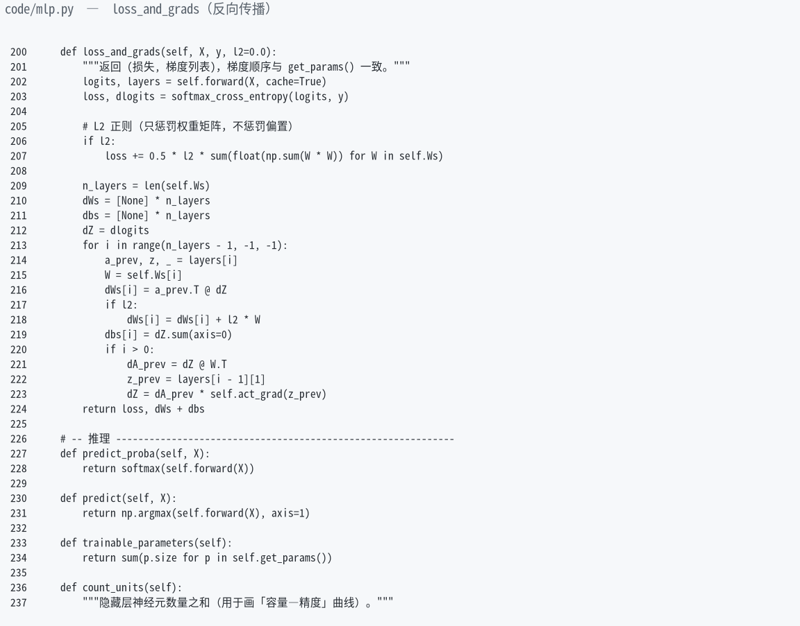

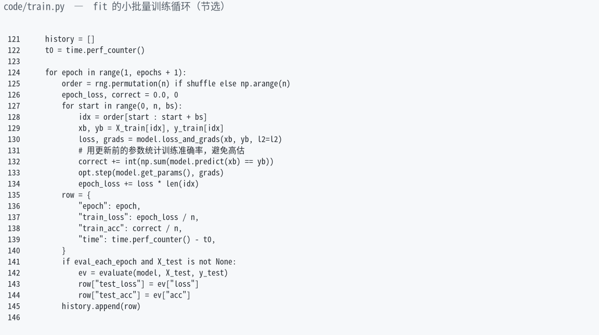

#### 4.2.6 运行结果截图

以下为实验脚本的实际终端输出（`full_experiment.py` 的梯度校验、二维实验、MNIST 全量实验三部分）。

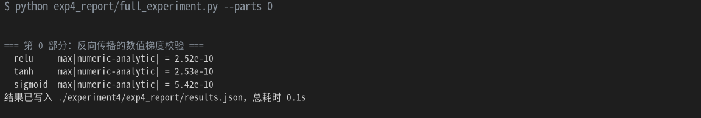

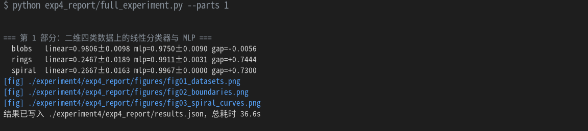

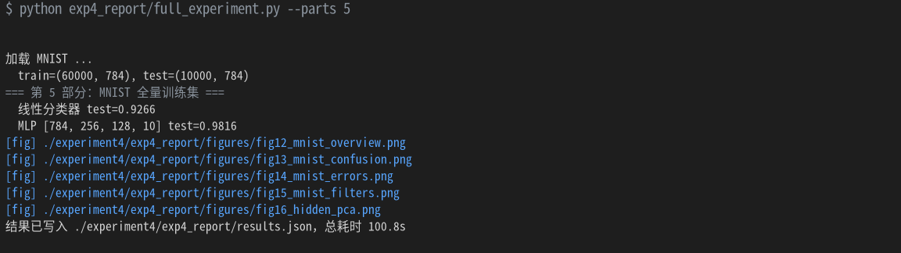

### 4.3 实验一：二维四类数据上的决策边界
#### 4.3.1 数据与设置

三份数据的散点图见图 1。每份数据都按类别分层划分为 70% 训练、30% 测试；三个随机种子分别改变数据生成与划分，因此表中的均值反映了"换一批样本"时的波动。

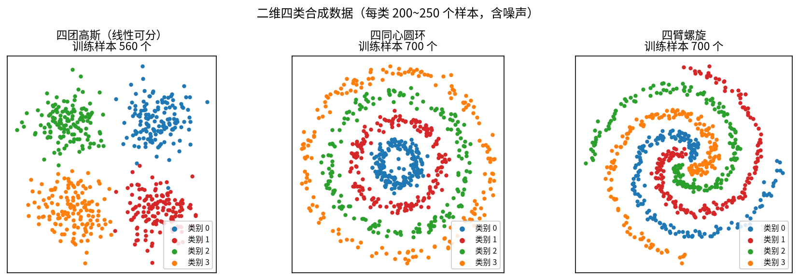

实验设置：线性分类器（2 维输入、4 类，共 12 个参数），Adam，学习率 0.1，批大小 64，1500 个 epoch；MLP 结构 2-32-32-4（ReLU，He 初始化，1284 个参数），Adam，学习率 0.01，批大小 64，600 个 epoch。

#### 4.3.2 结果

| 数据集 | 线性 测试准确率（3 次均值） | MLP 测试准确率（3 次均值） | 差值 (MLP−线性) | 线性 3 次 | MLP 3 次 |
|---|---|---|---|---|---|
| 四团高斯 | 0.981 ± 0.010 | 0.975 ± 0.009 | -0.006 | 0.967 / 0.988 / 0.988 | 0.967 / 0.971 / 0.988 |
| 四同心圆环 | 0.247 ± 0.019 | 0.991 ± 0.003 | +0.744 | 0.273 / 0.233 / 0.233 | 0.987 / 0.993 / 0.993 |
| 四臂螺旋 | 0.267 ± 0.016 | 0.997 ± 0.000 | +0.730 | 0.287 / 0.267 / 0.247 | 0.997 / 0.997 / 0.997 |

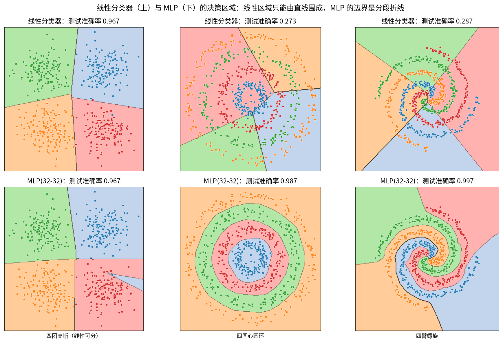

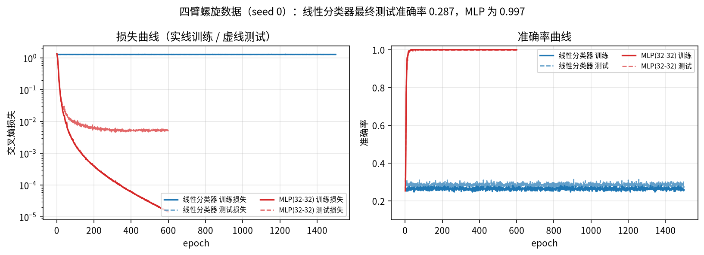

#### 4.3.3 结果分析

**（1）四团高斯：MLP 没有优势。** 线性分类器 0.981，MLP 0.975，后者反而低 0.56 个百分点。这份数据的贝叶斯最优边界就是四条直线（相邻类别中心的垂直平分线），线性模型恰好匹配了数据的真实结构；MLP 需要从数据中学出这些直线，多出来的 1272 个参数没有带来任何信息增益，反而增加了估计方差。从图 2 左下角还能看到，MLP 的边界在红色类别附近出现了一条细长的蓝色楔形区域——这是用大量分段折线去拟合一条简单直线时产生的"多余折角"，它吃掉了少量测试样本。这个对照说明：**模型容量要与任务复杂度匹配，非线性本身不是优点。**

**（2）四同心圆环：线性分类器接近随机猜测。** 线性分类器只有 0.247，四类问题的随机猜测是 25%，也就是说它几乎没有学到任何有效信息；MLP 达到 0.991。从图 2 上排可以看到，线性模型的判定区域是几条直线围成的扇形，每个扇形都同时穿过四个环，因此无论怎么调整角度，每个区域内的类别都是混杂的。这是 4.1.1 节结论的直接体现：**线性模型的每个判定区域必须是凸的，而一个圆环不是凸集。** MLP 的两个隐藏层把 32 条折线组合起来，围出了近似圆形的封闭边界，四个环被依次分开。

**（3）四臂螺旋：差距同样很大。** 线性分类器 0.267，MLP 0.997，相差 73.0 个百分点。螺旋的每条臂都绕原点旋转两圈，任意一个凸区域都无法只包含一条臂；线性模型的边界只能从原点向外辐射，把每条臂都切成几段。MLP 的边界是分段折线，可以沿螺旋方向"拐弯"，因此能够贴合弯曲的类别界面。

图 3 的损失曲线给出了另一个角度的证据。线性分类器的训练损失在 1.30 附近停住，与四类均匀分布时的交叉熵 $\ln 4\approx 1.386$ 非常接近，说明它的输出几乎是均匀分布，模型没有找到多少可用的线性信号。MLP 的损失在 100 个 epoch 内就下降到 $10^{-2}$ 以下，测试损失最终稳定在 $5\times10^{-3}$ 左右；训练损失则继续降到 $10^{-4}$ 以下，两者之间仍有差距，说明模型对训练集有一定程度的过拟合，但由于分类间隔已经足够大，测试准确率仍保持在 99.7%。

**（4）关于参数量。** 线性分类器只有 12 个参数，MLP 有 1284 个，后者约为前者的 107 倍。参数量的增加并没有让 MLP 在所有任务上都更好：它只在边界确实弯曲的任务上换来收益。换句话说，**参数数量本身不是能力，参数与数据结构的匹配才是。**

### 4.4 实验二：不同数据量下的表现
#### 4.4.1 二维螺旋

训练集从 30 个样本逐步增加到 2,100 个，每个规模用 3 次不同的分层抽样重复，测试集固定为 900 个样本。线性分类器训练 1500 轮，MLP 训练 400 轮，均为 Adam、批大小 64。结果见图 4 与下表。

| 训练样本数 | 线性分类器 测试准确率 | MLP(32-32) 测试准确率 | MLP 训练准确率 |
|---|---|---|---|
| 30 | 0.283 ± 0.008 | 0.603 ± 0.013 | 1.000 |
| 60 | 0.276 ± 0.003 | 0.797 ± 0.049 | 1.000 |
| 120 | 0.272 ± 0.004 | 0.923 ± 0.013 | 0.997 |
| 250 | 0.267 ± 0.008 | 0.934 ± 0.015 | 0.991 |
| 500 | 0.273 ± 0.007 | 0.958 ± 0.005 | 0.985 |
| 900 | 0.270 ± 0.002 | 0.966 ± 0.007 | 0.976 |
| 1,500 | 0.274 ± 0.001 | 0.961 ± 0.005 | 0.971 |
| 2,100 | 0.278 ± 0.000 | 0.964 ± 0.002 | 0.970 |

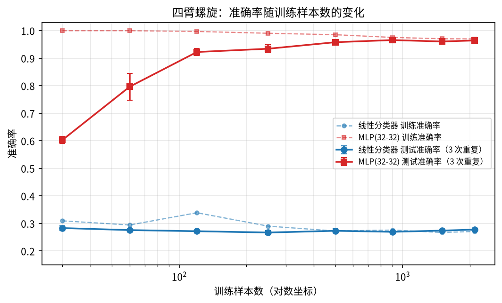

线性分类器的测试准确率在 0.26～0.28 之间几乎是一条水平线，训练准确率也只有 0.3 左右：增加数据不能弥补模型假设的错误，它根本没有能力表示螺旋边界，再多数据也只能把"错误的边界"估得更准。

MLP 则呈现典型的从小样本到大样本的增长：30 个样本时只有 0.603，120 个样本时已经到 0.92 左右，此后增长放缓，最终稳定在 0.964 附近。30～60 个样本时 MLP 的训练准确率接近 1.0，而测试准确率只有 0.60～0.80，是明显的过拟合；随着样本增加，训练与测试的差距收窄。这个过程中真正起作用的不是"更多参数"，而是**更多数据让分段折线的位置估计得更准**。

#### 4.4.2 MNIST

在 MNIST 上从训练集中分层抽取 100 到 60,000 个样本，测试集始终是完整的 10000 张。模型为线性分类器与 784-128-10 的 MLP，均训练 20 个 epoch。结果见图 5 与下表。

| 训练样本数 | 线性分类器 | MLP(128) | 提升（百分点） | 两者训练总耗时 / s |
|---|---|---|---|---|
| 100 | 0.763 | 0.769 | +0.54 | 13.9 |
| 300 | 0.805 | 0.847 | +4.20 | 14.1 |
| 1,000 | 0.855 | 0.892 | +3.70 | 15.5 |
| 3,000 | 0.897 | 0.925 | +2.80 | 14.4 |
| 10,000 | 0.914 | 0.957 | +4.31 | 22.0 |
| 30,000 | 0.923 | 0.974 | +5.12 | 38.4 |
| 60,000 | 0.927 | 0.979 | +5.24 | 60.8 |

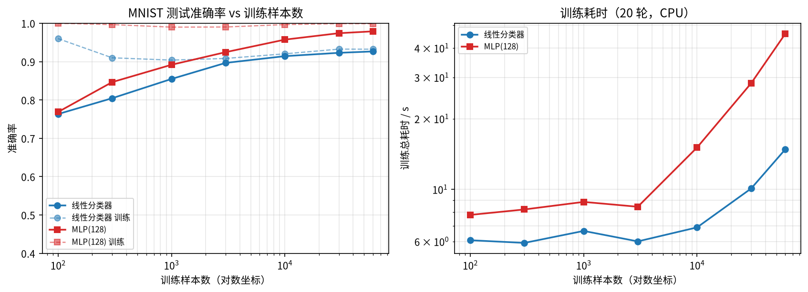

线性分类器从 100 个样本的 76.3% 提升到 60,000 个样本的 92.7%，提升约 16.3 个百分点；MLP 从 76.9% 提升到 97.9%，提升约 21.0 个百分点。两个现象值得注意。

第一，**数据量对 MLP 的边际收益远大于线性模型**。在只有 100 张图时，MLP 和线性模型的差距很小（76.9% 对 76.3%），因为样本太少，MLP 无法可靠地估计非线性边界；到 60000 张时差距扩大到 5.2 个百分点。这说明非线性模型的优势需要数据来"兑现"。

第二，**线性模型在大数据下也没有继续提升**，它在 10000 张以后基本停在 92% 左右。这是模型假设的天花板：MNIST 中大量数字存在笔画变形，真正的类别边界是弯曲的，线性打分无法刻画。

从耗时看，MLP 的训练时间随样本数近似线性增长，60000 张、20 个 epoch、两个隐藏层（约 10 万参数）在 CPU 上只需几十秒，说明纯 NumPy 的实现足以支撑这个规模的实验。

### 4.5 实验三：超参数对结果的影响
本组实验在 MNIST 的 10,000 张训练集、5,000 张测试集上进行，基准配置为：784-128-10、ReLU、He 初始化、Adam、学习率 $10^{-3}$、批大小 128、无 L2、20 个 epoch。每次只改变一个因素，其余保持不变。这样做的代价是无法发现超参数之间的交互作用，但可以在有限的计算预算内得到清晰的单因素趋势。

#### 4.5.1 隐藏层宽度

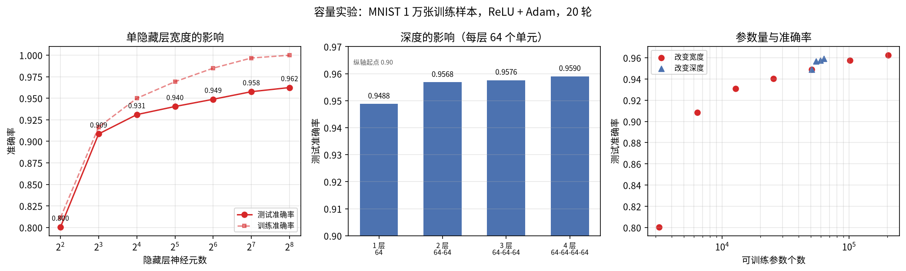

| 隐藏单元数 | 参数量 | 测试准确率 | 训练准确率 | 训练耗时 / s |
|---|---|---|---|---|
| 4 | 3,190 | 0.8004 | 0.8113 | 2.6 |
| 8 | 6,370 | 0.9086 | 0.9165 | 2.9 |
| 16 | 12,730 | 0.9310 | 0.9499 | 3.0 |
| 32 | 25,450 | 0.9404 | 0.9692 | 3.7 |
| 64 | 50,890 | 0.9488 | 0.9849 | 5.5 |
| 128 | 101,770 | 0.9576 | 0.9967 | 8.0 |
| 256 | 203,530 | 0.9624 | 0.9999 | 14.5 |

宽度从 4 增加到 32 时，测试准确率从 0.8004 提升到 0.9404，提升最明显；从 64 往后曲线趋于平缓，最佳宽度是 256 个单元（0.9624）。参数量的增长近似线性（每个隐藏单元带来 784 个输入权重和 10 个输出权重），但准确率并不是线性增长的：少数单元只能表达很少几种折线，无法覆盖 10 个数字的多样性；单元数达到一定规模后，新增单元提供的"新折线"与已有单元高度相关，边际收益就小了。

注意训练准确率：宽网络在小数据上很容易把训练集拟合到接近 100%，而测试准确率提升有限，这就是容量过剩的表现。

#### 4.5.2 深度

| 隐藏层结构 | 参数量 | 测试准确率 | 训练准确率 | 训练耗时 / s |
|---|---|---|---|---|
| 64 | 50,890 | 0.9488 | 0.9849 | 5.3 |
| 64-64 | 55,050 | 0.9568 | 0.9958 | 5.7 |
| 64-64-64 | 59,210 | 0.9576 | 0.9993 | 6.3 |
| 64-64-64-64 | 63,370 | 0.9590 | 1.0000 | 6.1 |

1 个隐藏层（64 个单元）的测试准确率为 0.9488，2 个隐藏层为 0.9568，提升 0.80 个百分点；3 层和 4 层分别为 0.9576、0.9590，仍在上升，但每增加一层只带来约 0.1 个百分点的收益，参数量与训练时间却按层数增加。在本实验的规模（1 万张训练图、每层 64 个单元、20 个 epoch）下，深度不是瓶颈：单隐藏层已经足够宽，额外的层主要是在做细微的边界修正。更深网络的优化难度更高，固定学习率下的收益因此递减；如果配合更长的训练、残差连接或归一化，深度的优势通常会变得更明显。

#### 4.5.3 激活函数

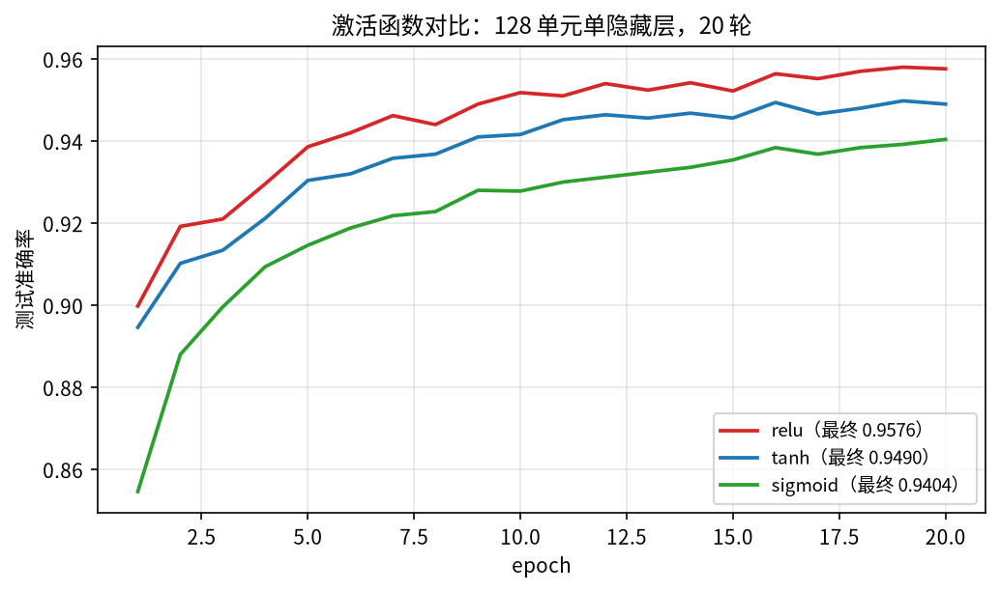

| 激活函数 | 测试准确率 | 训练准确率 | 训练耗时 / s |
|---|---|---|---|
| relu | 0.9576 | 0.9967 | 8.0 |
| tanh | 0.9490 | 0.9922 | 11.7 |
| sigmoid | 0.9404 | 0.9629 | 12.8 |

三种激活函数中表现最好的是 **relu**（0.9576）。ReLU 的导数在正区间恒为 1，不存在饱和，梯度可以稳定地传过多个隐藏层；sigmoid 和 tanh 的两端导数趋近于零，深层堆叠时容易出现梯度消失，收敛明显更慢。对于这个只有 128 个单元的网络，tanh 尚可，sigmoid 最慢。

#### 4.5.4 学习率

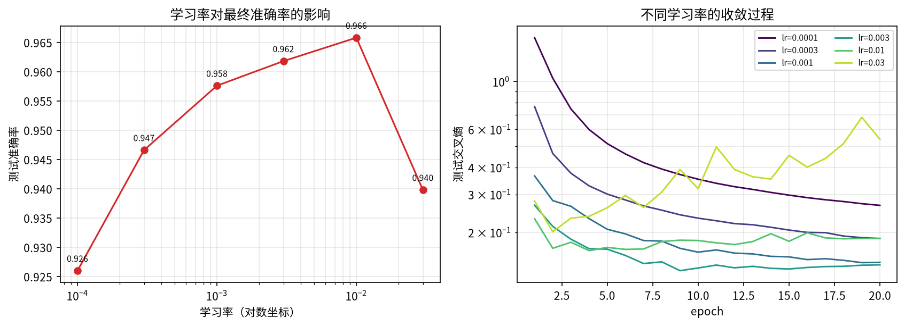

| 学习率 | 测试准确率 | 训练准确率 | 测试交叉熵 |
|---|---|---|---|
| 0.0001 | 0.9260 | 0.9282 | 0.2669 |
| 0.0003 | 0.9466 | 0.9665 | 0.1874 |
| 0.001 | 0.9576 | 0.9967 | 0.1453 |
| 0.003 | 0.9618 | 1.0000 | 0.1415 |
| 0.01 | 0.9658 | 1.0000 | 0.1878 |
| 0.03 | 0.9398 | 0.9738 | 0.5395 |

学习率是本组实验中影响最直接、也最容易踩坑的超参数之一。$10^{-4}$ 时 20 个 epoch 只更新了很少的有效步数，测试准确率只有 0.9260；$3\times10^{-2}$ 时步长过大，损失震荡，测试准确率为 0.9398，测试交叉熵也明显偏高。准确率最高的是 $\eta=0.01$（0.9658），但如果看测试交叉熵，最低的是 $\eta=10^{-3}$（0.1453）。大学习率在 20 轮内把准确率推得更高，却因为步长过大在最优点附近震荡，损失没有降到最低。这说明"准确率最高"和"损失最低"并不总是同一个学习率，调参时要先明确评价指标。图 8 右侧的损失曲线也反映了这一点：小学习率的损失平缓下降，大学习率快速下降后出现抖动。

#### 4.5.5 初始化方式

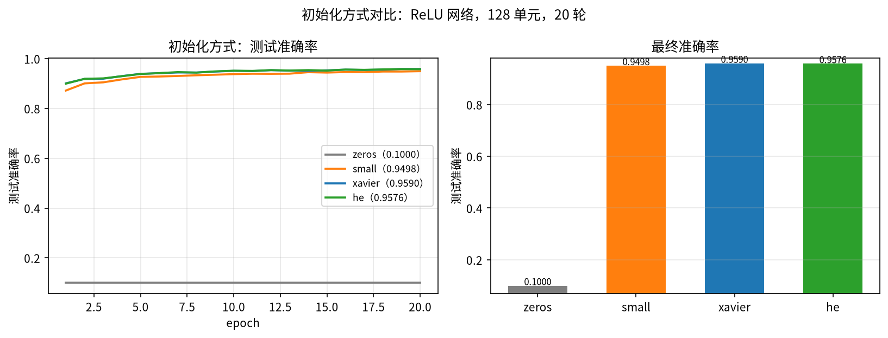

| 初始化 | 测试准确率 | 训练准确率 |
|---|---|---|
| zeros | 0.1000 | 0.0944 |
| small | 0.9498 | 0.9849 |
| xavier | 0.9590 | 0.9968 |
| he | 0.9576 | 0.9967 |

全零初始化（zeros）只有 0.1000，相当于把所有样本都预测成同一类。原因比"退化成线性模型"更彻底：隐藏层权重为零时隐藏层输出恒为零，输出层权重 $W_3$ 的梯度 $H_2^\top\delta$ 为零；反过来 $W_3=0$ 又让隐藏层的梯度为零。整个网络只有输出层的偏置 $b_3$ 能根据类别先验更新，而 MNIST 十类大致均衡，于是它学到的是"永远预测同一类"，准确率约 10%。这个结果说明：**对称性一旦无法打破，网络连线性模型都不如**。小方差初始化（small，标准差 0.01）为 0.9498，能打破对称性，但信号在层间传播时方差逐渐缩小，收敛较慢。Xavier 与 He 分别为 0.9590 和 0.9576，它们根据扇入/扇出调整方差，让各层激活值保持合适的尺度，是本实验中表现最好的两种方式。

#### 4.5.6 批大小

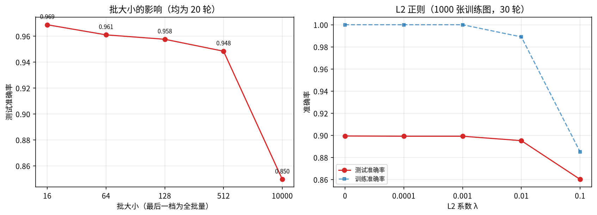

| 批大小 | 测试准确率 | 训练准确率 | 训练耗时 / s |
|---|---|---|---|
| 16 | 0.9688 | 1.0000 | 26.9 |
| 64 | 0.9610 | 0.9997 | 11.5 |
| 128 | 0.9576 | 0.9967 | 8.4 |
| 512 | 0.9484 | 0.9757 | 6.3 |
| 10000 | 0.8496 | 0.8275 | 11.2 |

在**固定 epoch 数**的前提下，批越小测试准确率越高：批大小 16 时为 0.9688，128 时为 0.9576，全批量（10000）时为 0.8496。原因不是"小批量更准"，而是更新次数不同：10000 个样本、批大小 16 时每个 epoch 有 625 次参数更新，批大小 128 时只有 78 次，全批量只有 1 次。全批量在 20 个 epoch 内总共只更新 20 次，显然不够；把轮数增加到 300 后，全批量的测试准确率回升到 0.9484，说明它并不是学不会，只是需要更多迭代。

另一方面，小批量带来的梯度噪声也有正则化效果，通常能获得略好的泛化，但这需要配合更大的 epoch 预算来观察。

#### 4.5.7 L2 正则

小数据实验：从训练集中取出 1,000 张图，训练 30 个 epoch，批大小 64，只改变 $\lambda$：

| L2 系数 λ | 训练准确率 | 测试准确率 | 训练−测试（百分点） |
|---|---|---|---|
| 0 | 1.0000 | 0.8994 | +10.06 |
| 0.0001 | 1.0000 | 0.8992 | +10.08 |
| 0.001 | 1.0000 | 0.8992 | +10.08 |
| 0.01 | 0.9890 | 0.8952 | +9.38 |
| 0.1 | 0.8850 | 0.8602 | +2.48 |

$\lambda=0$ 时训练准确率 100%、测试 0.8994，训练−测试差距 10.06 个百分点，是典型的过拟合。增大 $\lambda$ 后训练准确率下降、差距收窄，但测试准确率并没有随之提高：$\lambda\le 0.01$ 时测试准确率都在 0.899 附近，$\lambda=0.1$ 时反而降到 0.8602（欠拟合）。这说明在这份小数据设置下，L2 的主要作用是缩小泛化差距，而测试准确率的瓶颈在于数据量与模型容量本身，单靠权重衰减无法突破。实际中更有效的做法通常是增加数据、使用 Dropout 或早停，L2 只是正则化工具箱中的一种。

#### 4.5.8 优化器

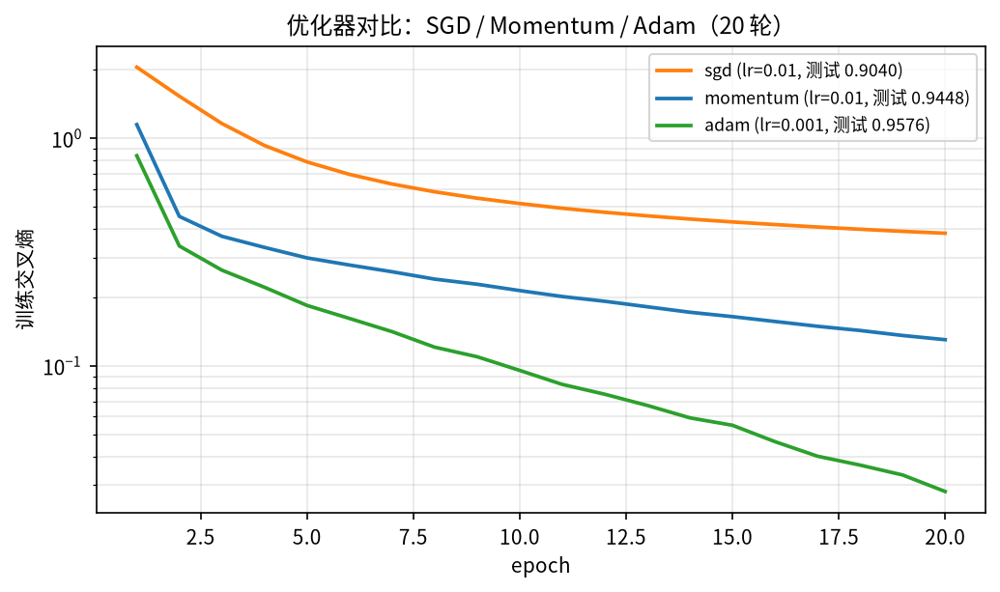

| 优化器 | 学习率 | 测试准确率 | 训练耗时 / s |
|---|---|---|---|
| sgd | 0.01 | 0.9040 | 4.6 |
| momentum | 0.01 | 0.9448 | 5.0 |
| adam | 0.001 | 0.9576 | 6.4 |

在相同的 20 个 epoch 预算下，Adam（0.9576）明显快于 SGD 和 Momentum。SGD 对所有参数使用同一个学习率，在损失曲面不同方向曲率差异很大时收敛慢；Momentum 利用历史梯度平滑方向，略好于 SGD；Adam 为每个参数维护自适应的步长，在训练早期就能快速下降。需要说明的是，这里 SGD 的学习率（$10^{-2}$）已经比 Adam（$10^{-3}$）大，仍然没有追平，说明差距主要来自自适应步长而不是学习率数值。如果训练几百个 epoch 并配合学习率衰减，三者的最终差距会明显缩小。

#### 4.5.9 随机种子

用 3 个不同的初始化种子重复基准配置，测试准确率为 0.9576 / 0.9610 / 0.9598，均值 0.9595，标准差 0.0014。波动远小于上面各因素造成的差异，说明本节的结论不是某一次运行的偶然结果。不过对于差距小于约 0.3 个百分点的两组配置，仍应视为统计上不可区分。

### 4.6 实验四：MNIST 手写数字分类
#### 4.6.1 设置与总体结果

训练集 60000 张、测试集 10000 张，图像为 $28\times28$ 灰度图，拉平成 784 维并缩放到 $[0,1]$。线性分类器为 784 个输入直接连到 10 个输出；MLP 结构为 [784, 256, 128, 10]（两个隐藏层，ReLU，He 初始化）。两者都用 Adam、学习率 $10^{-3}$、批大小 128、训练 20 个 epoch。

| 模型 | 参数量 | 训练准确率 | 测试准确率 | 测试交叉熵 | 训练耗时 / s |
|---|---|---|---|---|---|
| 线性分类器 | 7,850 | 93.25% | 92.66% | 0.2637 | 12.4 |
| MLP 784-256-128-10 | 235,146 | 99.86% | 98.16% | 0.1011 | 84.7 |

MLP 把测试准确率从 92.66% 提升到 98.16%，绝对提升 5.50 个百分点，测试交叉熵从 0.2637 降到 0.1011。参数量从 7,850 增加到 235,146，约为 30.0 倍；训练耗时从 12.4 秒增加到 84.7 秒。

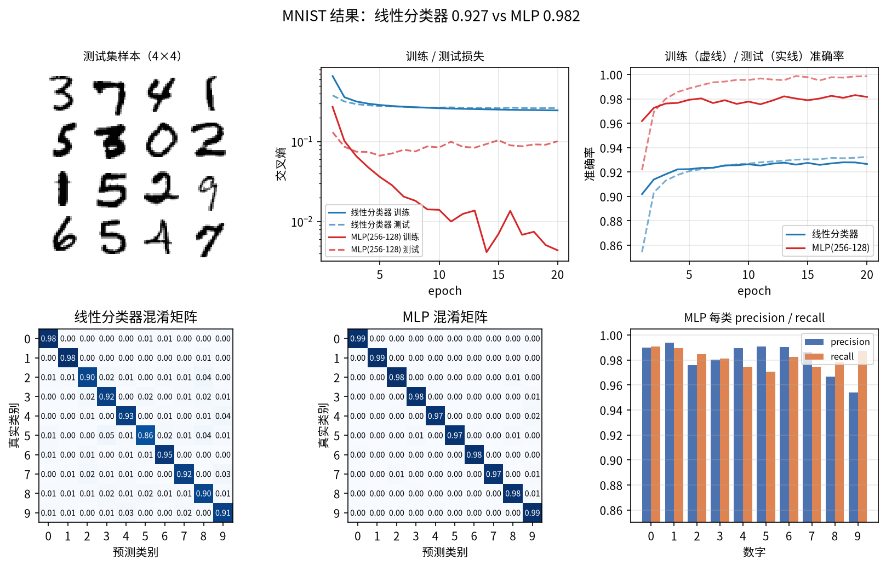

从训练曲线可以看到，MLP 在前 5 个 epoch 就把测试准确率推到 97% 以上，之后缓慢爬升；线性分类器则一直在 92% 附近，而且训练与测试曲线几乎重合——它不是过拟合，而是容量不足导致欠拟合。MLP 的训练准确率最终达到 99.86%、测试为 98.16%，两者相差约 1.7 个百分点，说明它在 6 万张图上仍有轻度过拟合；不过测试准确率随训练缓慢上升，没有出现明显回落。

#### 4.6.2 混淆矩阵与每类指标

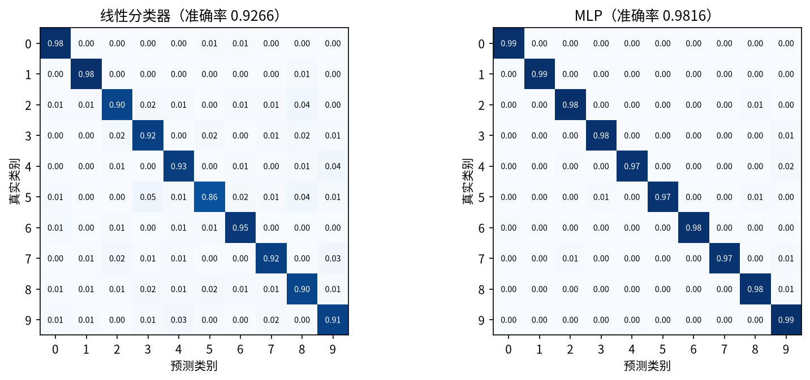

| 数字 | precision | recall | F1 | 测试样本数 |
|---|---|---|---|---|
| 0 | 0.990 | 0.991 | 0.990 | 980 |
| 1 | 0.994 | 0.989 | 0.992 | 1,135 |
| 2 | 0.976 | 0.984 | 0.980 | 1,032 |
| 3 | 0.980 | 0.981 | 0.981 | 1,010 |
| 4 | 0.990 | 0.975 | 0.982 | 982 |
| 5 | 0.991 | 0.971 | 0.981 | 892 |
| 6 | 0.991 | 0.982 | 0.986 | 958 |
| 7 | 0.986 | 0.975 | 0.980 | 1,028 |
| 8 | 0.967 | 0.978 | 0.972 | 974 |
| 9 | 0.954 | 0.987 | 0.970 | 1,009 |

召回率最低的是数字 5（0.971），最高的是数字 0（0.991）。最易混淆的类别对如下：

| 真实 → 预测 | 错误数 | 占该类比例 | 占该预测类比例 |
|---|---|---|---|
| 4 → 9 | 16 | 1.6% | 1.5% |
| 7 → 9 | 11 | 1.1% | 1.1% |
| 7 → 2 | 10 | 1.0% | 1.0% |
| 2 → 8 | 9 | 0.9% | 0.9% |
| 3 → 9 | 9 | 0.9% | 0.9% |
| 5 → 8 | 8 | 0.9% | 0.8% |

混淆集中在形状相近的数字上：4 与 9 都带有一个开口和弯钩，7 与 9 的区别只在于上半部分是否闭合，2 与 8 的差别在于底部横画，8 与 3 在笔画粘连时也很接近。这类错误不是"模型没训好"，而是样本本身在像素层面就存在歧义，人眼也容易看错。

线性分类器的错误则更多：它的每一类只有一个线性打分模板，无法同时容纳同一个数字的多种写法（例如 2 的两种起笔、7 的两种竖钩）。MLP 通过两个隐藏层学到了多个"笔画组合"特征，再在输出层组合，因此对书写变体更鲁棒。

#### 4.6.3 错分样本

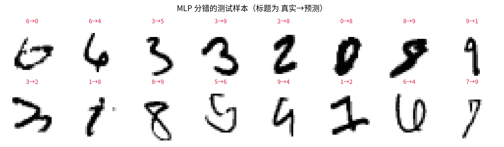

这些错分样本大多本身就难以辨认：笔画粘连、缺笔、写得过小或倾斜，单独拿出来看，人眼也需要停顿一下。需要说明的是，MNIST 的测试错误率并不是全都来自标注噪声（人工错误率通常在 0.2% 上下），本实验约 1.8% 的错误中仍有相当一部分来自模型本身：全连接层把图像拉平，丢弃了二维局部结构，也没有平移不变性；改用卷积结构、数据增强或更长的训练都能继续降低错误率。

#### 4.6.4 第一层权重与隐层表示

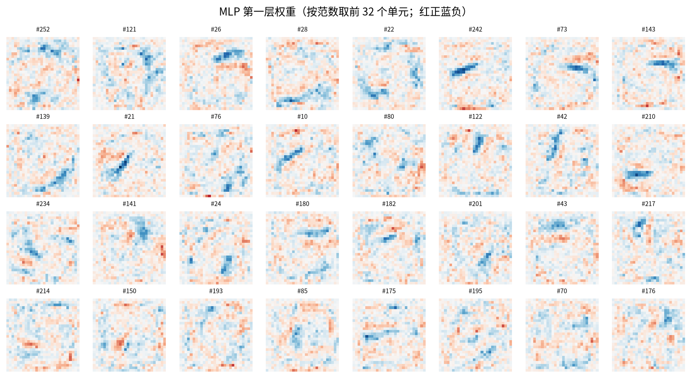

第一层的每个隐藏单元对应一张 $28\times28$ 的模板。图 15 中可以分辨出一些有明确方向的笔画检测器，例如 #242 对水平笔画敏感、#121 与 #10 对斜向笔画敏感，还有一些单元呈现"中心-周边"的对比结构；也有不少单元的模板比较分散，需要与后面的层配合才能解释。这些模板不是人工设计的，而是从数据中通过反向传播学出来的。与卷积网络第一层学到的 Gabor 状滤波器相比，全连接层的模板更"全局"、更嘈杂，这也从侧面说明了为什么卷积结构更适合图像。

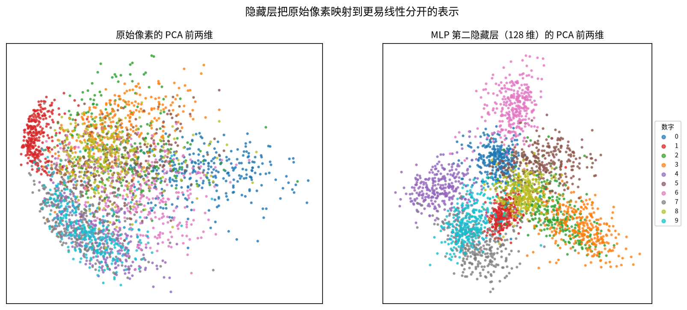

图 16 左侧是原始像素直接做 PCA 的结果，不同数字混在一起；右侧是 MLP 第二隐藏层（128 维）的 PCA 投影，同类样本明显聚成条带或团块，不同类之间的间隔更大。这说明隐藏层的作用可以理解为**学习一个让线性分类更容易的特征变换**：输出层仍然是一个线性分类器，但它作用在学到的表示上，而不是原始像素上。

#### 4.6.5 与线性分类器的对比小结

| 对比项 | 线性分类器 | MLP |
|---|---|---|
| 决策边界 | 超平面，区域为凸集 | 分段折线，可围出非凸区域 |
| 参数量 | 7,850 | 235,146 |
| MNIST 测试准确率 | 92.66% | 98.16% |
| 训练耗时 | 12.4 s | 84.7 s |
| 典型错误 | 无法区分同一数字的多种写法 | 仅混淆形状本身相近的数字 |

两者在 MNIST 上的差距（约 5.5 个百分点）远小于在螺旋数据上的差距（约 73.0 个百分点），原因是 MNIST 的类别在原始像素空间中已经大致线性可分，10 类问题中每一类都有相对独立的"平均模板"。越是需要弯曲边界、越依赖局部组合的任务，MLP 的优势越明显。

### 4.7 扩展实验：更多数据集上的验证
为了检验前面的结论是否只对二维合成数据和 MNIST 成立，又选了 6 个公开数据集，用同一套 MLP（ReLU、He、Adam）和同一个线性分类器重复"线性 vs MLP"的对照。每个数据集只用一个训练/测试划分、一个随机种子，因此小于 1～2 个百分点的差异不应过度解读；各数据集的结构与训练轮数是事先指定的，没有针对测试结果反复调参。

| 数据集 | 训练样本 | 测试样本 | 特征维 | 类别数 | 线性准确率 | MLP 准确率 | gap |
|---|---|---|---|---|---|---|---|
| Fashion-MNIST | 20,000 | 5,000 | 784 | 10 | 0.8294 | 0.8606 | +0.0312 |
| Pendigits | 7,696 | 3,296 | 16 | 10 | 0.9284 | 0.9942 | +0.0658 |
| Optdigits | 3,935 | 1,685 | 64 | 10 | 0.9680 | 0.9810 | +0.0131 |
| Letter | 14,000 | 6,000 | 16 | 26 | 0.7583 | 0.9530 | +0.1947 |
| Iris | 105 | 45 | 4 | 3 | 0.9333 | 0.9556 | +0.0222 |
| WDBC | 398 | 171 | 30 | 2 | 0.9825 | 0.9649 | -0.0175 |

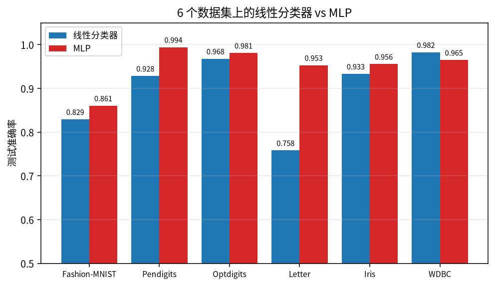


**数据集。** Fashion-MNIST 是 28×28 的服装灰度图，10 类，这里抽取 20000 张训练、5000 张测试、训练 12 轮；Pendigits 是 16 维手写数字笔迹特征，10 类；Optdigits 是 8×8 像素拉平成 64 维，10 类；Letter 是 16 个几何/统计特征，26 个字母类；Iris 是 4 维鸢尾花测量，3 类、150 个样本；WDBC 是 30 维乳腺肿瘤细胞特征，2 类、569 个样本。

**结果。** 差距最大的是 Letter（+19.5 个百分点）：26 个类别、边界高度非线性，线性分类器的凸判定区域远远不够。Pendigits 次之（+6.6），10 类、16 维特征，MLP 达到 99.4%。Fashion-MNIST 上 MLP 比线性高 3.1 个百分点；这里只训练了 12 轮，全量 6 万张、20 轮时 MLP 通常能到 89%～90%。Optdigits 的差距只有 1.3 个百分点，因为 8×8 像素空间里的数字边界本来就接近线性。Iris 上两者相差 2.2 个百分点，但测试集只有 45 个样本，差异在噪声范围内。唯一出现反转的是 WDBC：线性 98.2%，MLP 96.5%，后者低 1.8 个百分点——398 个训练样本、30 维高度相关特征，线性模型已经很强，MLP 更容易过拟合。

**解释。** 这组结果与第 4.3～4.6 节一致：MLP 的优势取决于决策边界的弯曲程度与可用的数据量，而不是参数量。类别多、边界弯（Letter、Pendigits）时非线性收益明显；特征本身接近线性（Optdigits）或样本很少（Iris、WDBC）时，线性模型往往已经够用，甚至更好。需要强调，这些数字来自单次划分、未调参的模型，只能用于趋势判断，不能当作各数据集的性能上限。

**复现。** 脚本为 `learn/practice/extra_datasets.py`，结果写入 `learn/practice/extra_results.json`，运行约 45 秒；Fashion-MNIST 由 `data/download_fashion_mnist.sh` 下载。

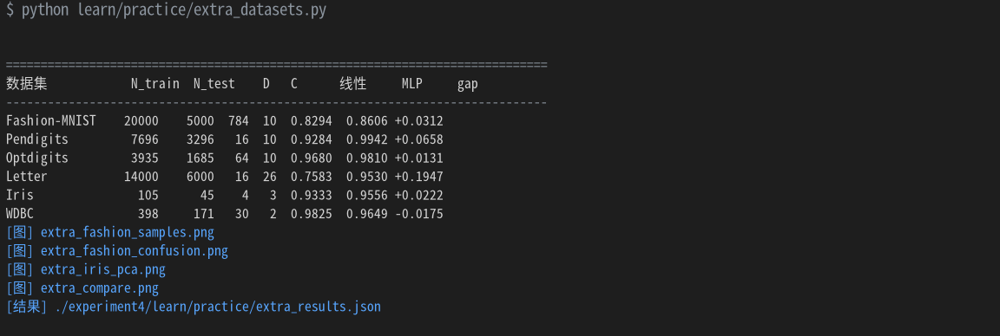

### 4.8 讨论
#### 4.8.1 线性模型与 MLP 的差异到底来自哪里

三组二维实验给出了同一条规律：**差距的大小取决于真实决策边界的"弯曲程度"，而不是模型的参数量**。

- 四团高斯：边界是直线，线性模型与 MLP 打平（0.981 对 0.975）；
- 四同心环：边界是圆，线性模型停在随机水平（0.247），MLP 达到 0.991；
- 四臂螺旋：边界是螺旋线，差距同样很大（0.267 对 0.997）。

从几何上看，线性分类器的每个判定区域是半平面的交，必然是凸集；MLP 的每个 ReLU 单元贡献一条折线，多个单元组合后可以围出非凸的、带孔的区域。圆环和螺旋都需要这样的区域。从表示上看，MLP 的前几层学到的是一组新的特征，最后一层在这些特征上做线性划分；如果新特征让类别变得线性可分，线性输出层就够用了。第 4.6.4 节的 PCA 图给出了这一解释的可视化证据。

另一个容易被忽略的点是：**非线性模型在简单任务上可能更差**。四团高斯上 MLP 反而低了 0.56 个百分点，决策边界上出现了多余的折角。这说明增加容量会引入方差，当真实边界简单时，这部分方差没有对应的偏差下降来抵消。

#### 4.8.2 数据量、容量与正则化

第二组实验说明，MLP 的优势不是无条件的：在螺旋数据上，30 个样本时 MLP 只有 0.603，120 个样本后才到 0.92，最终饱和在 0.964；在 MNIST 上，100 张图时 MLP 与线性模型几乎相同，60000 张时才拉开 5.2 个百分点。容量必须由数据来"喂养"，否则参数只是在记忆训练集。

第三组实验中的 L2 扫描说明了正则化的作用边界。小数据（1,000 张）时，不加强正则的训练准确率是 100%、测试只有 0.8994，差距约 10.1 个百分点；增大 $\lambda$ 后训练准确率下降、差距收窄（$\lambda=0.1$ 时只剩 2.5 个百分点），但测试准确率并没有提高，$\lambda=0.1$ 时反而降到 0.8602。也就是说，L2 抑制了"记忆"，却没有把模型变成更好的分类器——这份数据的瓶颈是样本量，而不是权重幅度。正则化能减少方差，但不能凭空提供信息；真正有效的手段是增加数据或使用更合适的结构。

#### 4.8.3 超参数的敏感度

把第 4.5 节的扫描结果放在一起看，各因素在本实验条件下造成的测试准确率变化范围大致为：

1. **宽度**：4 个单元到 256 个单元，从 0.8004 到 0.9624（约 16.2 个百分点）。容量不足是最"硬"的瓶颈；但超过 64 个单元后边际收益迅速下降。
2. **初始化**：全零 0.1000，最好的正常初始化 0.9590，相差约 85.9 个百分点。全零不是"效果差一点"，而是完全学不动（隐藏层与输出层的权重互相锁死），属于必须避免的实现错误。
3. **批大小**：16 到全批量，从 0.9688 到 0.8496（约 11.9 个百分点）。但这一项与"更新次数"纠缠，不能简单理解为"批越小越好"；全批量训练 300 轮后回到 0.9484。
4. **优化器**：从 0.9040 到 0.9576（约 5.4 个百分点），差距会随训练轮数增加而缩小。
5. **学习率**：从 0.9260 到 0.9658（约 4.0 个百分点），最优点在 $10^{-2}$ 附近。
6. **激活函数**：从 0.9404 到 0.9576（约 1.7 个百分点），ReLU 最好，sigmoid 最慢。
7. **深度**：1 层到 4 层，从 0.9488 到 0.9590（约 1.0 个百分点），收益递减。
8. **L2**：在小数据设置下，$\lambda\le 0.01$ 时测试准确率几乎不变（约 0.899），主要作用是缩小训练-测试差距；$\lambda=0.1$ 时开始欠拟合。
9. **随机种子**：基准配置下标准差 0.0014，远小于以上各项，说明主要结论不是偶然。

需要强调，"敏感度排序"依赖训练预算。例如学习率与优化器的差距会随着训练轮数增加而缩小，宽度与深度的差距会随着数据量增加而变化。这些结论应理解为"在本实验设定的数据规模与计算预算下"的相对重要性。

#### 4.8.4 优化困难与表达能力是两回事

深度实验给出的结果比较温和：1 层到 4 层的测试准确率从 0.9488 升到 0.9590，一共只有 1.0 个百分点，而参数量从 50,890 增加到 63,370。在本实验的规模下，表达能力不是瓶颈，增加深度的收益被优化难度与数据量抵消了。表达能力与可训练性是两件事：一个网络能表示某个函数，不代表梯度下降能在有限的轮数内找到它。要让深度真正发挥作用，通常需要配合更好的初始化、归一化、残差连接和更长的训练；本实验没有实现这些组件，因此不能据此得出"深层网络没用"的结论。

#### 4.8.5 实验的局限

- MNIST 是相对简单、干净的数据集，98% 左右的准确率不能代表 MLP 在真实图像任务上的水平；本实验的目的是对比模型与展示方法，而不是刷榜。
- 受 CPU 时间限制，超参数扫描只做了单因素实验，没有做网格搜索或贝叶斯优化，也没有探索学习率衰减、早停等技巧。
- 所有结论基于单次运行（二维数据除外，用了 3 个种子）；超参数扫描的差异如果小于约 0.3 个百分点，应当视为噪声。
- 未实现卷积、BatchNorm、Dropout、残差连接等现代组件，因此这里的 MLP 是一个"教科书版本"，用于理解原理而非追求最优性能。

### 4.9 复现说明
#### 4.9.1 运行步骤

```bash
# 1. 下载 MNIST（仓库中已附带 data/*.gz，可跳过）
bash data/download_mnist.sh

# 2. 运行全部实验（约 15 分钟，CPU）
cd exp4_report
python full_experiment.py

# 3. 生成报告（Markdown + docx）
python gen_report.py
```

`full_experiment.py` 支持 `--parts 0 1 2 3 4 5` 只运行其中一部分，也支持 `--out` 指定结果文件，便于分片运行后合并。报告中的所有数字均由 `gen_report.py` 从 `results.json` 读取，不手工抄写。

#### 4.9.2 文件清单

| 路径 | 说明 |
|---|---|
| `code/mlp.py` | MLP 前向 / 反向传播、初始化、数值梯度校验 |
| `code/linear.py` | 线性 softmax 分类器 |
| `code/train.py` | SGD / Momentum / Adam、训练循环、评估 |
| `code/datasets.py` | 二维合成数据、MNIST 加载、分层抽样 |
| `code/metrics.py` | 混淆矩阵、每类指标、易混淆类别对 |
| `code/viz.py` | 决策边界、曲线、混淆矩阵、样本网格 |
| `data/*.gz` | MNIST 原始 IDX 文件 |
| `exp4_report/full_experiment.py` | 四组实验的主脚本 |
| `exp4_report/results.json` | 全部指标与曲线数据 |
| `exp4_report/figures/fig01–fig18` | 报告插图 |
| `learn/practice/extra_datasets.py` | 第 4.7 节六个额外数据集的实验脚本 |
| `learn/practice/extra_results.json` | 第 4.7 节的准确率表 |
| `exp4_report/gen_report.py` | 从 JSON 生成本报告 |
| `exp4_report/实验四_多层感知机_实验报告.md` | 本报告 |

#### 4.9.3 复现注意事项

- 所有随机过程都使用显式种子；二维实验的种子为 0/1/2，MNIST 超参数扫描的种子为 0（稳定性实验额外用 1、2）。
- 训练时间与 CPU 型号、BLAS 线程数有关，报告中只用于量级比较，不作为性能结论。
- 若只重跑某一部分，`full_experiment.py --parts N` 会合并写入已有的 `results.json`，不会覆盖其他部分的结果。

## 5. 实验总体结论
1. 用纯 NumPy 实现了一个完整的 MLP 训练系统：前向传播、反向传播、softmax 交叉熵、He / Xavier 初始化、SGD / Momentum / Adam、L2 正则和小批量训练。数值梯度校验显示解析梯度与中心差分在 $10^{-10}$ 量级上一致，证明实现正确。
2. 线性分类器与 MLP 的差异由决策边界的几何形状决定。在线性可分的四团数据上两者相当（0.981 对 0.975）；在圆环与螺旋数据上，线性分类器停留在随机水平（0.247、0.267），MLP 达到 0.991 和 0.997。原因是线性模型的判定区域必须是凸集，无法表示圆环、螺旋这类非凸类别。
3. 数据量对非线性模型至关重要：螺旋数据上 MLP 从 30 个样本的 0.603 提升到 2100 个样本的 0.964；MNIST 上从 100 张的 76.9% 提升到 60000 张的 97.9%，并在此过程中把与线性模型的差距从几乎为零扩大到 5.2 个百分点。
4. 超参数中宽度与初始化的影响最大（全零初始化会让网络完全学不动，只剩约 10% 的准确率），批大小、优化器和学习率次之，深度与激活函数的影响相对温和。宽度与深度都存在明显的边际收益递减；小批量在固定 epoch 下因更新次数更多而收敛更快；L2 能显著缩小训练-测试差距，但在本实验的小数据设置下没有提高测试准确率。
5. MNIST 上 MLP 达到 98.16% 的测试准确率，比线性分类器的 92.66% 高 5.50 个百分点；混淆矩阵、错分样本、第一层权重和隐层 PCA 表明，MLP 学到的是笔画级别的局部特征，而线性模型只能为每个数字学一个全局模板。
6. 通过本次实验，完整走通了"推导公式 → 手写实现 → 数值校验 → 控制变量实验 → 可视化分析"的流程，理解了表达能力、优化难度与泛化能力是三个需要分别对待的问题。

## 6. 完整实验代码

> 以下源码与仓库文件逐字一致，共 1802 行。运行入口是 `exp4_report/full_experiment.py`；报告生成脚本 `gen_report.py`、截图脚本 `make_screenshots.py` 不列入正文。

| 文件 | 行数 | 作用 |
|---|---|---|
| `code/mlp.py` | 282 | MLP 前向传播、反向传播、初始化、数值梯度校验 |
| `code/linear.py` | 94 | 线性 softmax 分类器 |
| `code/train.py` | 147 | SGD / Momentum / Adam 与训练循环 |
| `code/datasets.py` | 159 | 二维合成数据、MNIST 加载、分层抽样 |
| `code/metrics.py` | 64 | 混淆矩阵、每类指标、易混淆类别对 |
| `code/viz.py` | 134 | 决策边界、曲线、混淆矩阵等绘图 |
| `exp4_report/full_experiment.py` | 922 | 四组实验的主脚本 |

### 6.1 `code/mlp.py`

MLP 前向传播、反向传播、初始化、数值梯度校验。

```python
"""多层感知机（MLP）的 NumPy 实现。

本文件手写前向传播与反向传播，不使用 PyTorch / TensorFlow / JAX 等任何
自动微分框架，也不依赖 scikit-learn 的模型实现。所有梯度均由链式法则
逐层显式推出并写成矩阵乘法（见报告第 4 节）。

记号约定
--------
- 第 l 层（l = 1..L-1，0 号为输入层）：
      Z_l = A_{l-1} W_l + b_l ,    A_l = f(Z_l)
  其中 W_l 形状 (n_{l-1}, n_l)，b_l 形状 (n_l,)。
- 输出层不加激活函数，直接输出 logits，配合 softmax + 交叉熵。
- 损失（含 L2 正则，偏置不参与正则）：
      L = -1/N * sum_n log softmax(z_n)[y_n] + lambda/2 * sum_l ||W_l||_F^2
"""

from __future__ import annotations

import numpy as np

# ---------------------------------------------------------------------------
# 激活函数：每个都返回 (f, f')，且 f' 只依赖 z
# ---------------------------------------------------------------------------


def relu(z: np.ndarray) -> np.ndarray:
    return np.maximum(z, 0.0)


def relu_grad(z: np.ndarray) -> np.ndarray:
    return (z > 0).astype(z.dtype)


def sigmoid(z: np.ndarray) -> np.ndarray:
    """数值稳定写法：正负分两段，避免 exp 溢出。"""
    out = np.empty_like(z, dtype=z.dtype)
    pos = z >= 0
    out[pos] = 1.0 / (1.0 + np.exp(-z[pos]))
    ez = np.exp(z[~pos])
    out[~pos] = ez / (1.0 + ez)
    return out


def sigmoid_grad(z: np.ndarray) -> np.ndarray:
    s = sigmoid(z)
    return s * (1.0 - s)


def tanh(z: np.ndarray) -> np.ndarray:
    return np.tanh(z)


def tanh_grad(z: np.ndarray) -> np.ndarray:
    t = np.tanh(z)
    return 1.0 - t * t


def identity(z: np.ndarray) -> np.ndarray:
    return z


def identity_grad(z: np.ndarray) -> np.ndarray:
    return np.ones_like(z)


ACTIVATIONS = {
    "relu": (relu, relu_grad),
    "sigmoid": (sigmoid, sigmoid_grad),
    "tanh": (tanh, tanh_grad),
    "linear": (identity, identity_grad),
}


# ---------------------------------------------------------------------------
# softmax 与交叉熵
# ---------------------------------------------------------------------------


def softmax(logits: np.ndarray) -> np.ndarray:
    """按行做 softmax，减去行最大值保证数值稳定（不改变结果）。"""
    z = logits - logits.max(axis=1, keepdims=True)
    e = np.exp(z)
    return e / e.sum(axis=1, keepdims=True)


def softmax_cross_entropy(logits: np.ndarray, y: np.ndarray):
    """返回 (平均交叉熵, 对 logits 的梯度 (N, C))。

    用 logsumexp 计算损失，避免 log(0)；对 logits 的梯度就是
    (softmax(z) - onehot(y)) / N，这一步是整条反向链的起点。
    """
    n = logits.shape[0]
    m = logits.max(axis=1, keepdims=True)
    shifted = logits - m
    logsumexp = np.log(np.exp(shifted).sum(axis=1, keepdims=True)) + m
    loss = np.mean(logsumexp - logits[np.arange(n), y])

    probs = softmax(logits)
    dlogits = probs.copy()
    dlogits[np.arange(n), y] -= 1.0
    dlogits /= n
    return float(loss), dlogits


# ---------------------------------------------------------------------------
# 参数初始化
# ---------------------------------------------------------------------------


class MLP:
    """全连接多层感知机（多分类）。

    Parameters
    ----------
    layer_sizes : list[int]
        例如 [784, 256, 128, 10]：输入 784 维，两个隐藏层，10 类输出。
    activation : str
        隐藏层激活函数，取 "relu" / "tanh" / "sigmoid" / "linear"。
    init : str
        权重初始化方式：
        - "he"     : N(0, 2/fan_in)，适合 ReLU；
        - "xavier" : N(0, 2/(fan_in+fan_out))，适合 tanh/sigmoid；
        - "small"  : N(0, 0.01^2)；
        - "zeros"  : 全零（用来演示对称性无法打破）；
        - "auto"   : ReLU 用 he，其余用 xavier。
    seed : int
        初始化随机种子。
    """

    def __init__(self, layer_sizes, activation="relu", init="auto", seed=0):
        if len(layer_sizes) < 2:
            raise ValueError("layer_sizes 至少要有输入维和输出维")
        if activation not in ACTIVATIONS:
            raise ValueError(f"未知激活函数: {activation}")
        self.layer_sizes = list(layer_sizes)
        self.activation = activation
        self.act, self.act_grad = ACTIVATIONS[activation]
        self.init = init
        self.seed = seed
        self.rng = np.random.default_rng(seed)

        self.Ws, self.bs = [], []
        for fan_in, fan_out in zip(self.layer_sizes[:-1], self.layer_sizes[1:]):
            self.Ws.append(self._init_weight(fan_in, fan_out))
            self.bs.append(np.zeros(fan_out, dtype=np.float64))
        # 供可视化使用的训练步数计数
        self.step_count = 0

    def _init_weight(self, fan_in, fan_out):
        mode = self.init
        if mode == "auto":
            mode = "he" if self.activation == "relu" else "xavier"
        if mode == "he":
            std = np.sqrt(2.0 / fan_in)
        elif mode == "xavier":
            std = np.sqrt(2.0 / (fan_in + fan_out))
        elif mode == "small":
            std = 0.01
        elif mode == "zeros":
            return np.zeros((fan_in, fan_out), dtype=np.float64)
        else:
            raise ValueError(f"未知初始化方式: {mode}")
        return self.rng.normal(0.0, std, size=(fan_in, fan_out))

    # -- 参数扁平化，便于优化器统一处理 -----------------------------------
    @property
    def param_names(self):
        # 顺序必须与 get_params() 一致：先所有 W，再所有 b
        names = [f"W{i + 1}" for i in range(len(self.Ws))]
        names += [f"b{i + 1}" for i in range(len(self.bs))]
        return names

    def get_params(self):
        return self.Ws + self.bs

    def set_params(self, params):
        n = len(self.Ws)
        self.Ws = list(params[:n])
        self.bs = list(params[n:])

    # -- 前向传播 ---------------------------------------------------------
    def forward(self, X, cache=False):
        """返回 logits；cache=True 时同时返回反向传播所需的中间量。"""
        a = X
        layers = []
        n_layers = len(self.Ws)
        for i, (W, b) in enumerate(zip(self.Ws, self.bs)):
            z = a @ W + b
            if i < n_layers - 1:
                a_next = self.act(z)
            else:
                a_next = z  # 输出层：线性 logits
            if cache:
                layers.append((a, z, a_next))
            a = a_next
        if cache:
            return a, layers
        return a

    def loss_and_grads(self, X, y, l2=0.0):
        """返回 (损失, 梯度列表)，梯度顺序与 get_params() 一致。"""
        logits, layers = self.forward(X, cache=True)
        loss, dlogits = softmax_cross_entropy(logits, y)

        # L2 正则（只惩罚权重矩阵，不惩罚偏置）
        if l2:
            loss += 0.5 * l2 * sum(float(np.sum(W * W)) for W in self.Ws)

        n_layers = len(self.Ws)
        dWs = [None] * n_layers
        dbs = [None] * n_layers
        dZ = dlogits
        for i in range(n_layers - 1, -1, -1):
            a_prev, z, _ = layers[i]
            W = self.Ws[i]
            dWs[i] = a_prev.T @ dZ
            if l2:
                dWs[i] = dWs[i] + l2 * W
            dbs[i] = dZ.sum(axis=0)
            if i > 0:
                dA_prev = dZ @ W.T
                z_prev = layers[i - 1][1]
                dZ = dA_prev * self.act_grad(z_prev)
        return loss, dWs + dbs

    # -- 推理 -------------------------------------------------------------
    def predict_proba(self, X):
        return softmax(self.forward(X))

    def predict(self, X):
        return np.argmax(self.forward(X), axis=1)

    def trainable_parameters(self):
        return sum(p.size for p in self.get_params())

    def count_units(self):
        """隐藏层神经元数量之和（用于画「容量—精度」曲线）。"""
        return sum(self.layer_sizes[1:-1])


# ---------------------------------------------------------------------------
# 数值梯度校验
# ---------------------------------------------------------------------------


def numeric_gradient_check(model, X, y, l2=0.0, eps=1e-6):
    """中心差分逐元素检验解析梯度。

    Returns
    -------
    rows : list[dict]
        每个参数张量一行：名称、最大绝对误差、相对误差、是否通过。
    """
    _, grads = model.loss_and_grads(X, y, l2)
    params = model.get_params()
    rows = []
    for idx, (name, P) in enumerate(zip(model.param_names, params)):
        G = grads[idx]
        num = np.zeros_like(P)
        it = np.nditer(P, flags=["multi_index"])
        for _ in it:
            k = it.multi_index
            old = P[k]
            P[k] = old + eps
            lp, _ = model.loss_and_grads(X, y, l2)
            P[k] = old - eps
            lm, _ = model.loss_and_grads(X, y, l2)
            P[k] = old
            num[k] = (lp - lm) / (2.0 * eps)
        abs_err = float(np.max(np.abs(num - G)))
        denom = max(float(np.max(np.abs(num) + np.abs(G))), 1e-12)
        rel_err = abs_err / denom
        rows.append(
            {
                "param": name,
                "shape": list(P.shape),
                "max_abs_err": abs_err,
                "rel_err": rel_err,
                "passed": abs_err < 1e-6,
            }
        )
    return rows
```

### 6.2 `code/linear.py`

线性 softmax 分类器。

```python
"""线性分类器：多项逻辑回归（softmax 回归），独立手写。

这是本实验的对照模型。它只有一个线性打分函数

    logits = X W + b ,      P(y=c|x) = softmax(logits)_c

决策边界是超平面；把 2 维输入映射到平面上，每一类的判定区域是若干半平面
的交，因此必然是**凸的、由直线围成**的区域。MLP 通过隐藏层把输入先映射到
一个新空间，相当于先学出一组非线性特征，再做线性划分，这是它能处理
环形、螺旋形等线性不可分数据的原因。
"""

from __future__ import annotations

import numpy as np


def softmax(logits: np.ndarray) -> np.ndarray:
    z = logits - logits.max(axis=1, keepdims=True)
    e = np.exp(z)
    return e / e.sum(axis=1, keepdims=True)


class SoftmaxClassifier:
    """多项逻辑回归，用 (小批量) 梯度下降训练，支持 L2 正则。

    与 MLP 使用相同的优化器和训练循环，保证两者唯一的差别是模型本身，
    而不是训练技巧。
    """

    def __init__(self, n_features, n_classes, seed=0, init="zeros"):
        self.n_features = n_features
        self.n_classes = n_classes
        rng = np.random.default_rng(seed)
        if init == "zeros":
            self.W = np.zeros((n_features, n_classes))
        elif init == "small":
            self.W = rng.normal(0.0, 0.01, size=(n_features, n_classes))
        else:
            raise ValueError(init)
        self.b = np.zeros(n_classes)

    # 与 MLP 保持同样的参数接口，方便复用同一套优化器与训练循环
    @property
    def param_names(self):
        return ["W1", "b1"]

    def get_params(self):
        return [self.W, self.b]

    def set_params(self, params):
        self.W, self.b = params[0], params[1]

    def forward(self, X, cache=False):
        logits = X @ self.W + self.b
        if cache:
            return logits, X
        return logits

    def loss_and_grads(self, X, y, l2=0.0):
        logits = X @ self.W + self.b
        n = X.shape[0]
        m = logits.max(axis=1, keepdims=True)
        shifted = logits - m
        logsumexp = np.log(np.exp(shifted).sum(axis=1, keepdims=True)) + m
        loss = float(np.mean(logsumexp - logits[np.arange(n), y]))
        if l2:
            loss += 0.5 * l2 * float(np.sum(self.W * self.W))

        probs = softmax(logits)
        dlogits = probs.copy()
        dlogits[np.arange(n), y] -= 1.0
        dlogits /= n
        dW = X.T @ dlogits
        if l2:
            dW = dW + l2 * self.W
        db = dlogits.sum(axis=0)
        return loss, [dW, db]

    def predict_proba(self, X):
        return softmax(X @ self.W + self.b)

    def predict(self, X):
        return np.argmax(X @ self.W + self.b, axis=1)

    def trainable_parameters(self):
        return self.W.size + self.b.size

    def count_units(self):
        return 0

    def decision_scores(self, X):
        """每个类别的线性打分，用于画平行等值线。"""
        return X @ self.W + self.b
```

### 6.3 `code/train.py`

SGD / Momentum / Adam 与训练循环。

```python
"""优化器与训练循环（不依赖 torch.optim，全部手写）。

支持的优化器：
- SGD：p <- p - lr * g
- Momentum：v <- mu*v - lr*g ; p <- p + v
- Adam：一阶/二阶矩估计 + 偏差修正
"""

from __future__ import annotations

import time

import numpy as np


class SGD:
    def __init__(self, lr=0.1):
        self.lr = lr

    def step(self, params, grads):
        for p, g in zip(params, grads):
            p -= self.lr * g

    def state_dict(self):
        return {}


class Momentum:
    def __init__(self, lr=0.01, momentum=0.9):
        self.lr = lr
        self.momentum = momentum
        self.velocity = None

    def step(self, params, grads):
        if self.velocity is None:
            self.velocity = [np.zeros_like(p) for p in params]
        for p, g, v in zip(params, grads, self.velocity):
            v *= self.momentum
            v -= self.lr * g
            p += v

    def state_dict(self):
        return {"momentum": self.momentum}


class Adam:
    def __init__(self, lr=1e-3, beta1=0.9, beta2=0.999, eps=1e-8):
        self.lr = lr
        self.beta1 = beta1
        self.beta2 = beta2
        self.eps = eps
        self.m = None
        self.v = None
        self.t = 0

    def step(self, params, grads):
        if self.m is None:
            self.m = [np.zeros_like(p) for p in params]
            self.v = [np.zeros_like(p) for p in params]
        self.t += 1
        b1, b2 = self.beta1, self.beta2
        for p, g, m, v in zip(params, grads, self.m, self.v):
            m *= b1
            m += (1.0 - b1) * g
            v *= b2
            v += (1.0 - b2) * (g * g)
            m_hat = m / (1.0 - b1 ** self.t)
            v_hat = v / (1.0 - b2 ** self.t)
            p -= self.lr * m_hat / (np.sqrt(v_hat) + self.eps)

    def state_dict(self):
        return {"beta1": self.beta1, "beta2": self.beta2}


def make_optimizer(name, lr):
    name = name.lower()
    if name == "sgd":
        return SGD(lr)
    if name == "momentum":
        return Momentum(lr, momentum=0.9)
    if name == "adam":
        return Adam(lr)
    raise ValueError(f"未知优化器: {name}")


def accuracy(model, X, y):
    if len(y) == 0:
        return float("nan")
    return float(np.mean(model.predict(X) == y))


def evaluate(model, X, y):
    loss, _ = model.loss_and_grads(X, y, l2=0.0)
    return {"loss": loss, "acc": accuracy(model, X, y)}


def fit(
    model,
    X_train,
    y_train,
    X_test=None,
    y_test=None,
    epochs=20,
    batch_size=64,
    lr=1e-3,
    l2=0.0,
    optimizer="adam",
    seed=0,
    shuffle=True,
    eval_each_epoch=True,
):
    """小批量训练。

    batch_size >= 训练集大小 时退化为全批量梯度下降。
    返回 history: 每个 epoch 一行，记录损失、准确率与耗时。
    """
    rng = np.random.default_rng(seed)
    opt = make_optimizer(optimizer, lr)
    n = X_train.shape[0]
    bs = min(int(batch_size), n)
    history = []
    t0 = time.perf_counter()

    for epoch in range(1, epochs + 1):
        order = rng.permutation(n) if shuffle else np.arange(n)
        epoch_loss, correct = 0.0, 0
        for start in range(0, n, bs):
            idx = order[start : start + bs]
            xb, yb = X_train[idx], y_train[idx]
            loss, grads = model.loss_and_grads(xb, yb, l2=l2)
            # 用更新前的参数统计训练准确率，避免高估
            correct += int(np.sum(model.predict(xb) == yb))
            opt.step(model.get_params(), grads)
            epoch_loss += loss * len(idx)
        row = {
            "epoch": epoch,
            "train_loss": epoch_loss / n,
            "train_acc": correct / n,
            "time": time.perf_counter() - t0,
        }
        if eval_each_epoch and X_test is not None:
            ev = evaluate(model, X_test, y_test)
            row["test_loss"] = ev["loss"]
            row["test_acc"] = ev["acc"]
        history.append(row)

    return history
```

### 6.4 `code/datasets.py`

二维合成数据、MNIST 加载、分层抽样。

```python
"""数据生成与加载。

包含三类人工构造的二维四类数据（用于观察决策边界），以及 MNIST 手写数字
数据集的 IDX 文件解析。
"""

from __future__ import annotations

import gzip
import struct
from pathlib import Path

import numpy as np

# ---------------------------------------------------------------------------
# 二维合成数据
# ---------------------------------------------------------------------------


def make_blobs(n_per_class=200, spread=1.0, seed=0):
    """4 个高斯团，分别位于四个象限的对角方向。

    类别之间可以被直线分开，是线性分类器的「友好」场景，用作对照。
    """
    rng = np.random.default_rng(seed)
    centers = np.array([[2.5, 2.5], [2.5, -2.5], [-2.5, 2.5], [-2.5, -2.5]])
    X, y = [], []
    for c, mu in enumerate(centers):
        X.append(rng.normal(mu, spread, size=(n_per_class, 2)))
        y.append(np.full(n_per_class, c))
    return np.vstack(X), np.concatenate(y)


def make_rings(n_per_class=250, radii=(1.0, 2.2, 3.4, 4.6), width=0.2, seed=0):
    """4 个同心圆环，一个类别占一个半径区间。

    类与类之间的边界是圆，任何直线都无法把某一环完整地与其他环分开，
    因此线性分类器最多只能做「内 / 外」的粗分。
    """
    rng = np.random.default_rng(seed)
    X, y = [], []
    for c, r in enumerate(radii):
        theta = rng.uniform(0.0, 2.0 * np.pi, size=n_per_class)
        rad = rng.normal(r, width, size=n_per_class)
        X.append(np.column_stack([rad * np.cos(theta), rad * np.sin(theta)]))
        y.append(np.full(n_per_class, c))
    return np.vstack(X), np.concatenate(y)


def make_spiral(n_per_class=250, n_classes=4, turns=2.0, noise=0.03, seed=0):
    """多臂螺旋：每条臂是一个类别，不同臂在空间中交错缠绕。

    类与类之间的界面是弯曲的螺旋面，线性分类器只能切成扇形，MLP 则能
    用分段线性的折线去逼近弯曲线。这是本实验中最能体现非线性能力的场景。
    """
    rng = np.random.default_rng(seed)
    X, y = [], []
    for c in range(n_classes):
        t = np.linspace(0.08, 1.0, n_per_class)
        r = t
        theta = 2.0 * np.pi * c / n_classes + turns * np.pi * t
        pts = np.column_stack([r * np.cos(theta), r * np.sin(theta)])
        pts += rng.normal(0.0, noise, size=pts.shape)
        X.append(pts)
        y.append(np.full(n_per_class, c))
    return np.vstack(X), np.concatenate(y)


def train_test_split(X, y, test_frac=0.3, seed=0, shuffle=True):
    """分层留出法：每类按相同比例分到训练集与测试集。"""
    rng = np.random.default_rng(seed)
    classes = np.unique(y)
    train_idx, test_idx = [], []
    for c in classes:
        idx = np.flatnonzero(y == c)
        if shuffle:
            idx = rng.permutation(idx)
        n_test = int(round(len(idx) * test_frac))
        test_idx.append(idx[:n_test])
        train_idx.append(idx[n_test:])
    train_idx = np.concatenate(train_idx)
    test_idx = np.concatenate(test_idx)
    if shuffle:
        train_idx = rng.permutation(train_idx)
        test_idx = rng.permutation(test_idx)
    return X[train_idx], y[train_idx], X[test_idx], y[test_idx]


DATASETS_2D = {
    "blobs": make_blobs,
    "rings": make_rings,
    "spiral": make_spiral,
}

DATASET_TITLES = {
    "blobs": "四团高斯（线性可分）",
    "rings": "四同心圆环",
    "spiral": "四臂螺旋",
}


# ---------------------------------------------------------------------------
# MNIST
# ---------------------------------------------------------------------------


def _read_idx_images(path):
    with gzip.open(path, "rb") as f:
        magic, n, rows, cols = struct.unpack(">IIII", f.read(16))
        if magic != 2051:
            raise ValueError(f"{path} 不是 IDX 图像文件 (magic={magic})")
        buf = f.read(n * rows * cols)
    arr = np.frombuffer(buf, dtype=np.uint8).reshape(n, rows * cols)
    return arr.astype(np.float64) / 255.0


def _read_idx_labels(path):
    with gzip.open(path, "rb") as f:
        magic, n = struct.unpack(">II", f.read(8))
        if magic != 2049:
            raise ValueError(f"{path} 不是 IDX 标签文件 (magic={magic})")
        buf = f.read(n)
    return np.frombuffer(buf, dtype=np.uint8).astype(np.int64)


def load_mnist(data_dir):
    """返回 (X_train, y_train, X_test, y_test)，像素已缩放至 [0, 1]。"""
    d = Path(data_dir)
    files = {
        "train_images": "train-images-idx3-ubyte.gz",
        "train_labels": "train-labels-idx1-ubyte.gz",
        "test_images": "t10k-images-idx3-ubyte.gz",
        "test_labels": "t10k-labels-idx1-ubyte.gz",
    }
    missing = [f for f in files.values() if not (d / f).exists()]
    if missing:
        raise FileNotFoundError(f"缺少 MNIST 文件: {missing}，请先运行 data/download_mnist.sh")
    X_train = _read_idx_images(d / files["train_images"])
    y_train = _read_idx_labels(d / files["train_labels"])
    X_test = _read_idx_images(d / files["test_images"])
    y_test = _read_idx_labels(d / files["test_labels"])
    return X_train, y_train, X_test, y_test


def stratified_subsample(X, y, n, seed=0):
    """按类别等比例抽取 n 个样本，保证小样本下类别仍然均衡。"""
    if n >= len(y):
        return X, y
    rng = np.random.default_rng(seed)
    classes = np.unique(y)
    per_class = n // len(classes)
    idx = []
    for c in classes:
        ci = np.flatnonzero(y == c)
        take = min(per_class, len(ci))
        idx.append(rng.choice(ci, size=take, replace=False))
    idx = np.concatenate(idx)
    rng.shuffle(idx)
    return X[idx], y[idx]
```

### 6.5 `code/metrics.py`

混淆矩阵、每类指标、易混淆类别对。

```python
"""分类评价指标：准确率、混淆矩阵、每类 P/R/F1、最易混淆类别对。"""

from __future__ import annotations

import numpy as np


def accuracy(y_true, y_pred):
    return float(np.mean(np.asarray(y_true) == np.asarray(y_pred)))


def confusion_matrix(y_true, y_pred, n_classes):
    cm = np.zeros((n_classes, n_classes), dtype=np.int64)
    np.add.at(cm, (np.asarray(y_true), np.asarray(y_pred)), 1)
    return cm


def per_class_report(y_true, y_pred, n_classes, class_names=None):
    """返回每类的 precision / recall / f1 / support。"""
    cm = confusion_matrix(y_true, y_pred, n_classes)
    tp = np.diag(cm).astype(float)
    support = cm.sum(axis=1).astype(float)
    predicted = cm.sum(axis=0).astype(float)
    precision = np.divide(tp, predicted, out=np.zeros_like(tp), where=predicted > 0)
    recall = np.divide(tp, support, out=np.zeros_like(tp), where=support > 0)
    f1 = np.divide(
        2 * precision * recall,
        precision + recall,
        out=np.zeros_like(tp),
        where=(precision + recall) > 0,
    )
    rows = []
    for c in range(n_classes):
        rows.append(
            {
                "class": int(c),
                "name": class_names[c] if class_names else str(c),
                "precision": float(precision[c]),
                "recall": float(recall[c]),
                "f1": float(f1[c]),
                "support": int(support[c]),
            }
        )
    return rows


def top_confusions(y_true, y_pred, n_classes, k=8):
    """按「真实类 -> 预测类」的错误数量排序，返回 top-k 混淆对。"""
    cm = confusion_matrix(y_true, y_pred, n_classes)
    pairs = []
    for i in range(n_classes):
        for j in range(n_classes):
            if i != j and cm[i, j] > 0:
                pairs.append(
                    {
                        "true": int(i),
                        "pred": int(j),
                        "count": int(cm[i, j]),
                        "rate_of_class": float(cm[i, j] / max(cm[i].sum(), 1)),
                        "rate_of_pred": float(cm[i, j] / max(cm[:, j].sum(), 1)),
                    }
                )
    pairs.sort(key=lambda d: -d["count"])
    return pairs[:k]
```

### 6.6 `code/viz.py`

决策边界、曲线、混淆矩阵等绘图。

```python
"""可视化工具：决策边界、训练曲线、混淆矩阵、MNIST 样本网格。"""

from __future__ import annotations

from pathlib import Path

import matplotlib

matplotlib.use("Agg")
import matplotlib.pyplot as plt
import numpy as np
from matplotlib.colors import ListedColormap

plt.rcParams["font.sans-serif"] = [
    "Noto Sans CJK SC",
    "WenQuanYi Micro Hei",
    "AR PL UMing CN",
    "DejaVu Sans",
]
plt.rcParams["axes.unicode_minus"] = False

# 四类 / 十类通用配色
CLASS_COLORS = [
    "#1f77b4",
    "#d62728",
    "#2ca02c",
    "#ff7f0e",
    "#9467bd",
    "#8c564b",
    "#e377c2",
    "#7f7f7f",
    "#bcbd22",
    "#17becf",
]
LIGHT_COLORS = [
    "#aec7e8",
    "#ff9896",
    "#98df8a",
    "#ffbb78",
    "#c5b0d5",
    "#c49c94",
    "#f7b6d2",
    "#c7c7c7",
    "#dbdb8d",
    "#9edae5",
]


def savefig(fig, path, dpi=150):
    path = Path(path)
    path.parent.mkdir(parents=True, exist_ok=True)
    fig.savefig(path, dpi=dpi, bbox_inches="tight")
    plt.close(fig)
    print(f"[fig] {path}")
    return path


def plot_decision_boundary(ax, model, X, y, title="", resolution=260, pad=0.4,
                           show_train=True, n_classes=4):
    """在 ax 上画分类器的决策区域与样本点。"""
    x_min, x_max = X[:, 0].min() - pad, X[:, 0].max() + pad
    y_min, y_max = X[:, 1].min() - pad, X[:, 1].max() + pad
    xx, yy = np.meshgrid(
        np.linspace(x_min, x_max, resolution), np.linspace(y_min, y_max, resolution)
    )
    grid = np.column_stack([xx.ravel(), yy.ravel()])
    zz = model.predict(grid).reshape(xx.shape)
    cmap = ListedColormap(LIGHT_COLORS[:n_classes])
    ax.contourf(xx, yy, zz, levels=np.arange(n_classes + 1) - 0.5, cmap=cmap, alpha=0.75)
    ax.contour(xx, yy, zz, levels=np.arange(n_classes) - 0.5, colors="k", linewidths=0.6, alpha=0.5)
    for c in range(n_classes):
        m = y == c
        ax.scatter(X[m, 0], X[m, 1], s=11, color=CLASS_COLORS[c], edgecolors="white",
                   linewidths=0.3, label=f"class {c}")
    ax.set_xlim(x_min, x_max)
    ax.set_ylim(y_min, y_max)
    ax.set_xticks([])
    ax.set_yticks([])
    ax.set_title(title, fontsize=11)
    ax.set_aspect("equal")


def plot_history(ax, history, key, label, color=None, linestyle="-", marker=None):
    epochs = [h["epoch"] for h in history]
    vals = [h[key] for h in history]
    ax.plot(epochs, vals, label=label, color=color, linestyle=linestyle,
            marker=marker, markersize=3, linewidth=1.6)


def plot_confusion_matrix(ax, cm, title="混淆矩阵", cmap="Blues", normalize=False):
    cm = np.asarray(cm, dtype=float)
    if normalize:
        cm = cm / np.maximum(cm.sum(axis=1, keepdims=True), 1e-12)
    im = ax.imshow(cm, cmap=cmap)
    n = cm.shape[0]
    ax.set_xticks(range(n))
    ax.set_yticks(range(n))
    ax.set_xlabel("预测类别")
    ax.set_ylabel("真实类别")
    ax.set_title(title)
    thresh = cm.max() / 2.0 if cm.max() > 0 else 0.5
    fmt = (lambda v: f"{v:.2f}") if normalize else (lambda v: f"{int(v)}")
    for i in range(n):
        for j in range(n):
            ax.text(j, i, fmt(cm[i, j]), ha="center", va="center",
                    color="white" if cm[i, j] > thresh else "black", fontsize=7)
    return im


def plot_mnist_grid(images, labels, preds=None, ncols=8, title="", save_path=None,
                    correct_mask=None):
    """把若干 28x28 图像排成网格；给了 preds 时在标题里显示预测。"""
    n = len(images)
    nrows = int(np.ceil(n / ncols))
    fig, axes = plt.subplots(nrows, ncols, figsize=(ncols * 1.15, nrows * 1.35))
    axes = np.atleast_2d(axes)
    for k in range(nrows * ncols):
        ax = axes[k // ncols, k % ncols]
        ax.axis("off")
        if k >= n:
            continue
        ax.imshow(images[k].reshape(28, 28), cmap="gray_r", vmin=0, vmax=1)
        if preds is None:
            ax.set_title(str(int(labels[k])), fontsize=9)
        else:
            ok = preds[k] == labels[k] if correct_mask is None else correct_mask[k]
            color = "black" if ok else "crimson"
            ax.set_title(f"{int(labels[k])}→{int(preds[k])}", fontsize=9, color=color)
    if title:
        fig.suptitle(title, fontsize=12)
    fig.tight_layout()
    if save_path:
        savefig(fig, save_path)
    return fig
```

### 6.7 `exp4_report/full_experiment.py`

四组实验的主脚本。

```python
#!/usr/bin/env python3
# -*- coding: utf-8 -*-
"""实验四主实验脚本：多层感知机 vs 线性分类器。

运行方式：
    cd exp4_report && python full_experiment.py            # 全部实验
    cd exp4_report && python full_experiment.py --parts 1  # 只跑第 1 部分

输出：
    exp4_report/results.json   全部指标
    exp4_report/figures/*.png  全部插图
"""

from __future__ import annotations

import argparse
import json
import platform
import sys
import time
from pathlib import Path

import numpy as np

HERE = Path(__file__).resolve().parent
ROOT = HERE.parent
sys.path.insert(0, str(ROOT / "code"))

import matplotlib

matplotlib.use("Agg")
import matplotlib.pyplot as plt

from datasets import (
    DATASETS_2D,
    DATASET_TITLES,
    load_mnist,
    stratified_subsample,
    train_test_split,
)
from linear import SoftmaxClassifier
from metrics import accuracy, confusion_matrix, per_class_report, top_confusions
from mlp import MLP, numeric_gradient_check
from train import fit
from viz import (
    CLASS_COLORS,
    plot_confusion_matrix,
    plot_decision_boundary,
    plot_history,
    plot_mnist_grid,
    savefig,
)

FIG_DIR = HERE / "figures"
FIG_DIR.mkdir(exist_ok=True)
DATA_DIR = ROOT / "data"
SEED = 0


# ---------------------------------------------------------------------------
# 工具函数
# ---------------------------------------------------------------------------


def to_py(obj):
    """把 numpy 标量 / 数组递归转换成可 JSON 序列化的 Python 对象。"""
    if isinstance(obj, dict):
        return {str(k): to_py(v) for k, v in obj.items()}
    if isinstance(obj, (list, tuple)):
        return [to_py(v) for v in obj]
    if isinstance(obj, np.ndarray):
        return obj.tolist()
    if isinstance(obj, (np.floating, np.integer)):
        return obj.item()
    if isinstance(obj, np.bool_):
        return bool(obj)
    return obj


def run(model, Xtr, ytr, Xte, yte, epochs, batch_size, lr, l2=0.0, opt="adam", seed=SEED):
    t0 = time.perf_counter()
    hist = fit(
        model,
        Xtr,
        ytr,
        Xte,
        yte,
        epochs=epochs,
        batch_size=batch_size,
        lr=lr,
        l2=l2,
        optimizer=opt,
        seed=seed,
    )
    return {
        "history": hist,
        "train_acc": hist[-1]["train_acc"],
        "test_acc": hist[-1]["test_acc"],
        "train_loss": hist[-1]["train_loss"],
        "test_loss": hist[-1]["test_loss"],
        "time": time.perf_counter() - t0,
        "params": int(model.trainable_parameters()),
    }


def timed(label, fn, *args, **kwargs):
    t0 = time.perf_counter()
    out = fn(*args, **kwargs)
    print(f"[done] {label}  ({time.perf_counter() - t0:.1f}s)")
    return out


# ---------------------------------------------------------------------------
# 第 0 部分：梯度校验
# ---------------------------------------------------------------------------


def part0_gradcheck():
    print("\n=== 第 0 部分：反向传播的数值梯度校验 ===")
    rng = np.random.default_rng(SEED)
    X = rng.normal(size=(6, 3))
    y = rng.integers(0, 4, size=6)
    out = {"model": "[3, 5, 4]", "n_samples": 6, "eps": 1e-6, "l2": 0.01, "runs": []}
    for act in ["relu", "tanh", "sigmoid"]:
        model = MLP([3, 5, 4], activation=act, init="xavier", seed=1)
        rows = numeric_gradient_check(model, X, y, l2=0.01, eps=1e-6)
        out["runs"].append({"activation": act, "rows": rows,
                            "max_abs_err": max(r["max_abs_err"] for r in rows)})
        print(f"  {act:8s} max|numeric-analytic| = {out['runs'][-1]['max_abs_err']:.2e}")
    return out


# ---------------------------------------------------------------------------
# 第 1 部分：二维四类数据，线性 vs MLP
# ---------------------------------------------------------------------------

SYNTH_EPOCHS = 600
SYNTH_LINEAR_EPOCHS = 1500
SYNTH_BATCH = 64
SYNTH_SEEDS = [0, 1, 2]
LINEAR_LR_2D = 1e-1
MLP_LR_2D = 1e-2
MLP_2D_SIZES = [2, 32, 32, 4]


def part1_2d():
    print("\n=== 第 1 部分：二维四类数据上的线性分类器与 MLP ===")
    results = {"config": {"mlp_epochs": SYNTH_EPOCHS, "linear_epochs": SYNTH_LINEAR_EPOCHS,
                          "batch_size": SYNTH_BATCH, "linear_lr": LINEAR_LR_2D,
                          "mlp_lr": MLP_LR_2D, "mlp_sizes": MLP_2D_SIZES,
                          "optimizer": "adam", "seeds": SYNTH_SEEDS},
               "datasets": {}}
    models = {}

    for name in ["blobs", "rings", "spiral"]:
        test_acc = {"linear": [], "mlp": []}
        train_acc = {"linear": [], "mlp": []}
        test_loss = {"linear": [], "mlp": []}
        times = {"linear": [], "mlp": []}
        seed0 = {}
        for s in SYNTH_SEEDS:
            X, y = DATASETS_2D[name](seed=s)
            Xtr, ytr, Xte, yte = train_test_split(X, y, test_frac=0.3, seed=s)
            lin = SoftmaxClassifier(2, 4, seed=s)
            mlp = MLP(MLP_2D_SIZES, activation="relu", init="he", seed=s)
            r_lin = run(lin, Xtr, ytr, Xte, yte, SYNTH_LINEAR_EPOCHS, SYNTH_BATCH, LINEAR_LR_2D)
            r_mlp = run(mlp, Xtr, ytr, Xte, yte, SYNTH_EPOCHS, SYNTH_BATCH, MLP_LR_2D)
            for tag, r in [("linear", r_lin), ("mlp", r_mlp)]:
                test_acc[tag].append(r["test_acc"])
                train_acc[tag].append(r["train_acc"])
                test_loss[tag].append(r["test_loss"])
                times[tag].append(r["time"])
            if s == SEED:
                models[name] = (lin, mlp, (Xtr, ytr, Xte, yte))
                seed0 = {"linear_test": r_lin["test_acc"], "mlp_test": r_mlp["test_acc"],
                         "n_train": int(len(ytr)), "n_test": int(len(yte)),
                         "linear_history": r_lin["history"], "mlp_history": r_mlp["history"]}

        d = {"title": DATASET_TITLES[name], "seed0": seed0}
        for tag in ["linear", "mlp"]:
            d[tag] = {
                "test_acc_mean": float(np.mean(test_acc[tag])),
                "test_acc_std": float(np.std(test_acc[tag])),
                "train_acc_mean": float(np.mean(train_acc[tag])),
                "test_accs": test_acc[tag],
                "test_loss_mean": float(np.mean(test_loss[tag])),
                "time_mean": float(np.mean(times[tag])),
                "params": int(models[name][0 if tag == "linear" else 1].trainable_parameters()),
            }
        d["gap_mean"] = d["mlp"]["test_acc_mean"] - d["linear"]["test_acc_mean"]
        results["datasets"][name] = d
        print(f"  {name:7s} linear={d['linear']['test_acc_mean']:.4f}±{d['linear']['test_acc_std']:.4f} "
              f"mlp={d['mlp']['test_acc_mean']:.4f}±{d['mlp']['test_acc_std']:.4f} "
              f"gap={d['gap_mean']:+.4f}")

    # 图 1：三个数据集的散点
    fig, axes = plt.subplots(1, 3, figsize=(12.0, 3.9))
    for ax, name in zip(axes, ["blobs", "rings", "spiral"]):
        Xtr, ytr, _, _ = models[name][2]
        for c in range(4):
            m = ytr == c
            ax.scatter(Xtr[m, 0], Xtr[m, 1], s=9, color=CLASS_COLORS[c], label=f"类别 {c}")
        ax.set_title(f"{DATASET_TITLES[name]}\n训练样本 {len(ytr)} 个", fontsize=11)
        ax.set_aspect("equal")
        ax.set_xticks([])
        ax.set_yticks([])
        ax.legend(fontsize=7.5, loc="lower right", markerscale=1.4, framealpha=0.85)
    fig.suptitle("二维四类合成数据（每类 200~250 个样本，含噪声）", fontsize=12)
    fig.tight_layout()
    savefig(fig, FIG_DIR / "fig01_datasets.png")

    # 图 2：决策边界对比
    fig, axes = plt.subplots(2, 3, figsize=(12.4, 8.0))
    for j, name in enumerate(["blobs", "rings", "spiral"]):
        lin, mlp, (Xtr, ytr, Xte, yte) = models[name]
        d = results["datasets"][name]
        plot_decision_boundary(axes[0, j], lin, Xtr, ytr,
                               title=f"线性分类器：测试准确率 {d['seed0']['linear_test']:.3f}")
        plot_decision_boundary(axes[1, j], mlp, Xtr, ytr,
                               title=f"MLP(32-32)：测试准确率 {d['seed0']['mlp_test']:.3f}")
        axes[1, j].set_xlabel(DATASET_TITLES[name], fontsize=9)
    fig.suptitle("线性分类器（上）与 MLP（下）的决策区域：线性区域只能由直线围成，"
                 "MLP 的边界是分段折线", fontsize=12)
    fig.tight_layout()
    savefig(fig, FIG_DIR / "fig02_boundaries.png")

    # 图 3：螺旋数据上的训练曲线
    fig, axes = plt.subplots(1, 2, figsize=(11.0, 4.0))
    lin_h = results["datasets"]["spiral"]["seed0"]["linear_history"]
    mlp_h = results["datasets"]["spiral"]["seed0"]["mlp_history"]
    for h, tag, col in [(lin_h, "线性分类器", "#1f77b4"), (mlp_h, "MLP(32-32)", "#d62728")]:
        axes[0].plot([r["epoch"] for r in h], [r["train_loss"] for r in h], color=col,
                     label=f"{tag} 训练损失", linewidth=1.6)
        axes[0].plot([r["epoch"] for r in h], [r["test_loss"] for r in h], color=col,
                     linestyle="--", alpha=0.7, label=f"{tag} 测试损失", linewidth=1.3)
        axes[1].plot([r["epoch"] for r in h], [r["train_acc"] for r in h], color=col,
                     label=f"{tag} 训练", linewidth=1.6)
        axes[1].plot([r["epoch"] for r in h], [r["test_acc"] for r in h], color=col,
                     linestyle="--", alpha=0.7, label=f"{tag} 测试", linewidth=1.3)
    axes[0].set_xlabel("epoch")
    axes[0].set_ylabel("交叉熵损失")
    axes[0].set_yscale("log")
    axes[0].set_title("损失曲线（实线训练 / 虚线测试）")
    axes[0].grid(alpha=0.3)
    axes[0].legend(fontsize=7.5, ncol=2)
    axes[1].set_xlabel("epoch")
    axes[1].set_ylabel("准确率")
    axes[1].set_title("准确率曲线")
    axes[1].set_ylim(0.1, 1.02)
    axes[1].grid(alpha=0.3)
    axes[1].legend(fontsize=7.5, ncol=2)
    fig.suptitle(f"四臂螺旋数据（seed 0）：线性分类器最终测试准确率 "
                 f"{results['datasets']['spiral']['seed0']['linear_test']:.3f}，"
                 f"MLP 为 {results['datasets']['spiral']['seed0']['mlp_test']:.3f}", fontsize=11.5)
    fig.tight_layout()
    savefig(fig, FIG_DIR / "fig03_spiral_curves.png")

    return results


# ---------------------------------------------------------------------------
# 第 2 部分：二维数据上的「训练集大小」实验
# ---------------------------------------------------------------------------


def part2_data_size_2d():
    print("\n=== 第 2 部分：训练集大小的影响（二维螺旋） ===")
    X, y = DATASETS_2D["spiral"](n_per_class=750, noise=0.05, seed=1)
    Xtr, ytr, Xte, yte = train_test_split(X, y, test_frac=0.3, seed=1)
    sizes = [30, 60, 120, 250, 500, 900, 1500, 2100]
    sub_seeds = [0, 1, 2]
    out = {"sizes": sizes, "n_test": int(len(yte)), "sub_seeds": sub_seeds,
           "linear": [], "mlp": [], "epochs": {"linear": SYNTH_LINEAR_EPOCHS, "mlp": 400}}

    for n in sizes:
        accs = {"linear": [], "mlp": []}
        trains = {"linear": [], "mlp": []}
        times = {"linear": [], "mlp": []}
        for s in sub_seeds:
            Xs, ys = stratified_subsample(Xtr, ytr, n, seed=s)
            lin = SoftmaxClassifier(2, 4, seed=s)
            mlp = MLP(MLP_2D_SIZES, activation="relu", init="he", seed=s)
            rl = run(lin, Xs, ys, Xte, yte, SYNTH_LINEAR_EPOCHS, min(64, n), LINEAR_LR_2D)
            rm = run(mlp, Xs, ys, Xte, yte, 400, min(64, n), MLP_LR_2D)
            for tag, r in [("linear", rl), ("mlp", rm)]:
                accs[tag].append(r["test_acc"])
                trains[tag].append(r["train_acc"])
                times[tag].append(r["time"])
        row = {"n": int(n)}
        for tag in ["linear", "mlp"]:
            row[tag] = {
                "test_acc_mean": float(np.mean(accs[tag])),
                "test_acc_std": float(np.std(accs[tag])),
                "train_acc_mean": float(np.mean(trains[tag])),
                "test_accs": accs[tag],
                "time_mean": float(np.mean(times[tag])),
            }
        out["linear"].append({"n": int(n), **row["linear"]})
        out["mlp"].append({"n": int(n), **row["mlp"]})
        print(f"  n={n:5d}  linear={row['linear']['test_acc_mean']:.3f}±"
              f"{row['linear']['test_acc_std']:.3f}  "
              f"mlp={row['mlp']['test_acc_mean']:.3f}±{row['mlp']['test_acc_std']:.3f}")

    fig, ax = plt.subplots(figsize=(7.2, 4.4))
    for key, tag, col, marker in [("linear", "线性分类器", "#1f77b4", "o"),
                                  ("mlp", "MLP(32-32)", "#d62728", "s")]:
        ns = [d["n"] for d in out[key]]
        te = [d["test_acc_mean"] for d in out[key]]
        te_std = [d["test_acc_std"] for d in out[key]]
        tr = [d["train_acc_mean"] for d in out[key]]
        ax.errorbar(ns, te, yerr=te_std, marker=marker, color=col, capsize=3,
                    label=f"{tag} 测试准确率（3 次重复）", linewidth=1.7)
        ax.plot(ns, tr, marker=marker, color=col, linestyle="--", alpha=0.55,
                label=f"{tag} 训练准确率", linewidth=1.2, markersize=4)
    ax.set_xscale("log")
    ax.set_xlabel("训练样本数（对数坐标）")
    ax.set_ylabel("准确率")
    ax.set_ylim(0.15, 1.03)
    ax.grid(alpha=0.3, which="both")
    ax.legend(fontsize=8, loc="center right")
    ax.set_title("四臂螺旋：准确率随训练样本数的变化", fontsize=11.5)
    fig.tight_layout()
    savefig(fig, FIG_DIR / "fig04_data_size_2d.png")
    return out


# ---------------------------------------------------------------------------
# 第 3 部分：MNIST 上的「训练集大小」实验
# ---------------------------------------------------------------------------

MNIST_SMALL_MLP = [784, 128, 10]


def part3_data_size_mnist(Xtr, ytr, Xte, yte):
    print("\n=== 第 3 部分：训练集大小的影响（MNIST） ===")
    sizes = [100, 300, 1000, 3000, 10000, 30000, 60000]
    out = {"sizes": sizes, "n_test": int(len(yte)), "linear": [], "mlp": [],
           "epochs": 20, "mlp_sizes": MNIST_SMALL_MLP}

    for n in sizes:
        Xs, ys = stratified_subsample(Xtr, ytr, n, seed=SEED)
        lin = SoftmaxClassifier(784, 10, seed=SEED)
        mlp = MLP(MNIST_SMALL_MLP, activation="relu", init="he", seed=SEED)
        rl = run(lin, Xs, ys, Xte, yte, 20, min(128, max(16, n // 4)), 1e-3)
        rm = run(mlp, Xs, ys, Xte, yte, 20, min(128, max(16, n // 4)), 1e-3)
        out["linear"].append({"n": int(n), "test_acc": rl["test_acc"],
                              "train_acc": rl["train_acc"], "time": rl["time"]})
        out["mlp"].append({"n": int(n), "test_acc": rm["test_acc"],
                           "train_acc": rm["train_acc"], "time": rm["time"]})
        print(f"  n={n:6d}  linear={rl['test_acc']:.4f}  mlp={rm['test_acc']:.4f}")

    fig, axes = plt.subplots(1, 2, figsize=(11.4, 4.2))
    for key, tag, col, marker in [("linear", "线性分类器", "#1f77b4", "o"),
                                  ("mlp", "MLP(128)", "#d62728", "s")]:
        ns = [d["n"] for d in out[key]]
        axes[0].plot(ns, [d["test_acc"] for d in out[key]], marker=marker, color=col,
                     label=tag, linewidth=1.7)
        axes[0].plot(ns, [d["train_acc"] for d in out[key]], marker=marker, color=col,
                     linestyle="--", alpha=0.55, linewidth=1.2, label=f"{tag} 训练")
        axes[1].plot(ns, [d["time"] for d in out[key]], marker=marker, color=col,
                     label=tag, linewidth=1.7)
    axes[0].set_xscale("log")
    axes[0].set_xlabel("训练样本数（对数坐标）")
    axes[0].set_ylabel("准确率")
    axes[0].set_ylim(0.4, 1.0)
    axes[0].grid(alpha=0.3, which="both")
    axes[0].legend(fontsize=8)
    axes[0].set_title("MNIST 测试准确率 vs 训练样本数")
    axes[1].set_xscale("log")
    axes[1].set_yscale("log")
    axes[1].set_xlabel("训练样本数（对数坐标）")
    axes[1].set_ylabel("训练总耗时 / s")
    axes[1].grid(alpha=0.3, which="both")
    axes[1].legend(fontsize=8)
    axes[1].set_title("训练耗时（20 轮，CPU）")
    fig.tight_layout()
    savefig(fig, FIG_DIR / "fig05_data_size_mnist.png")
    return out


# ---------------------------------------------------------------------------
# 第 4 部分：MNIST 子集上的超参数实验
# ---------------------------------------------------------------------------

HP_EPOCHS = 20


def hp_run(Xtr, ytr, Xte, yte, sizes, **kwargs):
    mlp = MLP(sizes, activation=kwargs.pop("activation", "relu"),
              init=kwargs.pop("init", "he"), seed=kwargs.pop("seed", SEED))
    res = run(mlp, Xtr, ytr, Xte, yte, kwargs.pop("epochs", HP_EPOCHS),
              kwargs.pop("batch_size", 128), kwargs.pop("lr", 1e-3),
              kwargs.pop("l2", 0.0), kwargs.pop("opt", "adam"))
    return res


def part4_hyperparams(Xtr, ytr, Xte, yte):
    print("\n=== 第 4 部分：超参数对比（MNIST 子集） ===")
    Xs, ys = stratified_subsample(Xtr, ytr, 10000, seed=SEED)
    Xv, yv = stratified_subsample(Xte, yte, 5000, seed=1)
    out = {"n_train": int(len(ys)), "n_test": int(len(yv)), "epochs": HP_EPOCHS,
           "base": {"sizes": [784, 128, 10], "batch_size": 128, "lr": 1e-3,
                    "optimizer": "adam", "l2": 0.0}}

    # -- 宽度 --------------------------------------------------------------
    print("  [宽度]")
    widths = [4, 8, 16, 32, 64, 128, 256]
    out["width"] = {"units": widths, "test_acc": [], "train_acc": [], "params": [],
                    "time": [], "history": []}
    for w in widths:
        r = hp_run(Xs, ys, Xv, yv, [784, w, 10])
        out["width"]["test_acc"].append(r["test_acc"])
        out["width"]["train_acc"].append(r["train_acc"])
        out["width"]["params"].append(r["params"])
        out["width"]["time"].append(r["time"])
        out["width"]["history"].append(r["history"])
        print(f"    width={w:3d} test={r['test_acc']:.4f} train={r['train_acc']:.4f}")

    # -- 深度 --------------------------------------------------------------
    print("  [深度]")
    depths = [1, 2, 3, 4]
    out["depth"] = {"depths": depths, "sizes": [], "test_acc": [], "train_acc": [],
                    "params": [], "time": [], "history": []}
    for d in depths:
        sizes = [784] + [64] * d + [10]
        r = hp_run(Xs, ys, Xv, yv, sizes, epochs=20)
        out["depth"]["sizes"].append(sizes)
        out["depth"]["test_acc"].append(r["test_acc"])
        out["depth"]["train_acc"].append(r["train_acc"])
        out["depth"]["params"].append(r["params"])
        out["depth"]["time"].append(r["time"])
        out["depth"]["history"].append(r["history"])
        print(f"    depth={d} test={r['test_acc']:.4f} train={r['train_acc']:.4f}")

    # -- 激活函数 ----------------------------------------------------------
    print("  [激活函数]")
    acts = ["relu", "tanh", "sigmoid"]
    out["activation"] = {"names": acts, "test_acc": [], "train_acc": [], "history": [],
                         "params": [], "time": []}
    for act in acts:
        r = hp_run(Xs, ys, Xv, yv, [784, 128, 10], activation=act,
                   init="auto", epochs=20)
        out["activation"]["test_acc"].append(r["test_acc"])
        out["activation"]["train_acc"].append(r["train_acc"])
        out["activation"]["params"].append(r["params"])
        out["activation"]["time"].append(r["time"])
        out["activation"]["history"].append(r["history"])
        print(f"    {act:8s} test={r['test_acc']:.4f} train={r['train_acc']:.4f}")

    # -- 学习率 ------------------------------------------------------------
    print("  [学习率]")
    lrs = [1e-4, 3e-4, 1e-3, 3e-3, 1e-2, 3e-2]
    out["lr"] = {"lrs": lrs, "test_acc": [], "train_acc": [], "history": [],
                 "test_loss": [], "time": []}
    for lr in lrs:
        r = hp_run(Xs, ys, Xv, yv, [784, 128, 10], lr=lr, epochs=20)
        out["lr"]["test_acc"].append(r["test_acc"])
        out["lr"]["train_acc"].append(r["train_acc"])
        out["lr"]["test_loss"].append(r["test_loss"])
        out["lr"]["history"].append(r["history"])
        out["lr"]["time"].append(r["time"])
        print(f"    lr={lr:g} test={r['test_acc']:.4f} loss={r['test_loss']:.4f}")

    # -- 初始化 ------------------------------------------------------------
    print("  [初始化]")
    inits = ["zeros", "small", "xavier", "he"]
    out["init"] = {"names": inits, "test_acc": [], "train_acc": [], "history": [],
                   "time": []}
    for init in inits:
        r = hp_run(Xs, ys, Xv, yv, [784, 128, 10], init=init, epochs=20)
        out["init"]["test_acc"].append(r["test_acc"])
        out["init"]["train_acc"].append(r["train_acc"])
        out["init"]["history"].append(r["history"])
        out["init"]["time"].append(r["time"])
        print(f"    {init:7s} test={r['test_acc']:.4f} train={r['train_acc']:.4f}")

    # -- 批大小 ------------------------------------------------------------
    print("  [批大小]")
    batches = [16, 64, 128, 512, 10000]
    out["batch"] = {"sizes": batches, "test_acc": [], "train_acc": [], "history": [],
                    "time": []}
    for bs in batches:
        r = hp_run(Xs, ys, Xv, yv, [784, 128, 10], batch_size=bs, epochs=20)
        out["batch"]["test_acc"].append(r["test_acc"])
        out["batch"]["train_acc"].append(r["train_acc"])
        out["batch"]["history"].append(r["history"])
        out["batch"]["time"].append(r["time"])
        print(f"    batch={bs:6d} test={r['test_acc']:.4f}")

    # 全批量再用 300 轮，说明「更新次数」才是瓶颈
    r = hp_run(Xs, ys, Xv, yv, [784, 128, 10], batch_size=10000, epochs=300)
    out["batch"]["full_300ep"] = {"test_acc": r["test_acc"], "train_acc": r["train_acc"],
                                  "history": r["history"], "time": r["time"]}
    print(f"    full-batch 300ep test={r['test_acc']:.4f}")

    # -- L2 正则（小数据、易过拟合） --------------------------------------
    print("  [L2 正则，小数据]")
    Xsm, ysm = stratified_subsample(Xs, ys, 1000, seed=2)
    l2s = [0.0, 1e-4, 1e-3, 1e-2, 1e-1]
    out["l2"] = {"l2": l2s, "test_acc": [], "train_acc": [], "history": [],
                 "n_train": int(len(ysm)), "epochs": 30}
    for lam in l2s:
        r = hp_run(Xsm, ysm, Xv, yv, [784, 128, 10], l2=lam, epochs=30, batch_size=64)
        out["l2"]["test_acc"].append(r["test_acc"])
        out["l2"]["train_acc"].append(r["train_acc"])
        out["l2"]["history"].append(r["history"])
        print(f"    l2={lam:g} test={r['test_acc']:.4f} train={r['train_acc']:.4f}")

    # -- 优化器 ------------------------------------------------------------
    print("  [优化器]")
    opts = [("sgd", 1e-2), ("momentum", 1e-2), ("adam", 1e-3)]
    out["optimizer"] = {"names": [], "lrs": [], "test_acc": [], "train_acc": [],
                        "history": [], "time": []}
    for name, lr in opts:
        r = hp_run(Xs, ys, Xv, yv, [784, 128, 10], opt=name, lr=lr, epochs=20)
        out["optimizer"]["names"].append(name)
        out["optimizer"]["lrs"].append(lr)
        out["optimizer"]["test_acc"].append(r["test_acc"])
        out["optimizer"]["train_acc"].append(r["train_acc"])
        out["optimizer"]["history"].append(r["history"])
        out["optimizer"]["time"].append(r["time"])
        print(f"    {name:8s} lr={lr:g} test={r['test_acc']:.4f}")

    # -- 随机种子稳定性 ----------------------------------------------------
    print("  [随机种子]")
    seeds = [0, 1, 2]
    accs = []
    for s in seeds:
        r = hp_run(Xs, ys, Xv, yv, [784, 128, 10], seed=s, epochs=20)
        accs.append(r["test_acc"])
    out["seed"] = {"seeds": seeds, "test_acc": accs,
                   "mean": float(np.mean(accs)), "std": float(np.std(accs))}
    print(f"    seeds={seeds} mean={np.mean(accs):.4f} std={np.std(accs):.4f}")

    plot_hyperparam_figures(out)
    return out


def plot_hyperparam_figures(hp):
    # 图 6：宽度与深度
    fig, axes = plt.subplots(1, 3, figsize=(14.0, 4.2))
    w = hp["width"]
    axes[0].plot(w["units"], w["test_acc"], "o-", color="#d62728", label="测试准确率")
    axes[0].plot(w["units"], w["train_acc"], "s--", color="#d62728", alpha=0.55,
                 label="训练准确率", markersize=4)
    axes[0].set_xscale("log", base=2)
    axes[0].set_xlabel("隐藏层神经元数")
    axes[0].set_ylabel("准确率")
    axes[0].grid(alpha=0.3, which="both")
    axes[0].legend(fontsize=8, loc="lower right")
    axes[0].set_title("单隐藏层宽度的影响")
    for x, yv in zip(w["units"], w["test_acc"]):
        axes[0].annotate(f"{yv:.3f}", (x, yv), textcoords="offset points",
                         xytext=(0, 7), ha="center", fontsize=7.5)

    d = hp["depth"]
    labels = [f"{n} 层\n" + "-".join(str(s) for s in sz[1:-1]) for n, sz in zip(d["depths"], d["sizes"])]
    axes[1].bar(range(len(labels)), d["test_acc"], color="#4c72b0", width=0.6)
    for i, v in enumerate(d["test_acc"]):
        axes[1].text(i, v + 0.002, f"{v:.4f}", ha="center", fontsize=8)
    axes[1].set_xticks(range(len(labels)))
    axes[1].set_xticklabels(labels, fontsize=7.5)
    axes[1].set_ylim(0.90, 0.97)
    axes[1].text(0.02, 0.905, "纵轴起点 0.90", transform=axes[1].transAxes, fontsize=7,
                 color="#555555")
    axes[1].set_ylabel("测试准确率")
    axes[1].grid(alpha=0.3, axis="y")
    axes[1].set_title("深度的影响（每层 64 个单元）")

    all_params = list(hp["width"]["params"]) + list(hp["depth"]["params"])
    all_acc = list(hp["width"]["test_acc"]) + list(hp["depth"]["test_acc"])
    axes[2].scatter(hp["width"]["params"], hp["width"]["test_acc"], color="#d62728",
                    marker="o", label="改变宽度")
    axes[2].scatter(hp["depth"]["params"], hp["depth"]["test_acc"], color="#4c72b0",
                    marker="^", label="改变深度")
    axes[2].set_xscale("log")
    axes[2].set_xlabel("可训练参数个数")
    axes[2].set_ylabel("测试准确率")
    axes[2].grid(alpha=0.3, which="both")
    axes[2].legend(fontsize=8)
    axes[2].set_title("参数量与准确率")
    fig.suptitle("容量实验：MNIST 1 万张训练样本，ReLU + Adam，20 轮", fontsize=12)
    fig.tight_layout()
    savefig(fig, FIG_DIR / "fig06_capacity.png")

    # 图 7：激活函数
    fig, ax = plt.subplots(figsize=(7.0, 4.2))
    colors = {"relu": "#d62728", "tanh": "#1f77b4", "sigmoid": "#2ca02c"}
    for name, hist, acc in zip(hp["activation"]["names"], hp["activation"]["history"],
                               hp["activation"]["test_acc"]):
        ax.plot([r["epoch"] for r in hist], [r["test_acc"] for r in hist],
                color=colors[name], label=f"{name}（最终 {acc:.4f}）", linewidth=1.8)
    ax.set_xlabel("epoch")
    ax.set_ylabel("测试准确率")
    ax.grid(alpha=0.3)
    ax.legend(fontsize=9)
    ax.set_title("激活函数对比：128 单元单隐藏层，20 轮", fontsize=11.5)
    fig.tight_layout()
    savefig(fig, FIG_DIR / "fig07_activation.png")

    # 图 8：学习率
    fig, axes = plt.subplots(1, 2, figsize=(11.4, 4.2))
    lrs = hp["lr"]["lrs"]
    axes[0].plot(lrs, hp["lr"]["test_acc"], "o-", color="#d62728")
    axes[0].set_xscale("log")
    axes[0].set_xlabel("学习率（对数坐标）")
    axes[0].set_ylabel("测试准确率")
    axes[0].grid(alpha=0.3, which="both")
    axes[0].set_title("学习率对最终准确率的影响")
    for x, y in zip(lrs, hp["lr"]["test_acc"]):
        axes[0].annotate(f"{y:.3f}", (x, y), textcoords="offset points",
                         xytext=(0, 8), ha="center", fontsize=7.5)
    for lr, hist, col in zip(lrs, hp["lr"]["history"],
                             plt.cm.viridis(np.linspace(0, 0.9, len(lrs)))):
        axes[1].plot([r["epoch"] for r in hist], [r["test_loss"] for r in hist],
                     color=col, label=f"lr={lr:g}", linewidth=1.4)
    axes[1].set_yscale("log")
    axes[1].set_xlabel("epoch")
    axes[1].set_ylabel("测试交叉熵")
    axes[1].grid(alpha=0.3, which="both")
    axes[1].legend(fontsize=7.5, ncol=2)
    axes[1].set_title("不同学习率的收敛过程")
    fig.tight_layout()
    savefig(fig, FIG_DIR / "fig08_lr.png")

    # 图 9：初始化
    fig, axes = plt.subplots(1, 2, figsize=(11.0, 4.2))
    colors2 = {"zeros": "#7f7f7f", "small": "#ff7f0e", "xavier": "#1f77b4", "he": "#2ca02c"}
    for name, hist, acc in zip(hp["init"]["names"], hp["init"]["history"],
                               hp["init"]["test_acc"]):
        axes[0].plot([r["epoch"] for r in hist], [r["test_acc"] for r in hist],
                     color=colors2[name], label=f"{name}（{acc:.4f}）", linewidth=1.8)
    axes[0].set_xlabel("epoch")
    axes[0].set_ylabel("测试准确率")
    axes[0].grid(alpha=0.3)
    axes[0].legend(fontsize=8.5)
    axes[0].set_title("初始化方式：测试准确率")
    axes[1].bar(range(len(hp["init"]["names"])), hp["init"]["test_acc"],
                color=[colors2[n] for n in hp["init"]["names"]], width=0.6)
    for i, v in enumerate(hp["init"]["test_acc"]):
        axes[1].text(i, v + 0.002, f"{v:.4f}", ha="center", fontsize=8)
    axes[1].set_xticks(range(len(hp["init"]["names"])))
    axes[1].set_xticklabels(hp["init"]["names"])
    axes[1].set_ylim(min(hp["init"]["test_acc"]) - 0.03, min(1.0, max(hp["init"]["test_acc"]) + 0.02))
    axes[1].set_ylabel("测试准确率")
    axes[1].grid(alpha=0.3, axis="y")
    axes[1].set_title("最终准确率")
    fig.suptitle("初始化方式对比：ReLU 网络，128 单元，20 轮", fontsize=12)
    fig.tight_layout()
    savefig(fig, FIG_DIR / "fig09_init.png")

    # 图 10：批大小与 L2
    fig, axes = plt.subplots(1, 2, figsize=(11.4, 4.2))
    b = hp["batch"]
    xs = list(range(len(b["sizes"])))
    axes[0].plot(xs, b["test_acc"], "o-", color="#d62728")
    axes[0].set_xticks(xs)
    axes[0].set_xticklabels([str(s) for s in b["sizes"]])
    axes[0].set_xlabel("批大小（最后一档为全批量）")
    axes[0].set_ylabel("测试准确率")
    axes[0].grid(alpha=0.3)
    for x, y in zip(xs, b["test_acc"]):
        axes[0].annotate(f"{y:.3f}", (x, y), textcoords="offset points",
                         xytext=(0, 8), ha="center", fontsize=8)
    axes[0].set_title("批大小的影响（均为 20 轮）")

    l2 = hp["l2"]
    idx = np.arange(len(l2["l2"]))
    axes[1].plot(idx, l2["test_acc"], "o-", color="#d62728", label="测试准确率")
    axes[1].plot(idx, l2["train_acc"], "s--", color="#1f77b4", alpha=0.7,
                 label="训练准确率", markersize=4)
    axes[1].set_xticks(idx)
    axes[1].set_xticklabels(["0"] + [f"{v:g}" for v in l2["l2"][1:]])
    axes[1].set_xlabel("L2 系数 λ")
    axes[1].set_ylabel("准确率")
    axes[1].grid(alpha=0.3)
    axes[1].legend(fontsize=8, loc="lower left")
    axes[1].set_title(f"L2 正则（{l2['n_train']} 张训练图，30 轮）")
    fig.tight_layout()
    savefig(fig, FIG_DIR / "fig10_batch_l2.png")

    # 图 11：优化器
    fig, ax = plt.subplots(figsize=(7.0, 4.2))
    colors3 = {"sgd": "#ff7f0e", "momentum": "#1f77b4", "adam": "#2ca02c"}
    for name, lr, hist, acc in zip(hp["optimizer"]["names"], hp["optimizer"]["lrs"],
                                   hp["optimizer"]["history"], hp["optimizer"]["test_acc"]):
        ax.plot([r["epoch"] for r in hist], [r["train_loss"] for r in hist],
                color=colors3[name], label=f"{name} (lr={lr:g}, 测试 {acc:.4f})",
                linewidth=1.8)
    ax.set_xlabel("epoch")
    ax.set_ylabel("训练交叉熵")
    ax.set_yscale("log")
    ax.grid(alpha=0.3, which="both")
    ax.legend(fontsize=8.5)
    ax.set_title("优化器对比：SGD / Momentum / Adam（20 轮）", fontsize=11.5)
    fig.tight_layout()
    savefig(fig, FIG_DIR / "fig11_optimizer.png")


# ---------------------------------------------------------------------------
# 第 5 部分：MNIST 正式实验（全量训练集）
# ---------------------------------------------------------------------------

MNIST_BIG_MLP = [784, 256, 128, 10]


def part5_mnist(Xtr, ytr, Xte, yte):
    print("\n=== 第 5 部分：MNIST 全量训练集 ===")
    out = {"epochs": 20, "n_train": int(len(ytr)), "n_test": int(len(yte)),
           "mlp_sizes": MNIST_BIG_MLP}

    lin = SoftmaxClassifier(784, 10, seed=SEED)
    r_lin = run(lin, Xtr, ytr, Xte, yte, 20, 128, 1e-3)
    print(f"  线性分类器 test={r_lin['test_acc']:.4f}")

    mlp = MLP(MNIST_BIG_MLP, activation="relu", init="he", seed=SEED)
    r_mlp = run(mlp, Xtr, ytr, Xte, yte, 20, 128, 1e-3)
    print(f"  MLP {MNIST_BIG_MLP} test={r_mlp['test_acc']:.4f}")

    for tag, r in [("linear", r_lin), ("mlp", r_mlp)]:
        out[tag] = {k: r[k] for k in ["train_acc", "test_acc", "train_loss",
                                      "test_loss", "time", "params"]}
        out[tag]["history"] = r["history"]

    # 混淆矩阵与每类指标
    pred_lin = lin.predict(Xte)
    pred_mlp = mlp.predict(Xte)
    out["linear"]["per_class"] = per_class_report(yte, pred_lin, 10)
    out["mlp"]["per_class"] = per_class_report(yte, pred_mlp, 10)
    out["linear"]["confusion"] = confusion_matrix(yte, pred_lin, 10).tolist()
    out["mlp"]["confusion"] = confusion_matrix(yte, pred_mlp, 10).tolist()
    out["mlp"]["top_confusions"] = top_confusions(yte, pred_mlp, 10, k=8)

    # 图 12：MNIST 概览
    fig = plt.figure(figsize=(13.6, 7.2))
    gs = fig.add_gridspec(2, 3, height_ratios=[1.0, 1.0], hspace=0.35, wspace=0.25)
    ax_samples = fig.add_subplot(gs[0, 0])
    ax_samples.axis("off")
    rng = np.random.default_rng(SEED)
    idx = rng.choice(len(Xte), 16, replace=False)
    grid = np.zeros((4 * 28, 4 * 28))
    for k, i in enumerate(idx):
        r, c = divmod(k, 4)
        grid[r * 28:(r + 1) * 28, c * 28:(c + 1) * 28] = Xte[i].reshape(28, 28)
    ax_samples.imshow(grid, cmap="gray_r")
    ax_samples.set_title("测试集样本（4×4）", fontsize=10)

    ax_loss = fig.add_subplot(gs[0, 1])
    for r, tag, col in [(r_lin, "线性分类器", "#1f77b4"), (r_mlp, "MLP(256-128)", "#d62728")]:
        ax_loss.plot([h["epoch"] for h in r["history"]], [h["train_loss"] for h in r["history"]],
                     color=col, label=f"{tag} 训练")
        ax_loss.plot([h["epoch"] for h in r["history"]], [h["test_loss"] for h in r["history"]],
                     color=col, linestyle="--", alpha=0.7, label=f"{tag} 测试")
    ax_loss.set_xlabel("epoch")
    ax_loss.set_ylabel("交叉熵")
    ax_loss.set_yscale("log")
    ax_loss.grid(alpha=0.3)
    ax_loss.legend(fontsize=7)
    ax_loss.set_title("训练 / 测试损失", fontsize=10)

    ax_acc = fig.add_subplot(gs[0, 2])
    for r, tag, col in [(r_lin, "线性分类器", "#1f77b4"), (r_mlp, "MLP(256-128)", "#d62728")]:
        ax_acc.plot([h["epoch"] for h in r["history"]], [h["test_acc"] for h in r["history"]],
                    color=col, label=tag)
        ax_acc.plot([h["epoch"] for h in r["history"]], [h["train_acc"] for h in r["history"]],
                    color=col, linestyle="--", alpha=0.6)
    ax_acc.set_xlabel("epoch")
    ax_acc.set_ylabel("准确率")
    ax_acc.grid(alpha=0.3)
    ax_acc.legend(fontsize=8)
    ax_acc.set_title("训练（虚线）/ 测试（实线）准确率", fontsize=10)

    ax_cm1 = fig.add_subplot(gs[1, 0])
    plot_confusion_matrix(ax_cm1, np.array(out["linear"]["confusion"]), title="线性分类器混淆矩阵",
                          normalize=True)
    ax_cm2 = fig.add_subplot(gs[1, 1])
    plot_confusion_matrix(ax_cm2, np.array(out["mlp"]["confusion"]), title="MLP 混淆矩阵",
                          normalize=True)
    ax_bar = fig.add_subplot(gs[1, 2])
    per = out["mlp"]["per_class"]
    x = np.arange(10)
    ax_bar.bar(x - 0.2, [p["precision"] for p in per], width=0.4, label="precision", color="#4c72b0")
    ax_bar.bar(x + 0.2, [p["recall"] for p in per], width=0.4, label="recall", color="#dd8452")
    ax_bar.set_xticks(x)
    ax_bar.set_ylim(0.85, 1.005)
    ax_bar.set_xlabel("数字")
    ax_bar.grid(alpha=0.3, axis="y")
    ax_bar.legend(fontsize=8)
    ax_bar.set_title("MLP 每类 precision / recall", fontsize=10)
    fig.suptitle(f"MNIST 结果：线性分类器 {out['linear']['test_acc']:.3f} vs "
                 f"MLP {out['mlp']['test_acc']:.3f}", fontsize=13)
    savefig(fig, FIG_DIR / "fig12_mnist_overview.png")

    # 图 13：单独的大混淆矩阵（便于阅读）
    fig, axes = plt.subplots(1, 2, figsize=(11.0, 4.6))
    plot_confusion_matrix(axes[0], np.array(out["linear"]["confusion"]),
                          title=f"线性分类器（准确率 {out['linear']['test_acc']:.4f}）", normalize=True)
    plot_confusion_matrix(axes[1], np.array(out["mlp"]["confusion"]),
                          title=f"MLP（准确率 {out['mlp']['test_acc']:.4f}）", normalize=True)
    fig.tight_layout()
    savefig(fig, FIG_DIR / "fig13_mnist_confusion.png")

    # 图 14：MLP 错分样本
    wrong = np.flatnonzero(pred_mlp != yte)
    rng.shuffle(wrong)
    sel = wrong[:16]
    fig = plt.figure(figsize=(11.0, 3.2))
    for k, i in enumerate(sel):
        ax = fig.add_subplot(2, 8, k + 1)
        ax.imshow(Xte[i].reshape(28, 28), cmap="gray_r")
        ax.axis("off")
        ax.set_title(f"{yte[i]}→{pred_mlp[i]}", fontsize=9, color="crimson")
    fig.suptitle("MLP 分错的测试样本（标题为 真实→预测）", fontsize=12)
    fig.tight_layout()
    savefig(fig, FIG_DIR / "fig14_mnist_errors.png")

    # 图 15：第一层权重（每个隐藏单元 28x28 的模板）
    W1 = mlp.Ws[0]
    norms = np.linalg.norm(W1, axis=0)
    top = np.argsort(norms)[::-1][:32]
    vmax = np.abs(W1[:, top]).max()
    fig, axes = plt.subplots(4, 8, figsize=(11.0, 6.0))
    for ax, j in zip(axes.ravel(), top):
        ax.imshow(W1[:, j].reshape(28, 28), cmap="RdBu_r", vmin=-vmax, vmax=vmax)
        ax.axis("off")
        ax.set_title(f"#{j}", fontsize=7)
    fig.suptitle("MLP 第一层权重（按范数取前 32 个单元；红正蓝负）", fontsize=12)
    fig.tight_layout()
    savefig(fig, FIG_DIR / "fig15_mnist_filters.png")

    # 图 16：原始像素 PCA vs 第一隐藏层表示 PCA
    Xs_, ys_ = stratified_subsample(Xte, yte, 3000, seed=3)
    # 重新取第一层激活
    Z1 = Xs_ @ mlp.Ws[0] + mlp.bs[0]
    H1 = np.maximum(Z1, 0.0)
    Z2 = H1 @ mlp.Ws[1] + mlp.bs[1]
    H2 = np.maximum(Z2, 0.0)

    def pca2(X):
        Xc = X - X.mean(axis=0, keepdims=True)
        U, S, Vt = np.linalg.svd(Xc, full_matrices=False)
        return Xc @ Vt[:2].T

    fig, axes = plt.subplots(1, 2, figsize=(11.6, 4.9))
    for ax, Xrep, title in [
        (axes[0], pca2(Xs_), "原始像素的 PCA 前两维"),
        (axes[1], pca2(H2), "MLP 第二隐藏层（128 维）的 PCA 前两维"),
    ]:
        for c in range(10):
            m = ys_ == c
            ax.scatter(Xrep[m, 0], Xrep[m, 1], s=4, color=CLASS_COLORS[c], alpha=0.7,
                       label=str(c))
        ax.set_xticks([])
        ax.set_yticks([])
        ax.set_title(title, fontsize=10.5)
        ax.set_aspect("equal")
    axes[1].legend(fontsize=7, loc="center left", bbox_to_anchor=(1.0, 0.5),
                   markerscale=2.0, title="数字", title_fontsize=7)
    fig.suptitle("隐藏层把原始像素映射到更易线性分开的表示", fontsize=12)
    fig.tight_layout()
    savefig(fig, FIG_DIR / "fig16_hidden_pca.png")

    return out


# ---------------------------------------------------------------------------
# 主流程
# ---------------------------------------------------------------------------


def main():
    parser = argparse.ArgumentParser()
    parser.add_argument("--parts", nargs="+", default=["0", "1", "2", "3", "4", "5"])
    parser.add_argument("--out", default="results.json",
                        help="结果文件名（默认 results.json，可指定分片文件）")
    args = parser.parse_args()
    parts = set(args.parts)

    t_start = time.perf_counter()
    results = {
        "meta": {
            "date": time.strftime("%Y-%m-%d"),
            "python": sys.version.split()[0],
            "numpy": np.__version__,
            "platform": platform.platform(),
            "seed": SEED,
        }
    }

    if "0" in parts:
        results["gradcheck"] = part0_gradcheck()
    if "1" in parts:
        results["part1_2d"] = part1_2d()
    if "2" in parts:
        results["part2_size_2d"] = part2_data_size_2d()

    need_mnist = bool(parts & {"3", "4", "5"})
    if need_mnist:
        print("\n加载 MNIST ...")
        Xtr, ytr, Xte, yte = load_mnist(DATA_DIR)
        print(f"  train={Xtr.shape}, test={Xte.shape}")
    if "3" in parts:
        results["part3_size_mnist"] = part3_data_size_mnist(Xtr, ytr, Xte, yte)
    if "4" in parts:
        results["part4_hyper"] = part4_hyperparams(Xtr, ytr, Xte, yte)
    if "5" in parts:
        results["part5_mnist"] = part5_mnist(Xtr, ytr, Xte, yte)

    # 如果只跑了部分，合并已有的 results.json，避免覆盖
    out_path = HERE / args.out
    if parts != {"0", "1", "2", "3", "4", "5"} and out_path.exists():
        old = json.loads(out_path.read_text(encoding="utf-8"))
        old.update(results)
        results = old

    out_path.write_text(json.dumps(to_py(results), ensure_ascii=False, indent=1),
                        encoding="utf-8")
    print(f"\n结果已写入 {out_path}，总耗时 {time.perf_counter() - t_start:.1f}s")


if __name__ == "__main__":
    main()
```

## 7. 参考文献
1. Cybenko G. Approximation by superpositions of a sigmoidal function. *Mathematics of Control, Signals and Systems*, 1989, 2(4): 303–314.
2. Hornik K., Stinchcombe M., White H. Multilayer feedforward networks are universal approximators. *Neural Networks*, 1989, 2(5): 359–366.
3. Glorot X., Bengio Y. Understanding the difficulty of training deep feedforward neural networks. *AISTATS*, 2010.
4. He K., Zhang X., Ren S., Sun J. Delving deep into rectifiers: Surpassing human-level performance on ImageNet classification. *ICCV*, 2015.
5. Kingma D. P., Ba J. Adam: A method for stochastic optimization. *ICLR*, 2015.
6. LeCun Y., Bottou L., Bengio Y., Haffner P. Gradient-based learning applied to document recognition. *Proceedings of the IEEE*, 1998, 86(11): 2278–2324.
7. Montúfar G., Pascanu R., Cho K., Bengio Y. On the number of linear regions of deep neural networks. *NIPS*, 2014.
8. Rumelhart D. E., Hinton G. E., Williams R. J. Learning representations by back-propagating errors. *Nature*, 1986, 323: 533–536.
