# 实验五：卷积神经网络实验

> 姓名：________　学号：________　班级：________　日期：________
>
> 代码目录：`code/`（`data.py` 数据与增强、`models.py` LeNet-5 / SmallVGG / MLP、`engine.py` 训练引擎、`metrics.py` 指标、`viz.py` 可视化）
>
> 主实验脚本：`exp5_report/full_experiment.py`　结果：`exp5_report/results.json`　插图：`exp5_report/figures/`
>
> 实验环境：PyTorch 2.14.1+cu130（CUDA 13.0），GPU 为 NVIDIA GeForce RTX 4050 Laptop GPU；全部训练都在 GPU 上完成
>
> 运行方式：`cd exp5_report && python full_experiment.py`，再由 `python gen_report.py` 生成本报告

## 摘要

本实验用 PyTorch 在 GPU 上构建并训练卷积神经网络，解决 MNIST 手写数字图像分类问题。主模型采用课程中介绍的 LeNet-5：两个 5×5 卷积层（6、16 个通道）接 2×2 池化，再经过 256→120→84→10 的全连接分类头，共 44,426 个可训练参数。所有实验共用同一套训练引擎、同一份数据划分（54,001 张训练图、5,999 张验证图、官方 10,000 张测试图）和同一套评估流程，共完成 66 次训练，考察了激活函数、Dropout、数据量、优化器、学习率、批大小、权重衰减、数据增强等因素。

主要结果如下。第一，在相同优化器（Adam）和相同训练轮数下，现代配方（ReLU + 最大池化）的测试准确率为 98.80%，比经典配方（Sigmoid + 平均池化）的 97.87% 高 0.93 个百分点；更深的 SmallVGG（3×3 卷积 + BN + Dropout）达到 99.47%。第二，激活函数的影响与优化器强耦合：在 Adam 下六种激活函数的测试准确率落在 93.61%～98.06% 之间；而在原始的 SGD lr=0.01 下，Sigmoid 网络训练 6 轮后测试准确率只有 11.35%，第一层卷积的梯度范数约 9.3e-05，比 ReLU 的 1.0e-02 小约 2.1 个数量级，这是典型的梯度消失。第三，Dropout 只在过拟合明显的场景下有效：在 6,000 张训练图、故意放大的全连接头（512-128）上，无正则化的训练-验证差距为 +2.7 个百分点，测试准确率 98.07%；配置最优的「Dropout 0.5 (FC)」把差距缩小到 +1.3 个百分点、测试准确率提高到 98.19%。第四，数据量从 600 增加到 54,001 时，CNN 的测试准确率从 78.14% 提升到 98.82%；在训练集很小（600 张）时 CNN 反而比 MLP 低 9.7 个百分点，样本量增大后反超并逐步扩大优势。第五，在 6,000 张训练图的过拟合场景中，±20° 旋转/平移增强把干净测试集的准确率从 97.63% 变为 97.91%，但把测试集整体旋转 20° 后的准确率从 91.48% 提升到 95.59%，说明增强换来的主要是鲁棒性而不是干净测试集上的精度。第六，按验证集选出的最终配方为「R5 SmallVGG (更深+BN+Dropout)」，用 3 个随机种子重复训练 15 轮，测试准确率为 99.52% ± 0.07%，共 41 张测试图被分错；在 Fashion-MNIST 上，同一套 CNN 的测试准确率为 88.71%，比 MLP 的 88.05% 高 0.66 个百分点。

本实验还定量展示了 CNN 相对全连接网络的优势来源：LeNet-5 只有 44,426 个参数，不到 MLP（235,146 个）的五分之一，测试准确率却高 1.11 个百分点——权值共享、局部连接和平移等变的归纳偏置，比单纯的参数量更重要。

## 1. 实验目的

1. 理解卷积神经网络处理图像的基本原理：局部连接、权值共享、池化下采样，以及这些设计为什么能让参数量远小于全连接网络、同时保留图像的空间结构。
2. 用 PyTorch 从零搭建 LeNet-5，掌握卷积层、池化层、激活函数、Dropout、批归一化和全连接层的组合方式，理解每个张量的通道数与空间尺寸如何逐层变化。
3. 掌握在 GPU 上训练模型的基本流程：数据加载、小批量迭代、前向传播、损失计算、反向传播、优化器更新、验证集评估与模型保存，并用控制变量法设计对照实验。
4. 通过实验分析激活函数的选择：Sigmoid、Tanh、ReLU、LeakyReLU、ELU、GELU 对收敛速度和最终准确率的影响，并从梯度量级的角度定量解释梯度消失现象。
5. 通过实验分析 Dropout 技巧：丢包率、作用位置（卷积层 / 全连接层）以及它与权重衰减的搭配，理解正则化只有在"过拟合确实存在"时才有收益。
6. 系统改变数据量与超参数（优化器、学习率、批大小、权重衰减），观察学习曲线、欠拟合与过拟合、优化稳定性，掌握"固定其余变量、只动一个因素"的实验方法。
7. 掌握图像数据增强（旋转、平移、随机擦除）与鲁棒性评估：不仅看干净测试集上的准确率，还要看模型在分布发生偏移（旋转）时的表现。
8. 完成一次完整的深度学习实验流程：数据检查 → 模型实现 → 正确性验证 → 控制变量实验 → 结果可视化 → 误差分析 → 结论与局限，并学会用混淆矩阵、每类指标、错分样本、卷积核和特征图解释模型行为。

## 2. 实验内容

实验共分九部分，全部由 `exp5_report/full_experiment.py` 运行完成，结果写入 `results.json`，插图写入 `figures/`。除特别说明外，训练集、验证集、测试集的划分在所有实验中保持不变：

- 训练池：MNIST 官方训练集 60,000 张中按类别分层留出 5,999 张作验证集，剩下 54,001 张；
- 验证集：5,999 张（用于选择模型、判断过拟合；不参与梯度更新）；
- 测试集：MNIST 官方测试集 10,000 张。

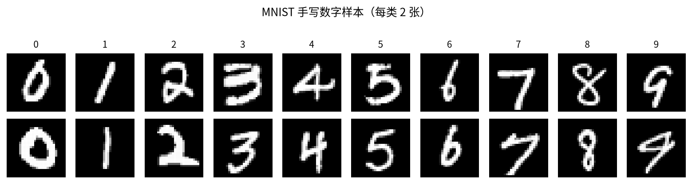

**第一部分：数据概览与结构图。** 展示 MNIST 各类样本，统计训练集类别分布（各类 5421～6742 张），并画出 LeNet-5 的结构示意图，核对每层输出尺寸与参数量。

**第二部分：基线模型对比。** 在全部 54,001 张训练图上训练 10 轮，比较 5 个模型：LeNet-5 经典结构（Sigmoid + 平均池化）、LeNet-5 现代结构（ReLU + 最大池化）、LeNet-5 + 批归一化、更深的 SmallVGG（3×3 卷积 + BN + Dropout）、以及同样参数量级的 MLP 基线。所有模型使用相同的优化器（Adam，lr=0.001）与批大小（64）。

**第三部分：激活函数对比与梯度消失诊断。** 在 10,000 张训练图上固定 LeNet-5 结构（最大池化），分别使用 ReLU、Sigmoid、Tanh、LeakyReLU、ELU、GELU 训练 8 轮，记录验证曲线和第一层卷积权重的梯度范数。另设一组诊断实验：用经典结构分别搭配 SGD lr=0.01、SGD lr=0.1、Adam lr=0.001，并与 ReLU 结构对照，训练 6 轮，定量说明"激活函数 + 优化器"必须一起考虑。

**第四部分：Dropout 与正则化。** 为制造明显的过拟合，只用 6,000 张训练图，并把 LeNet-5 的全连接头放大到 512→128，训练 20 轮。比较 6 种设置：无正则化、Dropout 0.2、Dropout 0.5、Dropout 0.5 + 卷积层 Dropout2d 0.25、仅权重衰减 1e-3、Dropout 0.5 + 权重衰减 1e-3。

**第五部分：数据量的影响。** 训练集规模取 600、2,000、6,000、20,000、54,001 五档（按类别等比例分层抽样），每档分别训练 CNN（LeNet-5 现代结构）与 MLP，各 8 轮，比较测试准确率与两者的差距。

**第六部分：超参数对比。** 在 10,000 张训练图上固定其它条件，每次只改一个因素，各训练 8 轮：优化器（SGD、SGD + Momentum、Adam、AdamW）、Adam 学习率（1e-4、3e-4、1e-3、3e-3）、SGD + Momentum 学习率（1e-3、1e-2、1e-1）、批大小（16、32、64、128、256）、权重衰减（0、1e-4、1e-3、1e-2）。

**第七部分：数据增强与旋转鲁棒性。** 在 6,000 张训练图的过拟合场景下，比较无增强、随机旋转/平移 ±10°、随机旋转/平移 ±20°、±20° 旋转 + 随机擦除四种增广方式，各训练 20 轮；然后把同一个测试集分别旋转 −30°、−20°、−10°、0°、10°、20°、30°，测量每个模型的准确率变化。

**第八部分：最终模型与误差分析。** 在全量训练集上比较 5 个候选配方（LeNet-5、+Dropout、+增广、+Dropout+增广、SmallVGG），按验证集准确率选出最终配方，用 3 个随机种子训练 15 轮，报告测试准确率的均值与标准差；再用混淆矩阵、每类 precision/recall/F1、错分样本、第一层卷积核、特征图、置信度分布、置信度阈值下的覆盖率-精度曲线和旋转鲁棒性对最终模型做误差分析。

**第九部分：Fashion-MNIST 验证。** 在同样规模但更难的服装图像数据集（10 类）上训练 CNN 与 MLP 各 10 轮，检验前面关于 CNN 优势的结论是否能迁移到另一种图像数据。

## 3. 实验环境

| 项目 | 配置 |
|---|---|
| 操作系统 | Linux-6.6.87.2-microsoft-standard-WSL2-x86_64-with-glibc2.39 |
| 编程语言 | Python 3.13.12（Anaconda 发行版） |
| 深度学习框架 | PyTorch 2.14.1+cu130 + torchvision 0.29.1+cu130 |
| CUDA 运行时 | CUDA 13.0，cuDNN 9.24.0 |
| GPU | NVIDIA GeForce RTX 4050 Laptop GPU（6.0 GB 显存，计算能力 8.9） |
| CPU / 内存 | 18 逻辑核（数据加载使用 4 个工作进程） |
| 数值计算 / 绘图 | NumPy 2.5.2，Matplotlib 3.11.2（中文字体 Noto Sans CJK SC） |
| 精度 | 默认 FP32（`torch.get_float32_matmul_precision() = highest`），未使用混合精度 |
| 随机性 | 固定 Python / NumPy / PyTorch 随机种子；cudnn 设为确定性模式 |
| 运行方式 | `cd exp5_report && python full_experiment.py` |

**GPU 环境。** 除正确性验证（模型很小，在 CPU 上用 float64 做数值梯度校验）外，本实验的全部训练与推理都在 GPU 上完成；测试集旋转在 CPU 上生成后用 GPU 推理。PyTorch 的 CUDA 版安装方式为：

```bash
pip install torch torchvision --index-url https://download.pytorch.org/whl/cu130
```

安装后 `torch.cuda.is_available()` 返回 True，设备名为 `NVIDIA GeForce RTX 4050 Laptop GPU`。实验脚本在启动时打印设备信息；如果换到没有 GPU 的机器上，`engine.get_device()` 会自动退回 CPU，代码无需修改。

**训练速度。** 以 LeNet-5 现代结构、全量 54,001 张训练图、批大小 64 为例，一个 epoch 包含 844 次参数更新，在 GPU 上平均耗时 3.15 秒（10 轮合计 32 秒，包含每轮的验证集评估）。作为对比，实验四中规模接近的 MLP 在纯 CPU 上用 NumPy 手写实现训练一个 epoch 需要数秒到数十秒；GPU 让本实验的 66 次训练（含每轮的验证集评估）累计只用约 20 分钟。

**数据。** 使用 MNIST 原始 IDX 文件（`data/mnist/*.gz`，仓库已附带，也可用 `bash data/download_mnist.sh` 重新下载），由 `code/data.py` 直接解析，像素值除以 255 缩放到 $[0,1]$，不做额外的均值方差标准化。选择 MNIST 的理由：它是课程中介绍卷积神经网络时最常用的数据集，10 类、图像小（28×28）、训练集足够大，既能观察小样本过拟合，也能在合理时间内完成几十次对照实验。

## 4. 实验原理

### 4.1 全连接网络处理图像的三个问题

把 28×28 的灰度图拉平成 784 维向量送进全连接层，看起来可行（实验四的 MLP 在 MNIST 上就有 97% 以上的准确率），但存在三个结构性问题。

**参数爆炸。** 第一个隐藏层若有 256 个神经元，参数量就是 $784\times256+256=200{,}960$；而图像分辨率一旦提高到 256×256，同样的隐藏层需要 $65{,}536\times256$ 个参数，约 1,677 万个。参数越多，越容易过拟合，也越难训练。

**空间结构被破坏。** 拉平操作把相邻像素之间的二维关系丢掉了。数字 "1" 的笔画在左上角和右下角出现的模式没有任何区别，但 MLP 对每个位置都要单独学一套权重，无法复用。

**没有平移等变。** 同一个数字向上平移 2 个像素，在像素空间里是一个完全不同的输入向量，MLP 需要重新学习；而人类识别数字时，位置的小幅移动几乎不改变判断。

卷积神经网络用三个归纳偏置（inductive bias）解决这些问题：**局部连接**（每个神经元只看输入的一个小邻域）、**权值共享**（同一卷积核在整张图上滑动，参数复用）、**池化下采样**（降低分辨率、扩大感受野，并带来一定的小范围平移不变性）。

### 4.2 卷积运算与输出尺寸

设输入特征图为 $X\in\mathbb{R}^{C_{in}\times H\times W}$，卷积核为 $W\in\mathbb{R}^{C_{out}\times C_{in}\times K\times K}$，偏置 $b\in\mathbb{R}^{C_{out}}$，步长 $S=1$、零填充 $P$。第 $o$ 个输出通道在位置 $(i,j)$ 的值为

$$
Y_{o,i,j}=\sum_{c=1}^{C_{in}}\sum_{u=0}^{K-1}\sum_{v=0}^{K-1}W_{o,c,u,v}\,X_{c,\,iS+u-P,\,jS+v-P}+b_o .
$$

输出空间尺寸由下式决定：

$$
H_{out}=\lfloor\frac{H-K+2P}{S}\rfloor+1,\qquad W_{out}=\lfloor\frac{W-K+2P}{S}\rfloor+1 .
$$

本实验的 LeNet-5 不做零填充（$P=0$）、步长为 1，因此 28→24→12→8→4 逐层缩小：

- 输入 $1\times28\times28$；
- conv1：$K=5$，输出 $6\times24\times24$；
- maxpool 2×2：输出 $6\times12\times12$；
- conv2：$K=5$，输出 $16\times8\times8$；
- maxpool 2×2：输出 $16\times4\times4$；
- flatten：256 维；再经过 120、84、10 三个全连接层。

**参数量对比。** 一个 $K\times K$、输入 $C_{in}$ 通道、输出 $C_{out}$ 通道的卷积层参数量为

$$
K^2\cdot C_{in}\cdot C_{out}+C_{out}.
$$

所以 conv1 有 $5^2\times1\times6+6=156$ 个参数，conv2 有 $5^2\times6\times16+16=2{,}416$ 个；而一个把 784 维映射到 256 维的全连接层就有 200,960 个参数。LeNet-5 全部参数只有 44,426 个，这正是权值共享带来的效率。

### 4.3 权值共享、局部连接与平移等变

**局部连接**：卷积核只在 $K\times K$ 的邻域内取值，符合图像"相邻像素相关"的先验。每个输出位置只与输入的局部区域相连，参数按位置共享。

**权值共享**：同一个卷积核在整张图上滑动，因此同一个"笔画检测器"可以在任意位置使用。这带来两重收益：参数量与图像大小无关（只与卷积核大小、通道数有关）；同一模式在不同位置被同样地检测，模型自动获得**平移等变**（translation equivariance）：输入平移 $t$，卷积输出也平移 $t$（在边界效应之外）。

**感受野**：堆叠卷积可以扩大感受野。第一层 5×5 卷积的每个输出只看输入的 5×5 区域；第二层 5×5 卷积作用在第一层 12×12 的特征图上，对应原图的感受野为 5+2×(5−1)=13×13。感受野随层数加深而增大，深层神经元能"看到"更大的结构（笔画组合、数字轮廓），同时空间尺寸逐层减小、通道数逐层增加——这是 CNN 典型的"空间分辨率下降、语义信息上升"的金字塔结构。

### 4.4 池化

池化对每个通道独立地在 $2\times2$ 窗口上取最大值或平均值，步长为 2。设输入为 $X$，则

$$
\text{MaxPool}(X)_{i,j}=\max_{u,v\in\{0,1\}} X_{2i+u,\,2j+v},\qquad
\text{AvgPool}(X)_{i,j}=\frac{1}{4}\sum_{u,v\in\{0,1\}} X_{2i+u,\,2j+v}.
$$

池化有三个作用：把特征图尺寸减半，降低后续计算量；扩大后续层的感受野；对窗口内的小幅平移不敏感（最大池化只保留窗口内最强的响应）。池化层没有可学习参数。最大池化保留最显著的响应，平均池化保留整体能量；本实验会在基线里对比这两种方式。

### 4.5 激活函数：Sigmoid、Tanh 与 ReLU 族

卷积和池化都是线性（或分段的线性）操作，如果网络里没有非线性激活函数，多层卷积的复合仍然等价于一次线性变换。激活函数是 CNN 表达能力的来源。实验对比的六种激活函数为：

$$
\sigma(x)=\frac{1}{1+e^{-x}},\qquad \tanh(x)=\frac{e^{x}-e^{-x}}{e^{x}+e^{-x}},\qquad
\text{ReLU}(x)=\max(0,x),
$$

$$
\text{LeakyReLU}(x)=\max(\alpha x,x)\ (\alpha=0.1),\qquad
\text{ELU}(x)=\begin{cases}x,&x>0\\ \alpha(e^{x}-1),&x\le 0\end{cases},\qquad
\text{GELU}(x)=x\cdot\Phi(x),
$$

其中 $\Phi$ 是标准正态分布的累积分布函数。它们的导数性质差别很大：

- Sigmoid 的导数 $\sigma'(x)=\sigma(x)(1-\sigma(x))\le 0.25$，且在两端的饱和区趋近于 0；
- Tanh 的导数 $1-\tanh^2(x)\le 1$，比 Sigmoid 略好，但同样会饱和；
- ReLU 在正半轴的导数恒为 1，不饱和，计算只需一次比较；负半轴导数为 0（"死亡 ReLU"问题）；
- LeakyReLU / ELU 给负半轴留了小的斜率，缓解死亡问题；GELU 是平滑的 ReLU 近似，是 Transformer 等现代模型的默认选择。

**梯度消失的定量解释。** 反向传播时，梯度要逐层乘上激活函数的导数。若每层导数都约为 0.25（Sigmoid 的典型值），经过 $L$ 层后梯度就缩放到约 $0.25^L$：5 层约 $10^{-3}$，10 层约 $10^{-6}$。这就是为什么经典 Sigmoid 网络需要用合适的学习率、精心的初始化，或者换用 ReLU 族激活函数。本实验第 7 节会用实测的第一层卷积梯度范数验证这一点。

### 4.6 Dropout

Dropout 在每个训练批次中，以概率 $p$ 随机把隐藏层神经元的输出置零，保留下来的神经元除以 $1-p$ 以保持期望不变：

$$
r_j\sim\text{Bernoulli}(1-p),\qquad \tilde{h}_j=\frac{r_j h_j}{1-p}.
$$

测试阶段不做随机丢弃，直接使用完整的隐藏层（相当于对指数多个"子网络"做隐式集成）。Dropout 的作用可以理解为：禁止神经元之间形成固定的共适应关系，迫使每个神经元学到相对独立的特征，从而降低过拟合。它通常只在大容量、小数据的场景下有效；数据充足时，Dropout 反而会拖慢收敛。

**作用位置。** 对全连接层使用标准的 Dropout；对卷积层，通常使用 Dropout2d（按通道整张特征图丢弃，而不是逐元素丢弃），因为卷积通道之间存在空间相关性，逐元素丢弃破坏性太强。本实验会对比"只在全连接层用 Dropout"与"全连接层 + 卷积层都用 Dropout2d"。

### 4.7 批归一化（Batch Normalization）

BN 对每个通道在小批量维度上计算均值与方差，再归一化到零均值、单位方差，并用两个可学习参数 $\gamma,\beta$ 恢复表达能力：

$$
\hat{x}=\frac{x-\mu_B}{\sqrt{\sigma_B^2+\epsilon}},\qquad y=\gamma\hat{x}+\beta.
$$

它在训练时使用当前批次的统计量，推理时使用训练过程中累积的滑动平均统计量。BN 的作用包括：缓解内部协变量偏移、允许更大的学习率、让损失曲面更平滑、加快收敛；代价是引入了批次依赖，小批量时统计量噪声较大。本实验把 BN 作为基线对比的一部分（LeNet-5 + BN、SmallVGG 使用 BN）。

### 4.8 LeNet-5 结构

LeNet-5 是 LeCun 等人在 1998 年提出的经典卷积网络，最初用于手写数字与文档识别。原始版本输入 32×32、使用 Sigmoid 激活和平均池化（下采样），本实验把它适配到 MNIST 的 28×28 输入：

| 层 | 操作 | 输入尺寸 | 输出尺寸 | 参数量 |
|---|---|---|---|---|
| conv1 | 5×5 卷积，6 通道 | 1×28×28 | 6×24×24 | 156 |
| pool1 | 2×2 池化 | 6×24×24 | 6×12×12 | 0 |
| conv2 | 5×5 卷积，16 通道 | 6×12×12 | 16×8×8 | 2,416 |
| pool2 | 2×2 池化 | 16×8×8 | 16×4×4 | 0 |
| flatten | 拉平 | 16×4×4 | 256 | 0 |
| fc1 | 全连接 256→120 | 256 | 120 | 30,840 |
| fc2 | 全连接 120→84 | 120 | 84 | 10,164 |
| fc3 | 全连接 84→10 | 84 | 10 | 850 |
| **合计** | | | | **44,426** |

原始 LeNet-5 输入 32×32、第二个池化后得到 16×5×5=400 维，本实验输入 28×28 时变成 16×4×4=256 维，因此第一个全连接层是 256→120。结构示意图如下：

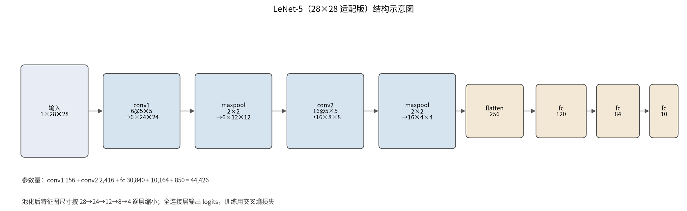

### 4.9 损失函数与优化器

多分类使用 softmax 交叉熵。设模型输出 logits $z\in\mathbb{R}^{10}$，真实类别为 $y$，则

$$
p_c=\frac{e^{z_c}}{\sum_{j=1}^{10}e^{z_j}},\qquad
L=-\log p_y=-\left(z_y-\log\sum_{j=1}^{10}e^{z_j}\right).
$$

对 logits 的梯度有简洁形式 $\partial L/\partial z_c=p_c-\mathbb{1}[c=y]$，反向传播从这里开始。实际实现中 PyTorch 的 `CrossEntropyLoss` 把 softmax 与负对数似然合并，数值稳定的实现会先减去 logits 的最大值。

优化器方面，本实验对比 SGD、SGD + Momentum 和 Adam：

$$
v_t=\beta v_{t-1}+(1-\beta)\nabla_\theta L_t,\qquad \theta_{t+1}=\theta_t-\eta\,v_t \quad\text{(SGD/Momentum)},
$$

$$
m_t=\beta_1 m_{t-1}+(1-\beta_1)g_t,\quad v_t=\beta_2 v_{t-1}+(1-\beta_2)g_t^2,\quad
\theta_{t+1}=\theta_t-\eta\frac{\hat{m}_t}{\sqrt{\hat{v}_t}+\epsilon}\quad\text{(Adam)},
$$

其中 $\beta_1=0.9$、$\beta_2=0.999$。Adam 用梯度二阶矩对每个参数做自适应缩放，因此对梯度量级不敏感——这正是它能"救活"Sigmoid 网络的原因。权重衰减（L2 正则）则在损失里加 $\lambda\lVert\theta\rVert^2/2$，AdamW 使用与梯度更新解耦的衰减方式。

## 5. 实现与正确性验证

### 5.1 代码结构

| 路径 | 说明 |
|---|---|
| `code/data.py` | MNIST / Fashion-MNIST 的 IDX 解析、分层划分、DataLoader、四种数据增强、测试集旋转 |
| `code/models.py` | LeNet-5（激活/池化/BN/Dropout 可配置）、SmallVGG、MLP、参数量统计 |
| `code/engine.py` | 随机种子、设备选择、优化器构造、单轮训练/评估、统一训练循环（记录曲线与第一层梯度范数） |
| `code/metrics.py` | 混淆矩阵、每类 precision/recall/F1、最易混淆类别对、置信度统计与覆盖率-精度曲线 |
| `code/viz.py` | 训练曲线、样本网格、混淆矩阵、错分样本、卷积核、特征图、LeNet-5 结构图 |
| `exp5_report/full_experiment.py` | 九部分实验主脚本，结果写入 `results.json` |
| `exp5_report/verify.py` | 正确性验证（参数量、初始损失、输出尺寸、数值梯度、单批过拟合、旋转函数） |
| `exp5_report/gen_report.py` | 从 `results.json` 生成 Markdown 报告并调用 pandoc 生成 docx |

**关键接口。** 所有模型统一接受 `(N, 1, 28, 28)` 的输入、输出 `(N, 10)` 的 logits；所有实验共用 `engine.fit()` 训练、`engine.evaluate()` 评估，保证除被研究变量外其它条件完全一致。数据划分、验证集抽样、训练集子集抽样都使用显式随机种子。

### 5.2 LeNet-5 的 PyTorch 实现

核心代码（`code/models.py`，删去注释与类型标注）：

```python
class ConvBlock(nn.Module):
    def __init__(self, in_ch, out_ch, kernel_size=5, activation="relu",
                 pooling="max", use_bn=False, dropout=0.0):
        super().__init__()
        self.conv = nn.Conv2d(in_ch, out_ch, kernel_size)
        self.bn = nn.BatchNorm2d(out_ch) if use_bn else None
        self.act = make_activation(activation)
        self.pool = nn.MaxPool2d(2) if pooling == "max" else nn.AvgPool2d(2)
        self.dropout = nn.Dropout2d(dropout) if dropout > 0 else None

    def forward(self, x):
        x = self.conv(x)
        if self.bn is not None:
            x = self.bn(x)
        x = self.act(x)
        x = self.pool(x)
        if self.dropout is not None:
            x = self.dropout(x)
        return x

class LeNet5(nn.Module):
    def __init__(self, num_classes=10, activation="relu", pooling="max",
                 use_bn=False, dropout_fc=0.0, dropout_conv=0.0,
                 fc_sizes=(120, 84)):
        super().__init__()
        self.features = nn.Sequential(
            ConvBlock(1, 6, 5, activation, pooling, use_bn, dropout_conv),
            ConvBlock(6, 16, 5, activation, pooling, use_bn, dropout_conv),
        )
        fc1, fc2 = fc_sizes
        self.classifier = nn.Sequential(
            nn.Flatten(),
            nn.Linear(16 * 4 * 4, fc1), make_activation(activation),
            nn.Dropout(dropout_fc) if dropout_fc > 0 else nn.Identity(),
            nn.Linear(fc1, fc2), make_activation(activation),
            nn.Dropout(dropout_fc) if dropout_fc > 0 else nn.Identity(),
            nn.Linear(fc2, num_classes),
        )

    def forward(self, x):
        return self.classifier(self.features(x))
```

激活函数通过字典工厂 `make_activation(name)` 构造，因此换激活函数只需要改一个字符串；池化、BN、Dropout 同理，这是后面所有控制变量实验能共用一套代码的原因。

### 5.3 训练循环

`engine.fit()` 的骨架如下（省略日志与梯度范数记录）：

```python
model = model.to(device)
criterion = nn.CrossEntropyLoss()
opt = make_optimizer(model, optimizer, lr, weight_decay)
for epoch in range(1, epochs + 1):
    model.train()
    for x, y in train_loader:
        x, y = x.to(device), y.to(device)
        opt.zero_grad(set_to_none=True)
        loss = criterion(model(x), y)
        loss.backward()
        opt.step()
    va = evaluate(model, val_loader, device)   # 验证集只评估、不更新
    if va["acc"] > best_val_acc:               # 保存验证集最好的模型
        best_state = deepcopy(model.state_dict())
model.load_state_dict(best_state)              # 用验证集最优轮次的参数报告测试结果
```

**公平对照协议。**（1）所有实验使用相同的数据划分与同一个验证集；（2）同一组对照使用相同的随机种子、优化器、学习率、批大小和训练轮数，只改变被研究的变量；（3）每个配置报告"验证集最优轮次"对应的测试准确率，避免用训练末期的过拟合参数；（4）超参数扫描使用 10,000 张训练图的固定子集以控制变量与时间，最终模型回到全量数据；（5）涉及随机性的结论用多个种子或多次抽样验证。

### 5.4 评估指标

主指标是测试集准确率（10,000 张图的分类正确率）。误差分析还使用：

- **混淆矩阵** $C_{ij}$：真实类别 $i$ 被判为类别 $j$ 的样本数；
- **每类 precision / recall / F1**：$P_i=C_{ii}/\sum_j C_{ji}$，$R_i=C_{ii}/\sum_j C_{ij}$，$F_1=2PR/(P+R)$；
- **置信度**：softmax 最大概率；统计正确预测与错误预测的置信度分布，并用"置信度阈值筛选后的覆盖率-精度曲线"评估模型能否用置信度拒绝不可靠预测。

### 5.5 正确性验证

在正式实验前，先用 `exp5_report/verify.py` 从六个方面检查实现是否正确，实测结果如下（详细输出见 `exp5_report/verification.json`）：

| 检查项 | 实测结果 | 判定 |
|---|---|---|
| 参数量核对 | 手算 44,426 个，PyTorch 统计 44,426 个 | ✓ |
| 输出尺寸核对 | Conv2d(2, 6, 24, 24)；MaxPool2d(2, 6, 12, 12)；Conv2d(2, 16, 8, 8)；MaxPool2d(2, 16, 4, 4)；Linear(2, 120)；Linear(2, 84)；Linear(2, 10) | ✓ |
| 初始损失 | 2.307682（ln10 = 2.302585，误差 5.10e-03） | ✓ |
| 数值梯度校验 | 检查 10 个参数（conv/fc 混合），最大相对误差 4.26e-08 | ✓ |
| 单批过拟合 | 固定 64 张图训练 400 步：损失 2.3027 → 6.17e-07，准确率 100.0% | ✓ |
| 旋转函数校验 | 0° 旋转与原图一致：True；形状保持：True；取值范围正确：True | ✓ |

六项检查全部通过。其中数值梯度校验的做法是：把模型与数据转成 float64，在 CPU 上对 10 个参数（卷积层与全连接层各若干）做中心差分 $\partial L/\partial\theta\approx[L(\theta+\epsilon)-L(\theta-\epsilon)]/(2\epsilon)$（$\epsilon=10^{-5}$），与 PyTorch 自动求导的解析梯度比较，最大相对误差 4.3e-08，说明反向传播链路（包括卷积、池化、展平、全连接）的梯度计算正确。单批过拟合把损失从 2.3027 降到 6.2e-07，说明前向、损失、反向、优化器更新整条链路正常，排除了"模型很大但根本没在学"这类低级错误。

## 6. 实验一：基线模型对比

### 6.1 设置

全部 54,001 张训练图、10 轮、Adam lr=0.001、批大小 64。五个模型的控制变量设计如下：

- **LeNet-5 经典结构**：Sigmoid 激活 + 平均池化，代表 1998 年的原始配方；
- **LeNet-5 现代结构**：ReLU 激活 + 最大池化，其余结构完全相同；
- **LeNet-5 + BN**：在现代结构上给每个卷积层加批归一化；
- **SmallVGG**：两个卷积块（每块两层 3×3 卷积 + BN + ReLU，通道数 32/64），接 128 维全连接 + Dropout 0.5；
- **MLP 基线**：784→256→128→10 的全连接网络，ReLU + Adam。

除 MLP 外都用相同的 LeNet-5 分类头（120→84→10）和相同的训练协议。

### 6.2 结果

| 模型 | 参数量 | 验证最优轮次 | 验证准确率 | 测试准确率 | 训练耗时 | 平均每轮 |
|---|---|---|---|---|---|---|
| LeNet-5 经典结构 (Sigmoid+AvgPool) | 44,426 | 9 | 97.37% | 97.87% | 31 s | 3.09 s |
| LeNet-5 现代结构 (ReLU+MaxPool) | 44,426 | 6 | 98.50% | 98.80% | 32 s | 3.15 s |
| LeNet-5 + BN | 44,470 | 9 | 98.33% | 98.96% | 35 s | 3.48 s |
| SmallVGG (更深+BN+Dropout) | 468,202 | 8 | 99.18% | 99.47% | 43 s | 4.28 s |
| MLP 基线 | 235,146 | 5 | 97.50% | 97.69% | 61 s | 6.08 s |

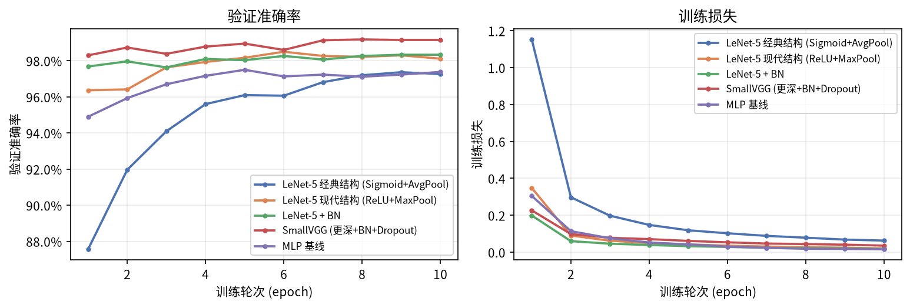

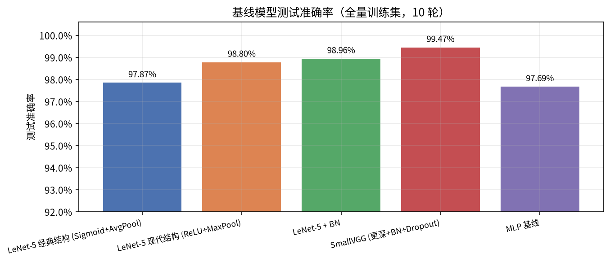

### 6.3 分析

**经典结构 vs 现代结构。** 两者只差激活函数（Sigmoid → ReLU）和池化方式（平均 → 最大），测试准确率却从 97.87% 提高到 98.80%，相差 0.93 个百分点。从曲线（图 3）可以看到，经典结构的验证准确率在前几轮爬升明显更慢，到第 10 轮时训练准确率只有 98.11%、验证准确率 97.27%，而现代结构在第 1 轮结束就已有 96.37%。原因就是 4.5 节讨论的 Sigmoid 饱和与梯度缩小：虽然这里用 Adam 已经缓解了梯度量级问题，但 Sigmoid 的导数上界 0.25 仍然限制了每层的有效更新，收敛速度明显更慢。

**BN 的作用。** 在同样的现代结构上加 BN，测试准确率从 98.80% 提高到 98.96%（0.16 个百分点）。训练耗时从 32 秒增加到 35 秒，因为 BN 增加了计算量。在这个小网络上 BN 的收益有限，但它的收敛曲线更平滑（验证准确率更早进入 97% 以上）。

**更深的 SmallVGG。** SmallVGG 的测试准确率达到 99.47%，是五个模型中最高的，比 LeNet-5 现代结构高 0.67 个百分点。它用两层堆叠的 3×3 卷积代替一层 5×5 卷积（在相同感受野下参数更少、非线性更强），并用 BN 与 Dropout 稳定训练；代价是参数量增加到 468,202，训练时间几乎翻倍。

**CNN vs MLP。** MLP 的参数量（235,146）是 LeNet-5（44,426）的 5.3 倍，测试准确率却低 1.11 个百分点。这不是"参数越多越好"的反例，而是归纳偏置的胜利：卷积核的局部连接与权值共享把"图像上相邻像素相关""同一笔画可以出现在任意位置"这两个先验直接编码进了网络结构，因此用更少的参数学到了更可迁移的特征。MLP 的验证准确率在第 5 轮左右达到最高（97.50%），之后明显过拟合（训练准确率继续升到 99.47%，验证准确率回落），说明全连接层对图像数据更容易记住训练样本。

**运行时间。** LeNet-5 现代结构平均每轮 3.15 秒，MLP 平均每轮 6.08 秒。MLP 反而更慢，一个原因是它的全连接矩阵乘法在大 batch 下访存更密集；另一个原因是实验过程中 GPU 会因笔记本功耗墙降频，后运行的模型耗时会长一些。报告中的耗时只用于量级比较，不作为严格的性能结论。

## 7. 实验二：激活函数的选择

### 7.1 六种激活函数的对比

在 10,000 张训练图、8 轮、Adam lr=0.001、LeNet-5 现代结构（最大池化）上，每次只换激活函数：

| 激活函数 | 公式 | 验证准确率 | 测试准确率 | 第一轮梯度范数 | 末轮梯度范数 |
|---|---|---|---|---|---|
| ReLU | $\max(0,x)$ | 96.63% | 97.46% | 0.457 | 0.491 |
| Sigmoid | $1/(1+e^{-x})$ | 92.25% | 93.61% | 0.000325 | 0.0692 |
| Tanh | $\tanh(x)$ | 97.32% | 98.00% | 0.586 | 0.345 |
| LeakyReLU | $\max(0.1x,x)$ | 96.62% | 97.67% | 0.459 | 0.311 |
| ELU | $\alpha(e^x-1)$（$x\le0$） | 97.07% | 97.77% | 0.532 | 0.349 |
| GELU | $x\Phi(x)$ | 97.13% | 98.06% | 0.545 | 0.295 |

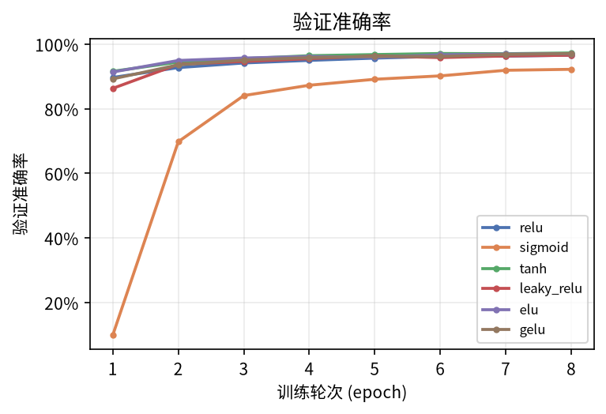

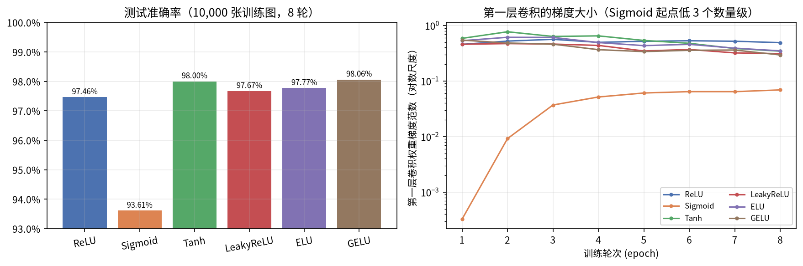

**结果。** 测试准确率从高到低依次为 GELU（98.06%）、Tanh（98.00%）、ELU（97.77%）、LeakyReLU（97.67%）、ReLU（97.46%）、Sigmoid（93.61%）。最好与最差相差 4.45 个百分点。几个值得注意的点：（1）GELU、Tanh、ELU、LeakyReLU 都落在 97.67%～98.06% 的窄区间内，说明只要解决饱和问题，激活函数具体形状的影响是次要的；（2）**ReLU 本身在这个设置下反而是 ReLU 族里最低的**（97.46%），比 GELU 低 0.60 个百分点，这是单种子、8 轮、10,000 张图下的小样本波动，不应解读为 GELU 一定更好；（3）Sigmoid 以 93.61% 明显落后，梯度饱和的影响在收敛速度上表现得最清楚（图 5 中 Sigmoid 曲线全程最低）。

**梯度范数证据。** 图 6 右侧是对数尺度的第一层卷积权重梯度范数。ReLU 的梯度范数在整个训练过程中稳定在 0.46～0.56；Sigmoid 的梯度范数在第 1 轮只有 0.00032（比 ReLU 低约 3.1 个数量级），随后随着参数移动、Sigmoid 逐渐退出饱和区而上升到第 8 轮的 0.069，此时仍比 ReLU 低约 0.9 个数量级。注意这是在 Adam 下的测量：Adam 用梯度二阶矩做逐参数归一化，把 Sigmoid 的小梯度放大到可用步长，所以网络仍能收敛；但同样的梯度量级如果交给固定学习率的 SGD，就会直接失效——这正是 7.2 节要验证的。

### 7.2 梯度消失诊断：激活函数必须和优化器一起看

上面的对比里 Sigmoid 还能到 93.61%，是因为 Adam 的归一化抵消了梯度量级。如果把优化器换回 1998 年常用的 SGD，同样 6 轮、10,000 张训练图，结果如下：

| 配置 | 优化器 / 学习率 | 测试准确率 | 第一轮梯度范数 | 末轮梯度范数 |
|---|---|---|---|---|
| Sigmoid+AvgPool | SGD, lr=0.01 | 11.35% | 9.3e-05 | 9.1e-05 |
| Sigmoid+AvgPool | SGD, lr=0.1 | 10.10% | 9.8e-05 | 0.0001 |
| Sigmoid+AvgPool | Adam, lr=0.001 | 89.82% | 0.000286 | 0.0519 |
| ReLU+MaxPool | SGD, lr=0.01 | 34.51% | 0.0105 | 0.0519 |
| ReLU+MaxPool | Adam, lr=0.001 | 97.25% | 0.486 | 0.553 |

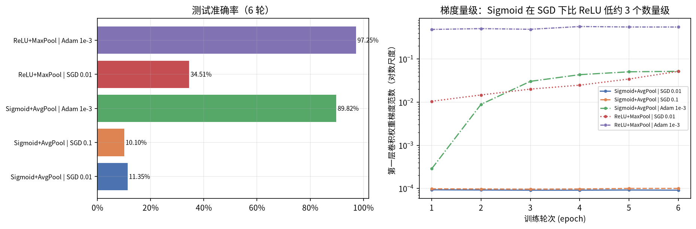

**现象。** 经典结构（Sigmoid + 平均池化）在 SGD lr=0.01 下训练 6 轮后测试准确率只有 11.35%，几乎等于 10 类随机猜测；把学习率提高 10 倍到 0.1 也没有改善（10.10%）。而同样的结构改用 Adam 后达到 89.82%。作为对照，ReLU 结构在 SGD lr=0.01 下也只有 34.51%，改用 Adam 后达到 97.25%。

**解释。** 这不是代码 bug，而是梯度量级问题。图 7 右侧显示：Sigmoid 结构第一层卷积的梯度范数只有 9.3e-05 量级，ReLU 结构是 1.0e-02 量级，相差约 2.1 个数量级。在固定学习率下，参数更新量正比于梯度，所以 Sigmoid 结构的参数几乎不动；把学习率提高 10 倍只能把更新放大 10 倍（约 1 个数量级），对约 2 个数量级的梯度差距是杯水车薪，而 Adam 用梯度二阶矩做逐参数归一化，相当于自动为每个参数选择合适步长，才把网络"救活"。

**与实验四的呼应。** 实验四中手写 MLP 时，全零初始化和过大的学习率都会让网络学不动；这次在 CNN 上看到的是同一类问题的另一种表现：**优化难度与表达能力是两回事**。Sigmoid 网络表达能力和 ReLU 一样（甚至更强，因为它是平滑的），但在这个深度/初始化/优化器组合下根本走不到好的解。这也解释了为什么 2010 年以后 ReLU 会成为深度网络的默认激活函数：它同时改善了梯度量级和计算效率。

## 8. 实验三：Dropout 与正则化

### 8.1 设置

为了让过拟合明显出现，本组实验只用 6,000 张训练图，并把 LeNet-5 的全连接头放大到 512→128（参数量从 44,426 增加到 201,110），训练 20 轮。其它条件（Adam lr=0.001、批大小 64、验证集不变）与前面一致。共比较 6 种正则化设置：

| 设置 | Dropout（FC） | Dropout2d（卷积） | 权重衰减 | 验证准确率 | 测试准确率 | 最后训练-验证差距 |
|---|---|---|---|---|---|---|
| 无正则化 | 0.00 | 0.00 | 0 | 97.32% | 98.07% | +2.65 pp |
| Dropout 0.2 (FC) | 0.20 | 0.00 | 0 | 97.45% | 97.97% | +2.30 pp |
| Dropout 0.5 (FC) | 0.50 | 0.00 | 0 | 97.55% | 98.19% | +1.28 pp |
| Dropout 0.5 (FC) + Dropout2d 0.25 | 0.50 | 0.25 | 0 | 97.22% | 97.81% | -0.62 pp |
| Weight Decay 1e-3（无 Dropout） | 0.00 | 0.00 | 0.001 | 97.20% | 97.74% | +2.27 pp |
| Dropout 0.5 + Weight Decay 1e-3 | 0.50 | 0.00 | 0.001 | 97.22% | 97.92% | +1.25 pp |

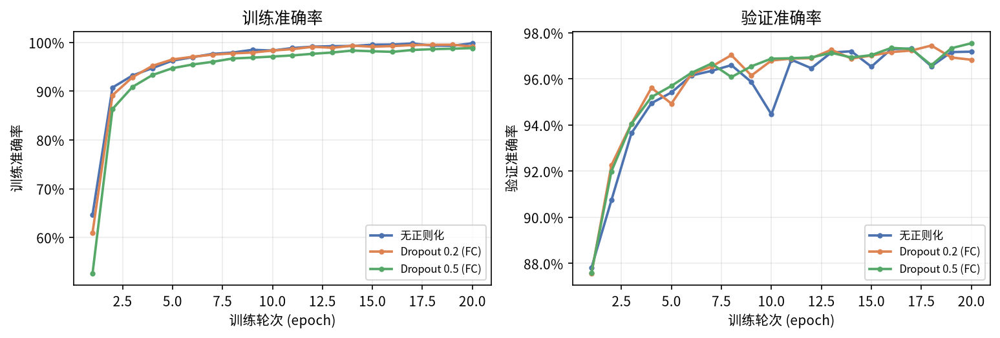

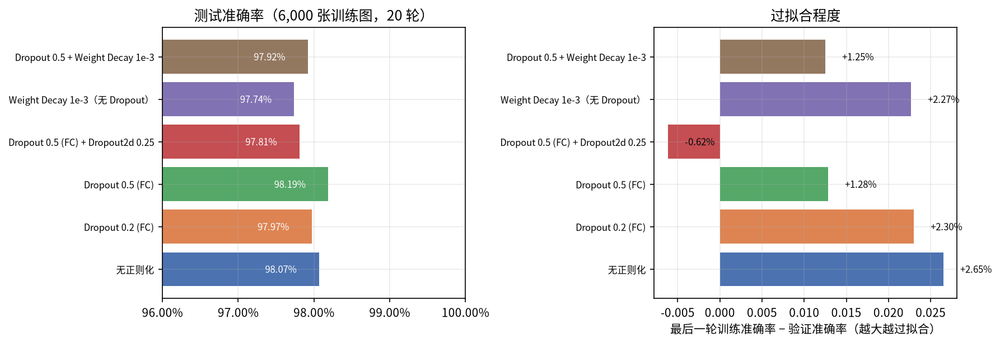

### 8.2 分析

**过拟合确实存在。** 无正则化时，最后一轮训练准确率 99.83%、验证准确率 97.18%，差距 +2.65 个百分点（图 8 中两条曲线的开口），验证准确率在第 17 轮之后开始回落。6,000 张图 + 约 201,110 个参数足以让网络开始"背题"。

**Dropout 的作用。** 加上 Dropout 后，训练-验证差距从 +2.65 个百分点缩小到 Dropout 0.2 的 +2.30 和 Dropout 0.5 的 +1.28 个百分点；测试准确率从 98.07% 变为 97.97%（p=0.2）和 98.19%（p=0.5）。注意 Dropout 让训练准确率变低（因为训练时有一半神经元被丢弃），这正是它抑制过拟合的代价：用训练集上的拟合能力换验证集/测试集上的泛化。

**Dropout 的作用位置。** 只在全连接层加 Dropout 0.5 与同时在卷积层加 Dropout2d 0.25 的测试准确率分别为 98.19% 与 97.81%，差距 -0.38 个百分点。卷积层的 Dropout2d 丢弃整个通道，会破坏低层特征的完整性；在本实验的小数据场景下，它没有带来额外收益，反而略低。经验上 Dropout 主要用于参数量大的全连接层，卷积层更常用 BN、数据增强或权重衰减。

**Dropout vs 权重衰减。** 单独使用权重衰减 1e-3 的测试准确率为 97.74%，Dropout 0.5 为 98.19%，两者组合为 97.92%。权重衰减直接压制权重大小，Dropout 通过随机丢弃破坏神经元之间的共适应，两者的正则化机制不同；在本实验中单独使用 Dropout 的收益更明显。

**结论。** Dropout 不是"越多越好"，也不是"永远有效"。它的收益依赖于：模型容量相对数据量偏大、过拟合真实存在、丢弃率适中（本实验 p=0.5 略优于 p=0.2）。在实验一的全量数据（54,001 张）上，LeNet-5 的过拟合不严重，Dropout 的收益会明显缩小——第 12 节的配方对比中，加 Dropout 的 R2 只比 R1 高 0.18 个百分点，远小于本节 2.65→1.28 个百分点的差距缩小幅度。

## 9. 实验四：数据量的影响

### 9.1 结果

训练集规模从 600 到 54,001 按类别等比例分层抽样，CNN（LeNet-5 现代结构）与 MLP（784-256-128）各训练 8 轮：

| 训练样本数 | CNN 测试准确率 | MLP 测试准确率 | CNN − MLP | CNN 每轮耗时 | MLP 每轮耗时 |
|---|---|---|---|---|---|
| 600 | 78.14% | 87.85% | -9.71 pp | 0.10 s | 0.08 s |
| 2,000 | 92.98% | 90.74% | +2.24 pp | 0.26 s | 0.19 s |
| 6,000 | 96.61% | 94.00% | +2.61 pp | 0.47 s | 0.42 s |
| 20,000 | 98.03% | 96.86% | +1.17 pp | 1.30 s | 1.59 s |
| 54,001 | 98.82% | 97.57% | +1.25 pp | 3.54 s | 6.62 s |

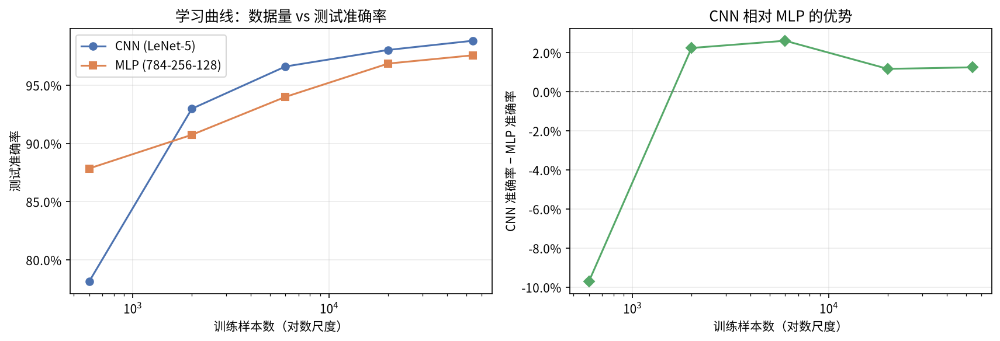

### 9.2 分析

**数据量是最大的单一因素。** CNN 的测试准确率从 600 张时的 78.14% 提升到全量时的 98.82%，提高了 20.68 个百分点；MLP 从 87.85% 提升到 97.57%。在 600 张时两者都还明显欠拟合（验证准确率曲线仍在上升），到 20,000 张之后收益开始递减（图 10 左）。

**CNN 的优势随数据量变化，并且在极小数据上会出现反转。** 在 600 张训练图时，CNN 的测试准确率（78.14%）反而比 MLP（87.85%）低 9.7 个百分点；从 2,000 张开始 CNN 反超（2.24 个百分点），到全量 54,001 张时领先 1.25 个百分点（图 10 右）。对这个反转有两种解释：一是**优化预算**——固定 8 轮时，CNN 的参数共享与池化让梯度更"分散"，达到同样拟合程度需要更多更新，600 张图×8 轮只有 600 次参数更新，CNN 明显欠拟合（训练准确率也只有 78.50%，而 MLP 为 94.00%）；二是**归纳偏置的代价**——卷积先验假定"局部模式可以复用"，数据极小时这个先验未必能带来净收益。数据量增大后，CNN 的参数效率优势才体现出来。因此"CNN 一定比 MLP 好"是不成立的，数据量、训练预算和任务先验都会影响结论。

**训练效率。** 相同数据量下 MLP 的每轮耗时通常高于 CNN（例如全量时 6.62 秒对 3.54 秒），因为它的全连接矩阵更大。也就是说 CNN 在准确率和计算效率上同时占优。

**注意。** 这里只训练 8 轮，曲线尚未完全收敛；数据量很大时的最终准确率受训练轮数与学习率影响，不能把表中的数字当作该数据量的性能上限。

## 10. 实验五：超参数的影响

本组实验使用 10,000 张训练图的固定子集、8 轮，固定 LeNet-5 现代结构（ReLU + 最大池化），每次只改一个超参数。

### 10.1 优化器

| 配置 | 优化器 | 验证准确率 | 测试准确率 | 每轮耗时 |
|---|---|---|---|---|
| SGD lr=0.01 | sgd | 64.19% | 65.30% | 0.64 s |
| SGD+Momentum lr=0.01 | momentum | 96.03% | 96.81% | 0.51 s |
| Adam lr=1e-3 | adam | 96.48% | 97.56% | 0.87 s |
| AdamW lr=1e-3 wd=1e-2 | adamw | 96.57% | 97.60% | 0.84 s |

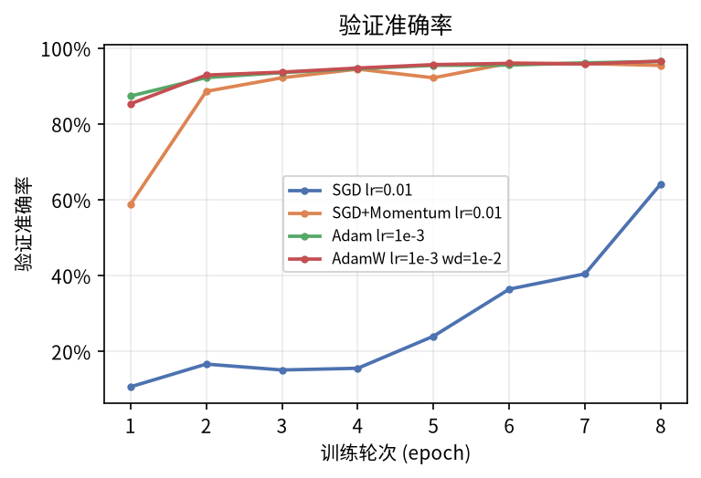

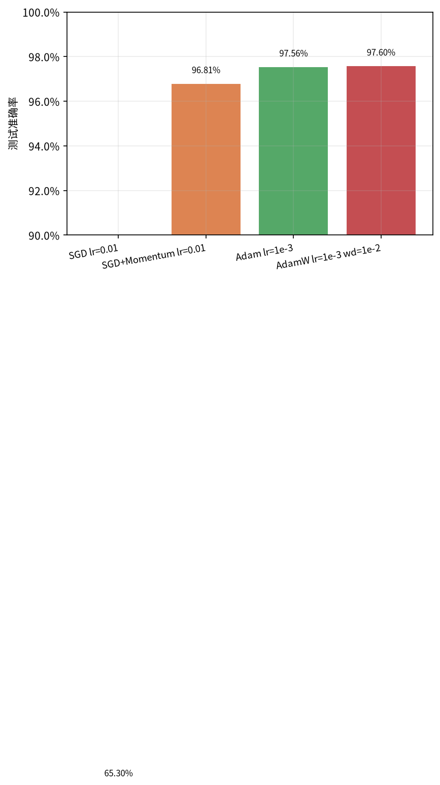

从高到低为：AdamW lr=1e-3 wd=1e-2（97.60%）、Adam lr=1e-3（97.56%）、SGD+Momentum lr=0.01（96.81%）、SGD lr=0.01（65.30%）。Adam / AdamW 明显好于 SGD；SGD lr=0.01 在 8 轮内只达到 65.30%，是欠拟合而不是过拟合——它的训练准确率也只有 49.47%。这再次说明：比较优化器时必须让每个优化器都有机会收敛（各自的合理学习率），否则得到的结论是"学习率选得对不对"而不是"优化器谁更好"。AdamW 在本实验中的差别很小（它与 Adam 的区别是权重衰减的解耦方式，而本组 wd=1e-2 的强度在 10,000 张图上影响有限）。

### 10.2 学习率

| 优化器 | 学习率 | 验证准确率 | 测试准确率 | 末轮训练损失 |
|---|---|---|---|---|
| Adam | 0.0001 | 90.20% | 91.67% | 0.3326 |
| Adam | 0.0003 | 94.70% | 95.43% | 0.1864 |
| Adam | 0.001 | 96.60% | 97.58% | 0.0664 |
| Adam | 0.003 | 97.07% | 97.80% | 0.0421 |
| SGD+Momentum | 0.001 | 49.36% | 50.39% | 2.1467 |
| SGD+Momentum | 0.01 | 96.78% | 97.38% | 0.0812 |
| SGD+Momentum | 0.1 | 96.08% | 96.48% | 0.1049 |

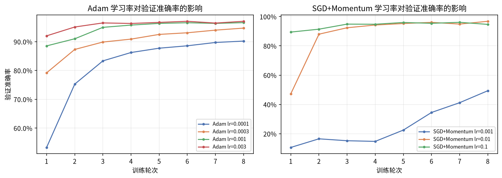

Adam 在扫描范围内测试准确率最高的是 0.003（97.80%），且从 1e-4 到 3e-3 呈单调上升趋势：学习率太小（1e-4）时 8 轮内明显欠拟合，末轮训练损失仍有 0.333；3e-3 在本实验的 8 轮预算内表现最好，但曲线初期的波动也更大，继续增大到 1e-2 量级是否会震荡本实验没有测试。SGD + Momentum 需要大得多的学习率（0.01～0.1 量级）才能与 Adam 可比，因为 Adam 的自适应步长等价于给每个参数单独调了学习率。**学习率的合理范围取决于优化器，不能脱离优化器谈"最优学习率"。**

### 10.3 批大小

| 配置 | 批大小 | 验证准确率 | 测试准确率 | 每轮耗时 |
|---|---|---|---|---|
| batch=16 | 16 | 96.95% | 97.77% | 2.73 s |
| batch=32 | 32 | 97.00% | 97.89% | 1.43 s |
| batch=64 | 64 | 96.63% | 97.46% | 0.67 s |
| batch=128 | 128 | 95.77% | 96.59% | 0.40 s |
| batch=256 | 256 | 94.57% | 95.41% | 0.24 s |

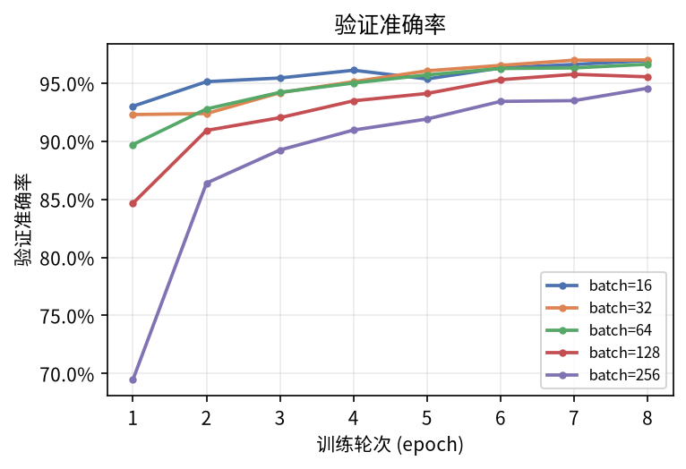

批大小从 16 增加到 256，测试准确率从 97.77% 变为 95.41%。在固定 epoch 数的情况下，小批量每个 epoch 的参数更新次数更多（10,000 张图、batch=16 时每轮 625 次更新，batch=256 时只有 39 次），所以小批量收敛更快；但小批量的每轮耗时更长，且梯度噪声更大。批大小和训练轮数、学习率之间存在耦合，比较时要注意"固定 epoch"这一协议本身的偏差。

### 10.4 权重衰减

| 配置 | 权重衰减 | 验证准确率 | 测试准确率 | 每轮耗时 |
|---|---|---|---|---|
| weight decay=0 | 0 | 96.88% | 97.63% | 0.63 s |
| weight decay=0.0001 | 0.0001 | 96.37% | 97.12% | 0.66 s |
| weight decay=0.001 | 0.001 | 95.98% | 96.92% | 0.66 s |
| weight decay=0.01 | 0.01 | 95.22% | 96.02% | 0.64 s |

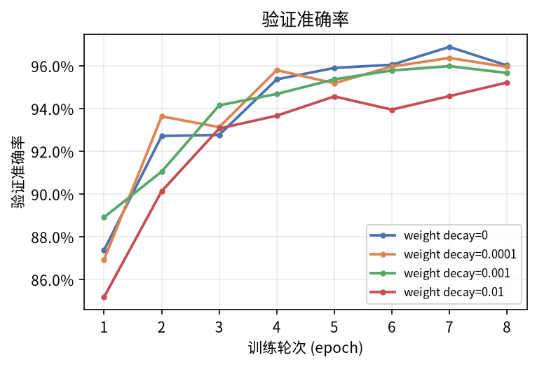

在 10,000 张训练图、8 轮的设置下，权重衰减从 0 增加到 1e-2，测试准确率的变化在 96.02%～97.63% 之间。这个子集上的过拟合并不严重，所以权重衰减没有带来实质收益；过强的衰减（1e-2）会略微限制拟合能力。第 8 节在 6,000 张图的过拟合场景下也观察到类似现象：正则化只有在过拟合存在时才有价值。

## 11. 实验六：数据增强与旋转鲁棒性

### 11.1 设置

仍然使用 6,000 张训练图、20 轮、Adam lr=0.001，只改变训练时的数据增强方式：

- **无增强**：原图直接训练；
- **旋转/平移 ±10°**：随机旋转 ±10°，随机平移最多 10% 的边长；
- **旋转/平移 ±20°**：更强的旋转与平移；
- **±20° + 随机擦除**：在 ±20° 旋转/平移的基础上，以 0.5 的概率随机擦除 2%～10% 面积的矩形区域（用背景色填充）。

### 11.2 结果

| 增强方式 | 测试准确率 | 验证准确率 | 训练-验证差距 | 旋转 −20° 时准确率 | 旋转 +20° 时准确率 | 旋转 +30° 时准确率 |
|---|---|---|---|---|---|---|
| 无增强 | 97.63% | 96.68% | +2.87 pp | 87.44% | 91.48% | 79.25% |
| 旋转/平移 ±10° | 97.62% | 97.03% | -1.10 pp | 91.35% | 91.84% | 80.21% |
| 旋转/平移 ±20° | 97.91% | 97.17% | -2.00 pp | 94.45% | 95.59% | 89.31% |
| ±20° + 随机擦除 | 97.91% | 96.97% | -5.48 pp | 94.67% | 94.61% | 88.30% |

> 说明：表中的"训练-验证差距"是最后一轮训练准确率减去验证准确率。使用数据增强或 Dropout 时，训练阶段的图像被随机变换、神经元被随机丢弃，训练准确率本身会偏低（甚至低于验证准确率），因此差距可能出现负值，这**不代表**过拟合消失，只说明训练阶段的评估条件比验证阶段更苛刻。

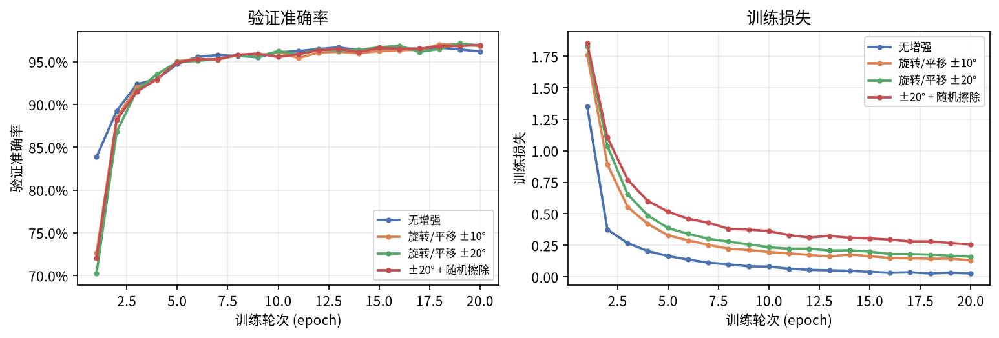

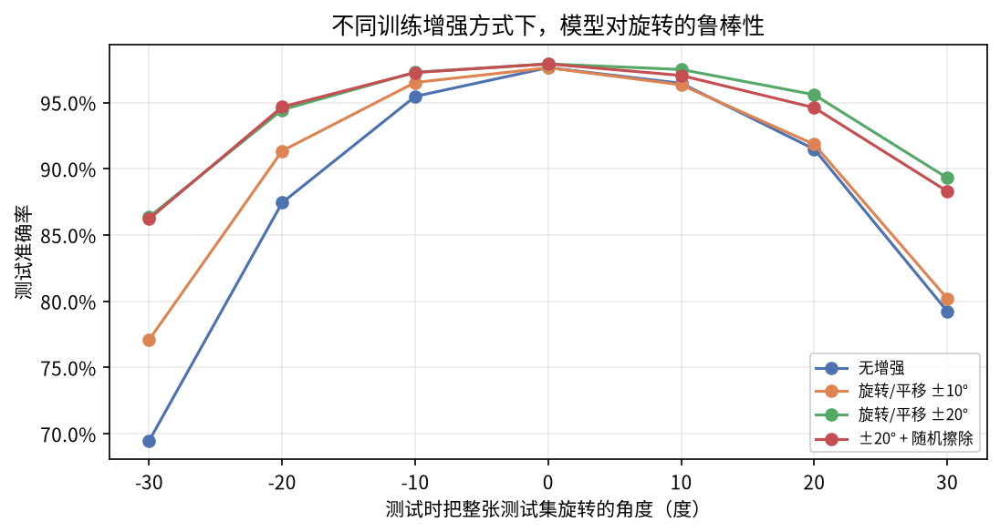

### 11.3 分析

**干净测试集上的精度。** 测试准确率最高的是「旋转/平移 ±20°」（97.91%）。无增强为 97.63%，±10° 增强为 97.62%，±20° 增强为 97.91%，±20° + 随机擦除为 97.91%。在 6,000 张图的场景下，增强对干净测试集的影响并不大（因为 MNIST 数字本身基本是居中的正立图像，旋转/平移增强相当于引入了训练分布与测试分布的偏移）。

**旋转鲁棒性。** 图 17 是更有信息量的结果：把整个测试集旋转不同角度后重新评估。无增强模型在 0° 时准确率 97.63%，旋转 ±20° 后掉到 87.44% / 91.48%；而用 ±20° 旋转增强训练的模型在 ±20° 时仍有 94.45% / 95.59%。旋转角度越大，无增强模型退化越快，增强模型则明显更平缓——**增强的本质是让训练分布覆盖测试时可能出现的变换**，它换来的往往不是干净测试集上的精度，而是分布偏移下的鲁棒性。

**随机擦除。** 在 ±20° 增强上再加随机擦除，测试准确率为 97.91%，与不加擦除的 97.91% 接近；旋转鲁棒性也基本持平。这说明在 MNIST 这种干净、居中的小图上，遮挡类增强的边际收益很小；在真实场景（部分遮挡、复杂背景）中随机擦除才更能体现价值。

## 12. 实验七：最终模型与误差分析

### 12.1 配方选择与多种子结果

前面的实验分别考察了结构、激活函数、Dropout 和增强。为了得到最终模型，本节在全量训练集上比较 5 个候选配方（每个配方训练 12 轮、单一种子），按**验证集准确率**选择，再用选中的配方训练 3 个随机种子、15 轮，报告测试准确率的均值与标准差：

| 候选配方 | 结构 | 数据增强 | 验证准确率 | 测试准确率 |
|---|---|---|---|---|
| R1 LeNet-5 (ReLU+MaxPool) | LeNet-5 | none | 98.67% | 98.82% |
| R2 R1 + Dropout 0.5 | LeNet-5 | none | 98.52% | 99.00% |
| R3 R1 + 增广 ±10° | LeNet-5 | rotate10 | 98.70% | 98.88% |
| R4 R2 + 增广 ±20° | LeNet-5 | rotate20 | 98.50% | 98.91% |
| R5 SmallVGG (更深+BN+Dropout) | SmallVGG | none | 99.32% | 99.59% |

按验证集选出的是「R5 SmallVGG (更深+BN+Dropout)」，最终模型结构为 SmallVGG（3×3 卷积 + BN + Dropout），共 468,202 个参数。三个随机种子的测试准确率分别为 99.59%、99.46%、99.51%，均值 99.52% ± 0.07%；三个种子的波动（标准差 0.07 个百分点）说明在 MNIST 上模型已经比较稳定，用单个种子比较相差 0.1～0.2 个百分点的配置时要谨慎。

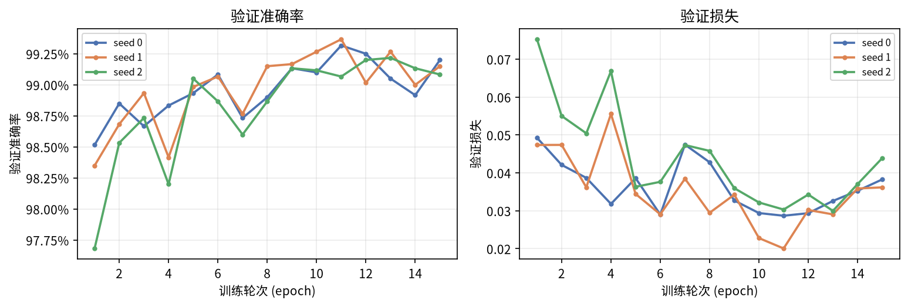

从配方对比还能看到一个与第 8 节呼应的现象：在**全量数据**上，加 Dropout 或增强的 LeNet-5（R2/R3/R4）测试准确率分别为 99.00%、98.88%、98.91%，与最简单的 R1（98.82%）相比分别高 0.18、0.06、0.09 个百分点，单种子下很难区分；而更深的 SmallVGG（R5）测试准确率 99.59%，比最好的 LeNet-5 配方高 0.59 个百分点。原因与第 8 节相同——全量 54,001 张图时 LeNet-5 的过拟合并不严重，正则化带来的偏差与方差收益大致抵消；而"加深网络 + BN + 适度 Dropout"是更有效的容量扩展方式。

### 12.2 混淆矩阵与每类指标

最终模型（第 0 个种子）在 10,000 张测试图上的准确率为 99.59%，共 41 张错分。图 19 是行归一化的混淆矩阵，图 20 是每类 precision / recall / F1：

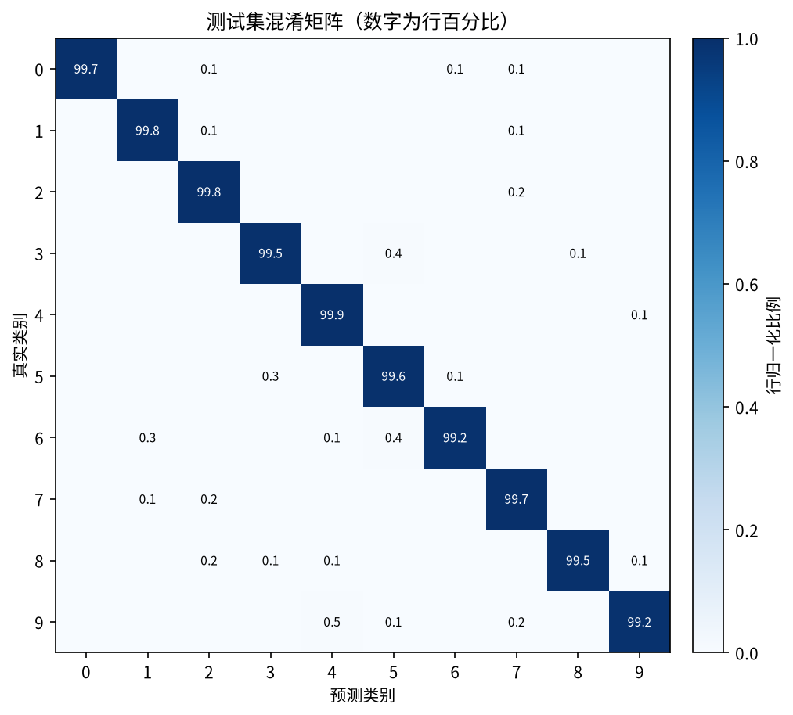

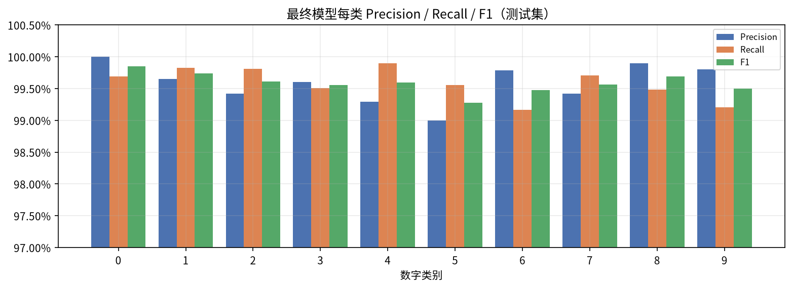

| 类别 | 支持数 | Precision | Recall | F1 | 错分数 |
|---|---|---|---|---|---|
| 0 | 980 | 100.00% | 99.69% | 99.85% | 3 |
| 1 | 1135 | 99.65% | 99.82% | 99.74% | 2 |
| 2 | 1032 | 99.42% | 99.81% | 99.61% | 2 |
| 3 | 1010 | 99.60% | 99.50% | 99.55% | 5 |
| 4 | 982 | 99.29% | 99.90% | 99.59% | 1 |
| 5 | 892 | 99.00% | 99.55% | 99.27% | 4 |
| 6 | 958 | 99.79% | 99.16% | 99.48% | 8 |
| 7 | 1028 | 99.42% | 99.71% | 99.56% | 3 |
| 8 | 974 | 99.90% | 99.49% | 99.69% | 5 |
| 9 | 1009 | 99.80% | 99.21% | 99.50% | 8 |

**分析。** 召回率最低的类别是 6（99.16%），精确率最低的类别是 5（99.00%）。最常出现的混淆是 9 → 4（5 张）、3 → 5（4 张）、6 → 5（4 张）、5 → 3（3 张）、6 → 1（3 张）。这些错误大多来自笔画结构相近的数字（例如 9→4、3→5、6→5），与人的辨认难点一致；混淆矩阵对角线以外的数值都很小，说明模型没有系统性地偏向某个类别。

### 12.3 错分样本

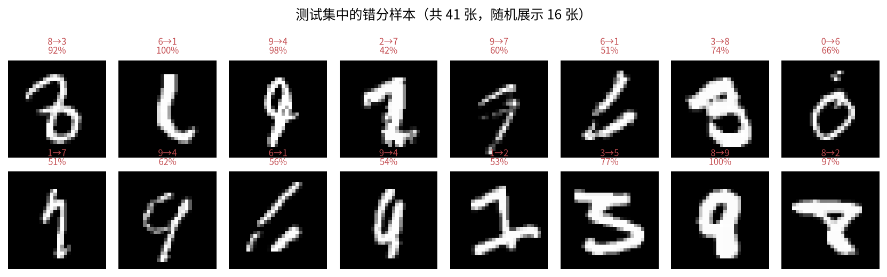

图 21 从 41 张错分样本中随机抽取了 16 张。可以看到相当一部分是书写潦草、笔画缺失或非常规写法的样本，另一些则是人眼也容易犹豫的样本。这说明剩余错误的主要来源是数据本身的歧义（贝叶斯误差），而不是模型还有明显的系统缺陷。

### 12.4 第一层卷积核与特征图

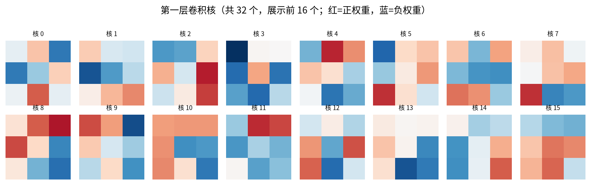

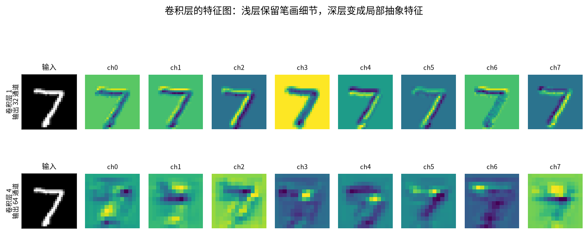

图 23 是第一层 32 个 3×3 卷积核中的 16 个。与经典 LeNet-5 的 5×5 核相比，3×3 核能表达的图案更小，肉眼看起来不如图片里常见的"Gabor 条纹"那么直观，但仍能辨认出若干方向性的亮暗对比模式（例如中心与两侧反号、上下或左右方向的红蓝交替），它们的作用是检测局部笔画边缘与拐角。这正是 CNN 可解释性的经典证据——第一层学到的是与位置无关的局部模式，而不是某个数字的完整模板。

图 24 中，浅层（第一个卷积层）的特征图保留了较多的空间细节，不同通道分别响应不同的笔画方向和位置；深层（最后一个卷积层）的特征图空间尺寸缩小到 7×7，响应变成更抽象的局部区域，不同通道对应数字的不同部件。越深的层越"看不清"原始像素，但语义信息越集中，这就是 4.3 节所说的"空间分辨率下降、语义信息上升"。

### 12.5 置信度分析

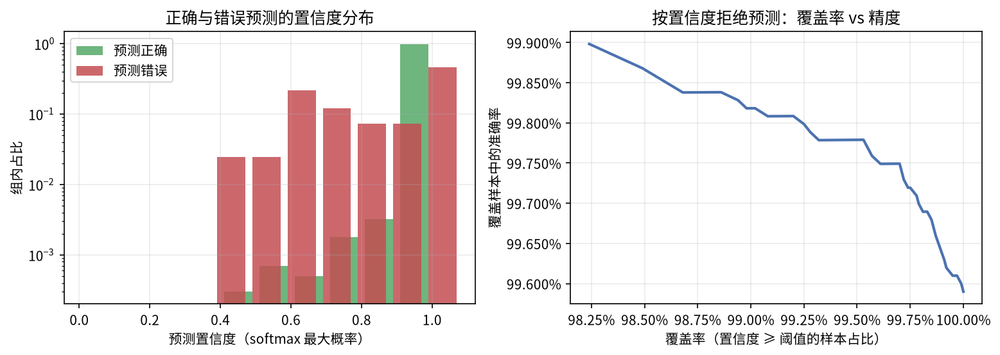

正确预测的平均置信度为 99.8%，错误预测的平均置信度为 78.9%：模型对自己的错误预测信心明显更低，但并非完全"知道自己不知道"。图 22 右侧把置信度当作拒绝阈值：如果只保留置信度超过阈值的预测，覆盖率与准确率之间存在明显的权衡。本模型把整体准确率提高到 99.5% 以上后，若要求被保留样本的准确率不低于 99.8%，最多还能覆盖约 99.2% 的测试样本（即拒绝约 0.8% 最不可靠的输入，其中包含了大部分错误样本）；精度要求再高（例如 99.9%）时，覆盖率会迅速降到 0——因为 41 个错误样本中有相当一部分的置信度并不低，"用置信度拒识"只能解决一部分问题。

### 12.6 最终模型的旋转鲁棒性

最终模型（配方「R5 SmallVGG (更深+BN+Dropout)」）在旋转后的测试集上的准确率：

| 旋转角度 | -30° | -20° | -10° | 0° | 10° | 20° | 30° |
|---|---|---|---|---|---|---|---|
| 准确率 | 83.57% | 95.74% | 99.10% | 99.59% | 99.17% | 97.41% | 90.79% |

即使配方中不包含旋转增强，最终模型对 ±10° 的小角度旋转仍有一定容忍度（99.10% / 99.17%，相比 0° 的 99.59% 只下降 0.49 / 0.42 个百分点）：小角度旋转在数字中心附近可以局部近似为小幅平移，而卷积 + 池化对这种局部平移有一定容忍度；但 ±30° 时准确率降到 83.57% / 90.79%，说明这种容忍度只在很小的角度范围内成立。如果应用场景中图像朝向不固定，应当在训练时加入旋转增强（第 11 节），或者先做朝向归一化。

## 13. 实验八：Fashion-MNIST 上的验证

MNIST 的数字图像干净、居中、类别差异明显。为了检验前面的结论是否能迁移到更难的图像数据，又在 Fashion-MNIST 上做了同样的 CNN vs MLP 对比。Fashion-MNIST 与 MNIST 尺寸、规模、类别数完全相同（28×28、60,000 训练 / 10,000 测试、10 类），但内容是 T 恤、裤子、外套等服装，类内差异大、类间差异小，难度明显更高。

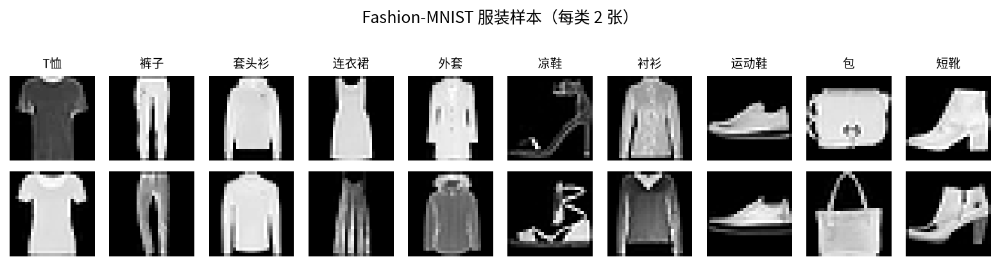

| 模型 | 参数量 | 验证准确率 | 测试准确率 | 训练耗时 |
|---|---|---|---|---|
| CNN（LeNet-5 现代结构） | 44,426 | 88.87% | 88.71% | 30 s |
| MLP（784-256-128） | 235,146 | 89.07% | 88.05% | 60 s |

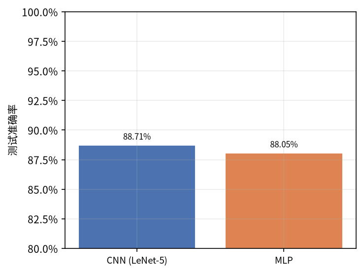

**结果分析。** 在 Fashion-MNIST 上，CNN 的测试准确率为 88.71%，MLP 为 88.05%，CNN 高 0.66 个百分点；在 MNIST 上两者差距是 1.11 个百分点。两个模型在 Fashion-MNIST 上的绝对准确率都明显低于 MNIST（同一 CNN 从 98.80% 降到 88.71%），符合"任务更难"的预期。值得诚实记录的是：**CNN 相对 MLP 的优势并没有在更难的数据上放大**（0.66 对 1.11 个百分点），两者只训练 10 轮且没有针对 Fashion-MNIST 调参，可能都还没跑满这个任务的性能，因此这个比较只能说明"CNN 仍然更好"，不能说明"CNN 的优势更大"。

这也再次说明：**在一种数据上得到的超参数结论不能直接搬到另一种数据上**。本实验没有为 Fashion-MNIST 重新调参（学习率、轮数、Dropout、增强都与 MNIST 相同），因此这些数字只用于验证"CNN 优势方向"是否一致，而不是该数据集上的性能上限，也不能用单次运行的 0.66 个百分点去论证更强的结论。

## 14. 讨论

### 14.1 CNN 的优势来源：归纳偏置而不是参数量

把实验一、实验四和实验八放在一起看：LeNet-5 用 44,426 个参数在 MNIST 上达到 98.80%，MLP 用 235,146 个参数只达到 97.69%；在更难的 Fashion-MNIST 上，CNN 仍比 MLP 高 0.66 个百分点。卷积网络把"局部性"和"平移等变"写进了结构，因此同样的数据量下能学到更可迁移的特征；但归纳偏置也是一把双刃剑：如果任务本身不满足这些先验，或者数据和训练预算不足以让 CNN 兑现先验，CNN 的优势就会缩小甚至消失——实验四中 MLP 在部分表格数据集上反而更好，本实验数据量实验中 600 张图时 CNN 也输给了 MLP，都是同一类现象。

### 14.2 激活函数：ReLU 族成为默认选择的原因

实验二给出了两条证据：在 Adam 下，ReLU 族的测试准确率为 98.06% 左右，Sigmoid 为 93.61%，差距 4.45 个百分点；梯度消失诊断中，Sigmoid + SGD 的网络 6 轮后仍停在随机水平（11.35%），第一层梯度只有 9.3e-05 量级。ReLU 的优势不只是"不饱和"，还包括计算便宜（一次 max）、在正半轴保持梯度尺度、天然产生稀疏激活。它的缺点是负半轴梯度为 0，可能造成神经元"死亡"，LeakyReLU / ELU / GELU 用很小的代价缓解了这个问题；本实验中这几种变体与 ReLU 的差距在 0.60 个百分点以内，说明**先解决饱和问题，再谈具体形状**。

### 14.3 Dropout：条件依赖的正则化

实验三中，Dropout 把 6,000 张图场景下的训练-验证差距从 +2.65 个百分点缩小到 +1.28 个百分点，测试准确率从 98.07% 提高到 98.19%；但实验七的全量数据配方对比中，加 Dropout 的 LeNet-5（R2，99.00%）只比不加的（R1，98.82%）高 0.18 个百分点，落在单种子波动范围内，收益远小于过拟合场景。这不是矛盾，而是正则化的基本规律：**正则化用偏差换方差，只有在方差（过拟合）是主要矛盾时才有净收益**。判断是否需要 Dropout 的方法不是看模型多大，而是看训练集与验证集的差距是否显著、验证准确率是否在训练后期回落。

### 14.4 数据量、模型容量与正则化的三角关系

数据量实验显示 CNN 从 600 张到 54,001 张提升 20.68 个百分点，且收益递减；Dropout 实验显示 6,000 张图 + 约 201,110 参数时过拟合明显，而全量数据时不明显。把这两点结合起来：模型容量应当与数据量匹配。数据少时，要么减小模型，要么加正则化（Dropout、权重衰减、数据增强）；数据多时，正则化过强反而欠拟合。本实验中 SmallVGG（更大容量）在全量数据上最好，但在 6,000 张图的小数据上它是否仍然最好并没有测试——这是本实验的一个局限。

### 14.5 超参数的敏感度与实验协议

从实验五看，学习率与优化器的组合影响最大（SGD lr=0.01 在 8 轮内只到 65.30%，而 Adam 达到 97.56%），批大小次之，权重衰减在本实验的范围内影响最小。需要强调协议本身的影响：超参数扫描使用 10,000 张图、8 轮，如果换成全量数据、30 轮，最优学习率和正则化强度都可能不同；"固定 epoch 数比较批大小"会让小批量因为更新次数更多而占便宜。这些偏差在报告中都如实标注，不能把扫描结果当作绝对结论。

### 14.6 实验的局限

1. **数据集有限**：只在 MNIST 和 Fashion-MNIST 两种 28×28 灰度图上验证，没有涉及彩色图像、目标检测、语义分割等更复杂的视觉任务，也没有用 ImageNet 规模的预训练模型。
2. **模型规模有限**：LeNet-5 和 SmallVGG 都是小网络，结论（例如 BN 收益有限、Dropout 依赖过拟合程度）不必然适用于大网络、大数据。
3. **训练预算有限**：大多数对照实验训练 8～20 轮，没有使用学习率调度、早停、模型集成等技巧；部分配置（如 SGD）并未跑到收敛，因此"优化器对比"只能说明本实验预算下的相对表现。
4. **随机性**：超参数扫描与消融实验大多只用了 1 个随机种子，小于 0.2 个百分点的差异不应过度解读；最终模型用了 3 个种子，报告了均值与标准差。
5. **验证集与测试集**：验证集从官方训练集中分层留出，测试集是官方测试集，二者同分布；没有测试分布偏移（如不同书写风格、不同采集设备）下的泛化。
6. **可解释性分析是定性的**：卷积核与特征图的解释基于肉眼观察，没有做定量归因（如 Grad-CAM、显著性图）。

## 15. 结论

1. 用 PyTorch 在 GPU 上完整实现并训练了 LeNet-5 卷积神经网络，在 MNIST 上达到 98.80%（现代结构）和 99.52% ± 0.07%（3 种子最终模型）的测试准确率；相比之下，参数量是它 5.3 倍的 MLP 只有 97.69%。CNN 的优势来自局部连接、权值共享和平移等变的归纳偏置，而不是参数量。
2. 激活函数的选择在本实验中影响显著：Adam 下 ReLU 族比 Sigmoid 高约 4.45 个百分点；在 SGD lr=0.01 下 Sigmoid 网络 6 轮后仍停在 11.35%（随机水平），第一层卷积梯度只有 9.3e-05，比 ReLU 小约 2.1 个数量级，是定量可测的梯度消失现象。激活函数必须和优化器、学习率一起考虑。
3. Dropout 是有效的正则化手段，但只在过拟合存在时有效：6,000 张图 + 大分类头的场景下，Dropout 0.5 把训练-验证差距从 +2.65 个百分点缩小到 +1.28 个百分点，测试准确率从 98.07% 提高到 98.19%；在全量数据上，Dropout 的收益缩小到单种子波动范围内（R2 比 R1 高 0.18 个百分点）。丢弃率过高、作用在卷积层（Dropout2d）都可能适得其反。
4. 数据量是最重要的单一因素：CNN 从 600 张训练图到 54,001 张，测试准确率提升 20.68 个百分点，收益随数据量增加而递减。CNN 相对 MLP 的优势与数据量强相关：600 张时 CNN 反而低 9.7 个百分点，2,000 张起反超，全量时高 1.25 个百分点——归纳偏置需要足够的数据和训练预算才能兑现。
5. 超参数中学习率与优化器的影响最大，批大小次之，权重衰减在本实验范围内影响最小；小批量在固定轮数下收敛更快（更新次数更多），但每轮耗时更长。学习率的合理范围依赖优化器，不能脱离优化器谈"最优学习率"。
6. 数据增强的价值主要体现在鲁棒性上：±20° 旋转/平移增强在干净测试集上的准确率与无增强接近（97.91% 对 97.63%），但把测试集整体旋转 20° 后准确率从 91.48% 提升到 95.59%。是否使用增强取决于应用场景中是否存在相应的变换。
7. 最终模型在测试集上错分 41 张（99.59% 准确率），错误集中在笔画结构相近的数字对（9→4、3→5、6→5），剩余错误主要来自样本本身的歧义；置信度可以在高精度场景下用于拒识，但会牺牲覆盖率。
8. 通过本次实验完整走通了"理解原理 → 实现模型 → 验证正确性 → 控制变量实验 → 可视化分析 → 误差分析 → 讨论局限"的深度学习实验流程，理解了表达能力、优化难度、泛化能力是三个需要分别对待的问题。

## 16. 复现说明

### 16.1 运行步骤

```bash
# 1. 安装 GPU 版 PyTorch（CUDA 13.0 wheel；其它 CUDA 版本换对应 index-url）
pip install torch torchvision --index-url https://download.pytorch.org/whl/cu130

# 2. 准备数据（仓库已附带 data/mnist/*.gz 与 data/fashion/*.gz，可跳过）
bash data/download_mnist.sh
bash data/download_fashion_mnist.sh

# 3. 正确性验证（约 10 秒）
cd exp5_report && python verify.py

# 4. 跑全部实验（本机 GPU 上约 20 分钟；可用 --parts 分片）
python full_experiment.py

# 5. 生成报告（Markdown + docx，需要 pandoc）
python gen_report.py
```

`full_experiment.py` 支持 `--parts 1 2 ...` 只运行指定部分，结果会增量写入 `results.json`；支持 `--out` 指定结果文件。报告中的所有数字由 `gen_report.py` 从 `results.json` 读取，不手工抄写。

### 16.2 文件清单

| 路径 | 说明 |
|---|---|
| `code/data.py` | IDX 解析、分层划分、DataLoader、数据增强、测试集旋转 |
| `code/models.py` | LeNet-5 / SmallVGG / MLP 与激活函数工厂 |
| `code/engine.py` | 训练引擎、环境信息、优化器、梯度范数记录 |
| `code/metrics.py` | 混淆矩阵、每类指标、置信度统计 |
| `code/viz.py` | 全部插图 |
| `data/mnist/*.gz`、`data/fashion/*.gz` | MNIST 与 Fashion-MNIST 原始数据 |
| `exp5_report/full_experiment.py` | 九部分实验主脚本 |
| `exp5_report/verify.py` | 正确性验证脚本 |
| `exp5_report/results.json` | 全部实验指标与曲线数据 |
| `exp5_report/verification.json` | 正确性验证结果 |
| `exp5_report/figures/fig01–fig26` | 报告插图 |
| `exp5_report/gen_report.py` | 从 JSON 生成本报告 |
| `exp5_report/实验五_卷积神经网络_实验报告.md` | 本报告 |

### 16.3 复现注意事项

- 所有随机过程都使用显式种子：随机种子固定为 0，最终模型用 0/1/2 三个种子；数据划分使用分层抽样，验证集固定为 5,999 张。
- GPU 型号、CUDA 版本、cuDNN 版本会影响训练耗时；`torch.backends.cudnn.deterministic=True` 会让 cudnn 选择确定性算法，速度略慢但结果可复现。
- 实验脚本默认使用 GPU，没有 GPU 时会退回 CPU，此时全部实验需要数小时，建议用 `--parts` 分片运行。
- 本报告中的"训练耗时"包含每轮的验证集评估，且受笔记本 GPU 功耗墙影响，只用于量级比较。
- 超参数扫描使用 10,000 张训练图、8 轮，最终模型使用全量数据、15 轮，两者的结论不能直接互推。

## 参考文献

1. LeCun Y., Bottou L., Bengio Y., Haffner P. Gradient-based learning applied to document recognition. *Proceedings of the IEEE*, 1998, 86(11): 2278–2324.
2. LeCun Y., Boser B., Denker J. S., Henderson D., Howard R. E., Hubbard W., Jackel L. D. Backpropagation applied to handwritten zip code recognition. *Neural Computation*, 1989, 1(4): 541–551.
3. Krizhevsky A., Sutskever I., Hinton G. E. ImageNet classification with deep convolutional neural networks. *NIPS*, 2012.
4. Simonyan K., Zisserman A. Very deep convolutional networks for large-scale image recognition. *ICLR*, 2015.
5. Srivastava N., Hinton G., Krizhevsky A., Sutskever I., Salakhutdinov R. Dropout: A simple way to prevent neural networks from overfitting. *Journal of Machine Learning Research*, 2014, 15(1): 1929–1958.
6. Ioffe S., Szegedy C. Batch normalization: Accelerating deep network training by reducing internal covariate shift. *ICML*, 2015.
7. He K., Zhang X., Ren S., Sun J. Delving deep into rectifiers: Surpassing human-level performance on ImageNet classification. *ICCV*, 2015.
8. Nair V., Hinton G. E. Rectified linear units improve restricted Boltzmann machines. *ICML*, 2010.
9. Glorot X., Bengio Y. Understanding the difficulty of training deep feedforward neural networks. *AISTATS*, 2010.
10. Kingma D. P., Ba J. Adam: A method for stochastic optimization. *ICLR*, 2015.
11. Bengio Y., Simard P., Frasconi P. Learning long-term dependencies with gradient descent is difficult. *IEEE Transactions on Neural Networks*, 1994, 5(2): 157–166.
12. Hendrycks D., Gimpel K. Gaussian error linear units (GELUs). *arXiv:1606.08415*, 2016.

