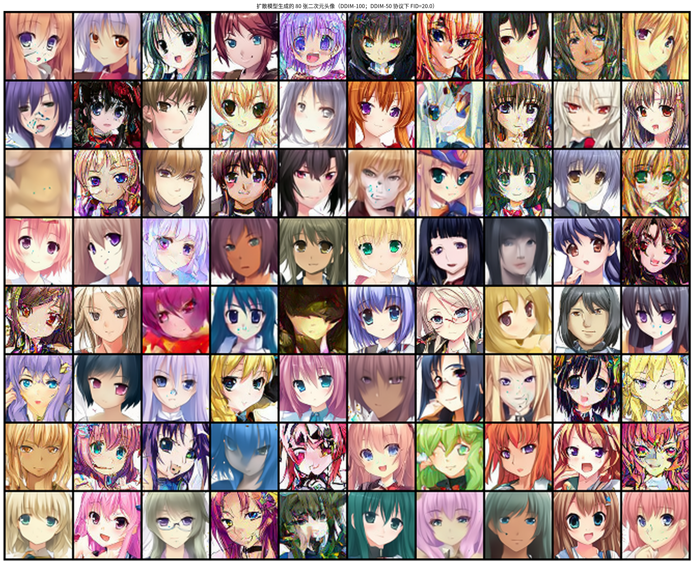

# 实验六：基于生成模型的图像生成

用 PyTorch **从零实现**三种生成式神经网络——DCGAN（生成对抗网络）、卷积 VAE（变分自编码器）与
**DDPM 扩散模型**，在公开的 **Anime Face Dataset**（64×64 二次元动漫头像）上训练生成模型；
系统分析激活函数、Dropout、数据量、潜维、学习率、批大小、Adam β1 与标签平滑的影响，
并用 FID、C2ST、最近邻距离和目检多角度评价生成质量，最后完成 **DCGAN vs VAE vs 扩散模型** 的三方对比。

> 完整课程实验报告（Markdown）在 `exp6_report/` 下，由 `results.json` 自动生成，正文数字可复现。



## 结果速览

| 项目 | 结果 |
|---|---|
| 数据 | 原始 21,551 张，按 md5 去重后 17,029 张；训练 14,029 张，FID 参考集 3,000 张 |
| DCGAN 主实验 | 6,000 步，生成器 3.58M / 判别器 2.77M 参数，**FID 102.0** |
| DCGAN 最终模型 | G 用 LeakyReLU + 潜维 256，6,000 步，**FID 92.7** |
| **DDPM 扩散模型** | U-Net 18.55M 参数、T=1000 余弦调度、EMA，batch 32，**172,000 步 / 9.4 小时**，**FID 20.0（DDIM-50）** |
| 三方对比（FID 越低越好） | **扩散 20.0** < DCGAN 92.7 < VAE 203.1 |
| C2ST（真实/生成可区分性） | 扩散 0.882 < VAE 0.895 < DCGAN 1.000（越低越难区分） |
| 采样成本（生成 1,000 张） | DCGAN ≈0.1 s，VAE ≈0.1 s，**扩散 168 s（DDIM-50）/ 341 s（DDIM-100）** |
| 记忆化程度（最近邻/真实基线） | 扩散 1.020、DCGAN 0.973、VAE 0.853（越接近 1 越不像背训练图） |
| 激活函数（1,500 步） | LeakyReLU FID 192.3 明显优于 ReLU 264.2 / GELU 266.8 |
| Dropout | 判别器泛化改善（差距 12.2→2.6 个百分点），但 FID 233→293 反而变差 |
| 数据量 | 1,000 张时 FID 反而最低（163.3），因为模型在背训练图；最近邻比值 0.920→0.945 |
| 实验规模 | 11 个 GAN 配置 + 2 个 VAE + 1 个扩散模型，39 张插图；GPU 总耗时约 12 小时 |

## 目录结构

```
experiment6/
├── code/
│   ├── data.py          # 数据去重、内存缓存、训练/参考集划分、DataLoader
│   ├── models.py        # DCGAN 生成器/判别器（激活、Dropout 可配置）、卷积 VAE
│   ├── engine.py        # 随机种子、GPU 设备、GAN/VAE 训练循环、采样与插值
│   ├── diffusion.py     # 扩散模型：DDPM U-Net、余弦噪声调度、EMA、DDPM/DDIM 采样
│   ├── metrics.py       # FID、最近邻记忆化分析、颜色多样性、C2ST、重建指标
│   └── viz.py           # 全部插图（数据分布、结构图、训练曲线、样本网格、对比图）
├── data/
│   ├── download_anime_faces.sh   # 一键下载 + 解压数据集
│   └── anime-faces/              # 下载后生成（未随仓库提交）
├── exp6_report/
│   ├── full_experiment.py        # 前十部分实验（DCGAN + VAE）→ results.json + figures/
│   ├── diffusion_train.py        # 第十一部分：扩散模型训练（AMP + torch.compile + 断点续训）
│   ├── diffusion_eval.py         # 扩散模型评估：挑选 EMA checkpoint、FID/C2ST/最近邻/采样速度
│   ├── diffusion_report.py       # 扩散模型插图生成 + results.json 更新
│   ├── verify.py                 # 18 项正确性验证
│   ├── gen_report.py             # results.json → Markdown（可选转 docx）
│   ├── audit_report.py           # 交付前报告自检（数字 / 插图 / 章节）
│   ├── results.json              # 全部实验指标与训练曲线
│   ├── verification.json         # 正确性验证结果
│   ├── figures/                  # 39 张插图（fig01–fig28: GAN/VAE；fig29–fig36: 扩散模型与三方对比）
│   └── 实验六_基于生成模型的图像生成_实验报告.md
├── requirements.txt
└── README.md
```

体积较大的 `checkpoints/`、`diffusion_run/`、`samples_*/` 与 `fid_reference.npz`（合计约 1.7 GB）未随仓库提交，重新训练后会生成。

## 环境

- Python 3.13 + PyTorch 2.14（CUDA 13.0）+ torchvision
- GPU：NVIDIA RTX 4050 Laptop（6 GB）；没有 GPU 时脚本会自动退回 CPU（很慢）
- 绘图：NumPy / Matplotlib（中文字体 Noto Sans CJK SC）
- 生成 docx 需要系统安装 [pandoc](https://pandoc.org/)（`sudo apt install pandoc`）

```bash
pip install -r requirements.txt
# 或手动安装 GPU 版 PyTorch：
pip install torch torchvision --index-url https://download.pytorch.org/whl/cu130
```

## 数据

Anime Face Dataset（Kaggle `soumikrakshit/anime-faces`，CC0 许可），通过 HuggingFace 镜像下载：

```bash
cd data && bash download_anime_faces.sh
```

代码第一次运行时会自动按 md5 去重并缓存成 `data/anime-faces/images_uint8.pt`。

## 运行

```bash
cd exp6_report
python verify.py                   # 18 项正确性验证（约 1 分钟）

# 前十部分：DCGAN + VAE（约 1.3 小时）
python full_experiment.py

# 第十一部分：DDPM 扩散模型（约 9.4 小时，RTX 4050；可 --max-hours 调整）
python diffusion_train.py --steps 172000 --max-hours 9.4
python diffusion_eval.py           # 挑选最佳 EMA checkpoint + 全套指标（约 40 分钟）
python diffusion_report.py         # 生成 fig29–fig36 并把结果写回 results.json

python gen_report.py               # 由 results.json 生成 Markdown
python audit_report.py             # 交付前自检
```

也可以只运行某几部分（结果增量写入 `results.json`）：

```bash
python full_experiment.py --parts 1 2 3      # 数据/结构/正确性验证
python full_experiment.py --parts 4          # DCGAN 主实验
python full_experiment.py --parts 5 6 7      # 激活函数 / Dropout / 数据量
python full_experiment.py --parts 8 9 10     # 超参数 / VAE / 最终 GAN
```

## 主要实验设置

- **数据划分**：去重后固定种子划分为训练池 14,029 张 + FID 参考集 3,000 张（不参与训练）。
- **对比实验协议**：固定优化步数（而非 epoch 数），保证不同数据量/配置下梯度更新次数一致；
  FID 参考集固定、生成样本数固定（对比实验 4,000 张、最终模型 5,000 张），采样种子固定。
- **评价**：FID（Inception-v3 2048 维特征）、C2ST 小 CNN 判别测试、最近邻像素距离、
  颜色多样性（色相熵）+ 人眼目检。
- **扩散模型**：DDPM（Ho et al. 2020）+ 余弦噪声调度（Nichol & Dhariwal 2021）+ 参数 EMA（0.9999）；
  U-Net 4 级下采样（64/32/16/8）、16×16 与 8×8 自注意力、时间步嵌入；bf16 AMP + torch.compile，
  batch 32，Adam lr 2e-4（warmup + 余弦退火），ResBlock Dropout 0.1，随机水平翻转；
  采样用 DDIM（20/50/100 步，η=0）与完整 DDPM-1000 对比。
- **显存安全**：扩散模型训练把进程显存限制在 4.3GB（`set_per_process_memory_fraction(0.72)`），
  实际占用约 1.4GB；训练中可断点续训（`--resume`）。
- **结果数据**：`exp6_report/results.json`、`exp6_report/verification.json`、
  `exp6_report/diffusion_run/eval_results.json`；报告附录 B 给出全部生成模型配置的 FID 汇总。
