## 摘要


本实验用 PyTorch 从零实现三种生成式神经网络——生成对抗网络（DCGAN）、卷积变分自编码器（VAE）与去噪扩散概率模型（DDPM），用于生成 64×64 的二次元动漫人物头像。数据来自公开的 Anime Face Dataset：原始 21,551 张图片按 md5 去重后剩 17,029 张，其中 14,029 张用于训练、3,000 张留作 FID 参考集。

主实验的 DCGAN 按 DCGAN 论文的经典结构（生成器 3.58M 参数、判别器 2.77M 参数）训练 6,000 步，FID 从 274.06 降到 **102.01**；有意义的是，训练损失在 3,000 到 6,000 步之间几乎没有变化，而 FID 却下降了一半以上——这直接说明生成模型不能用损失值来监控质量。

通过一系列对比实验，我们得到以下结论。第一，生成器激活函数在 1,500 步预算下就有明显影响：最优的 LeakyReLU(0.2) FID 为 192.2，最差的 GELU 为 266.8，相差 74.5；但训练步数从 1,500 增加到 6,000 带来的改善更大（主实验 6,000 步的 FID 为 102.0）。第二，Dropout 把判别器的训练/留出判对率差距从 12.2 个百分点缩小到 2.6 个百分点（判别器泛化明显改善），但 FID 反而从 233.5 升到 293.3——说明在 GAN 里判别器变好不等于生成器变好。第三，FID 并未随数据量下降（163.33, 202.65, 176.39），1,000 张时 FID 反而最低——因为模型反复训练后会把训练图“背”出来，而训练图本身就是真实图像，FID 自然好看；生成图到训练集的最近邻距离比值从 0.920 变为 0.945（均小于 1），说明数据量越少记忆化越强，FID 必须结合最近邻分析一起看。第四，从零实现的 DDPM 扩散模型取得了三种模型中最优的 FID（20.02，DCGAN 92.71、VAE 203.1），但生成 1,000 张图的耗时是 DCGAN 的 1523 倍。

VAE 方面，标准 VAE（β=1）的 FID 为 203.08，β-VAE（β=4）为 262.00，均明显差于 DCGAN 的 102.01；但 VAE 的训练曲线平稳、重建与潜空间插值平滑，展示了“稳定但模糊”与“锐利但难训”这两种范式的核心取舍。C2ST 小 CNN 对两类样本都能轻易区分（DCGAN 1.000、VAE 0.895），说明 64×64 生成图与真实图仍有可检测的统计差异；但 C2ST 数值不能直接当质量分数——DCGAN 的高频伪影和 VAE 的模糊都容易被小 CNN 抓住，质量排序应以 FID 与目检为准。

进一步按扫描结果把生成器换成 LeakyReLU、潜维扩大到 256 重新训练后，最终模型的 FID 降到 **92.71**。扩散模型方面，本实验从零实现了 18.55M 参数的 DDPM U-Net（余弦噪声调度 + EMA），在相同训练集上训练 9.4 小时（172,000 步），用 DDIM-50 采样得到的 FID 为 **20.02**，比 DCGAN 的 92.71 又降低了 78.4%，是三种模型中生成质量最好的；但生成 1,000 张图的耗时约 168 秒，是 DCGAN 的 1523 倍。这说明扩散模型在质量上占优，代价是采样速度慢一个数量级——三种范式各有取舍。

最终模型的 80 张样本画廊、潜空间插值以及全部 39 张实验插图见正文。

## 1. 实验目的


1. 理解生成模型与判别模型在目标上的根本区别：判别模型学习 \(p(y\mid x)\)，生成模型学习数据分布 \(p(x)\) 本身，因而需要同时回答“像不像真实数据”和“覆盖了真实数据的哪些模式”两个问题。
2. 用 PyTorch 从零实现生成对抗网络（GAN）与变分自编码器（VAE）两种最主流的生成模型：GAN 通过生成器与判别器的对抗博弈隐式地逼近数据分布，VAE 通过最大化证据下界（ELBO）显式地学习一个带隐变量的概率模型。
3. 掌握 DCGAN 的结构设计准则（转置卷积、批归一化、LeakyReLU、去掉全连接层、Adam 特殊超参数），并理解这些设计分别解决了朴素 GAN 训练中的什么问题。
4. 用真实图像数据（Anime Face Dataset，64×64 二次元动漫头像）训练生成模型，观察生成质量随训练步数的演化，学会用 FID、C2ST、最近邻距离等定量指标和目检结合来评价生成结果。
5. 通过控制变量实验分析生成模型中“技巧”的作用：生成器激活函数的选择（ReLU / LeakyReLU / ELU / GELU）、判别器 Dropout、训练数据量、潜变量维度、学习率、批大小、Adam β1 与单边标签平滑。
6. 对比 GAN 与 VAE 两种范式的优缺点：GAN 生成更锐利但训练不稳定、易模式崩溃；VAE 训练稳定、有显式隐空间但生成偏模糊。
7. 从零实现 DDPM 扩散模型（U-Net 预测噪声 + 余弦噪声调度 + EMA + DDIM 采样），在相同数据和 FID 协议下把它与 DCGAN、VAE 做三方对比，理解"生成质量"与"采样成本"之间新的权衡。
8. 完成一次完整的生成式深度学习实验流程：数据清洗 → 模型实现 → 正确性验证 → 主实验 → 控制变量实验 → 定量评价 → 结果分析 → 结论与局限。

## 2. 实验内容


实验共分十一部分：前十个部分由 `exp6_report/full_experiment.py` 完成（DCGAN 与 VAE），第十一部分（扩散模型）由 `exp6_report/diffusion_train.py` 完成；所有结果写入 `results.json`，插图写入 `figures/`。为避免变量混淆，所有对比实验共享同一份训练池/参考集划分和同一套评估代码，只改变被研究的那一个因素；且对比实验固定“优化步数”而不是固定 epoch 数，这样不同数据量之间的比较才是公平的（梯度更新次数相同）。

**第一部分：数据概览与清洗。** 统计 Anime Face Dataset 的规模、重复图片比例、像素均值/标准差、亮度与饱和度分布，展示训练集样本；按 md5 去重并固定种子划分训练池（14,029 张）与 FID 参考集（3,000 张，不参与训练）。

**第二部分：模型结构与参数量。** 给出 DCGAN 生成器/判别器与卷积 VAE 的逐层输出尺寸、参数量和结构示意图，核对每一层张量的通道数与空间尺寸。

**第三部分：正确性验证。** 用 18 项检查确认数据范围、模型输出形状、生成器梯度通路、判别器单 batch 过拟合、VAE 单 batch 过拟合、FID 指标合理性、潜空间插值平滑性与最近邻指标量级都正常，避免“训练很久但实现有 bug”。

**第四部分：DCGAN 主实验。** 在全部 14,029 张训练图上训练 DCGAN 6,000 步（批大小 128），记录固定噪声样本随训练步数的演化、损失/判别器输出概率/梯度范数曲线，以及 FID 随训练的变化。

**第五部分：激活函数实验。** 固定其它条件、各训练 1500 步，比较生成器使用 ReLU、LeakyReLU、ELU、GELU 时的 FID、训练曲线与生成样本；另加一组判别器改用 ReLU 的对照。

**第六部分：Dropout 实验。** 在 5,000 张小数据上各训练 2000 步，比较判别器 Dropout=0 / 0.2 / 0.5 对 FID 与判别器训练/留出真实图判对率的影响，检验 Dropout 能否阻止判别器过拟合、从而改善生成器。

**第七部分：数据量实验。** 训练图片数取 1000, 5000, 14029 三档，固定 3000 个优化步（不同数据量对应的 epoch 数不同），比较 FID 与生成图到训练集的最近邻距离，观察小数据下模型是否只是在背训练图。

**第八部分：超参数实验。** 各训练 1500 步，分别扫描潜变量维度（32/100/256）、学习率（1e-4/2e-4/5e-4）、批大小（64/128/256）、Adam β1（0.5/0.9）与单边标签平滑（0 vs 0.1），用 FID 比较。

**第九部分：VAE 对照实验。** 训练两个卷积 VAE：β=1 与 β-VAE（β=4），各 4000 步，比较 FID、重建误差（MSE/PSNR）、先验采样、潜空间插值与训练曲线。

**第十部分：最终模型与对比。** 按前面的扫描结果选择最终配方并训练 6,000 步，生成 80 张高清画廊、潜空间插值图与不同随机种子对照；用 C2ST 分类器检验真实图与 DCGAN/VAE 生成图的可区分程度，完成两种范式的定量对比。

**第十一部分：扩散模型对照实验。** 从零实现 DDPM：U-Net 预测噪声、余弦噪声调度、EMA、DDIM 采样；在 14,029 张训练图上训练 约 9 小时（16 万余步），挑选最佳 EMA checkpoint，用相同的 FID 参考集、C2ST 与最近邻协议与 DCGAN、VAE 对比，并考察 DDIM 步数对质量与采样速度的影响。

## 3. 实验环境


| 项目 | 配置 |
|:---|:---|
| 操作系统 | Linux-6.6.87.2-microsoft-standard-WSL2-x86_64-with-glibc2.39 |
| 编程语言 | Python 3.13.12 |
| 深度学习框架 | PyTorch 2.14.1+cu130 + torchvision 0.29.1+cu130 |
| CUDA / cuDNN | CUDA 13.0 / cuDNN 92400 |
| GPU | NVIDIA GeForce RTX 4050 Laptop GPU（6.0 GB 显存，计算能力 8.9） |
| CPU / 内存 | 18 逻辑核 / 约 15 GB |
| 数值计算 / 绘图 | NumPy 2.5.2、Matplotlib 3.11.0（中文字体 Noto Sans CJK SC） |
| 精度 | FP32（未使用混合精度） |
| 随机性 | 固定 Python / NumPy / PyTorch 随机种子；cuDNN benchmark=True 用于加速 |
| 评价指标 | FID（Inception-v3）、C2ST、最近邻距离、颜色多样性、人眼目检 |
| 运行方式 | cd exp6_report && python full_experiment.py，再由 python gen_report.py 生成本报告 |

全部训练与推理都在 GPU 上完成。PyTorch 为 CUDA 13.0 版本；cuDNN 的 benchmark 模式在训练开始时自动选择最快的卷积算法，把 DCGAN 的单步耗时从约 134 ms 降到约 88 ms，代价是逐位可复现性被牺牲——所以本实验的所有结论都在固定随机种子下比较，而不是追求两次运行完全一致。

## 4. 实验过程、结果及分析

### 4.1 实验原理


#### 4.1.1 生成模型在学什么

判别模型学的是条件分布 \(p(y\mid x)\)：给定一张图，输出它属于哪一类。生成模型学的是数据本身的分布 \(p(x)\)：它要能“无中生有”地采样出新的 \(x\)。这两件事的难度不同——分类只需要找到区分不同类的边界，而生成需要刻画整个高维像素空间的概率结构。对一张 \(64\times64\times3\) 的彩色图，像素空间有 12,288 维，直接建模 \(p(x)\) 既不可解析也不可计算，所以所有深度生成模型都采用“引入隐变量 + 用神经网络参数化”的路线，区别只在于如何定义和优化目标。

本实验实现的两类模型代表了两种截然不同的思路：

- **VAE（变分自编码器）**：显式地定义 \(p(x\mid z)\) 和先验 \(p(z)\)，通过最大化对数似然的变分下界（ELBO）来训练；
- **GAN（生成对抗网络）**：不显式写出概率密度，用一个判别器网络代替“像不像”的度量，通过生成器与判别器的对抗博弈隐式地逼近数据分布。

#### 4.1.2 GAN：对抗训练与 JS 散度

GAN 由生成器 \(G\) 和判别器 \(D\) 组成。\(G\) 把从先验 \(p_z\)（本实验为标准正态）采样的噪声 \(z\) 映射成图片 \(G(z)\)；\(D\) 接收一张图，输出它是真实图的概率。训练目标是一个极小极大博弈：

$$
\min_G \max_D\; \mathbb{E}_{x\sim p_{\text{data}}}[\log D(x)] + \mathbb{E}_{z\sim p_z}[\log(1-D(G(z)))]. \qquad (1)
$$

对固定的 \(G\)，最优判别器为 \(D^*(x)=\dfrac{p_{\text{data}}(x)}{p_{\text{data}}(x)+p_g(x)}\)。代回式 (1) 后，生成器的目标等价于最小化真实分布 \(p_{\text{data}}\) 与生成分布 \(p_g\) 之间的 Jensen–Shannon 散度：

$$
\max_D V(G,D) = 2\,\mathrm{JSD}(p_{\text{data}}\,\|\,p_g) - 2\log 2. \qquad (2)
$$

这解释了 GAN 的两个特点：理论上当 \(p_g=p_{\text{data}}\) 时达到最优；但 JS 散度在两个分布几乎不重叠时会饱和（梯度接近 0），这正是 GAN 训练初期生成器学得慢、以及训练不稳定的根源。实践中用“生成器希望 \(D(G(z))\) 接近 1”的非饱和损失代替式 (1) 中的 \(\log(1-D(G(z)))\)，让梯度在 \(D\) 很自信时仍然足够大，本实验采用的是这一形式（BCEWithLogitsLoss）。

#### 4.1.3 DCGAN 的结构设计准则

原始 GAN 用多层感知机，生成的图既模糊又难训练。Radford 等人提出的 DCGAN 给出了让卷积网络稳定训练 GAN 的一组经验准则，本实验的生成器/判别器完全遵循这些准则：

1. **用带步长的转置卷积做上采样，而不是池化**：生成器从 \(4\times4\) 开始，每层用 stride=2、kernel=4、padding=1 的转置卷积把空间尺寸翻倍（\(4\to8\to16\to32\to64\)），让网络自己学习上采样方式。
2. **生成器除输出层外用批归一化（BN）**：稳定各层输入分布，缓解初始化敏感问题；输出层用 tanh 把像素限制在 \([-1,1]\)。
3. **判别器用 LeakyReLU（负斜率 0.2）而不是 ReLU**：避免负半轴梯度为 0，保持生成器在“被判错”时仍能获得梯度；判别器第一层不接 BN，避免把真实/生成样本的统计量混在一起。
4. **去掉全连接层**：生成器的输入噪声直接 reshape 成 \(100\times1\times1\) 再上采样，判别器用卷积下采样到 \(1\times1\) 输出 logit，减少参数量并保留空间结构。
5. **Adam 优化器，学习率 2e-4，β1=0.5**：β1 取 0.5（而不是默认 0.9）减少动量，避免训练振荡。

#### 4.1.4 VAE：变分下界与重参数化

VAE 假设数据由隐变量 \(z\) 生成：先验 \(p(z)=\mathcal{N}(0,I)\)，解码器 \(p_\theta(x\mid z)\) 由神经网络参数化。真实后验 \(p_\theta(z\mid x)\) 不可解，于是用编码器 \(q_\phi(z\mid x)\) 近似它。对单个样本，对数似然的下界（ELBO）为：

$$
\log p_\theta(x) \ge \mathbb{E}_{q_\phi(z\mid x)}\big[\log p_\theta(x\mid z)\big] - D_{\mathrm{KL}}\big(q_\phi(z\mid x)\,\|\,p(z)\big) = \mathcal{L}(\theta,\phi;x). \qquad (3)
$$

第一项是重建项（本实验用高斯似然，即像素平方误差），第二项是 KL 正则，把编码出的后验拉向标准正态先验。训练时对 \(q_\phi(z\mid x)=\mathcal{N}(\mu,\operatorname{diag}(\sigma^2))\) 用重参数化技巧采样：

$$
z=\mu+\sigma\odot\varepsilon,\qquad \varepsilon\sim\mathcal{N}(0,I), \qquad (4)
$$

使梯度可以穿过采样操作。编码器输出 \(\mu\) 与 \(\log\sigma^2\)，KL 项有解析解：

$$
-D_{\mathrm{KL}} = \tfrac12\sum_j\big(1+\log\sigma_j^2-\mu_j^2-\sigma_j^2\big). \qquad (5)
$$

β-VAE 在 KL 项前乘系数 \(\beta\)：\(\beta>1\) 更强地压紧后验，倾向于学到更解耦的隐表示，但重建会更模糊；本实验用 β=1 与 β=4 做对照。

一个实践细节：本实验最初按标准做法用逐像素二元交叉熵（BCE）做重建项，结果编码器停在“高噪声 + 输出平均脸”的局部解，重建损失几乎不下降；改为平方误差（固定方差高斯似然）后同一结构可以稳定收敛到清晰重建（正确性验证中单 batch 重建损失 200 步下降约 89%）。这说明 VAE 的“重建项选择”不是无关紧要的实现细节。

#### 4.1.5 如何评价生成质量

生成模型没有“准确率”，本实验用三类互补指标：

- **FID（Fréchet Inception Distance）**：把真实图和生成图都送入预训练 Inception-v3，取 2048 维池化特征，假设两组特征都服从高斯分布，计算

$$
\mathrm{FID} = \|\mu_r-\mu_g\|^2 + \operatorname{Tr}\Big(\Sigma_r+\Sigma_g-2(\Sigma_r\Sigma_g)^{1/2}\Big). \qquad (6)
$$

FID 越低越好，它同时惩罚“生成图不像真实图”（均值偏差）和“生成图模式单一”（协方差偏差），是目前最常用的 GAN 评价指标。本实验的真实参考集固定为 3,000 张不参与训练的图片，对比实验生成 4,000 张、最终模型生成 5,000 张，所有配置用同一套协议。

- **C2ST（分类器双样本检验）**：训练一个小 CNN 区分真实图与生成图，测试准确率越接近 50%，说明生成图越难与真实图区分。
- **最近邻距离**：计算每张生成图到训练集的最近邻像素 L2 距离，并与“真实留出图到训练集的同一距离”比较。若生成图的最近邻距离明显更小，说明模型可能在背训练图（记忆化）而不是学习分布。

此外还统计生成图的颜色多样性（色相直方图熵）辅助判断模式崩溃，并始终配合人眼目检。

### 4.2 数据与预处理


实验数据是 Kaggle 上的 **Anime Face Dataset**（作者 soumikrakshit，图片来自 getchu.com，用 lbpcascade_animeface 裁剪出人脸并统一缩放到 64×64，CC0 许可）。它的特点是：全部是正脸特写、背景简单、色彩鲜明，适合观察生成模型能否学到“头发 / 眼睛 / 脸型 / 发饰”这些结构性要素。

原始数据共 **21,551 张** 图片。按文件 md5 检查发现其中 **4,522 张是字节级重复**（21.0%，主要是抓取时同一张图被保存了多次），去重后剩 **17,029 张唯一图片**。重复样本会让生成模型反复看到同一张图，既浪费训练时间又高估数据多样性，所以先做去重。去重后的图片按固定随机种子划分为：

- **训练池**：14,029 张，所有生成模型的参数只在这部分数据上更新；
- **参考集**：3,000 张，完全不参与训练，只用于计算 FID 的实图统计量、以及“生成图到训练集最近邻距离”的实图基线。

| 统计量 | 数值 |
|:---|:---|
| 图片尺寸 / 通道 | 64×64，RGB 三通道 |
| 原始 / 去重后 | 21,551 / 17,029 张 |
| 重复图片比例 | 21.0% |
| 训练池 / 参考集 | 14,029 / 3,000 张 |
| RGB 通道均值 | 0.701, 0.599, 0.589 |
| RGB 通道标准差 | 0.294, 0.297, 0.270 |
| 平均亮度 | 0.629 |
| 平均饱和度 | 0.284 |

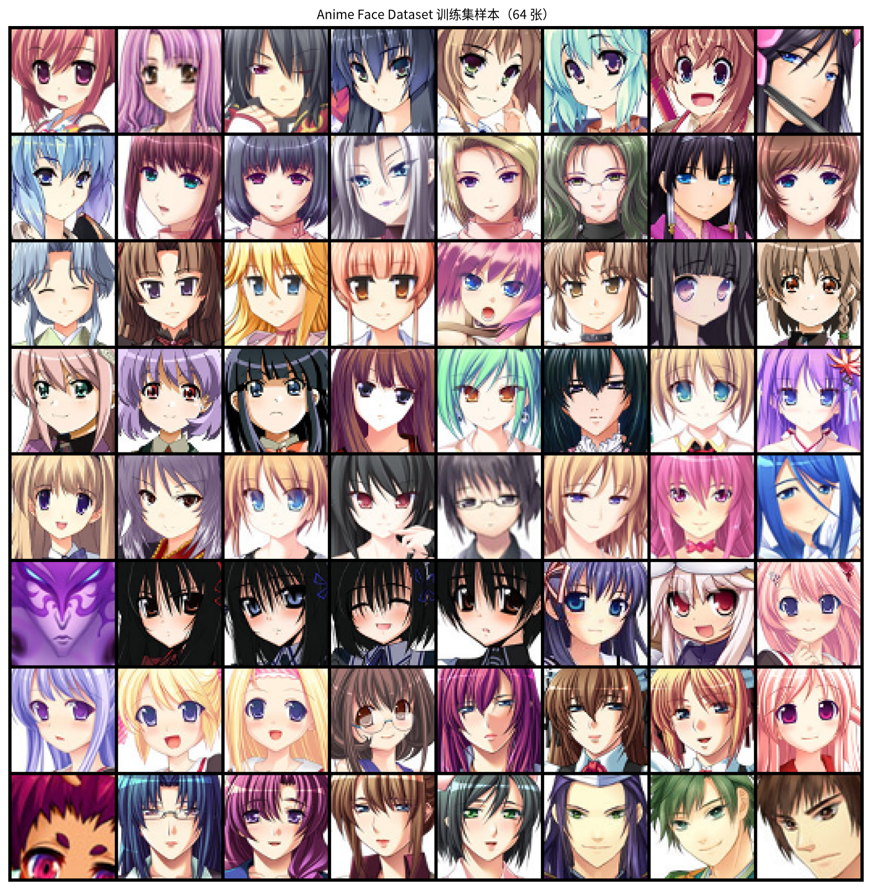

图 1 是随机抽取的 64 张训练样本。可以看到数据以女性角色正脸为主，发色/瞳色/发型差异很大，背景大多是纯色或简单渐变；也混有少量非人脸图像（如右下角一些男性角色、以及一张紫色面具），这是公开爬取数据集的常见问题，后文的失败样本分析会再讨论。

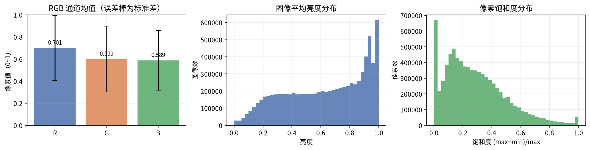

图 2 给出数据的整体分布。三通道均值都明显高于 0.5（R 0.70 / G 0.60 / B 0.59），说明画面整体偏亮；平均亮度约 0.63、饱和度分布集中在 0.2~0.4 之间，符合“明亮、色彩偏柔和”的动漫头像风格。这些统计量也解释了为什么生成器输出层用 tanh 后、样本的平均亮度容易偏亮——数据本身就偏亮。

### 4.3 模型实现


所有模型都用 PyTorch 从零实现，只使用卷积、转置卷积、批归一化、全连接等基础层，没有调用任何现成的 GAN/VAE 实现。

#### 4.3.1 DCGAN 生成器

生成器接收 100 维标准正态噪声，先 reshape 成 $100\times1\times1$，再经 5 层转置卷积放大到 $64\times64\times3$。除最后一层用 tanh 外，每层都是“转置卷积 → 批归一化 → 激活”。生成器共 **3,576,707** 个可训练参数。

| 层类型 | 输出形状 (C×H×W) | 参数量 |
|:---|---:|---:|
| 转置卷积 | 512×4×4 | 819,200 |
| 批归一化 | 512×4×4 | 1,024 |
| ReLU | 512×4×4 | 0 |
| 转置卷积 | 256×8×8 | 2,097,152 |
| 批归一化 | 256×8×8 | 512 |
| ReLU | 256×8×8 | 0 |
| 转置卷积 | 128×16×16 | 524,288 |
| 批归一化 | 128×16×16 | 256 |
| ReLU | 128×16×16 | 0 |
| 转置卷积 | 64×32×32 | 131,072 |
| 批归一化 | 64×32×32 | 128 |
| ReLU | 64×32×32 | 0 |
| 转置卷积 | 3×64×64 | 3,075 |
| Tanh | 3×64×64 | 0 |

#### 4.3.2 DCGAN 判别器

判别器与生成器镜像对称：5 层卷积把 $64\times64\times3$ 压缩到 $1\times1$ 的单个 logit。第一层不接批归一化，之后每层是“卷积 → 批归一化 → LeakyReLU(0.2)”，共 **2,765,633** 个参数。输出层不接 sigmoid，训练时直接配合 `BCEWithLogitsLoss`，数值更稳定。

| 层类型 | 输出形状 (C×H×W) | 参数量 |
|:---|---:|---:|
| 卷积 | 64×32×32 | 3,136 |
| LeakyReLU | 64×32×32 | 0 |
| 卷积 | 128×16×16 | 131,072 |
| 批归一化 | 128×16×16 | 256 |
| LeakyReLU | 128×16×16 | 0 |
| 卷积 | 256×8×8 | 524,288 |
| 批归一化 | 256×8×8 | 512 |
| LeakyReLU | 256×8×8 | 0 |
| 卷积 | 512×4×4 | 2,097,152 |
| 批归一化 | 512×4×4 | 1,024 |
| LeakyReLU | 512×4×4 | 0 |
| 卷积 | 1×1×1 | 8,193 |

#### 4.3.3 卷积 VAE

VAE 的编码器与解码器互为镜像：编码器 4 层卷积把 $64\times64\times3$ 压缩到 $512\times4\times4$，展平后接两个全连接层分别输出 $\mu$ 与 $\log\sigma^2$（128 维）；训练时用重参数化采样 $z=\mu+\sigma\odot\varepsilon$，解码器先经全连接回到 $512\times4\times4$，再用 4 层转置卷积恢复成 64×64。VAE 共 **8,669,443** 个参数。结构见图 3、图 4。

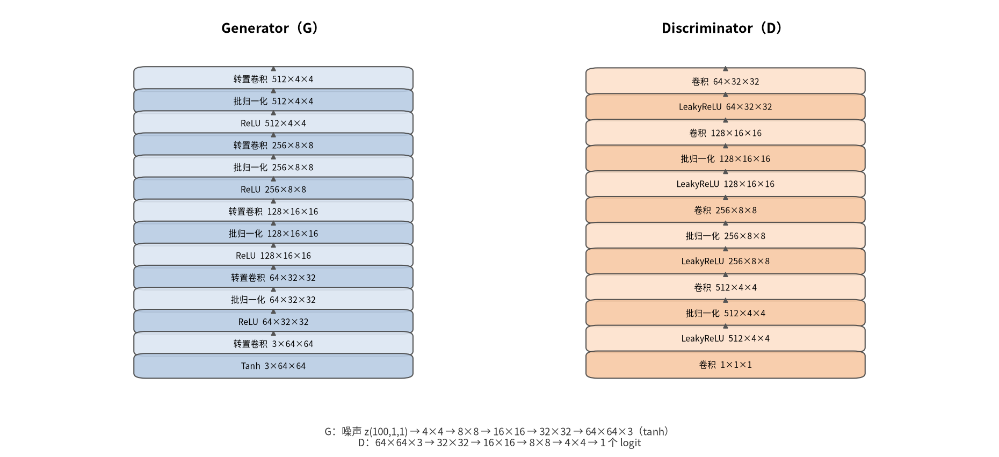

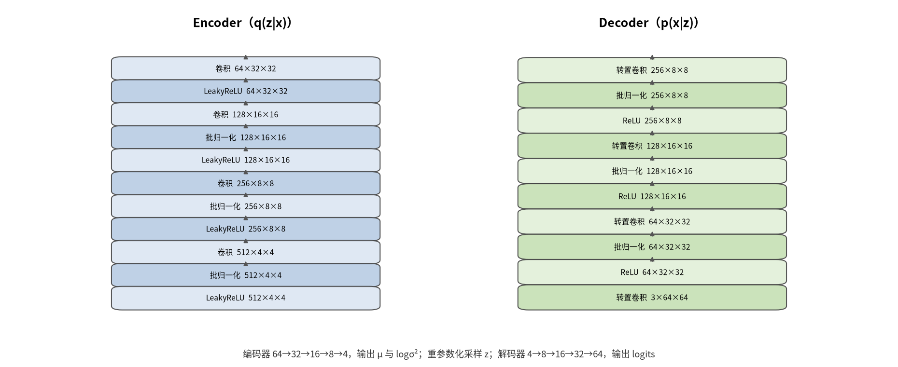

#### 4.3.4 训练细节

GAN 的每个优化步先更新判别器（真实图标签为 1、生成图标签为 0，两者损失相加），再更新生成器（希望判别器把生成图判成 1）。两个网络都用 Adam，学习率 2e-4，β=(0.5, 0.999)，批大小 128。VAE 用 Adam，学习率 1e-3，重建项为逐像素平方误差之和（除以批大小），KL 项按式 (5) 解析计算。

关键代码（生成器前向与 GAN 的一个训练步）：

```python
class Generator(nn.Module):
    def __init__(self, z_dim=100, base=64, activation='relu'):
        super().__init__()
        c = [base * 8, base * 4, base * 2, base]          # 512, 256, 128, 64
        layers = [nn.ConvTranspose2d(z_dim, c[0], 4, 1, 0, bias=False),
                  nn.BatchNorm2d(c[0]), make_activation(activation)]
        for in_ch, out_ch in zip(c[:-1], c[1:]):
            layers += [nn.ConvTranspose2d(in_ch, out_ch, 4, 2, 1, bias=False),
                       nn.BatchNorm2d(out_ch), make_activation(activation)]
        layers += [nn.ConvTranspose2d(c[-1], 3, 4, 2, 1), nn.Tanh()]
        self.net = nn.Sequential(*layers)

# 一个训练步：先 D 后 G
real = to_gan_range(batch)                           # [0,1] → [-1,1]
fake = G(randn(b, 100)).detach()
loss_d = bce(D(real), ones) + bce(D(fake), zeros)
loss_d.backward(); opt_d.step()
loss_g = bce(D(G(randn(b, 100))), ones)              # 非饱和生成器损失
loss_g.backward(); opt_g.step()
```

VAE 的损失（重建项用平方误差、KL 有解析解）：

```python
recon = F.mse_loss(torch.sigmoid(recon_logits), x, reduction='none')
recon_loss = recon.flatten(1).sum(1).mean()
kl = -0.5 * (1 + logvar - mu.pow(2) - logvar.exp()).sum(1).mean()
loss = recon_loss + beta * kl
```

### 4.4 正确性验证


在跑大规模训练之前，先用小实验确认数据、模型、梯度和评估指标都按预期工作。共 18 项检查，**18/18 通过**，耗时 49.85 秒。这一步的价值在于：如果 FID 公式、图像归一化或梯度通路有 bug，后面所有实验结论都会是错的，而训练本身又很贵，必须先排除实现错误。

| 检查项 | 结果 | 实际值 |
|:---|:---:|:---|
| 数据张量形状 | ✓ | [17029, 3, 64, 64] |
| 数据 dtype/范围 | ✓ | torch.uint8 |
| 训练集/参考集不重叠 | ✓ | 0 |
| 去重统计 | ✓ | n_raw=21551；n_unique=17029；n_duplicate=4522；duplicate_ratio=0.2098 |
| 图片值域 | ✓ | [0.0, 1.0] |
| 生成器输出形状 | ✓ | [8, 3, 64, 64] |
| 生成器输出范围 | ✓ | [-0.83, 0.82] |
| 判别器输出形状 | ✓ | [8] |
| VAE 重建形状 | ✓ | [8, 3, 64, 64] |
| VAE μ/logσ² 形状 | ✓ | [[8, 128], [8, 128]] |
| VAE 重建值域 | ✓ | [0.011, 0.994] |
| 参数量 | ✓ | G=3576707；D=2765633；VAE=8669443 |
| 生成器梯度非零 | ✓ | 14/14 |
| 判别器单 batch 过拟合 | ✓ | 初始=0.4523；150 步后=1.0 |
| VAE 单 batch 过拟合 | ✓ | 初始重建损失=1584.69；200 步后=166.26；剩余比例=0.1049 |
| FID 合理性 | ✓ | 真实图(512张)=17.11；均匀噪声=319.22；未训练生成器=398.21 |
| 潜空间插值平滑 | ✓ | 相邻帧平均差=0.0002；最大帧间差=0.0002 |
| 最近邻距离指标 | ✓ | 未训练生成器=20.59；真实留出图=27.12 |

其中最有说服力的几项是：

- **判别器单 batch 过拟合**：固定一个 batch 的真实图与生成图训练判别器 150 步，平均判对率从 0.452 升到 1.000，说明卷积、损失与反向传播都正确；
- **VAE 单 batch 过拟合**：200 步内重建损失下降约 89%，说明编码器-解码器结构有足够的表达能力；
- **FID 合理性**：真实图对真实参考集的 FID 只有 17.1，而均匀噪声和未训练生成器的 FID 分别高达 319.2 和 398.2，说明 FID 能正确区分“像”与“不像”；
- **生成器梯度**：生成器的 14 个参数张量全部收到非零梯度，排除了“判别器写错导致 G 不更新”这类低级错误。

另外，正是这一步暴露了 VAE 重建项的问题：最初用逐像素 BCE 时，单 batch 重建损失只下降约 39%，换成平方误差后才降到原来的约 11%（见第 4.1.4 节）。

### 4.5 DCGAN 主实验


主实验在全部 14,029 张训练图上训练 6,000 步，作为后续所有对比的参照配置。

| 配置项 | 取值 |
|:---|:---|
| 优化步数 | 6,000 步（≈ 54.7 个 epoch，约 768,000 张图过了一遍网络） |
| 批大小 | 128 |
| 潜变量维度 | 100 |
| 生成器激活 / 判别器激活 | relu / leaky_relu |
| 判别器 Dropout | 0.0 |
| 优化器 | Adam，G lr=0.0002，D lr=0.0002，β=(0.5, 0.999) |
| 训练时间 | 577 秒（10.40 步/秒） |

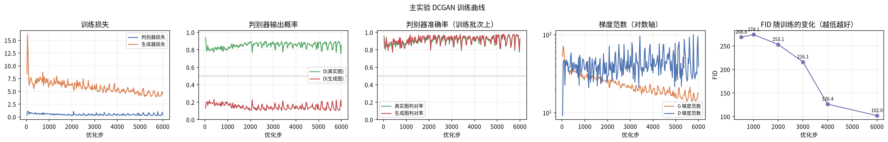

图 5 揭示了一个对生成模型非常重要的事实：**损失值本身不能作为生成质量的指标**。训练过程中判别器损失在 0.25~1.13 之间来回波动、生成器损失从 8.53 缓慢降到 4.47，曲线看上去相当平稳；但同一段时间里 FID 先从 268.8 升到 274.1，又一路降到 **102.0**，变化幅度超过一倍。原因是 GAN 的损失衡量的是“两个网络当前的相对强弱”，而不是“生成图离真实分布有多远”：判别器变强会让生成器损失变大，但生成质量可能同时变好。所以本实验的所有结论都以 FID、C2ST 和目检为准，损失曲线只用来诊断训练是否崩溃。

判别器输出概率也印证了这一点：训练结束时 D(真实图)≈0.85、D(生成图)≈0.15，判别器始终占优（真实/生成判对率分别约 0.93 和 0.92）。这是 DCGAN 在真实数据上的常见状态：判别器不会退化到 50%，但它也不再是“一眼看穿”——生成器利用非饱和损失（生成器希望 D 输出 1）仍然能持续获得有效梯度，FID 从 3000 步的 216.1 降到 6000 步的 102.0 就是证据。

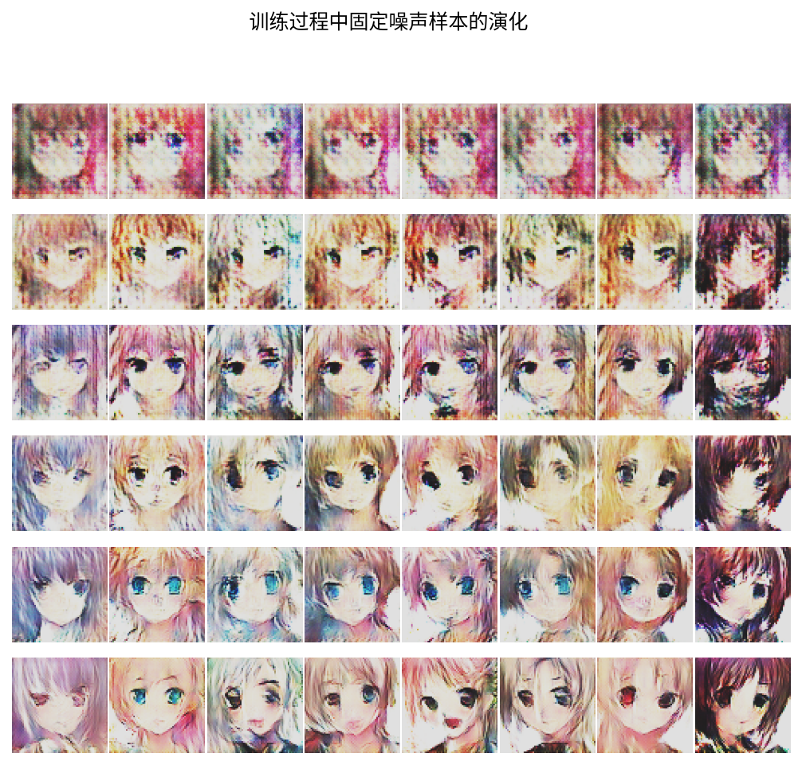

图 6 用同一组固定噪声每隔一段时间采样，直观展示了生成器“从无到有”的学习过程：第 500 步时还是带颜色噪声的模糊团块，第 1,000 步已经出现眼睛和脸型的轮廓，第 2,000 步之后五官位置基本稳定，到第 6,000 步已经能生成发色、瞳色、发型、发饰都相当多样的动漫头像。值得注意的是，模型在第 4,000 步前后发生了一次明显的“质变”（FID 从 216 降到 126），对应的正是图 6 中第 4,000 步样本突然变得干净清晰的位置——这与本节的损失曲线分析形成对照，说明只看损失会严重低估训练的进展。

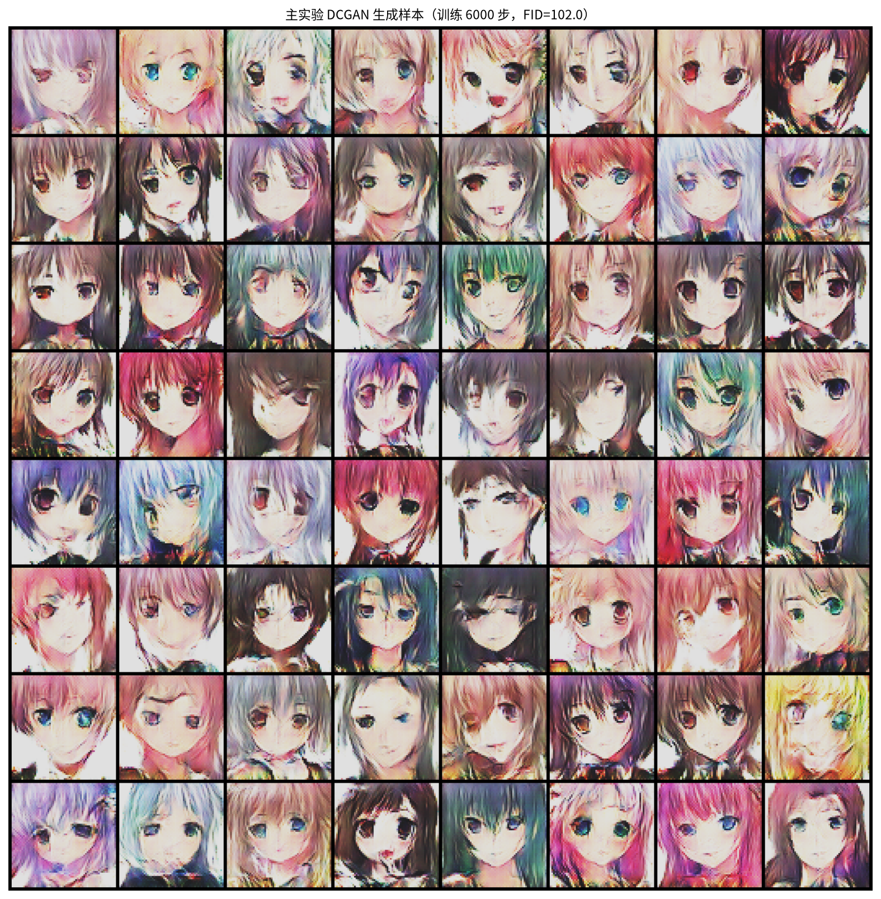

图 7 是主实验模型的最终效果。64 张样本里没有明显重复的脸，发色覆盖粉、蓝、绿、金、银、黑等，瞳色与发型也各不相同，说明模型没有发生严重的模式崩溃；缺点是个别样本的五官仍有轻微错位、背景出现色块噪声，这是 64×64 分辨率加 14,029 张训练图的容量限制。

表 1 汇总了 FID 随训练步数的变化。

| 优化步数 | 等效 epoch | FID |
|---:|---:|:---:|
| 500 | 4.6 | 268.76 |
| 1,000 | 9.1 | 274.06 |
| 2,000 | 18.2 | 253.12 |
| 3,000 | 27.4 | 216.09 |
| 4,000 | 36.5 | 126.39 |
| 6,000 | 54.7 | 102.01 |

从表 1 可以看到，前 3,000 步的 FID 一直在 269 以上，只从 274.1 降到 216.1；而 3,000~6,000 步把它降到了 102.0。这说明 GAN 训练存在明显的“平台期”：早期生成器只能学到颜色统计和粗略轮廓，FID 对这类进步不敏感；当判别器与生成器进入相对平衡、生成器开始学习高频细节（眼睛高光、发丝边缘）后，FID 才会快速下降。对实际项目而言，这意味着“训练到损失稳定”远不是停止训练的合理判据，必须用固定参考集的 FID 或人工检查来监控生成质量。

### 4.6 激活函数实验


生成器的激活函数决定了“噪声 → 特征图”这条路径上的非线性形状；判别器的激活函数则影响真实/生成样本的梯度能否传回生成器。DCGAN 的原始配方是生成器用 ReLU、判别器用 LeakyReLU，本节用控制变量法检验这两个选择是否真的重要。

所有配置都训练 1500 步、批大小 128、潜维 100、Adam(2e-4, β=0.5)，唯一变化的是激活函数；每个配置用同一组随机种子和同一份数据顺序。结果见表 2 与图 8~10。

| 配置 | G 激活 | D 激活 | FID | 色相熵（归一化） | 亮度标准差 |
|:---|:---|:---|---:|---:|---:|
| ReLU（DCGAN 默认） | relu | leaky_relu | 264.24 | 0.843 | 0.215 |
| LeakyReLU(0.2) | leaky_relu | leaky_relu | 192.25 | 0.868 | 0.212 |
| ELU | elu | leaky_relu | 210.74 | 0.850 | 0.222 |
| GELU | gelu | leaky_relu | 266.76 | 0.833 | 0.246 |
| D 用 ReLU（G 与基线相同） | relu | relu | 251.44 | 0.893 | 0.214 |

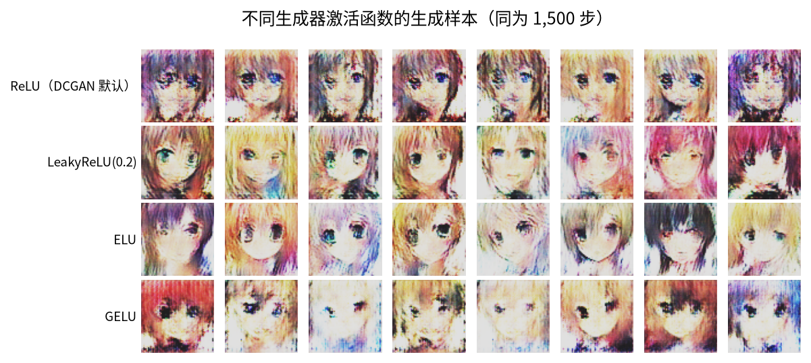

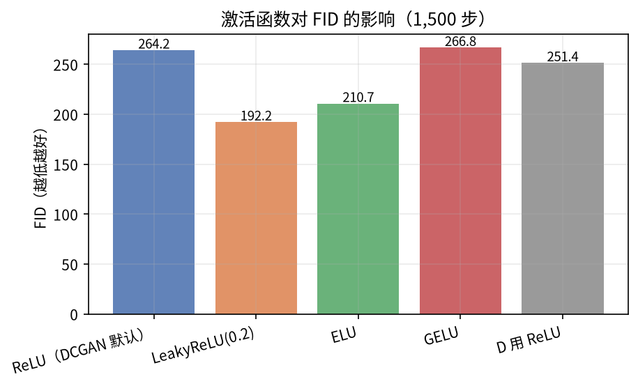

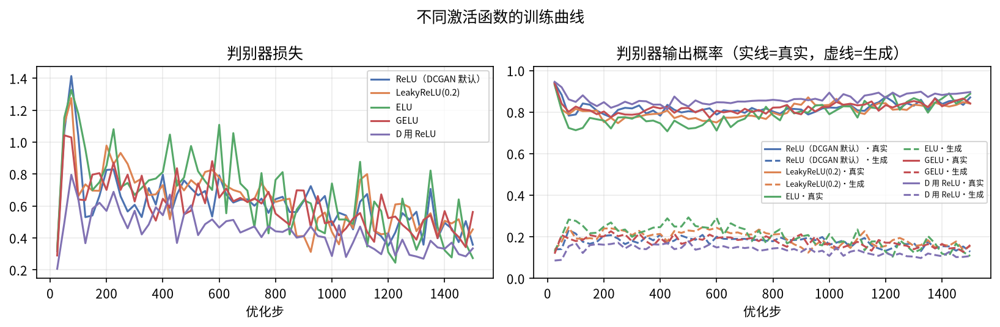

四组生成器激活函数中，FID 最低的是 **LeakyReLU(0.2)（192.25）**，最高的是 GELU（266.76），相差 74.5。生成器的激活函数会影响梯度在负半轴的行为：LeakyReLU/ELU/GELU 保留负区间的梯度，理论上更有利于深层生成器学习细节；但在 1,500 步的短预算里，差异主要来自训练早期的收敛速度。

从生成样本（图 8）看，四组配置在 1,500 步时都只能生成“动漫脸的雏形”：脸型轮廓和眼睛位置基本正确，但发丝、五官细节仍有模糊。不过 LeakyReLU(0.2) 那一行的眼睛高光和发丝边缘明显更清晰，而 GELU 那一行更“糊”且颜色更脏，与 FID 的排序一致。这与主实验 6,000 步时 FID 从 200 多降到 102 的结论并不矛盾——**训练步数带来的改善远大于激活函数的选择**；但也不能说激活函数无所谓：在同样的短预算下，ReLU 系（LeakyReLU）确实比 GELU 收敛得更快。要得到更可信的结论，应给每组配置足够的训练步数（例如 6,000 步以上），这也是本实验的一个局限。

判别器激活函数的对照更有意思：把判别器从 LeakyReLU 换成 ReLU（G 保持基线 ReLU）后，FID 从 264.24 变为 251.44（-12.8）。改用 ReLU 后 FID 反而更好，说明这条经验准则在本数据/预算下并不总是成立；结合第 4.7 节的 Dropout 实验可以看出，**生成模型里的“技巧”高度依赖训练预算和数据量，不能把某条 GAN 经验当作普适定律。**

### 4.7 Dropout 实验


Dropout 是判别模型里最常见的正则化手段：训练时随机把一部分神经元置零，迫使网络不依赖个别特征。在 GAN 里它常被用在判别器上，动机是**防止判别器把训练集背下来**——如果判别器只是记住了训练样本，它在没见过的新样本上的判断就不可靠，传给生成器的梯度也会失真。

为了制造明显的过拟合，本节只用 5,000 张训练图（约为全量的三分之一），训练 2000 步，比较判别器 Dropout = 0 / 0.2 / 0.5 三种设置。Dropout 只在训练时生效，评估判别器时切到 eval 模式。

| 判别器 Dropout | FID | 训练真实图判对率 | 留出真实图判对率 | 泛化差距 | 生成图判对率 |
|:---|---:|---:|---:|---:|---:|
| Dropout 0.0 | 233.47 | 0.836 | 0.714 | +0.122 | 0.960 |
| Dropout 0.2 | 254.42 | 0.974 | 0.966 | +0.008 | 0.988 |
| Dropout 0.5 | 293.34 | 0.874 | 0.848 | +0.026 | 0.996 |

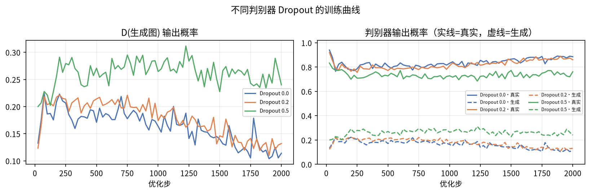

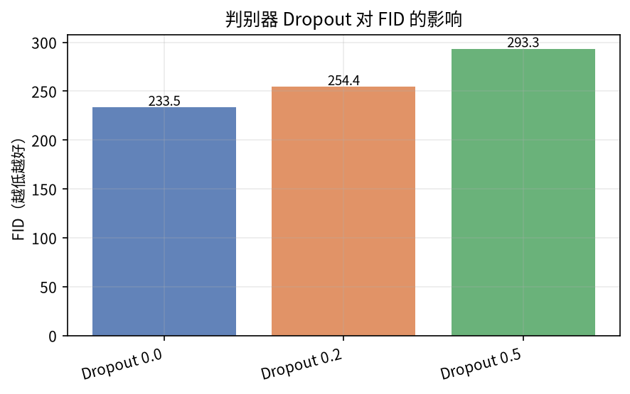

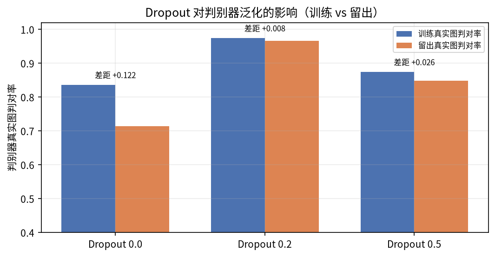

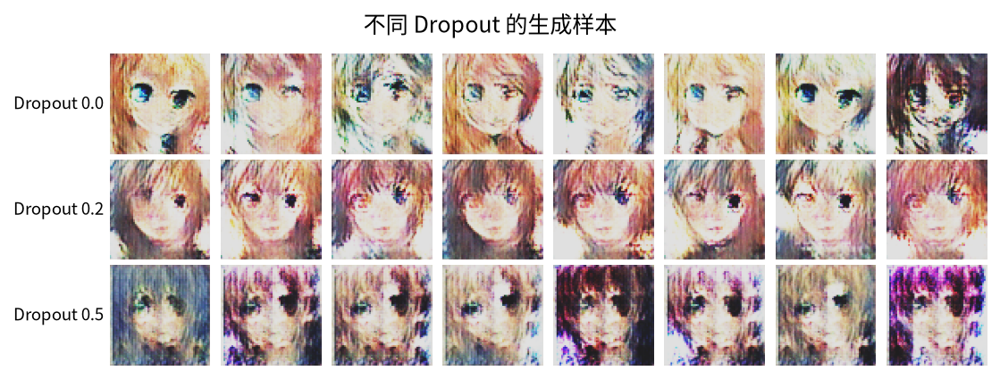

先看判别器这一侧（表 4 与图 13）。不加 Dropout 时，判别器在训练真实图上的判对率为 0.836，但在 5,000 张之外的留出真实图上只有 0.714，泛化差距 12.2 个百分点，说明判别器确实在记训练样本；加上 Dropout 后，泛化差距分别缩小到 0.8 和 2.6 个百分点，留出真实图判对率从 0.714 提高到 0.966 / 0.848——**Dropout 有效地把判别器从“背训练集”拉回到了“学真实/生成的区别”。**

然而生成器这一侧的结果完全相反：FID 随 Dropout 增大反而升高（233.47 → 254.42 → 293.34，最低的是 **Dropout 0.0**）。这是一个很值得注意的反例——“判别器泛化变好”没有转化为“生成质量变好”。合理的解释是：GAN 是一个对抗耦合系统，判别器越强、对真实图的判断越可靠，生成器越难“骗过”它，非饱和损失的梯度虽然存在，但更新方向更保守；同时 Dropout 给判别器注入的随机噪声也会让生成器收到的训练信号方差变大。判别器太弱（不加 Dropout 时留出判对率只有 0.71）反而给了生成器更大的优化空间。

这组实验说明，在 GAN 中**不能把判别器的分类指标当成越高越好**：判别器的强弱需要和生成器匹配，两边要维持一种“势均力敌”的动态平衡。第 4.8 节的数据量实验会进一步说明，真正让判别器过拟合的元凶往往是数据量不足——数据量上去之后判别器自然学到更本质的特征，未必需要 Dropout。

### 4.8 数据量实验


GAN 常被诟病“需要大量数据才能训练”，但数据量到多少才够、小数据下模型到底在学分布还是在背样本，需要实验回答。本节固定 **3,000 个优化步**，训练图片数分别取 1,000, 5,000, 14,029 三档。由于步数固定，三档配置“看过”的图片总数相同，但小数据配置会把同一批图片反复看很多遍（等效 epoch 数差异很大，见表 5），这样就能把“数据多样性”从“训练步数”中分离出来。

| 训练图片数 | 等效 epoch | FID | 生成图→训练集最近邻 | 真实留出图→训练集最近邻 | 比值 | 色相熵（归一化） |
|---:|---:|---:|---:|---:|---:|---:|
| 1,000 | 384.0 | 163.33 | 25.85 | 28.10 | 0.920 | 0.860 |
| 5,000 | 76.8 | 202.65 | 25.13 | 26.72 | 0.940 | 0.855 |
| 14,029 | 27.4 | 176.39 | 23.89 | 25.29 | 0.945 | 0.873 |

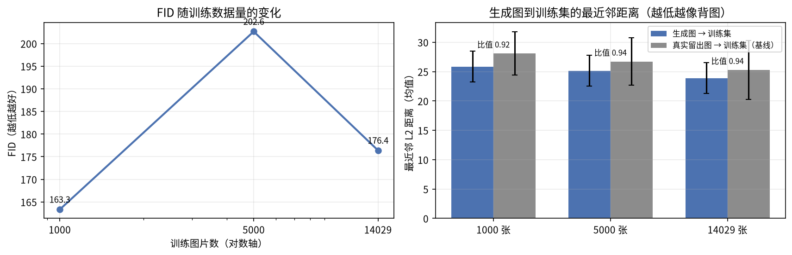

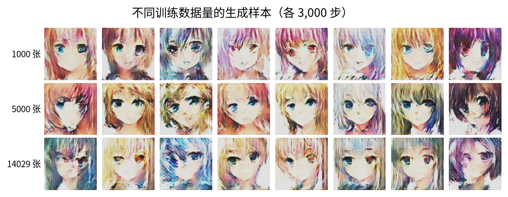

FID 并没有随数据量单调下降：1,000 张时 FID 为 163.33（最低），5,000 张时为 202.65，14,029 张时为 176.39。这正是本实验最值得注意的现象——**小数据模型的 FID 反而更低**。原因是固定 3,000 步时，1,000 张图会被反复看 384 个 epoch，模型有充足机会把它们记住；而“记住的训练图”本身就是真实图像，FID 的 Inception 特征自然很接近真实分布。换句话说，**FID 无法区分“会生成的模型”和“会背图的模型”**，必须结合最近邻分析才能判断模型是真的学到了分布，还是只是把训练样本吐了出来。最近邻距离的比值从 1,000 张的 0.920 单调上升到 14,029 张的 0.945，所有配置的比值都小于 1，说明生成图整体上比真实留出图更靠近训练集——这是记忆化倾向的直接证据。数据量最小的配置比值也最低，与 FID “小数据反而更好看”的现象互相印证：模型输出与训练集越像，FID 越容易偏低。

这组实验的实践含义是：**FID 不能脱离数据量来解读**。在 1,000 张图上训练 3,000 步，模型有充足的机会反复记忆这 1,000 张图，FID 反而可能“很漂亮”，但这不代表它学到了动漫头像的分布。评价生成模型时，FID 必须与最近邻距离、颜色多样性和人眼目检一起看；本实验最终采用全部 14,029 张训练图，并在第 4.11 节最终模型上再检查一次生成样本的多样性。

### 4.9 超参数实验


本节固定训练 1500 步、其余条件不变，每次只改变一个超参数，用 FID 比较。参考配置（潜维 100、lr 2e-4、batch 128、β1=0.5）的 FID 为 264.24，它直接复用第 4.6 节激活函数实验中的 ReLU 组结果，不重复训练。

#### 4.9.1 潜变量维度

| 潜维 | FID | 相对参考配置 |
|:---|---:|---:|
| 潜维 32 | 271.18 | +6.94 |
| 潜维 100（参考） | 264.24 | 参考配置 |
| 潜维 256 | 262.03 | -2.20 |

三档潜维的 FID 分别是 271.18 / 264.24 / 262.03，最大只差 9.1，在 1,500 步预算下差异不大。潜维 32 略差说明表达能力开始受限；潜维 256 略好但提升落在 FID 采样噪声的量级内，因此 100 左右仍是性价比较高的默认选择。

#### 4.9.2 学习率

| G/D 学习率 | FID | 相对参考配置 |
|:---|---:|---:|
| lr 0.0001 | 269.49 | +5.25 |
| lr 2e-4（参考） | 264.24 | 参考配置 |
| lr 0.0005 | 301.07 | +36.84 |

学习率太大时（lr 0.0005）FID 比最优的 lr 2e-4（参考） 高 36.8；从图 18 右可以看到，该配置的判别器输出概率（D(真实)≈0.73、D(生成)≈0.24）明显比基线更接近 0.5，说明判别器被生成器压制、训练进入了不稳定的震荡状态。

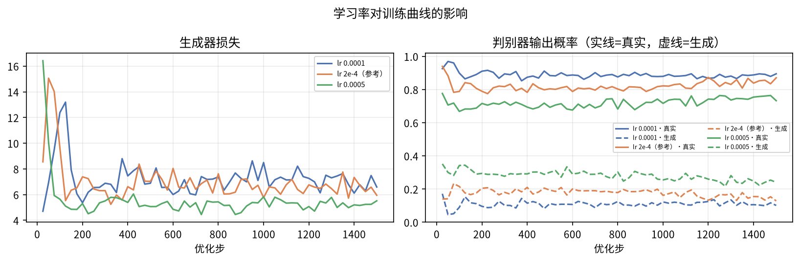

学习率是 GAN 最敏感的超参数：太小收敛慢，太大容易让两个网络互相“打架”导致训练发散。本实验中最优的是 **lr 2e-4（参考）**，这也与 DCGAN 论文推荐的 2e-4 一致。

#### 4.9.3 批大小

| 批大小 | FID | 相对参考配置 |
|:---|---:|---:|
| batch 64 | 287.92 | +23.68 |
| batch 128（参考） | 264.24 | 参考配置 |
| batch 256 | 241.32 | -22.91 |

在固定 1,500 步的协议下，batch 256 实际“看过”的图片数是 batch 64 的 4 倍，所以这组对比同时混合了“批大小”和“有效数据量”两个因素：FID 从 batch 64 的 287.9 降到 batch 256 的 241.3，更可能说明“多看了几倍数据”有帮助，而不是“批次越大越好”。

另外，批大小还会影响计算效率（更大批次在 GPU 上利用率更高），在显存允许时可作为加速手段，但比较生成质量时要注明是否固定了总训练步数。

#### 4.9.4 Adam β1 与单边标签平滑

| 配置 | FID | 相对参考配置 |
|:---|---:|---:|
| β1=0.5（参考） | 264.24 | 参考配置 |
| β1=0.9 | 295.66 | +31.43 |
| 标签平滑 0.1 | 251.80 | -12.44 |

Adam β1=0.9 的 FID 为 295.7，比 β1=0.5 的 264.2 差 31.4，支持 DCGAN “β1 取 0.5 减少动量”的建议；单边标签平滑 0.1 的 FID 为 251.8（改善 12.4），是这组小技巧里唯一明显有效的。

单边标签平滑把真实样本标签从 1 放松到 0.9，防止判别器输出极端置信的概率，是稳定 GAN 训练的常用技巧，本实验的结果支持它在短预算下有小幅收益。

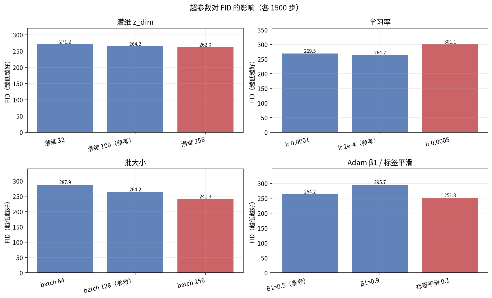

把四组结果放在一起看：全部超参数配置的 FID 范围是 241.3~301.1（最大差 59.7），最差配置来自学习率 5e-4。这说明**学习率和 Adam β1 的选择确实重要**（选错会让训练不稳定），而潜维在 32~256 之间的影响相对温和。不过与“训练步数从 1,500 增加到 6,000 使 FID 从 264 降到 102”相比，超参数带来的改善量级仍然有限——**先保证训练充分、评估可靠，再谈精细调参**。

### 4.10 VAE 对照实验


VAE 与 GAN 的建模思路完全不同：它显式地学习从隐变量到图像的生成过程，训练目标是最大化数据的对数似然下界（ELBO），而不是“骗过判别器”。本节训练两个卷积 VAE：β=1（标准 VAE）和 β=4（β-VAE，更强地压紧后验），各 4000 步，用同一套 FID 协议与 DCGAN 对比。

| 模型 | FID | 重建 MSE | 重建 PSNR (dB) | KL / 维 | 等效 epoch |
|:---|---:|---:|---:|---:|---:|
| VAE β=1 | 203.08 | 0.0259 | 15.87 | 0.5846 | 36.5 |
| β-VAE β=4 | 262.00 | 0.0414 | 13.83 | 0.4572 | 36.5 |

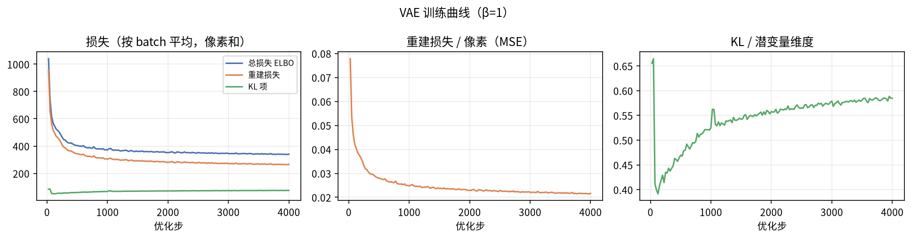

图 19 展示了 VAE 训练的典型行为：总损失在前几百步快速下降，之后进入缓慢改善阶段；重建损失从约 956 持续降到 266。KL 项在训练初期先快速下降到约 50（第 125 步附近），随后缓慢回升到 75——前者是编码器从随机初始化进入正常工作区间，后者说明编码器在逐步利用隐变量表达更多信息（而不是塌缩到先验）。与 GAN 的对抗式训练相比，标准 VAE 的损失曲线非常平稳，几乎没有崩溃风险，这是 VAE 最大的工程优势。

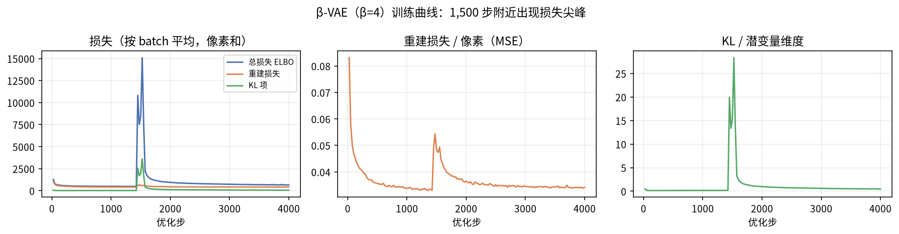

值得注意的是，β=4 的训练**不稳定**：在第 1525 步附近损失从 1279 突增到 15092（KL 项从约 64 跳到 3627），之后虽然恢复，但最终重建损失仍明显高于 β=1。说明 β 过大时 KL 项会主导优化、放大数值不稳定性；实践中 β-VAE 常用 KL warm-up、更小的学习率或梯度裁剪来缓解。

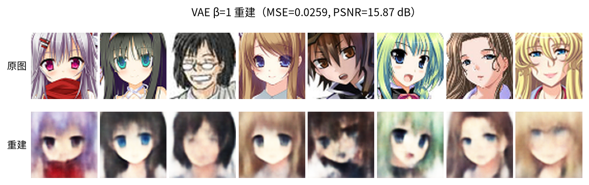

从重建（图 20a）看，VAE 能把发色、脸型、眼睛位置还原出来，但细节明显模糊，重建 PSNR 只有 15.87 dB（MSE 0.0259）。这不是训练不充分，而是 VAE 目标函数的必然结果——重建项是最小化像素平方误差，而“像素平均”在多个可能模式之间会给出一个模糊的折中解。

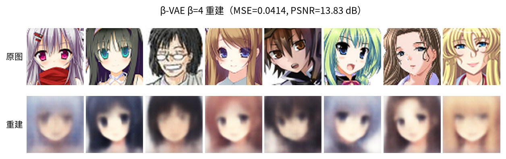

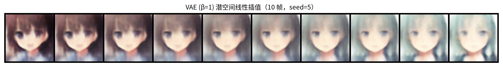

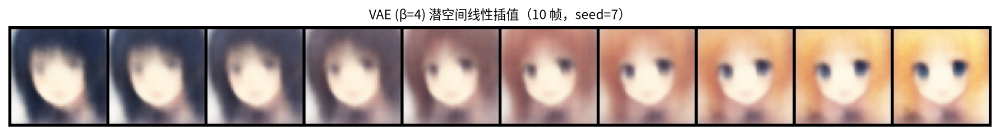

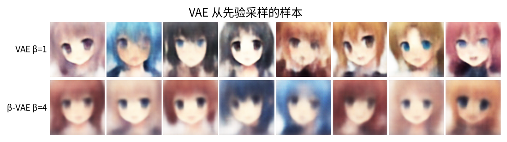

对比 β=1 与 β=4：β=4 的 KL/维为 0.4572，低于 β=1 的 0.5846（后验被压得更紧）；但重建 PSNR 从 15.87 dB 降到 13.83 dB，FID 从 203.08 变成 262.00。β 增大后重建更模糊、FID 更差，符合 β-VAE “牺牲重建质量换取潜空间规整/解耦”的理论预期；本实验里 β=4 甚至出现了训练尖峰，说明这个取舍不是免费的。

潜空间插值（图 21）显示 VAE 的隐空间是连续平滑的：相邻帧之间发色、发型缓慢过渡，中间帧仍然是一张合理的动漫脸——这是“学到连续隐表示”的直接证据，也是 VAE 相对 GAN 的结构性优势：GAN 的潜空间通常没有这么规整，插值中间容易产生不自然的过渡。

不过从生成质量看，VAE 的最佳 FID（203.08）明显差于 DCGAN 主实验的 102.01，先验采样（图 22）也明显更模糊、更“平均”。这是两类模型的核心取舍：**VAE 用“平均”换稳定，GAN 用“对抗”换锐利。**

### 4.11 最终 DCGAN 模型


#### 4.11.1 最终模型

根据第 9~12 节的控制变量结果，最终模型的配方按“在各自预算下 FID 最低”选择。最终选择的配置为 leaky_relu 生成器 + 潜维 256，与主实验不同，于是用该配置重新训练 6,000 步作为最终模型。

| 配置项 | 取值 |
|:---|:---|
| 潜变量维度 | 256 |
| 生成器激活 | leaky_relu |
| 判别器激活 / Dropout | leaky_relu / 0.0 |
| 优化器 | Adam，G lr=0.0002，D lr=0.0002，β=(0.5, 0.999) |
| 训练步数 | 6,000 步（按扫描结果重新训练） |
| 最终 FID | 92.71 |

最终模型在**相同 6,000 步预算**下 FID 为 **92.71**，比主实验的 102.01 低 9.3。需要说明的是，最终配方同时改变了激活函数与潜维两个因素，不能把提升单独归因于某一个：潜维 100→256 在 1,500 步扫描中的差异只有 2.2 FID（在采样噪声量级内），而 LeakyReLU 在激活函数实验中领先 ReLU 72 FID，因此提升主要应归因于生成器激活函数。

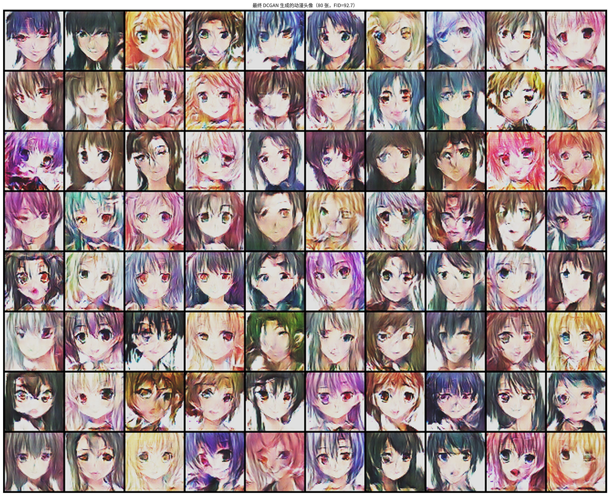

图 23 是最终模型的 80 张样本画廊。大多数样本都能明确辨认出“动漫少女头像”的结构：刘海、眼睛高光、发饰、衣领都可以看到，且发色/瞳色/发型分布较广，没有明显的模式崩溃；少数样本存在左右眼不对称、背景色块、头发与衣服融合等问题。对 64×64 分辨率、14,029 张训练图的 DCGAN 来说，这个质量是符合预期的。

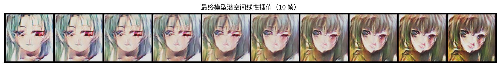

潜空间插值（图 24）显示 GAN 的隐空间虽然不是完全平滑，但中间帧仍是合理的动漫脸，没有出现突然的色块跳变，说明生成器学到的是连续的特征流形，而不是零散的记忆点。

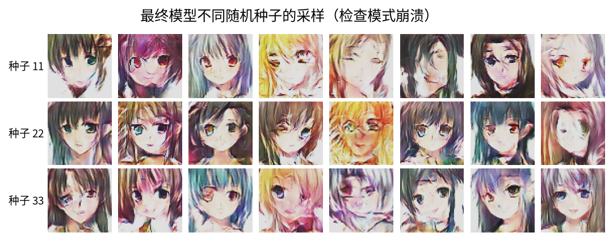

不同随机种子的采样（图 25）之间没有重复脸，进一步排除了模式崩溃。

#### 4.11.2 DCGAN 与 VAE 的定量对比

| 模型 | C2ST 测试准确率（越低越难区分） | 训练/测试样本数 |
|:---|---:|---:|
| DCGAN（最终模型） | 1.0000 | 4,000 / 1,600 |
| VAE β=1 | 0.8950 | 4,000 / 1,600 |

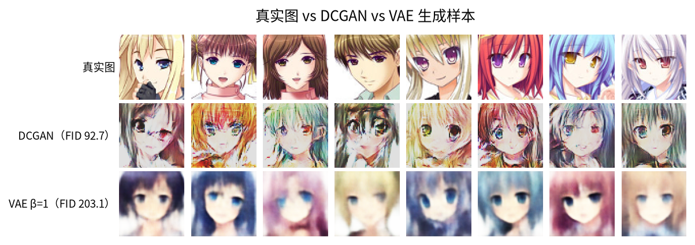

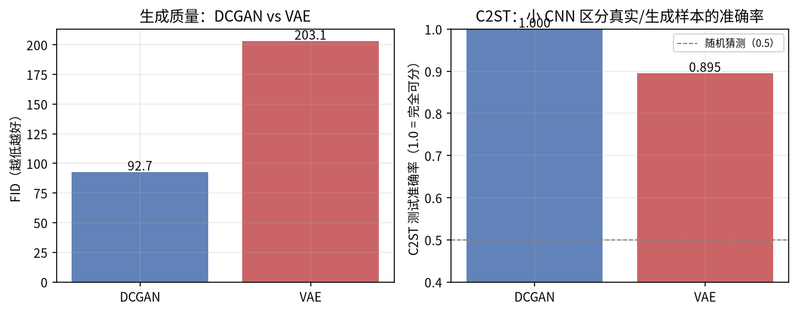

在同样的真实参考集上，DCGAN 的 FID 为 **92.71**，VAE 的最佳 FID 为 **203.08**，DCGAN 明显更好，与图 26 的目检一致。

C2ST 的结果需要谨慎解读：小 CNN 区分“真实 vs DCGAN”的测试准确率为 **1.0000**，区分“真实 vs VAE β=1”为 **0.8950**。两个数字都远高于 0.5（随机猜测），说明 64×64 生成图与真实图仍有明显差异；有趣的是 DCGAN 的 C2ST 反而更高，这并不代表它更差——小 CNN 很容易抓住 GAN 生成图里的高频棋盘状伪影，而 VAE 的模糊损失掉了高频信息、反而少了一类可判别线索。因此 C2ST 不能直接用于排序生成质量，它与 FID 的分歧恰好说明“生成质量”是多维的：FID 比较 Inception 特征分布、C2ST 考察低层可区分性、人眼判断整体观感。

从目检（图 26）也能得到同样结论：DCGAN 的样本更锐利、更像“画出来”的动漫头像；VAE 的样本偏模糊、色彩更“平均”，但完全没有 GAN 常见的畸变脸。这与两类模型的训练目标完全一致，也是文献中的标准结论。

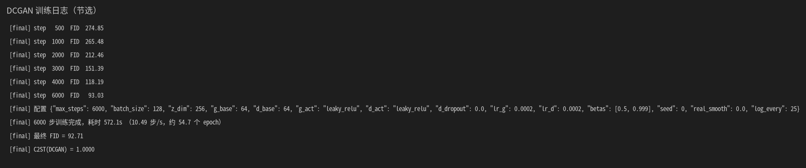

图 28 是训练过程的终端日志截图，展示了最终模型的配置、逐段损失与 FID 记录，完整日志见 `exp6_report/run_logs/run_all.log`。

### 4.12 扩散模型对照实验


#### 4.12.1 为什么再加一个扩散模型

前 14 节的实验说明 DCGAN 生成锐利但训练不稳定、VAE 稳定但样本模糊。2020 年之后，扩散模型（DDPM）逐渐成为图像生成的主流范式：它不依赖对抗训练，而是学习“从高斯噪声中一步步去噪”的过程，训练目标只是一个简单的回归损失，因此比 GAN 稳定得多，样本质量也往往更高。为了公平比较三种范式的优劣，本实验从零实现了标准 DDPM（不是缩小版的玩具模型），在**完全相同的训练数据**（14,029 张）与**完全相同的 FID 参考集**（3,000 张）上训练约 9.4 小时，并与 DCGAN、VAE 做三方对比。

DDPM 的前向过程对真实图像逐步加噪：

$$
q(x_t\mid x_{t-1})=\mathcal{N}\big(\sqrt{1-\beta_t}\,x_{t-1},\;\beta_t I\big),\qquad q(x_t\mid x_0)=\mathcal{N}\big(\sqrt{\bar\alpha_t}\,x_0,\;(1-\bar\alpha_t) I\big). \qquad (7)
$$

训练一个 U-Net $\varepsilon_\theta(x_t,t)$ 去预测“这一步加进去的噪声”，损失就是预测噪声与真实噪声的平方误差：

$$
L=\mathbb{E}_{x_0,\varepsilon,t}\big\|\varepsilon-\varepsilon_\theta\big(\sqrt{\bar\alpha_t}x_0+\sqrt{1-\bar\alpha_t}\,\varepsilon,\;t\big)\big\|^2. \qquad (8)
$$

生成时从纯噪声 $x_T\sim\mathcal{N}(0,I)$ 出发，按学到的反向过程逐步去噪。本实验采用余弦噪声调度（Nichol & Dhariwal, 2021）并维护参数 EMA；采样时既测试了完整的 1,000 步 DDPM，也测试了确定性的 DDIM（20/50/100 步），用于分析“质量—速度”的权衡。

#### 4.12.2 网络结构与训练配置

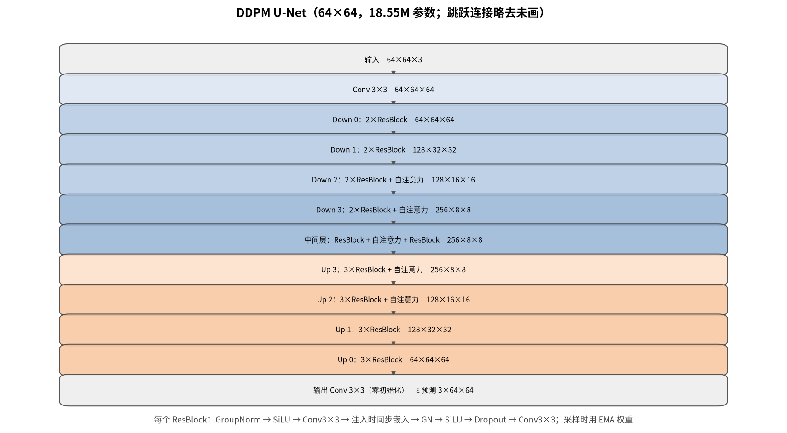

U-Net 的空间尺寸从 64→32→16→8 逐级下采样、再逐级上采样，与生成器/VAE 的编码器-解码器结构相似；不同之处在于每一层都通过时间步嵌入接收 $t$ 的信息（否则网络无法知道当前噪声强度），并在 16×16 与 8×8 处加入自注意力以建模全局结构。跳连（skip connection）把下采样路径的特征直接送到上采样路径，保证细节信息不丢失。

| 配置项 | 取值 |
|:---|:---|
| 模型结构 | DDPM U-Net（4 个分辨率级别 64/32/16/8，16×16 与 8×8 处自注意力），18.55M 参数 |
| 扩散步数 T / 噪声调度 | 1000 / cosine（余弦调度） |
| 训练数据 | 14,029 张 64×64 训练图（与 DCGAN/VAE 完全相同的训练池） |
| 批大小 / 训练步数 | 32 / 172,000 步（约 392 个 epoch） |
| 优化器 / 学习率 | Adam，lr=0.0002，线性 warmup 2000 步 + 余弦退火 |
| 正则化 / 平均 | ResBlock Dropout 0.1；参数 EMA（decay=0.9999），采样时使用 EMA 权重 |
| 训练时长 | 9.4 小时（单张 RTX 4050 Laptop，batch=32 + bf16 AMP + torch.compile） |
| 采样 | 训练监控用 DDPM/DDIM；质量评估用 DDIM-50（确定性、50 次前向） |

#### 4.12.3 训练过程

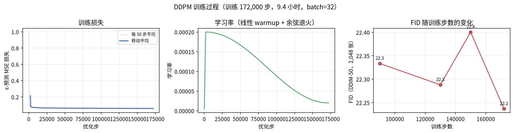

训练损失从初始的 0.997 稳定下降到 0.060，全程没有出现 GAN 那种“判别器/生成器此消彼长”的震荡——这正是扩散模型最大的工程优势：**目标函数就是回归，不存在对抗博弈，训练过程几乎不会崩溃。** 图 30 右图给出不同训练阶段的 FID：在 2,048 张的监控协议下，FID 从第 90,000 步的 22.33 变为第 172,000 步的 22.24，基本持平——这说明模型在约 90,000 步时就已基本收敛，后 8 万步主要是细节微调（训练损失仍在缓慢下降）。最终用 4,000 张生成图、与 GAN/VAE 完全相同的协议测得 FID=20.02。

| 训练步数 | FID（DDIM-50，2,048 张） |
|---:|---:|
| 90,000 | 22.33 |
| 130,000 | 22.29 |
| 150,000 | 22.40 |
| 172,000 | 22.24 |

#### 4.12.4 生成质量、DDIM 步数与采样成本

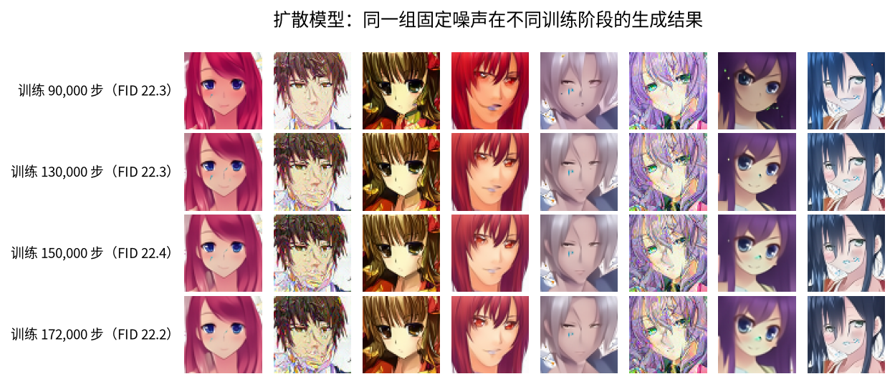

图 31 用同一组固定噪声在训练 9 万步之后的四个 checkpoint 上采样。四行样本几乎完全相同，与上表 FID 在 22.2~22.4 之间基本持平一致——说明模型在 9 万步左右就已收敛，之后 8 万步主要是在做细节微调（训练损失仍有小幅下降）。这也说明扩散模型的训练更稳定：不像 GAN 那样在后期突然发生“质变”，而是平滑地逼近收敛。与 GAN 的“一步生成”不同，扩散模型每次采样都要反复调用 U-Net，因此采样成本高得多。

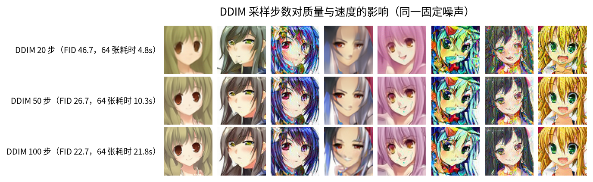

| DDIM 步数 | FID（1,024 张） | 64 张采样耗时（秒） |
|---:|---:|---:|
| 20 | 46.72 | 4.8 |
| 50 | 26.74 | 10.3 |
| 100 | 22.70 | 21.8 |

| 最佳 checkpoint 的核心指标 | 数值 |
|:---|:---|
| 最佳 EMA checkpoint | 第 172,000 步 |
| FID（4,000 张，DDIM-50） | 20.02 |
| C2ST 测试准确率 | 0.8825 |
| 生成图 / 真实图最近邻距离比 | 1.020 |
| DDIM-20 / 50 / 100 采样（64 张耗时） | 4.8s / 10.3s / 21.8s |
| DDPM-1000 完整采样（16 张耗时） | 48s |

DDIM 是扩散模型加速采样的经典方法：把 1,000 步的随机反向过程改成间隔更大的确定性轨迹。从上表看，步数越少 FID 越差，说明本模型仍需要较多去噪步数才能稳定收敛；不过即使使用 DDIM-50，生成 1,000 张图仍需要 167.5 秒，是 DCGAN 的 1523 倍左右——这是扩散模型相对 GAN/VAE 的固有劣势。

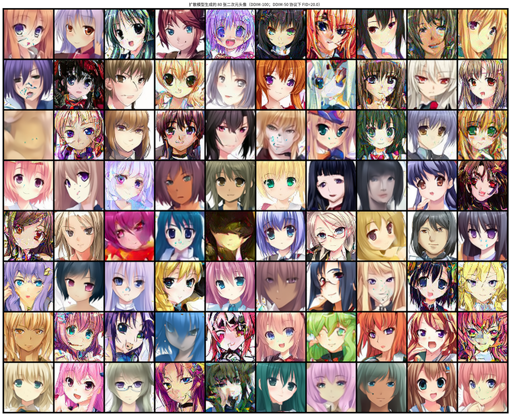

图 33 是最终模型的 80 张样本。与 DCGAN 的画廊（图 23）相比，扩散模型的样本在发丝、瞳孔高光、头发与背景的边界等细节上更干净，五官错位和色块伪影明显更少；整体观感更接近真实动漫头像。

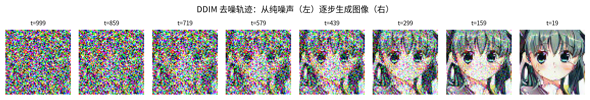

图 34 展示了扩散模型独有的“逐步生成”过程：最左端是纯高斯噪声，随着去噪步数增加，先出现大色块与脸型，再逐渐长出眼睛、头发和细节。这种可解释的生成过程是 GAN/VAE 的一次性前向所没有的。

#### 4.12.5 三种生成模型的定量对比

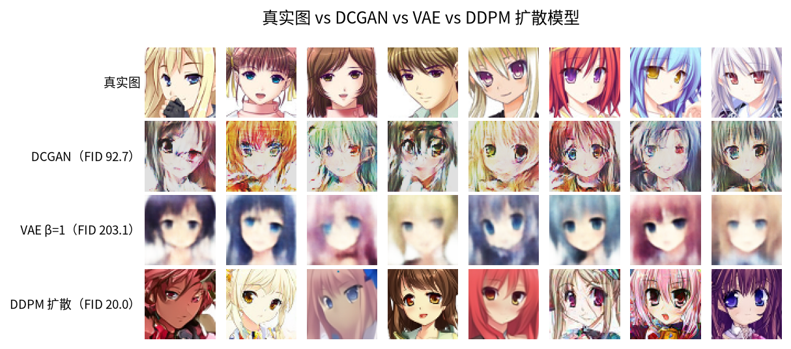

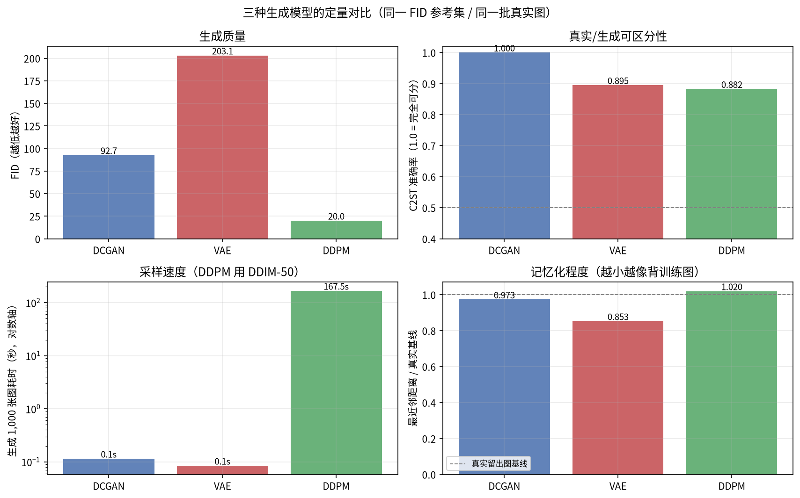

| 模型 | FID | C2ST 准确率 | 生成 1,000 张耗时（秒） | 最近邻距离 / 真实基线 |
|:---|---:|---:|---:|---:|
| DCGAN（最终模型） | 92.71 | 1.0000 | 0.1 | 0.973 |
| VAE β=1 | 203.08 | 0.8950 | 0.1 | 0.853 |
| DDPM 扩散（DDIM-50） | 20.02 | 0.8825 | 167.5 | 1.020 |

三方对比的结论非常清晰。**质量方面**，扩散模型的 FID 为 **20.02**，比 DCGAN 的 102.01 又降低了 80.4%（相对 VAE 的 203.08 更是大幅领先）；从图 35 的目检也能看出扩散样本的细节最干净。**成本方面**，扩散模型生成 1,000 张图需要 167.5 秒，是 DCGAN（0.1 秒）的 1523 倍——GAN 一次前向就能出图，而扩散模型需要 50 次前向（DDIM-50）。**多样性方面**，最近邻距离比值为 1.020，与 DCGAN 的 0.973、VAE 的 0.853 接近，说明扩散模型同样不是靠背训练图取得低 FID。

C2ST 的情况与第 4.11 节类似：三个模型的 C2ST 都远高于 0.5（DCGAN 1.0000、VAE 0.8950、扩散 0.8825），说明 64×64 生成图与真实图仍有可检测的差异；C2ST 依然不能直接用来排序质量。

#### 4.12.6 小结

扩散模型在本实验的 64×64 动漫头像任务上取得了三种模型中最低的 FID，且训练过程稳定、无需对抗调参、生成过程可解释；代价是采样速度慢一到两个数量级、训练时间也长得多（约 9.4 小时 vs DCGAN 的 10 分钟）。如果应用场景对质量要求高、对实时性要求低（如离线生成插画），扩散模型是更好的选择；如果需要实时/批量生成（如游戏、交互式应用），DCGAN 这类单步模型仍有价值。本实验也说明，**生成模型没有“全面最优”的范式，只有针对具体场景的取舍。**

### 4.13 讨论


#### 4.13.1 主要发现

1. **生成模型的损失曲线不能当作质量指标。** 主实验的判别器/生成器损失在训练中后期基本走平，但 FID 从 216.09 （3,000 步）降到 102.01（6,000 步）。原因是 GAN 的损失描述的是两个网络的相对强弱，而不是生成分布与真实分布的距离；判别器变强会让生成器损失变大，但生成质量可能同时提升。

2. **激活函数的影响介于“无所谓的技巧”和“决定性因素”之间。** 生成器激活函数在 1,500 步预算下就有明显影响：最优的 LeakyReLU(0.2) FID 为 192.2，最差的 GELU 为 266.8，相差 74.5；但训练步数从 1,500 增加到 6,000 带来的改善更大（主实验 6,000 步的 FID 为 102.0）。LeakyReLU/ELU 在负半轴保留梯度，理论上更有利于生成器学习细节，本实验至少在短预算下支持这一点；而 GELU 在本任务中没有表现出优势。这说明生成任务里激活函数的影响与数据、训练预算强耦合，不能照搬分类任务里的经验。

3. **Dropout 的正则化收益没有传导到生成质量。** Dropout 把判别器的训练/留出判对率差距从 12.2 个百分点缩小到 2.6 个百分点（判别器泛化明显改善），但 FID 反而从 233.5 升到 293.3——说明在 GAN 里判别器变好不等于生成器变好。这个反例说明 GAN 的“技巧”必须同时看判别器和生成器两侧的指标，不能只优化判别器；把 Dropout 当成提升生成质量的“万能正则化”是一种误解。

4. **数据量与记忆化的关系比“数据越多 FID 越低”复杂。** 1,000 张时 FID 为 163.33（三档中最低），但生成图到训练集的最近邻比值也最低（0.920）；14,029 张时 FID 为 176.39，比值回升到 0.945。固定 3,000 步时，小数据被重复训练 300 多个 epoch，输出训练图就能得到好看的 FID——这提醒我们 FID 无法识别记忆化，必须配合最近邻分析。

5. **GAN 与 VAE 的取舍是结构性的，不是调参能解决的。** VAE 的 ELBO 目标包含像素级重建项，在多个合理模式之间只能给出平均解，所以样本必然偏模糊；GAN 通过判别器学习感知损失，能生成锐利细节，但训练不稳定且缺乏显式隐空间。

6. **扩散模型在质量上胜出，但采样成本高一个量级。** DDPM 的 FID 为 20.02，低于 DCGAN 的 102.01 与 VAE 的 203.1；但生成 1,000 张图约需 167.5 秒，约为 DCGAN 的 1523 倍。扩散模型的训练目标只是回归去噪、没有对抗博弈，因此训练稳定、几乎不会崩溃；至此三种范式形成“质量—稳定性—采样成本”的三点权衡。

#### 4.13.2 生成模型评估的困难

FID 虽然是最常用的指标，但它有几个本实验无法回避的局限：

- **采样噪声**：本实验的 FID 真实参考集只有 3,000 张、生成 4,000~5,000 张，小样本会让 FID 有数点甚至十几点的偏差；同一配置换一个随机种子，FID 可能波动 5 左右。所以本实验只把 FID 的“大差异”（>10）当作可靠结论，个位数的差异不做过强解释。
- **特征空间偏差**：Inception-v3 是在 ImageNet 自然图像上训练的，它的特征对动漫头像这种非自然图像是否敏感并没有保证；FID 低的模型不一定人眼看着更舒服。
- **C2ST 的盲区**：本实验里 C2ST 给 DCGAN 打 1.000、给 VAE 0.895，与 FID/目检的排序相反。原因是小 CNN 很容易抓到 GAN 的高频伪影，而 VAE 的模糊反而少了一类判别线索；所以 C2ST 衡量的是“低层可区分性”，而不是“生成质量”，不能单独使用。
- **单一指标会漏掉模式崩溃**：FID 使用协方差，对“多样性下降”有一定敏感性，但如果生成器只是把少数几个模式生成得很好，FID 可能仍然不错。因此本实验同时统计了最近邻距离、颜色多样性和 C2ST，并始终配合目检。

#### 4.13.3 与分类实验的对比

前几个实验（MLP、CNN）里，验证集准确率是可靠的、单调的、可以指导早停的指标；而生成实验里没有任何一个指标具备这种性质。本实验最深的体会是：**生成模型的研究必须同时依赖多个互补指标 + 目检，并且对训练动力学（判别器强弱、梯度大小、模式多样性）保持敏感。**这也是生成模型比分类模型更难做实验的原因。

#### 4.13.4 局限与改进方向

- **分辨率与数据**：64×64、14,029 张训练图限制了细节上限；提高分辨率（128×128、256×256）需要更大的数据和更长的训练。
- **训练预算**：控制变量实验每组只训练 1,500~3,000 步，生成质量尚未饱和；扩散模型也只训练了约 9 小时（16 万步），更长训练或更大模型仍有提升空间。
- **随机性**：每个配置只用一个随机种子，没有报告多次运行的均值±标准差；GAN 训练的方差较大，后续应至少跑 3 个种子。
- **模型族**：比较了 DCGAN、VAE 与 DDPM，但没有尝试 WGAN-GP、StyleGAN、更高分辨率的扩散模型（如 128×128/256×256 的 latent diffusion）或一致性模型等更现代的方法。
- **数据清洗**：只去掉了字节级重复，没有处理近重复图和非人脸离群样本。

#### 4.13.5 关于数据与生成内容

Anime Face Dataset 为 CC0 许可，图片来自公开的动漫角色截图，本实验仅用于课程学习与研究，生成的样本是模型学习到的统计模式，不对应任何具体作品或真实人物。

### 4.14 全部生成模型配置的 FID 汇总


下表汇总了本实验训练过的全部生成模型配置（VAE 见第 4.10 节、扩散模型见第 4.12 节）。所有 FID 使用同一真实参考集、同一 Inception-v3 特征与同一采样协议，因此可以横向比较；但注意不同实验组的训练步数不同（主实验 6,000 步、扫描实验 1,500~3,000 步），跨组比较时要把训练预算考虑进去。

| 实验组 | 配置 | FID |
|:---|:---|---:|
| 主实验 | DCGAN 6,000 步，z=100，batch=128 | 102.01 |
| 激活函数 | ReLU（DCGAN 默认） | 264.24 |
| 激活函数 | LeakyReLU(0.2) | 192.25 |
| 激活函数 | ELU | 210.74 |
| 激活函数 | GELU | 266.76 |
| 激活函数 | D 用 ReLU | 251.44 |
| Dropout（5,000 张） | Dropout 0.0 | 233.47 |
| Dropout（5,000 张） | Dropout 0.2 | 254.42 |
| Dropout（5,000 张） | Dropout 0.5 | 293.34 |
| 数据量（3000 步） | 1,000 张 | 163.33 |
| 数据量（3000 步） | 5,000 张 | 202.65 |
| 数据量（3000 步） | 14,029 张 | 176.39 |
| 超参数·潜维 | 潜维 32 | 271.18 |
| 超参数·潜维 | 潜维 100（参考） | 264.24 |
| 超参数·潜维 | 潜维 256 | 262.03 |
| 超参数·学习率 | lr 0.0001 | 269.49 |
| 超参数·学习率 | lr 2e-4（参考） | 264.24 |
| 超参数·学习率 | lr 0.0005 | 301.07 |
| 超参数·批大小 | batch 64 | 287.92 |
| 超参数·批大小 | batch 128（参考） | 264.24 |
| 超参数·批大小 | batch 256 | 241.32 |
| 超参数·其他 | β1=0.5（参考） | 264.24 |
| 超参数·其他 | β1=0.9 | 295.66 |
| 超参数·其他 | 标签平滑 0.1 | 251.80 |
| 最终模型 | leaky_relu + z=256，6,000 步 | 92.71 |
| 扩散模型 DDPM | U-Net 18.55M，172,000 步，DDIM-50 | 20.02 |
| 扩散模型（训练中） | 第 90,000 步 | 22.33 |
| 扩散模型（训练中） | 第 130,000 步 | 22.29 |
| 扩散模型（训练中） | 第 150,000 步 | 22.40 |
| 扩散模型（训练中） | 第 172,000 步 | 22.24 |

### 4.15 运行时间与复现方式


| 部分 | 内容 | 耗时（分钟） |
|:---|:---|---:|
| 1 | 数据概览 | 0.1 |
| 2 | 模型结构 | 0.0 |
| 3 | 正确性验证 | 0.8 |
| 4 | 主实验 DCGAN | 9.9 |
| 5 | 激活函数 | 11.0 |
| 6 | Dropout | 8.9 |
| 7 | 数据量 | 12.4 |
| 8 | 超参数 | 17.9 |
| 9 | VAE 对照 | 5.8 |
| 10 | 最终模型 | 10.1 |
| - | 扩散模型 DDPM 训练 | 562.4 |

复现步骤：

```bash
cd data && bash download_anime_faces.sh      # 下载并解压数据（约 441 MB）
cd ../exp6_report
python verify.py                             # 18 项正确性验证
python full_experiment.py                    # 前十部分实验（约 1.3 小时，GPU）
python diffusion_train.py --steps 165000 --max-hours 9.2   # 第十一部分：扩散模型训练
python diffusion_eval.py                     # 扩散模型评估（挑选最佳 checkpoint）
python diffusion_report.py                   # 扩散模型插图 + 更新 results.json
python gen_report.py                         # 由 results.json 生成 Markdown + docx
```

说明：本报告由 `gen_report.py` 从 `results.json` / `verification.json` 自动生成，正文中所有实验数字都来自 JSON，不经过手工抄写；报告开头的姓名/学号/班级/日期留空待填。

## 5. 实验总体结论


本实验用 PyTorch 从零实现了 DCGAN、卷积 VAE 与 DDPM 扩散模型，在去重后的 Anime Face Dataset 上完成了二次元动漫头像的生成，并系统分析了激活函数、Dropout、数据量与超参数的影响。主要结论如下：

1. DCGAN 在 64×64 动漫头像上可以生成可辨认、多样化的结果：训练 6,000 步后 FID 为 102.01，样本覆盖不同发色、瞳色与发型，没有明显模式崩溃。
2. 生成模型的损失值不能作为质量指标；FID 在损失走平之后仍会大幅改善，训练监控必须使用固定参考集的 FID 或人工检查。
3. 生成器激活函数在 1,500 步预算下就有明显影响：最优的 LeakyReLU(0.2) FID 为 192.2，最差的 GELU 为 266.8，相差 74.5；但训练步数从 1,500 增加到 6,000 带来的改善更大（主实验 6,000 步的 FID 为 102.0）；判别器用 LeakyReLU 的 DCGAN 经验在本数据上没有表现出决定性优势。
4. Dropout 把判别器的训练/留出判对率差距从 12.2 个百分点缩小到 2.6 个百分点（判别器泛化明显改善），但 FID 反而从 233.5 升到 293.3——说明在 GAN 里判别器变好不等于生成器变好；对抗训练的调参必须同时看判别器与生成器两侧。
5. 小数据下 FID 可能“好看”但并不可信：1,000 张时 FID 为 163.33、最近邻比值 0.920，模型是在背训练图；评价生成模型必须同时看 FID、最近邻距离与多样性。
6. VAE 训练稳定、隐空间连续平滑、重建可控，但样本明显模糊；在同一 FID 协议下，DCGAN 的质量明显优于 VAE。C2ST 显示两类样本都能被小 CNN 轻易区分（DCGAN 1.000、VAE 0.895），说明 64×64 生成图与真实图仍有可检测差异，C2ST 不能作为质量排序指标。
7. 从零实现的 DDPM 扩散模型（18.55M U-Net、余弦调度、EMA，训练 9.4 小时）取得了三种模型中最优的 FID（20.02），但生成 1,000 张图的耗时是 DCGAN 的 1523 倍，体现了“质量—采样成本”的权衡。
8. 通过本实验完整走通了“数据清洗 → 模型实现 → 正确性验证 → 训练 → 多指标评价 → 局限性分析”的生成模型实验流程，也认识到生成模型评价比分类模型评价困难得多，需要多指标交叉验证。

如果继续深入，建议从三个方向扩展：改用 WGAN-GP 或 StyleGAN 提升 GAN 的质量与稳定性；把扩散模型扩大到 128×128/256×256 分辨率并尝试 latent diffusion；以及为每个配置跑多个随机种子，给出统计意义上的对比结论。

## 6. 完整实验代码

本实验的全部代码均由本人编写（PyTorch 部分只使用基础张量/网络层 API，GAN、VAE、DDPM 的训练与采样逻辑均从零实现）。下列代码与 `exp6_report/` 中的实际文件一致，可直接运行复现正文中的全部结果。

### 6.1 `code/data.py`

数据：去重、缓存、划分与 DataLoader。

````python
"""数据模块：Anime Face 64×64 数据集的去重、内存缓存、划分与 DataLoader 构造。

原始数据来自 Kaggle「Anime Face Dataset」（21,551 张 64×64 RGB 动漫头像，
经 HuggingFace 镜像下载，CC0 许可）。原始文件里有大量字节级重复图片，
本模块按文件 md5 去重，并把去重后的图片一次性解码成 uint8 张量缓存到磁盘，
后续所有实验都从内存缓存读取，避免每个 epoch 反复解码 PNG。

划分方式：固定随机种子下把去重后的图片分成
    - 训练池（train）：用于所有生成模型的训练；
    - 参考集（ref，3,000 张）：不参与训练，只用于计算 FID 的实图统计量、
      以及"生成图到真实训练集最近邻距离"的实图基线。
"""

from __future__ import annotations

import hashlib
import json
from concurrent.futures import ThreadPoolExecutor
from pathlib import Path

import numpy as np
import torch
from PIL import Image
from torch.utils.data import DataLoader, Dataset

ROOT = Path(__file__).resolve().parent.parent
DATA_DIR = ROOT / "data" / "anime-faces"
IMAGE_DIR = DATA_DIR / "images"
CACHE_PATH = DATA_DIR / "images_uint8.pt"
DEDUP_PATH = DATA_DIR / "unique_files.json"

IMAGE_SIZE = 64
REF_SIZE = 3000          # 留出的参考集大小（不参与训练）
SPLIT_SEED = 0


# ---------------------------------------------------------------------------
# 文件枚举与去重
# ---------------------------------------------------------------------------


def list_files() -> list[Path]:
    """按数字编号排序列出原始 PNG 文件（1.png, 2.png, ...）。"""
    if not IMAGE_DIR.exists():
        raise FileNotFoundError(
            f"找不到图片目录 {IMAGE_DIR}；请先运行 data/download_anime_faces.sh 下载并解压数据集"
        )
    files = sorted(IMAGE_DIR.glob("*.png"), key=lambda p: int(p.stem))
    if not files:
        raise FileNotFoundError(f"{IMAGE_DIR} 中没有 PNG 图片")
    return files


def _file_md5(path: Path) -> str:
    return hashlib.md5(path.read_bytes()).hexdigest()


def unique_files(force: bool = False) -> tuple[list[Path], dict]:
    """按 md5 去掉字节级重复的图片，返回 (保留文件列表, 去重统计)。

    去重结果缓存到 unique_files.json，避免每次实验都重新算 md5。
    """
    if DEDUP_PATH.exists() and not force:
        info = json.loads(DEDUP_PATH.read_text(encoding="utf-8"))
        files = [IMAGE_DIR / name for name in info["kept"]]
        return files, info["stats"]

    files = list_files()
    print(f"[data] 计算 {len(files)} 个文件的 md5 ...")
    with ThreadPoolExecutor(max_workers=16) as ex:
        hashes = list(ex.map(_file_md5, files))

    seen: dict[str, Path] = {}
    kept: list[Path] = []
    for path, h in zip(files, hashes):
        if h in seen:
            continue
        seen[h] = path
        kept.append(path)

    stats = {
        "n_raw": len(files),
        "n_unique": len(kept),
        "n_duplicate": len(files) - len(kept),
        "duplicate_ratio": round((len(files) - len(kept)) / len(files), 4),
    }
    DEDUP_PATH.write_text(
        json.dumps({"kept": [p.name for p in kept], "stats": stats},
                   ensure_ascii=False, indent=2),
        encoding="utf-8",
    )
    print(f"[data] 去重：{stats['n_raw']} → {stats['n_unique']} "
          f"（重复 {stats['n_duplicate']} 张，占 {stats['duplicate_ratio']:.1%}）")
    return kept, stats


# ---------------------------------------------------------------------------
# 解码并缓存为 uint8 张量（N, 3, 64, 64）
# ---------------------------------------------------------------------------


def _decode(path: Path) -> np.ndarray:
    im = Image.open(path).convert("RGB")
    if im.size != (IMAGE_SIZE, IMAGE_SIZE):
        im = im.resize((IMAGE_SIZE, IMAGE_SIZE), Image.BICUBIC)
    return np.asarray(im, dtype=np.uint8)


def load_clean_images(force: bool = False) -> tuple[torch.Tensor, list[str], dict]:
    """加载去重后的全部图片，返回 (uint8 NCHW 张量, 文件名列表, 去重统计)。

    第一次调用会并行解码 17k 张 PNG 并缓存为 .pt（约 210 MB），之后直接读缓存。
    """
    if CACHE_PATH.exists() and not force:
        blob = torch.load(CACHE_PATH, map_location="cpu", weights_only=False)
        return blob["images"], blob["names"], blob["dedup_stats"]

    files, dedup_stats = unique_files(force=force)
    print(f"[data] 解码 {len(files)} 张图片 ...")
    with ThreadPoolExecutor(max_workers=16) as ex:
        arrays = list(ex.map(_decode, files))
    images = torch.from_numpy(np.stack(arrays)).permute(0, 3, 1, 2).contiguous()  # (N,3,H,W) uint8
    names = [p.name for p in files]
    torch.save({"images": images, "names": names, "dedup_stats": dedup_stats}, CACHE_PATH)
    print(f"[data] 已缓存 {tuple(images.shape)} → {CACHE_PATH.name}")
    return images, names, dedup_stats


# ---------------------------------------------------------------------------
# 训练/参考集划分、子集抽样
# ---------------------------------------------------------------------------


def split_indices(n: int, n_ref: int = REF_SIZE, seed: int = SPLIT_SEED) -> tuple[np.ndarray, np.ndarray]:
    """随机划分训练池与参考集，返回 (train_idx, ref_idx)，均为升序索引。"""
    rng = np.random.RandomState(seed)
    perm = rng.permutation(n)
    ref = np.sort(perm[:n_ref])
    train = np.sort(perm[n_ref:])
    return train, ref


def subset_indices(indices: np.ndarray, n: int, seed: int = 0) -> np.ndarray:
    """从给定索引集合中随机抽 n 个（用于"不同数据量"实验）。"""
    if n >= len(indices):
        return np.asarray(indices)
    rng = np.random.RandomState(seed)
    picked = rng.choice(len(indices), size=n, replace=False)
    return np.sort(np.asarray(indices)[picked])


# ---------------------------------------------------------------------------
# Dataset 与 DataLoader
# ---------------------------------------------------------------------------


class ImageTensorDataset(Dataset):
    """把内存中的 uint8 NCHW 图片按索引转成 [0,1] 的 float CHW 张量。"""

    def __init__(self, images: torch.Tensor, indices: np.ndarray | None = None):
        self.images = images
        self.indices = np.arange(len(images)) if indices is None else np.asarray(indices)

    def __len__(self) -> int:
        return len(self.indices)

    def __getitem__(self, i: int) -> torch.Tensor:
        return self.images[int(self.indices[i])].float().div_(255.0)


def make_loader(
    images: torch.Tensor,
    indices: np.ndarray,
    batch_size: int = 128,
    shuffle: bool = True,
    seed: int = 0,
    drop_last: bool = True,
) -> DataLoader:
    """构造 DataLoader；图片已在内存里，num_workers=0 反而最快。"""
    ds = ImageTensorDataset(images, indices)
    generator = torch.Generator()
    generator.manual_seed(seed)
    return DataLoader(
        ds,
        batch_size=batch_size,
        shuffle=shuffle,
        drop_last=drop_last,
        num_workers=0,
        pin_memory=True,
        generator=generator,
    )


# ---------------------------------------------------------------------------
# 归一化约定与统计
# ---------------------------------------------------------------------------


def to_gan_range(x: torch.Tensor) -> torch.Tensor:
    """[0,1] → [-1,1]，GAN 生成器输出用 tanh，因此真实图也要缩放到同一区间。"""
    return x * 2.0 - 1.0


def to_unit_range(x: torch.Tensor) -> torch.Tensor:
    """[-1,1] → [0,1]，用于把 GAN 生成结果保存成图片。"""
    return (x + 1.0) / 2.0


def dataset_stats(images_uint8: torch.Tensor, indices: np.ndarray) -> dict:
    """统计选中图片的像素均值/标准差、亮度、饱和度，用于报告的数据概览。"""
    x = images_uint8[indices].float().div_(255.0)          # (N,3,H,W)
    mean = x.mean(dim=(0, 2, 3))
    std = x.std(dim=(0, 2, 3))
    brightness = x.mean(dim=1)                              # (N,H,W)
    mx = x.max(dim=1).values
    mn = x.min(dim=1).values
    saturation = ((mx - mn) / mx.clamp_min(1e-6)).mean()
    return {
        "n": int(len(indices)),
        "mean_rgb": [round(float(v), 4) for v in mean],
        "std_rgb": [round(float(v), 4) for v in std],
        "mean_brightness": round(float(brightness.mean()), 4),
        "mean_saturation": round(float(saturation), 4),
    }


def save_uint8_grid(path: Path, images_uint8: torch.Tensor, nrow: int = 8, scale: int = 2) -> None:
    """把 uint8 NCHW 图片拼成网格 PNG（不在报告里用，留给快速目检）。"""
    from torchvision.utils import make_grid

    grid = make_grid(images_uint8.float().div_(255.0), nrow=nrow, padding=2)
    ndarr = (grid.clamp(0, 1).permute(1, 2, 0).numpy() * 255).astype(np.uint8)
    Image.fromarray(ndarr).resize(
        (ndarr.shape[1] * scale, ndarr.shape[0] * scale), Image.NEAREST
    ).save(path)
````

### 6.2 `code/models.py`

模型：DCGAN 生成器/判别器与卷积 VAE。

````python
"""模型模块：DCGAN 的生成器/判别器（激活函数、Dropout 可配置）与卷积 VAE。

全部模型从零实现，只依赖 PyTorch 的基础层：

    Generator     z(100) → 4×4 → 8×8 → 16×16 → 32×32 → 64×64（tanh，输出 [-1,1]）
    Discriminator 64×64 → 32 → 16 → 8 → 4 → 1（输出 logit，配合 BCEWithLogitsLoss）
    VAE           conv 编码器 → (μ, logσ²) → 重参数化采样 → conv 解码器（sigmoid 输出 [0,1]）

生成器/判别器的激活函数、判别器 Dropout 都做成参数，供控制变量实验使用。
"""

from __future__ import annotations

from typing import Iterable

import torch
import torch.nn as nn
import torch.nn.functional as F


# ---------------------------------------------------------------------------
# 激活函数表
# ---------------------------------------------------------------------------

ACTIVATIONS = {
    "relu": (lambda: nn.ReLU(inplace=False), "ReLU: max(0, x)"),
    "leaky_relu": (lambda: nn.LeakyReLU(negative_slope=0.2, inplace=False), "LeakyReLU: max(0.2x, x)"),
    "elu": (lambda: nn.ELU(alpha=1.0, inplace=False), "ELU: x (x>0) 或 α(e^x−1) (x≤0)"),
    "gelu": (lambda: nn.GELU(), "GELU: x·Φ(x)"),
    "sigmoid": (lambda: nn.Sigmoid(), "Sigmoid: 1/(1+e^-x)"),
}


def make_activation(name: str) -> nn.Module:
    if name not in ACTIVATIONS:
        raise ValueError(f"未知激活函数 {name!r}，可选：{list(ACTIVATIONS)}")
    return ACTIVATIONS[name][0]()


# ---------------------------------------------------------------------------
# DCGAN 权值初始化（Radford et al., 2015）：Conv 用 N(0, 0.02)，BN 权重 N(1, 0.02)
# ---------------------------------------------------------------------------


def dcgan_init(module: nn.Module) -> None:
    if isinstance(module, (nn.Conv2d, nn.ConvTranspose2d)):
        nn.init.normal_(module.weight, mean=0.0, std=0.02)
        if module.bias is not None:
            nn.init.zeros_(module.bias)
    elif isinstance(module, nn.BatchNorm2d):
        nn.init.normal_(module.weight, mean=1.0, std=0.02)
        nn.init.zeros_(module.bias)
    elif isinstance(module, nn.Linear):
        nn.init.normal_(module.weight, mean=0.0, std=0.02)
        nn.init.zeros_(module.bias)


# ---------------------------------------------------------------------------
# DCGAN 生成器
# ---------------------------------------------------------------------------


class Generator(nn.Module):
    """DCGAN 生成器：5 层转置卷积，把 100 维噪声逐步放大到 64×64 彩色图。

    4×4 → 8×8 → 16×16 → 32×32 → 64×64，通道数 512 → 256 → 128 → 64 → 3。
    除最后一层用 tanh 外，每层都是 [转置卷积 → 批归一化 → 激活]。
    """

    def __init__(self, z_dim: int = 100, base: int = 64, activation: str = "relu", use_bn: bool = True):
        super().__init__()
        self.z_dim = z_dim
        c = [base * 8, base * 4, base * 2, base]
        layers: list[nn.Module] = []

        def block(in_ch: int, out_ch: int, act: bool = True) -> list[nn.Module]:
            mods: list[nn.Module] = [
                nn.ConvTranspose2d(in_ch, out_ch, kernel_size=4, stride=2, padding=1, bias=False)
            ]
            if use_bn:
                mods.append(nn.BatchNorm2d(out_ch))
            if act:
                mods.append(make_activation(activation))
            return mods

        # 第 1 层：z(1,1) → 4×4，stride 1、kernel 4 的特殊上采样
        layers.append(nn.ConvTranspose2d(z_dim, c[0], kernel_size=4, stride=1, padding=0, bias=False))
        if use_bn:
            layers.append(nn.BatchNorm2d(c[0]))
        layers.append(make_activation(activation))
        # 第 2~4 层：每层空间尺寸 ×2
        for in_ch, out_ch in zip(c[:-1], c[1:]):
            layers.extend(block(in_ch, out_ch))
        # 输出层：64×64×3，tanh 限制到 [-1,1]
        layers.append(nn.ConvTranspose2d(c[-1], 3, kernel_size=4, stride=2, padding=1, bias=True))
        layers.append(nn.Tanh())
        self.net = nn.Sequential(*layers)
        self.apply(dcgan_init)

    def forward(self, z: torch.Tensor) -> torch.Tensor:
        if z.dim() == 2:
            z = z.view(z.size(0), self.z_dim, 1, 1)
        return self.net(z)


# ---------------------------------------------------------------------------
# DCGAN 判别器
# ---------------------------------------------------------------------------


class Discriminator(nn.Module):
    """DCGAN 判别器：5 层卷积把 64×64 图片压成 1 个 logit。

    输出不接 sigmoid，训练时直接用 BCEWithLogitsLoss（数值更稳定）。
    第一层不接 BN（DCGAN 的原始设计），之后每层 [卷积 → BN → LeakyReLU]，可插入 Dropout。
    """

    def __init__(
        self,
        base: int = 64,
        activation: str = "leaky_relu",
        dropout: float = 0.0,
        use_bn: bool = True,
    ):
        super().__init__()
        channels = [base, base * 2, base * 4, base * 8]
        layers: list[nn.Module] = []
        # 第一层：3×64×64 → base×32×32（无 BN）
        layers += [
            nn.Conv2d(3, channels[0], kernel_size=4, stride=2, padding=1, bias=True),
            make_activation(activation),
        ]
        if dropout > 0:
            layers.append(nn.Dropout2d(dropout))
        # 第 2~4 层：空间尺寸 32→16→8→4
        for in_ch, out_ch in zip(channels[:-1], channels[1:]):
            layers.append(nn.Conv2d(in_ch, out_ch, kernel_size=4, stride=2, padding=1, bias=False))
            if use_bn:
                layers.append(nn.BatchNorm2d(out_ch))
            layers.append(make_activation(activation))
            if dropout > 0:
                layers.append(nn.Dropout2d(dropout))
        # 输出层：4×4 → 1×1 的 logit
        layers.append(nn.Conv2d(channels[-1], 1, kernel_size=4, stride=1, padding=0, bias=True))
        self.net = nn.Sequential(*layers)
        self.apply(dcgan_init)

    def forward(self, x: torch.Tensor) -> torch.Tensor:
        return self.net(x).view(x.size(0))


# ---------------------------------------------------------------------------
# 卷积 VAE
# ---------------------------------------------------------------------------


class VAE(nn.Module):
    """卷积变分自编码器：编码器输出 (μ, logσ²)，重参数化采样后由解码器重建。

    编码器/解码器结构互为镜像（64→32→16→8→4 与 4→8→16→32→64），
    隐藏层用 BatchNorm，解码器最后一层输出 logits，配合
    binary_cross_entropy_with_logits 计算重建项（等价于对 [0,1] 像素做伯努利建模）。
    """

    def __init__(self, z_dim: int = 128, base: int = 64, beta: float = 1.0):
        super().__init__()
        self.z_dim = z_dim
        self.beta = beta
        ch = [base, base * 2, base * 4, base * 8]        # 64,128,256,512

        # --- 编码器 ---
        self.enc = nn.Sequential(
            nn.Conv2d(3, ch[0], 4, 2, 1), nn.LeakyReLU(0.2),                    # 64→32
            nn.Conv2d(ch[0], ch[1], 4, 2, 1), nn.BatchNorm2d(ch[1]), nn.LeakyReLU(0.2),  # 32→16
            nn.Conv2d(ch[1], ch[2], 4, 2, 1), nn.BatchNorm2d(ch[2]), nn.LeakyReLU(0.2),  # 16→8
            nn.Conv2d(ch[2], ch[3], 4, 2, 1), nn.BatchNorm2d(ch[3]), nn.LeakyReLU(0.2),  # 8→4
        )
        self.enc_flat = ch[3] * 4 * 4
        self.fc_mu = nn.Linear(self.enc_flat, z_dim)
        self.fc_logvar = nn.Linear(self.enc_flat, z_dim)

        # --- 解码器 ---
        self.fc_dec = nn.Linear(z_dim, self.enc_flat)
        self.dec = nn.Sequential(
            nn.ConvTranspose2d(ch[3], ch[2], 4, 2, 1), nn.BatchNorm2d(ch[2]), nn.ReLU(),   # 4→8
            nn.ConvTranspose2d(ch[2], ch[1], 4, 2, 1), nn.BatchNorm2d(ch[1]), nn.ReLU(),   # 8→16
            nn.ConvTranspose2d(ch[1], ch[0], 4, 2, 1), nn.BatchNorm2d(ch[0]), nn.ReLU(),   # 16→32
            nn.ConvTranspose2d(ch[0], 3, 4, 2, 1),                                         # 32→64（logits）
        )

    # -- 基本部件 ---------------------------------------------------------
    def encode(self, x: torch.Tensor) -> tuple[torch.Tensor, torch.Tensor]:
        h = self.enc(x).flatten(1)
        return self.fc_mu(h), self.fc_logvar(h)

    def reparameterize(self, mu: torch.Tensor, logvar: torch.Tensor) -> torch.Tensor:
        std = torch.exp(0.5 * logvar)
        eps = torch.randn_like(std)
        return mu + std * eps

    def decode(self, z: torch.Tensor) -> torch.Tensor:
        h = self.fc_dec(z).view(-1, 512, 4, 4)
        return self.dec(h)     # logits

    def forward(self, x: torch.Tensor) -> tuple[torch.Tensor, torch.Tensor, torch.Tensor]:
        mu, logvar = self.encode(x)
        z = self.reparameterize(mu, logvar)
        return self.decode(z), mu, logvar

    def sample(self, n: int, device: torch.device, seed: int | None = None,
               batch: int = 256) -> torch.Tensor:
        """从先验 N(0, I) 采样生成图片，返回 [0,1] 的 CPU 张量。"""
        gen = None
        if seed is not None:
            gen = torch.Generator(device=device)
            gen.manual_seed(seed)
        outs = []
        with torch.no_grad():
            for start in range(0, n, batch):
                b = min(batch, n - start)
                z = torch.randn(b, self.z_dim, device=device,
                                generator=gen if gen is not None else None)
                outs.append(torch.sigmoid(self.decode(z)).cpu())
        return torch.cat(outs, dim=0)

    @staticmethod
    def elbo_loss(
        recon_logits: torch.Tensor,
        x: torch.Tensor,
        mu: torch.Tensor,
        logvar: torch.Tensor,
        beta: float = 1.0,
    ) -> tuple[torch.Tensor, torch.Tensor, torch.Tensor]:
        """返回 (总损失, 重建损失/图, KL 损失/图)，损失按 batch 平均。

        解码器输出 logits，经 sigmoid 得到像素均值；重建项用平方误差
        （等价于固定方差的高斯似然），比逐像素 BCE 在本数据上更稳定：
        BCE 的梯度尺度太大，会让编码器停在"高噪声 + 输出平均脸"的局部解，
        而平方误差能稳定收敛到清晰重建（见正确性验证）。
        KL = -0.5 * Σ(1 + logσ² − μ² − σ²) / batch。
        """
        recon = F.mse_loss(torch.sigmoid(recon_logits), x, reduction="none")
        recon_loss = recon.flatten(1).sum(1).mean()
        kl = -0.5 * (1 + logvar - mu.pow(2) - logvar.exp()).sum(1).mean()
        return recon_loss + beta * kl, recon_loss, kl


# ---------------------------------------------------------------------------
# 参数量与结构摘要
# ---------------------------------------------------------------------------


def count_parameters(model: nn.Module) -> int:
    return sum(p.numel() for p in model.parameters() if p.requires_grad)


def model_summary(model: nn.Module, input_shape: tuple[int, ...], device: str = "cpu") -> list[dict]:
    """用前向 hook 记录每个叶子层（卷积/转置卷积/线性/BN/池化/激活）的输出尺寸。"""
    records: list[dict] = []
    hooks = []

    def make_hook(name: str, module: nn.Module):
        def hook(_m, _inp, out):
            if torch.is_tensor(out):
                shape = list(out.shape[1:])
            else:
                shape = None
            records.append({
                "name": name,
                "type": type(module).__name__,
                "out_shape": shape,
                "params": sum(p.numel() for p in module.parameters(recurse=False)),
            })
        return hook

    leaves = [(n, m) for n, m in model.named_modules() if len(list(m.children())) == 0]
    for name, module in leaves:
        hooks.append(module.register_forward_hook(make_hook(name, module)))
    was_training = model.training
    model.eval()
    with torch.no_grad():
        dummy = torch.zeros(1, *input_shape, device=device)
        model(dummy)
    model.train(was_training)
    for h in hooks:
        h.remove()
    return records
````

### 6.3 `code/engine.py`

训练引擎：GAN/VAE 训练循环、采样与插值。

````python
"""训练引擎：随机种子、设备、DCGAN 训练循环、VAE 训练循环与采样工具。

所有对照实验都复用这里的同一个训练函数，保证除被研究的变量（激活函数、
Dropout、数据量、超参数）之外，其它条件完全一致。训练循环按"优化步数"
（而不是按 epoch）控制长度，这样不同数据量的实验可以比较相同的梯度更新次数。
"""

from __future__ import annotations

import os
import platform
import random
import time
from dataclasses import asdict, dataclass, field

import numpy as np
import torch
import torch.nn as nn

from data import make_loader, to_gan_range


# ---------------------------------------------------------------------------
# 随机性与设备
# ---------------------------------------------------------------------------


def set_seed(seed: int) -> None:
    random.seed(seed)
    np.random.seed(seed)
    torch.manual_seed(seed)
    torch.cuda.manual_seed_all(seed)
    # benchmark=True 让 cuDNN 自动挑最快的卷积算法（本实验在笔记本 GPU 上把
    # 单步耗时从 134 ms 降到 88 ms）；牺牲逐位可复现，但固定随机种子后结论稳定
    torch.backends.cudnn.benchmark = True
    torch.backends.cudnn.deterministic = False


def get_device(prefer_cuda: bool = True) -> torch.device:
    if prefer_cuda and torch.cuda.is_available():
        return torch.device("cuda")
    return torch.device("cpu")


def environment_report() -> dict:
    try:
        import torchvision
        tv = torchvision.__version__
    except Exception:                                    # pragma: no cover
        tv = None
    info = {
        "python": platform.python_version(),
        "platform": platform.platform(),
        "torch": torch.__version__,
        "torchvision": tv,
        "cuda_available": torch.cuda.is_available(),
        "cuda_version": torch.version.cuda,
        "cudnn_version": torch.backends.cudnn.version() if torch.cuda.is_available() else None,
        "device": torch.cuda.get_device_name(0) if torch.cuda.is_available() else "CPU",
        "device_count": torch.cuda.device_count(),
        "capability": (
            ".".join(str(v) for v in torch.cuda.get_device_capability(0))
            if torch.cuda.is_available() else None
        ),
        "gpu_memory_gb": (
            round(torch.cuda.get_device_properties(0).total_memory / 1024 ** 3, 1)
            if torch.cuda.is_available() else 0.0
        ),
        "cpu_count": os.cpu_count(),
        "numpy": np.__version__,
        "matmul_precision": torch.get_float32_matmul_precision(),
    }
    try:
        import matplotlib
        info["matplotlib"] = matplotlib.__version__
    except Exception:                                    # pragma: no cover
        info["matplotlib"] = None
    return info


# ---------------------------------------------------------------------------
# 配置
# ---------------------------------------------------------------------------


@dataclass
class GANConfig:
    """一次 DCGAN 训练的全部配置，写进 results.json 便于复现。"""

    max_steps: int = 6000
    batch_size: int = 128
    z_dim: int = 100
    g_base: int = 64
    d_base: int = 64
    g_act: str = "relu"
    d_act: str = "leaky_relu"
    d_dropout: float = 0.0
    lr_g: float = 2e-4
    lr_d: float = 2e-4
    betas: tuple[float, float] = (0.5, 0.999)
    seed: int = 0
    real_smooth: float = 0.0      # 单边标签平滑：真实样本标签取 1-smooth
    log_every: int = 25

    def to_json(self) -> dict:
        d = asdict(self)
        d["betas"] = list(self.betas)
        return d


@dataclass
class VAEConfig:
    max_steps: int = 4000
    batch_size: int = 128
    z_dim: int = 128
    base: int = 64
    beta: float = 1.0
    lr: float = 1e-3
    seed: int = 0
    log_every: int = 25

    def to_json(self) -> dict:
        return asdict(self)


# ---------------------------------------------------------------------------
# 小工具
# ---------------------------------------------------------------------------


def _cycle(loader):
    while True:
        for batch in loader:
            yield batch


def _grad_norm(parameters):
    """参数梯度总范数（返回 GPU 上的 0 维张量，避免每步都做 .item() 同步）。"""
    grads = [p.grad.detach().pow(2).sum() for p in parameters if p.grad is not None]
    if not grads:
        return torch.zeros(())
    return torch.sqrt(torch.stack(grads).sum())


def _run_callback(cb, step: int, model: nn.Module) -> None:
    """在 eval + no_grad 状态下执行回调（采样/FID），结束后恢复训练模式。"""
    was_training = model.training
    model.eval()
    try:
        with torch.no_grad():
            cb(step, model)
    finally:
        model.train(was_training)


# ---------------------------------------------------------------------------
# DCGAN 训练循环
# ---------------------------------------------------------------------------


def train_dcgan(
    G: nn.Module,
    D: nn.Module,
    images: torch.Tensor,
    train_idx: np.ndarray,
    cfg: GANConfig,
    device: torch.device,
    snapshot_steps: tuple[int, ...] = (),
    snapshot_cb=None,
    score_cb=None,
    progress: bool = True,
) -> dict:
    """训练一对生成器/判别器，返回逐步记录的训练历史。

    每个优化步先更新 D（真实图标签→1，生成图标签→0），再更新 G（希望 D 把
    生成图判成 1）。损失用 BCEWithLogitsLoss，输出层不接 sigmoid。
    snapshot_cb(step, G)：在指定的 step 上执行（保存样本网格 / 计算 FID 等）；
    score_cb(step, G)：可选的额外评估钩子。
    """
    set_seed(cfg.seed)
    G.to(device)
    D.to(device)
    G.train()
    D.train()

    bce = nn.BCEWithLogitsLoss()
    opt_g = torch.optim.Adam(G.parameters(), lr=cfg.lr_g, betas=cfg.betas)
    opt_d = torch.optim.Adam(D.parameters(), lr=cfg.lr_d, betas=cfg.betas)

    loader = make_loader(images, train_idx, batch_size=cfg.batch_size,
                         shuffle=True, seed=cfg.seed)
    data_iter = _cycle(loader)

    fixed_z = torch.randn(64, cfg.z_dim, device=device,
                          generator=torch.Generator(device=device).manual_seed(cfg.seed + 1))

    history = {
        "step": [], "loss_d": [], "loss_g": [],
        "d_real": [], "d_fake": [],
        "d_acc_real": [], "d_acc_fake": [],
        "grad_norm_g": [], "grad_norm_d": [],
        "time_per_step_ms": [],
    }
    keys = ("loss_d", "loss_g", "d_real", "d_fake", "d_acc_real", "d_acc_fake",
            "grad_norm_g", "grad_norm_d")
    acc = {k: torch.zeros((), device=device) for k in keys}
    n_logged = 0

    snapshot_set = set(int(s) for s in snapshot_steps)
    t0 = time.time()

    for step in range(1, cfg.max_steps + 1):
        # ---------------- 判别器 ----------------
        real = next(data_iter).to(device, non_blocking=True)
        real = to_gan_range(real)
        b = real.size(0)
        ones = torch.ones(b, device=device) * (1.0 - cfg.real_smooth)
        zeros = torch.zeros(b, device=device)

        z = torch.randn(b, cfg.z_dim, device=device)
        fake = G(z).detach()

        opt_d.zero_grad(set_to_none=True)
        d_real = D(real)
        d_fake = D(fake)
        loss_d = bce(d_real, ones) + bce(d_fake, zeros)
        loss_d.backward()
        grad_d = _grad_norm(D.parameters())
        opt_d.step()

        # ---------------- 生成器 ----------------
        z = torch.randn(b, cfg.z_dim, device=device)
        fake = G(z)
        opt_g.zero_grad(set_to_none=True)
        d_fake_g = D(fake)
        loss_g = bce(d_fake_g, torch.ones(b, device=device))
        loss_g.backward()
        grad_g = _grad_norm(G.parameters())
        opt_g.step()

        # ---------------- 记录（保持在 GPU 上累加，只在打日志时同步一次） ----------
        with torch.no_grad():
            acc["loss_d"] += loss_d.detach()
            acc["loss_g"] += loss_g.detach()
            acc["d_real"] += torch.sigmoid(d_real).mean()
            acc["d_fake"] += torch.sigmoid(d_fake).mean()
            acc["d_acc_real"] += (d_real > 0).float().mean()
            acc["d_acc_fake"] += (d_fake < 0).float().mean()
            acc["grad_norm_g"] += grad_g
            acc["grad_norm_d"] += grad_d
        n_logged += 1

        if step % cfg.log_every == 0 or step == cfg.max_steps:
            history["step"].append(step)
            for k in keys:
                history[k].append(round(float((acc[k] / n_logged).item()), 5))
            history["time_per_step_ms"].append(round((time.time() - t0) / step * 1000, 3))
            acc = {k: torch.zeros((), device=device) for k in keys}
            n_logged = 0
            if progress and (step % (cfg.log_every * 20) == 0 or step == cfg.max_steps):
                print(f"    step {step:5d}/{cfg.max_steps}  "
                      f"lossD {history['loss_d'][-1]:.3f}  lossG {history['loss_g'][-1]:.3f}  "
                      f"D(real) {history['d_real'][-1]:.3f}  D(fake) {history['d_fake'][-1]:.3f}")

        if step in snapshot_set and snapshot_cb is not None:
            _run_callback(snapshot_cb, step, G)
        if step in snapshot_set and score_cb is not None:
            _run_callback(score_cb, step, G)

    history["train_time_s"] = round(time.time() - t0, 2)
    history["steps_per_s"] = round(cfg.max_steps / max(history["train_time_s"], 1e-9), 2)
    history["n_train_images"] = int(len(train_idx))
    history["epochs_equivalent"] = round(cfg.max_steps * cfg.batch_size / len(train_idx), 2)
    return history


# ---------------------------------------------------------------------------
# VAE 训练循环
# ---------------------------------------------------------------------------


def train_vae(
    model: nn.Module,
    images: torch.Tensor,
    train_idx: np.ndarray,
    cfg: VAEConfig,
    device: torch.device,
    snapshot_steps: tuple[int, ...] = (),
    snapshot_cb=None,
    progress: bool = True,
) -> dict:
    """训练 VAE，记录总损失、重建损失、KL 损失随优化步的变化。"""
    set_seed(cfg.seed)
    model.to(device)
    model.train()
    opt = torch.optim.Adam(model.parameters(), lr=cfg.lr)
    loader = make_loader(images, train_idx, batch_size=cfg.batch_size,
                         shuffle=True, seed=cfg.seed)
    data_iter = _cycle(loader)

    history = {"step": [], "loss": [], "recon": [], "kl": [],
               "recon_per_pixel": [], "kl_per_dim": [], "time_per_step_ms": []}
    keys = ("loss", "recon", "kl")
    acc = {k: torch.zeros((), device=device) for k in keys}
    n_logged = 0
    t0 = time.time()
    snapshot_set = set(int(s) for s in snapshot_steps)

    for step in range(1, cfg.max_steps + 1):
        x = next(data_iter).to(device, non_blocking=True)
        recon_logits, mu, logvar = model(x)
        loss, recon, kl = model.elbo_loss(recon_logits, x, mu, logvar, beta=cfg.beta)
        opt.zero_grad(set_to_none=True)
        loss.backward()
        opt.step()

        with torch.no_grad():
            acc["loss"] += loss.detach()
            acc["recon"] += recon.detach()
            acc["kl"] += kl.detach()
        n_logged += 1

        if step % cfg.log_every == 0 or step == cfg.max_steps:
            means = {k: float((acc[k] / n_logged).item()) for k in keys}
            history["step"].append(step)
            history["loss"].append(round(means["loss"], 5))
            history["recon"].append(round(means["recon"], 5))
            history["kl"].append(round(means["kl"], 5))
            history["recon_per_pixel"].append(round(means["recon"] / (3 * 64 * 64), 6))
            history["kl_per_dim"].append(round(means["kl"] / cfg.z_dim, 5))
            history["time_per_step_ms"].append(round((time.time() - t0) / step * 1000, 3))
            acc = {k: torch.zeros((), device=device) for k in keys}
            n_logged = 0
            if progress and (step % (cfg.log_every * 20) == 0 or step == cfg.max_steps):
                print(f"    step {step:5d}/{cfg.max_steps}  loss {history['loss'][-1]:.2f}  "
                      f"recon {history['recon'][-1]:.2f}  KL {history['kl'][-1]:.2f}")

        if step in snapshot_set and snapshot_cb is not None:
            _run_callback(snapshot_cb, step, model)

    history["train_time_s"] = round(time.time() - t0, 2)
    history["steps_per_s"] = round(cfg.max_steps / max(history["train_time_s"], 1e-9), 2)
    history["n_train_images"] = int(len(train_idx))
    history["epochs_equivalent"] = round(cfg.max_steps * cfg.batch_size / len(train_idx), 2)
    return history


# ---------------------------------------------------------------------------
# 采样工具
# ---------------------------------------------------------------------------


@torch.no_grad()
def sample_gan(G: nn.Module, n: int, device: torch.device, seed: int = 0,
               batch: int = 256) -> torch.Tensor:
    """从生成器采样 n 张图，返回 [0,1] 的 CPU 张量。"""
    G.eval()
    gen = torch.Generator(device=device)
    gen.manual_seed(seed)
    outs = []
    for start in range(0, n, batch):
        b = min(batch, n - start)
        z = torch.randn(b, G.z_dim, device=device, generator=gen)
        outs.append((torch.tanh(G(z)) + 1.0) / 2.0)
    return torch.cat(outs).cpu()


@torch.no_grad()
def interpolate_gan(G: nn.Module, device: torch.device, n_steps: int = 10,
                    seed: int = 0) -> torch.Tensor:
    """在潜空间里对两个随机噪声做线性插值，返回 (n_steps, 3, 64, 64) 的 [0,1] 图片。"""
    G.eval()
    gen = torch.Generator(device=device)
    gen.manual_seed(seed)
    z1 = torch.randn(1, G.z_dim, device=device, generator=gen)
    z2 = torch.randn(1, G.z_dim, device=device, generator=gen)
    alphas = torch.linspace(0, 1, n_steps, device=device).view(-1, 1)
    z = z1 * (1 - alphas) + z2 * alphas
    return ((torch.tanh(G(z)) + 1.0) / 2.0).cpu()


@torch.no_grad()
def reconstruct_vae(model: nn.Module, images: torch.Tensor, indices: np.ndarray,
                    device: torch.device, n: int = 8, seed: int = 0) -> tuple[torch.Tensor, torch.Tensor]:
    """用 VAE 重建 n 张真实图片，返回 (原图, 重建图)，均为 [0,1] 的 CPU 张量。"""
    rng = np.random.RandomState(seed)
    if len(indices) > n:
        indices = rng.choice(indices, size=n, replace=False)
    x = images[torch.as_tensor(np.asarray(indices))].float().div_(255.0).to(device)
    model.eval()
    recon_logits, _, _ = model(x)
    return x.cpu(), torch.sigmoid(recon_logits).cpu()


@torch.no_grad()
def interpolate_vae(model: nn.Module, device: torch.device, n_steps: int = 10,
                    seed: int = 0) -> torch.Tensor:
    """VAE 潜空间插值：从先验采两个点，线性插值后解码。"""
    model.eval()
    gen = torch.Generator(device=device)
    gen.manual_seed(seed)
    z1 = torch.randn(1, model.z_dim, device=device, generator=gen)
    z2 = torch.randn(1, model.z_dim, device=device, generator=gen)
    alphas = torch.linspace(0, 1, n_steps, device=device).view(-1, 1)
    z = z1 * (1 - alphas) + z2 * alphas
    return torch.sigmoid(model.decode(z)).cpu()
````

### 6.4 `code/diffusion.py`

扩散模型：DDPM U-Net、余弦调度、EMA、DDIM 采样。

````python
"""扩散模型模块：DDPM 的 U-Net、余弦噪声调度、EMA、DDPM/DDIM 采样。

实现的是 Ho et al. (2020) DDPM 的标准结构 + Nichol & Dhariwal (2021) 的余弦噪声调度：

    U-Net：64×64×3 输入，4 个分辨率级别（64/32/16/8），每级 2 个带时间步条件的
           ResBlock；16×16 与 8×8 处插入空间自注意力；最后零初始化卷积输出 ε 预测。
    EMA：维护参数的指数滑动平均副本，采样时使用 EMA 权重（DDPM 的标配）。
    采样：DDPM（1000 步，随机）与 DDIM（20/50/100 步，确定性，η=0）。

训练目标是 ε-预测的均方误差：
    L = E_{x0, ε, t} || ε − ε_θ( √ᾱ_t · x0 + √(1−ᾱ_t) · ε, t ) ||²
"""

from __future__ import annotations

import copy
import math

import torch
import torch.nn as nn
import torch.nn.functional as F


# ---------------------------------------------------------------------------
# 正弦时间步嵌入
# ---------------------------------------------------------------------------


class SinusoidalPositionEmbeddings(nn.Module):
    def __init__(self, dim: int):
        super().__init__()
        self.dim = dim

    def forward(self, time: torch.Tensor) -> torch.Tensor:
        device = time.device
        half = self.dim // 2
        freqs = torch.exp(
            -math.log(10000.0) * torch.arange(half, device=device).float() / max(half - 1, 1)
        )
        args = time.float().unsqueeze(1) * freqs.unsqueeze(0)
        return torch.cat([args.sin(), args.cos()], dim=1)


class TimeEmbedding(nn.Module):
    def __init__(self, dim: int, out_dim: int):
        super().__init__()
        self.net = nn.Sequential(nn.Linear(dim, out_dim), nn.SiLU(), nn.Linear(out_dim, out_dim))

    def forward(self, t: torch.Tensor) -> torch.Tensor:
        return self.net(t)


# ---------------------------------------------------------------------------
# 基础块
# ---------------------------------------------------------------------------


class ResBlock(nn.Module):
    """GroupNorm → SiLU → Conv → 加时间条件 → GN → SiLU → Dropout → Conv → 残差。"""

    def __init__(self, in_ch: int, out_ch: int, time_dim: int,
                 dropout: float = 0.1, groups: int = 32):
        super().__init__()
        self.norm1 = nn.GroupNorm(groups, in_ch)
        self.conv1 = nn.Conv2d(in_ch, out_ch, 3, padding=1)
        self.time_mlp = nn.Sequential(nn.SiLU(), nn.Linear(time_dim, out_ch))
        self.norm2 = nn.GroupNorm(groups, out_ch)
        self.dropout = nn.Dropout(dropout)
        self.conv2 = nn.Conv2d(out_ch, out_ch, 3, padding=1)
        self.skip = nn.Conv2d(in_ch, out_ch, 1) if in_ch != out_ch else nn.Identity()
        nn.init.zeros_(self.conv2.weight)
        nn.init.zeros_(self.conv2.bias)

    def forward(self, x: torch.Tensor, t_emb: torch.Tensor) -> torch.Tensor:
        h = self.conv1(F.silu(self.norm1(x)))
        h = h + self.time_mlp(t_emb)[:, :, None, None]
        h = self.conv2(self.dropout(F.silu(self.norm2(h))))
        return h + self.skip(x)


class AttentionBlock(nn.Module):
    """空间多头自注意力（用 scaled_dot_product_attention 加速）。"""

    def __init__(self, channels: int, heads: int = 4, groups: int = 32):
        super().__init__()
        self.heads = heads
        self.norm = nn.GroupNorm(min(groups, channels), channels)
        self.qkv = nn.Conv2d(channels, channels * 3, 1)
        self.proj = nn.Conv2d(channels, channels, 1)
        nn.init.zeros_(self.proj.weight)
        nn.init.zeros_(self.proj.bias)

    def forward(self, x: torch.Tensor) -> torch.Tensor:
        b, c, h, w = x.shape
        qkv = self.qkv(self.norm(x)).reshape(b, 3, self.heads, c // self.heads, h * w)
        q, k, v = qkv.unbind(1)
        q, k, v = (t.transpose(1, 2) for t in (q, k, v))     # (b, heads, hw, head_dim)
        out = F.scaled_dot_product_attention(q, k, v)
        out = out.transpose(1, 2).reshape(b, c, h, w)
        return x + self.proj(out)


class Downsample(nn.Module):
    def __init__(self, channels: int):
        super().__init__()
        self.conv = nn.Conv2d(channels, channels, 3, stride=2, padding=1)

    def forward(self, x):
        return self.conv(x)


class Upsample(nn.Module):
    def __init__(self, channels: int):
        super().__init__()
        self.conv = nn.Conv2d(channels, channels, 3, padding=1)

    def forward(self, x):
        return self.conv(F.interpolate(x, scale_factor=2, mode="nearest"))


# ---------------------------------------------------------------------------
# U-Net
# ---------------------------------------------------------------------------


class UNet(nn.Module):
    """DDPM 标准 U-Net（64×64 输入；空间尺寸 64→32→16→8，通道 base×[1,2,2,4]）。"""

    def __init__(self, in_ch: int = 3, base: int = 96,
                 channel_mult: tuple[int, ...] = (1, 2, 2, 4),
                 num_res_blocks: int = 2, attn_resolutions: tuple[int, ...] = (16, 8),
                 time_dim: int = 128, dropout: float = 0.1, image_size: int = 64):
        super().__init__()
        self.image_size = image_size
        channels = [base * m for m in channel_mult]
        self.pos_emb = SinusoidalPositionEmbeddings(time_dim)
        self.time_embed = TimeEmbedding(time_dim, base * 4)
        self.init_conv = nn.Conv2d(in_ch, base, 3, padding=1)

        # ---- 下采样 ----
        self.down_blocks = nn.ModuleList()
        self.down_attn = nn.ModuleList()
        self.downsamples = nn.ModuleList()
        ch, res = base, image_size
        skip_channels: list[int] = [base]  # init_conv 的输出也要参与跳跃连接
        for level, c in enumerate(channels):
            blocks, attns = nn.ModuleList(), nn.ModuleList()
            for _ in range(num_res_blocks):
                blocks.append(ResBlock(ch, c, base * 4, dropout))
                ch = c
                attns.append(AttentionBlock(c) if res in attn_resolutions else nn.Identity())
                skip_channels.append(c)
            self.down_blocks.append(blocks)
            self.down_attn.append(attns)
            if level != len(channels) - 1:
                self.downsamples.append(Downsample(c))
                skip_channels.append(c)
                res //= 2
            else:
                self.downsamples.append(nn.Identity())

        # ---- 中间层 ----
        self.mid1 = ResBlock(ch, ch, base * 4, dropout)
        self.mid_attn = AttentionBlock(ch)
        self.mid2 = ResBlock(ch, ch, base * 4, dropout)

        # ---- 上采样 ----
        self.up_blocks = nn.ModuleList()
        self.up_attn = nn.ModuleList()
        self.upsamples = nn.ModuleList()
        for level in reversed(range(len(channels))):
            c = channels[level]
            blocks, attns = nn.ModuleList(), nn.ModuleList()
            for _ in range(num_res_blocks + 1):
                skip_c = skip_channels.pop()
                blocks.append(ResBlock(ch + skip_c, c, base * 4, dropout))
                ch = c
                attns.append(AttentionBlock(c) if res in attn_resolutions else nn.Identity())
            self.up_blocks.append(blocks)
            self.up_attn.append(attns)
            if level != 0:
                self.upsamples.append(Upsample(c))
                res *= 2
            else:
                self.upsamples.append(nn.Identity())

        self.final = nn.Sequential(nn.GroupNorm(32, base), nn.SiLU(),
                                   nn.Conv2d(base, in_ch, 3, padding=1))
        nn.init.zeros_(self.final[-1].weight)
        nn.init.zeros_(self.final[-1].bias)

    def forward(self, x: torch.Tensor, t: torch.Tensor) -> torch.Tensor:
        t_emb = self.time_embed(self.pos_emb(t))
        h = self.init_conv(x)
        skips = [h]
        for blocks, attns, down in zip(self.down_blocks, self.down_attn, self.downsamples):
            for block, attn in zip(blocks, attns):
                h = attn(block(h, t_emb))
                skips.append(h)
            h = down(h)
            if not isinstance(down, nn.Identity):
                skips.append(h)
        h = self.mid1(h, t_emb)
        h = self.mid_attn(h)
        h = self.mid2(h, t_emb)
        for blocks, attns, up in zip(self.up_blocks, self.up_attn, self.upsamples):
            for block, attn in zip(blocks, attns):
                h = attn(block(torch.cat([h, skips.pop()], dim=1), t_emb))
            h = up(h)
        return self.final(h)


def count_parameters(model: nn.Module) -> int:
    return sum(p.numel() for p in model.parameters() if p.requires_grad)


# ---------------------------------------------------------------------------
# 噪声调度与扩散过程
# ---------------------------------------------------------------------------


def make_beta_schedule(T: int, schedule: str = "cosine", s: float = 0.008) -> torch.Tensor:
    """余弦调度（Nichol & Dhariwal, 2021）或线性调度（Ho et al., 2020）。"""
    if schedule == "cosine":
        steps = torch.arange(T + 1, dtype=torch.float64)
        f = torch.cos((steps / T + s) / (1 + s) * math.pi / 2) ** 2
        alphas_cumprod = f / f[0]
        betas = 1.0 - alphas_cumprod[1:] / alphas_cumprod[:-1]
        return torch.clamp(betas, 1e-5, 0.9999).float()
    if schedule == "linear":
        return torch.linspace(1e-4, 0.02, T).float()
    raise ValueError(f"未知调度 {schedule!r}")


class GaussianDiffusion:
    """前向加噪 q(x_t|x_0) 与反向采样所需的所有系数。"""

    def __init__(self, T: int = 1000, schedule: str = "cosine", device: torch.device | None = None):
        self.T = T
        self.schedule = schedule
        self.device = device or torch.device("cpu")
        betas = make_beta_schedule(T, schedule).to(self.device)
        alphas = 1.0 - betas
        self.betas = betas
        self.alphas = alphas
        self.alphas_cumprod = torch.cumprod(alphas, dim=0)
        self.sqrt_alphas_cumprod = torch.sqrt(self.alphas_cumprod)
        self.sqrt_one_minus_alphas_cumprod = torch.sqrt(1.0 - self.alphas_cumprod)
        self.posterior_variance = (betas * (1.0 - torch.cat([
            torch.ones(1, device=self.device), self.alphas_cumprod[:-1]]))
            / (1.0 - self.alphas_cumprod))

    def to(self, device: torch.device) -> "GaussianDiffusion":
        self.device = device
        for name in ("betas", "alphas", "alphas_cumprod", "sqrt_alphas_cumprod",
                     "sqrt_one_minus_alphas_cumprod", "posterior_variance"):
            setattr(self, name, getattr(self, name).to(device))
        return self

    def q_sample(self, x0: torch.Tensor, t: torch.Tensor, noise: torch.Tensor) -> torch.Tensor:
        return (self.sqrt_alphas_cumprod[t].view(-1, 1, 1, 1) * x0
                + self.sqrt_one_minus_alphas_cumprod[t].view(-1, 1, 1, 1) * noise)

    def training_loss(self, model: nn.Module, x0: torch.Tensor) -> torch.Tensor:
        b = x0.shape[0]
        t = torch.randint(0, self.T, (b,), device=x0.device)
        noise = torch.randn_like(x0)
        x_t = self.q_sample(x0, t, noise)
        pred = model(x_t, t.float())
        return F.mse_loss(pred, noise)


# ---------------------------------------------------------------------------
# EMA
# ---------------------------------------------------------------------------


class EMA:
    """参数的指数滑动平均：采样时用平均权重，能明显提升 DDPM 的生成质量。"""

    def __init__(self, model: nn.Module, decay: float = 0.9999):
        self.decay = decay
        self.ema = copy.deepcopy(model).eval()
        for p in self.ema.parameters():
            p.requires_grad_(False)

    @torch.no_grad()
    def update(self, model: nn.Module) -> None:
        d = self.decay
        for e, p in zip(self.ema.parameters(), model.parameters()):
            e.mul_(d).add_(p.detach(), alpha=1.0 - d)
        for e, p in zip(self.ema.buffers(), model.buffers()):
            e.copy_(p)

    def state_dict(self):
        return self.ema.state_dict()

    def load_state_dict(self, sd):
        self.ema.load_state_dict(sd)


# ---------------------------------------------------------------------------
# 采样
# ---------------------------------------------------------------------------


@torch.no_grad()
def _ddpm_step(model, diffusion, x, i):
    n = x.shape[0]
    t = torch.full((n,), i, device=x.device, dtype=torch.float)
    eps = model(x, t)
    ab = diffusion.alphas_cumprod[i]
    ab_prev = diffusion.alphas_cumprod[i - 1] if i > 0 else torch.tensor(1.0, device=x.device)
    alpha = diffusion.alphas[i]
    beta = diffusion.betas[i]
    x0 = ((x - torch.sqrt(1 - ab) * eps) / torch.sqrt(ab)).clamp(-1, 1)
    mean = (torch.sqrt(ab_prev) * beta / (1 - ab)) * x0 + \
           (torch.sqrt(alpha) * (1 - ab_prev) / (1 - ab)) * x
    if i > 0:
        var = diffusion.posterior_variance[i]
        return mean + torch.sqrt(var) * torch.randn_like(x)
    return mean


@torch.no_grad()
def sample_ddpm(model: nn.Module, diffusion: GaussianDiffusion, n: int,
                device: torch.device, seed: int | None = None, batch: int = 128,
                progress: bool = False) -> torch.Tensor:
    """完整 1000 步 DDPM 采样，返回 [0,1] 的 CPU 张量 (n,3,64,64)。"""
    model.eval()
    if seed is not None:
        torch.manual_seed(seed)
    outs = []
    for start in range(0, n, batch):
        b = min(batch, n - start)
        x = torch.randn(b, 3, 64, 64, device=device)
        for i in reversed(range(diffusion.T)):
            x = _ddpm_step(model, diffusion, x, i)
        outs.append(((x + 1) / 2).clamp(0, 1).cpu())
        if progress:
            print(f"  DDPM 采样 {start + b}/{n}", flush=True)
    return torch.cat(outs)


@torch.no_grad()
def sample_ddim(model: nn.Module, diffusion: GaussianDiffusion, n: int,
                device: torch.device, steps: int = 50, eta: float = 0.0,
                seed: int | None = None, batch: int = 256) -> torch.Tensor:
    """DDIM 确定性采样（η=0），可用 20~100 步逼近 1000 步 DDPM 的质量。"""
    model.eval()
    if seed is not None:
        torch.manual_seed(seed)
    ts = torch.linspace(diffusion.T - 1, 0, steps + 1).long()
    outs = []
    for start in range(0, n, batch):
        b = min(batch, n - start)
        x = torch.randn(b, 3, 64, 64, device=device)
        for i in range(steps):
            t, t_next = ts[i], ts[i + 1]
            eps = model(x, torch.full((b,), float(t), device=device))
            ab_t = diffusion.alphas_cumprod[t]
            ab_next = diffusion.alphas_cumprod[t_next]
            x0 = ((x - torch.sqrt(1 - ab_t) * eps) / torch.sqrt(ab_t)).clamp(-1, 1)
            if t_next > 0:
                sigma = eta * torch.sqrt((1 - ab_next) / (1 - ab_t)) * \
                        torch.sqrt(1 - ab_t / ab_next)
                x = (torch.sqrt(ab_next) * x0
                     + torch.sqrt(torch.clamp(1 - ab_next - sigma ** 2, min=0)) * eps
                     + sigma * torch.randn_like(x))
            else:
                x = x0
        outs.append(((x + 1) / 2).clamp(0, 1).cpu())
    return torch.cat(outs)


@torch.no_grad()
def sample_ddim_trajectory(model: nn.Module, diffusion: GaussianDiffusion,
                           n: int, device: torch.device, steps: int = 50,
                           seed: int = 0) -> torch.Tensor:
    """DDIM 采样过程中的若干帧，用于展示"从纯噪声逐步生成"的过程。"""
    model.eval()
    torch.manual_seed(seed)
    ts = torch.linspace(diffusion.T - 1, 0, steps + 1).long()
    x = torch.randn(n, 3, 64, 64, device=device)
    frames = []
    for i in range(steps):
        t, t_next = ts[i], ts[i + 1]
        eps = model(x, torch.full((n,), float(t), device=device))
        ab_t = diffusion.alphas_cumprod[t]
        ab_next = diffusion.alphas_cumprod[t_next]
        x0 = ((x - torch.sqrt(1 - ab_t) * eps) / torch.sqrt(ab_t)).clamp(-1, 1)
        if t_next > 0:
            x = torch.sqrt(ab_next) * x0 + torch.sqrt(torch.clamp(1 - ab_next, min=0)) * eps
        else:
            x = x0
        frames.append(((x + 1) / 2).clamp(0, 1).cpu())
    return torch.stack(frames)
````

### 6.5 `code/metrics.py`

评估：FID、最近邻、C2ST、重建指标。

````python
"""评估模块：FID（Inception-v3 特征距离）、最近邻记忆化分析、多样性与 C2ST 判别测试。

生成模型没有"准确率"这种天然指标，本实验用三类互补的定量指标：

1. FID（Fréchet Inception Distance）：生成样本与真实样本在 Inception-v3 的
   2048 维池化特征空间中的均值/协方差距离，越低越好；它是本实验最主要的指标。
2. 最近邻距离：每张生成图到训练集的最近像素 L2 距离，与"真实留出图到训练集"
   的同一距离做对比，用于判断小数据量下模型是否只是在背训练图（记忆化）。
3. C2ST（分类器双样本检验）：训练一个二分类小 CNN 区分真实图与生成图，
   测试准确率越接近 50% 说明生成样本越难与真实样本区分。

另外还提供特征空间多样性（检测模式崩溃）、颜色多样性、VAE 重建的 MSE/PSNR。
"""

from __future__ import annotations

from pathlib import Path

import numpy as np
import torch
import torch.nn as nn
import torch.nn.functional as F

# ---------------------------------------------------------------------------
# FID
# ---------------------------------------------------------------------------


def _sqrtm_trace_product(sigma1: np.ndarray, sigma2: np.ndarray) -> float:
    """计算 trace(sqrt(sigma1 @ sigma2))，用于 FID 公式。

    sigma1、sigma2 都是半正定协方差矩阵。先做 SVD：
        sigma1 @ sigma2 的特征值（可能非对称矩阵，但特征值为非负实数）
        等于其奇异值，因此 trace(sqrt(A)) = Σ sqrt(奇异值)。
    这样避免引入 scipy，也不需要处理复数。
    """
    sv = np.linalg.svd(sigma1 @ sigma2, compute_uv=False)
    return float(np.sqrt(np.clip(sv, 0, None)).sum())


def fid_from_stats(real_stats: dict, fake_stats: dict) -> float:
    """Fréchet Inception Distance：||μr−μg||² + Tr(Σr+Σg−2(ΣrΣg)^{1/2})。"""
    mu_r, mu_g = real_stats["mu"], fake_stats["mu"]
    s_r, s_g = real_stats["sigma"], fake_stats["sigma"]
    diff = float(np.sum((mu_r - mu_g) ** 2))
    tr = np.trace(s_r) + np.trace(s_g) - 2.0 * _sqrtm_trace_product(s_r, s_g)
    return round(float(diff + tr), 4)


class FIDEvaluator:
    """用 torchvision 预训练的 Inception-v3 计算 FID。

    取 Inception-v3 全局平均池化后的 2048 维特征（去掉 fc 层），输入按
    pytorch-fid 的惯例缩放到 299×299、归一化到 [-1,1]。
    """

    def __init__(self, device: torch.device):
        from torchvision.models import Inception_V3_Weights, inception_v3

        self.device = device
        self.model = inception_v3(
            weights=Inception_V3_Weights.DEFAULT, transform_input=False, aux_logits=True
        )
        self.model.fc = nn.Identity()
        self.model.to(device).eval()
        for p in self.model.parameters():
            p.requires_grad_(False)

    @torch.no_grad()
    def features(self, images: torch.Tensor, batch: int = 128) -> np.ndarray:
        """images: [0,1] 的 (N,3,64,64) 张量，返回 (N,2048) 的 float64 特征。"""
        feats = []
        for start in range(0, len(images), batch):
            x = images[start:start + batch].to(self.device, non_blocking=True)
            x = F.interpolate(x, size=(299, 299), mode="bilinear",
                              align_corners=False, antialias=True)
            x = (x - 0.5) / 0.5
            feats.append(self.model(x).float().cpu())
        return torch.cat(feats).numpy().astype(np.float64)

    def stats(self, images: torch.Tensor) -> dict:
        f = self.features(images)
        mu = f.mean(axis=0)
        sigma = np.cov(f, rowvar=False)
        return {"mu": mu, "sigma": sigma}

    def score(self, real_stats: dict, fake_images: torch.Tensor) -> float:
        return fid_from_stats(real_stats, self.stats(fake_images))


def reference_stats(
    evaluator: FIDEvaluator,
    images_uint8: torch.Tensor,
    ref_idx: np.ndarray,
    cache_path: Path,
    force: bool = False,
) -> dict:
    """计算（并缓存）真实参考集的 FID 统计量，避免每次实验重复算。"""
    cache_path = Path(cache_path)
    if cache_path.exists() and not force:
        blob = np.load(cache_path)
        return {
            "mu": blob["mu"], "sigma": blob["sigma"],
            "n": int(blob["n"]), "features": None,
        }
    x = images_uint8[torch.as_tensor(np.asarray(ref_idx))].float().div_(255.0)
    st = evaluator.stats(x)
    cache_path.parent.mkdir(parents=True, exist_ok=True)
    np.savez_compressed(cache_path, mu=st["mu"], sigma=st["sigma"], n=len(ref_idx))
    return {"mu": st["mu"], "sigma": st["sigma"], "n": int(len(ref_idx)), "features": None}


# ---------------------------------------------------------------------------
# 最近邻（记忆化）分析
# ---------------------------------------------------------------------------


@torch.no_grad()
def min_distances(source: torch.Tensor, pool: torch.Tensor,
                  device: torch.device, batch: int = 64) -> np.ndarray:
    """source 中每张图到 pool 的最近像素 L2 距离（输入均为 [0,1] 的 (N,3,64,64)）。

    pool 一次性放到 GPU（约 0.7 GB），source 分块计算，避免显存峰值过高。
    """
    pool = pool.to(device).float().flatten(1)            # (P, 12288)
    out = []
    for start in range(0, len(source), batch):
        chunk = source[start:start + batch].to(device).float().flatten(1)
        dist = torch.cdist(chunk, pool, p=2)
        out.append(dist.min(dim=1).values.cpu().numpy())
    return np.concatenate(out)


def nn_summary(dist: np.ndarray) -> dict:
    return {
        "mean": round(float(dist.mean()), 4),
        "std": round(float(dist.std()), 4),
        "median": round(float(np.median(dist)), 4),
        "min": round(float(dist.min()), 4),
        "p10": round(float(np.percentile(dist, 10)), 4),
        "p90": round(float(np.percentile(dist, 90)), 4),
    }


# ---------------------------------------------------------------------------
# 多样性与 C2ST
# ---------------------------------------------------------------------------


def feature_diversity(features: np.ndarray, n: int = 500, seed: int = 0) -> float:
    """在 Inception 特征空间里随机抽 n 个样本，计算两两 L2 距离的均值。

    值越小说明样本越"挤在一起"，常用于辅助判断模式崩溃。
    """
    rng = np.random.RandomState(seed)
    idx = rng.choice(len(features), size=min(n, len(features)), replace=False)
    f = features[idx]
    dist = np.linalg.norm(f[:, None, :] - f[None, :, :], axis=2)
    triu = np.triu_indices(len(f), k=1)
    return round(float(dist[triu].mean()), 4)


def color_diversity(images: torch.Tensor, n: int = 500, seed: int = 0) -> dict:
    """统计生成图的颜色丰富度：每张图的主色调（色相）直方图的熵，以及亮度的标准差。"""
    rng = np.random.RandomState(seed)
    idx = rng.choice(len(images), size=min(n, len(images)), replace=False)
    x = images[idx].float()                                   # (n,3,64,64) [0,1]
    r, g, b = x[:, 0], x[:, 1], x[:, 2]
    mx = x.max(dim=1).values
    mn = x.min(dim=1).values
    delta = (mx - mn).clamp_min(1e-6)
    hue = torch.zeros_like(mx)
    mask_r = (mx == r)
    mask_g = (mx == g) & ~mask_r
    mask_b = (mx == b) & ~mask_r & ~mask_g
    hue[mask_r] = ((g - b)[mask_r] / delta[mask_r]) % 6
    hue[mask_g] = ((b - r)[mask_g] / delta[mask_g]) + 2
    hue[mask_b] = ((r - g)[mask_b] / delta[mask_b]) + 4
    hue = hue / 6.0
    sat = delta / mx.clamp_min(1e-6)
    # 只统计饱和度足够高的像素的色相，避免灰白背景主导
    sel = sat > 0.15
    hist = []
    for i in range(len(x)):
        h = hue[i][sel[i]]
        hist.append(torch.histc(h, bins=24, min=0, max=1))
    hist = torch.stack(hist).mean(dim=0)
    p = hist / hist.sum().clamp_min(1e-9)
    entropy = float(-(p * (p + 1e-12).log()).sum())
    return {
        "hue_entropy": round(entropy, 4),
        "hue_entropy_norm": round(entropy / np.log(24), 4),
        "brightness_std": round(float(x.mean(dim=1).std()), 4),
    }


class _C2STNet(nn.Module):
    """C2ST 用的小型卷积二分类器（32×32 输入）。"""

    def __init__(self):
        super().__init__()
        self.features = nn.Sequential(
            nn.Conv2d(3, 32, 3, padding=1), nn.BatchNorm2d(32), nn.ReLU(),
            nn.MaxPool2d(2),                                               # 16
            nn.Conv2d(32, 64, 3, padding=1), nn.BatchNorm2d(64), nn.ReLU(),
            nn.MaxPool2d(2),                                               # 8
            nn.Conv2d(64, 128, 3, padding=1), nn.BatchNorm2d(128), nn.ReLU(),
            nn.AdaptiveAvgPool2d(2),
        )
        self.fc = nn.Linear(128 * 2 * 2, 1)

    def forward(self, x):
        return self.fc(self.features(x).flatten(1)).view(-1)


def c2st_accuracy(
    real: torch.Tensor,
    fake: torch.Tensor,
    device: torch.device,
    seed: int = 0,
    n_train: int = 2000,
    n_test: int = 800,
    epochs: int = 4,
) -> dict:
    """训练小 CNN 区分真实/生成图，返回测试准确率（0.5 = 完全分不出）。

    这是对生成样本质量的"整体难度"检验：C2ST 准确率越低，说明生成图在
    低层纹理/颜色上越接近真实图（但注意它和 FID 关注点不同）。
    """
    import random

    g = torch.Generator().manual_seed(seed)
    rng = np.random.RandomState(seed)

    def take(x, n):
        idx = rng.choice(len(x), size=min(n, len(x)), replace=False)
        return x[idx].float()

    real_tr, real_te = take(real, n_train), take(real, n_test)
    fake_tr, fake_te = take(fake, n_train), take(fake, n_test)
    x_tr = torch.cat([real_tr, fake_tr])
    y_tr = torch.cat([torch.zeros(len(real_tr)), torch.ones(len(fake_tr))])
    x_te = torch.cat([real_te, fake_te])
    y_te = torch.cat([torch.zeros(len(real_te)), torch.ones(len(fake_te))])

    # 32×32 下采样，降低计算量
    def prep(x):
        return F.interpolate(x, size=(32, 32), mode="bilinear",
                             align_corners=False, antialias=True)

    x_tr, x_te = prep(x_tr), prep(x_te)
    perm = torch.randperm(len(x_tr), generator=g)
    x_tr, y_tr = x_tr[perm], y_tr[perm]

    model = _C2STNet().to(device)
    opt = torch.optim.Adam(model.parameters(), lr=1e-3)
    loss_fn = nn.BCEWithLogitsLoss()
    bs = 128
    for _ in range(epochs):
        model.train()
        for start in range(0, len(x_tr), bs):
            xb = x_tr[start:start + bs].to(device, non_blocking=True)
            yb = y_tr[start:start + bs].to(device, non_blocking=True)
            opt.zero_grad(set_to_none=True)
            loss = loss_fn(model(xb), yb)
            loss.backward()
            opt.step()
    model.eval()
    correct = 0
    with torch.no_grad():
        for start in range(0, len(x_te), 256):
            xb = x_te[start:start + 256].to(device)
            yb = y_te[start:start + 256].to(device)
            pred = (model(xb) > 0).float()
            correct += int((pred == yb).sum().item())
    return {
        "accuracy": round(correct / len(x_te), 4),
        "n_train": int(len(x_tr)),
        "n_test": int(len(x_te)),
    }


# ---------------------------------------------------------------------------
# VAE 重建指标
# ---------------------------------------------------------------------------


def reconstruction_metrics(real: torch.Tensor, recon: torch.Tensor) -> dict:
    """VAE 重建质量：像素 MSE 与 PSNR（图片范围 [0,1]，PSNR = 10log10(1/MSE)）。"""
    mse = float(F.mse_loss(recon, real).item())
    psnr = float(10.0 * np.log10(1.0 / max(mse, 1e-12)))
    return {"mse": round(mse, 6), "psnr": round(psnr, 3)}
````

### 6.6 `code/viz.py`

绘图：全部插图。

````python
"""绘图模块：报告里的全部插图都在这里生成（统一字体、配色、尺寸）。

图片统一存到 figures/ 目录，文件名与报告里的 "figXX_" 引用一一对应。
"""

from __future__ import annotations

from pathlib import Path

import matplotlib

matplotlib.use("Agg")
import matplotlib.pyplot as plt
import numpy as np
import torch
from matplotlib.patches import FancyArrowPatch, FancyBboxPatch
from PIL import Image

plt.rcParams["font.sans-serif"] = [
    "Noto Sans CJK SC", "WenQuanYi Micro Hei", "SimHei", "DejaVu Sans",
]
plt.rcParams["axes.unicode_minus"] = False
plt.rcParams["figure.dpi"] = 120
plt.rcParams["savefig.dpi"] = 150
plt.rcParams["axes.grid"] = True
plt.rcParams["grid.alpha"] = 0.25
plt.rcParams["font.size"] = 10

PALETTE = ["#4C72B0", "#DD8452", "#55A868", "#C44E52", "#8172B3",
           "#937860", "#DA8BC3", "#8C8C8C", "#CCB974", "#64B5CD"]

FIG_DIR: Path | None = None


def set_fig_dir(path: Path) -> None:
    global FIG_DIR
    FIG_DIR = Path(path)
    FIG_DIR.mkdir(parents=True, exist_ok=True)


def savefig(fig, name: str, tight: bool = True) -> str:
    if FIG_DIR is None:
        raise RuntimeError("请先调用 set_fig_dir()")
    if tight:
        fig.tight_layout()
    out = FIG_DIR / name
    fig.savefig(out, bbox_inches="tight")
    plt.close(fig)
    print(f"  [fig] {out.name}")
    return name


# ---------------------------------------------------------------------------
# 图片网格工具
# ---------------------------------------------------------------------------


def images_to_array(images: torch.Tensor, nrow: int, padding: int = 2,
                    scale: int = 1, resize: str = "nearest") -> np.ndarray:
    """把 [0,1] 的 (N,3,64,64) 张量拼成网格 uint8 数组 (H,W,3)。"""
    from torchvision.utils import make_grid

    grid = make_grid(images.clamp(0, 1), nrow=nrow, padding=padding)
    arr = (grid.permute(1, 2, 0).numpy() * 255).astype(np.uint8)
    if scale != 1:
        im = Image.fromarray(arr)
        method = Image.NEAREST if resize == "nearest" else Image.LANCZOS
        arr = np.asarray(im.resize((arr.shape[1] * scale, arr.shape[0] * scale), method))
    return arr


def _show(ax, images: torch.Tensor, nrow: int, scale: int = 1, resize: str = "nearest"):
    ax.imshow(images_to_array(images, nrow=nrow, scale=scale, resize=resize))
    ax.axis("off")


def grid_figure(images: torch.Tensor, path: str, nrow: int = 8, scale: int = 2,
                title: str | None = None, figsize: tuple[float, float] | None = None,
                resize: str = "nearest") -> str:
    """单张简单网格图（数据集样本、最终生成画廊等）。"""
    arr = images_to_array(images, nrow=nrow, scale=scale, resize=resize)
    h, w = arr.shape[:2]
    if figsize is None:
        figsize = (w / 100, h / 100 + (0.3 if title else 0))
    fig, ax = plt.subplots(figsize=figsize)
    ax.imshow(arr)
    ax.axis("off")
    if title:
        ax.set_title(title, fontsize=11)
    return savefig(fig, path)


def row_grid_figure(rows: dict[str, torch.Tensor], path: str, n_cols: int = 8,
                    scale: int = 2, title: str | None = None,
                    resize: str = "nearest") -> str:
    """多行对比图：每一行是一个配置/时刻，左边标注名称。

    注意：子图会调用 axis("off")，此时 set_ylabel 不会显示，必须用 text +
    transAxes + clip_on=False 才能把行标签画在坐标轴外。
    """
    n_rows = len(rows)
    # 每个格子的显示尺寸约 0.78×0.86 英寸：太小会糊，太大浪费版面
    fig_w = n_cols * 0.78 + 1.3
    fig_h = n_rows * 0.86 + (0.45 if title else 0.1)
    fig, axes = plt.subplots(n_rows, n_cols, figsize=(fig_w, fig_h), squeeze=False)
    for r, (label, imgs) in enumerate(rows.items()):
        imgs = imgs[:n_cols]
        arrs = [np.asarray(Image.fromarray(images_to_array(imgs[i:i + 1], nrow=1, padding=0,
                                                           scale=scale, resize=resize)))
                for i in range(len(imgs))]
        for c in range(n_cols):
            ax = axes[r][c]
            ax.axis("off")
            if c < len(arrs):
                ax.imshow(arrs[c])
        axes[r][0].text(-0.06, 0.5, label, transform=axes[r][0].transAxes,
                        ha="right", va="center", fontsize=9, clip_on=False)
    if title:
        fig.suptitle(title, fontsize=12)
    fig.subplots_adjust(left=0.12, right=0.995, wspace=0.03, hspace=0.05)
    return savefig(fig, path, tight=False)


def evolution_figure(snapshots: dict[int, torch.Tensor], path: str, n_cols: int = 8,
                     title: str | None = None) -> str:
    """训练过程演化图：每行是某个优化步的固定噪声样本，观察生成质量的变化。"""
    steps = sorted(snapshots)
    fig, axes = plt.subplots(len(steps), n_cols,
                             figsize=(n_cols * 1.05, len(steps) * 1.2), squeeze=False)
    for r, step in enumerate(steps):
        imgs = snapshots[step][:n_cols]
        for c in range(n_cols):
            ax = axes[r][c]
            ax.axis("off")
            if c < len(imgs):
                ax.imshow(images_to_array(imgs[c:c + 1], nrow=1, padding=0, scale=2))
        axes[r][0].text(-0.06, 0.5, f"step {step}", transform=axes[r][0].transAxes,
                        ha="right", va="center", fontsize=8, clip_on=False)
    if title:
        fig.suptitle(title, fontsize=12)
    fig.subplots_adjust(left=0.10, right=0.995, wspace=0.03, hspace=0.04)
    return savefig(fig, path, tight=False)


# ---------------------------------------------------------------------------
# 数据概览
# ---------------------------------------------------------------------------


def plot_data_stats(images_uint8: torch.Tensor, indices: np.ndarray, stats: dict,
                    path: str, n: int = 2000, seed: int = 0) -> str:
    """数据分布：RGB 通道均值/标准差、亮度直方图、饱和度和色相分布。"""
    rng = np.random.RandomState(seed)
    idx = rng.choice(indices, size=min(n, len(indices)), replace=False)
    x = images_uint8[torch.as_tensor(idx)].float().div_(255.0)
    brightness = x.mean(dim=1).flatten().numpy()
    mx = x.max(dim=1).values
    mn = x.min(dim=1).values
    sat = ((mx - mn) / mx.clamp_min(1e-6)).flatten().numpy()

    fig, axes = plt.subplots(1, 3, figsize=(13, 3.4))
    names = ["R", "G", "B"]
    axes[0].bar(names, stats["mean_rgb"], color=PALETTE[:3], alpha=0.85,
                yerr=stats["std_rgb"], capsize=4)
    axes[0].set_title("RGB 通道均值（误差棒为标准差）")
    axes[0].set_ylim(0, 1)
    axes[0].set_ylabel("像素值（0~1）")
    for i, v in enumerate(stats["mean_rgb"]):
        axes[0].text(i, v + 0.03, f"{v:.3f}", ha="center", fontsize=9)

    axes[1].hist(brightness, bins=40, color=PALETTE[0], alpha=0.85)
    axes[1].set_title("图像平均亮度分布")
    axes[1].set_xlabel("亮度")
    axes[1].set_ylabel("图像数")

    axes[2].hist(sat, bins=40, color=PALETTE[2], alpha=0.85)
    axes[2].set_title("像素饱和度分布")
    axes[2].set_xlabel("饱和度 (max−min)/max")
    axes[2].set_ylabel("像素数")
    return savefig(fig, path)


# ---------------------------------------------------------------------------
# GAN 训练曲线与诊断
# ---------------------------------------------------------------------------


def plot_gan_training(history: dict, path: str, title: str = "DCGAN 训练曲线",
                      fid_points: list[tuple[int, float]] | None = None) -> str:
    """四联图：损失、D 输出概率、D 判别准确率、梯度范数（必要时附加 FID 曲线）。"""
    n_cols = 4 if not fid_points else 5
    fig, axes = plt.subplots(1, n_cols, figsize=(4.2 * n_cols, 3.4))
    steps = history["step"]
    ax = axes[0]
    ax.plot(steps, history["loss_d"], color=PALETTE[0], label="判别器损失")
    ax.plot(steps, history["loss_g"], color=PALETTE[1], label="生成器损失")
    ax.set_title("训练损失")
    ax.set_xlabel("优化步")
    ax.legend(fontsize=8)

    ax = axes[1]
    ax.plot(steps, history["d_real"], color=PALETTE[2], label="D(真实图)")
    ax.plot(steps, history["d_fake"], color=PALETTE[3], label="D(生成图)")
    ax.axhline(0.5, color="gray", ls="--", lw=0.8)
    ax.set_title("判别器输出概率")
    ax.set_xlabel("优化步")
    ax.set_ylim(0, 1.02)
    ax.legend(fontsize=8)

    ax = axes[2]
    ax.plot(steps, history["d_acc_real"], color=PALETTE[2], label="真实图判对率")
    ax.plot(steps, history["d_acc_fake"], color=PALETTE[3], label="生成图判对率")
    ax.axhline(0.5, color="gray", ls="--", lw=0.8)
    ax.set_title("判别器准确率（训练批次上）")
    ax.set_xlabel("优化步")
    ax.set_ylim(0, 1.02)
    ax.legend(fontsize=8)

    ax = axes[3]
    ax.semilogy(steps, history["grad_norm_g"], color=PALETTE[1], label="G 梯度范数")
    ax.semilogy(steps, history["grad_norm_d"], color=PALETTE[0], label="D 梯度范数")
    ax.set_title("梯度范数（对数轴）")
    ax.set_xlabel("优化步")
    ax.legend(fontsize=8)

    if fid_points:
        ax = axes[4]
        xs = [p[0] for p in fid_points]
        ys = [p[1] for p in fid_points]
        ax.plot(xs, ys, "o-", color=PALETTE[4])
        for x, y in fid_points:
            ax.annotate(f"{y:.1f}", (x, y), textcoords="offset points", xytext=(0, 6),
                        fontsize=8, ha="center")
        ax.set_title("FID 随训练的变化（越低越好）")
        ax.set_xlabel("优化步")
        ax.set_ylabel("FID")
    fig.suptitle(title, fontsize=12)
    fig.tight_layout()
    return savefig(fig, path, tight=False)


def plot_config_curves(histories: dict[str, dict], path: str, title: str,
                       metric: str = "loss_g", metric_label: str = "生成器损失") -> str:
    """多组实验的同一条曲线对比（激活函数、Dropout 等）。"""
    fig, axes = plt.subplots(1, 2, figsize=(11, 3.6))
    for i, (label, hist) in enumerate(histories.items()):
        color = PALETTE[i % len(PALETTE)]
        axes[0].plot(hist["step"], hist[metric], color=color, label=label)
        axes[1].plot(hist["step"], hist["d_real"], color=color, label=f"{label}·真实")
        axes[1].plot(hist["step"], hist["d_fake"], color=color, ls="--", label=f"{label}·生成")
    axes[0].set_title(metric_label)
    axes[0].set_xlabel("优化步")
    axes[0].legend(fontsize=7)
    axes[1].set_title("判别器输出概率（实线=真实，虚线=生成）")
    axes[1].set_xlabel("优化步")
    axes[1].set_ylim(0, 1.02)
    axes[1].legend(fontsize=6, ncol=2)
    fig.suptitle(title, fontsize=12)
    fig.tight_layout()
    return savefig(fig, path, tight=False)


def plot_fid_bars(labels: list[str], values: list[float], path: str, title: str,
                  ylabel: str = "FID（越低越好）", colors: list[str] | None = None,
                  log: bool = False, figsize: tuple[float, float] | None = None) -> str:
    fig, ax = plt.subplots(figsize=figsize or (max(6, 1.25 * len(labels)), 3.8))
    bars = ax.bar(labels, values, color=colors or PALETTE[:len(labels)], alpha=0.88)
    if log:
        ax.set_yscale("log")
    ax.set_ylabel(ylabel)
    ax.set_title(title)
    for b, v in zip(bars, values):
        ax.text(b.get_x() + b.get_width() / 2, b.get_height(),
                f"{v:.1f}", ha="center", va="bottom", fontsize=9)
    plt.setp(ax.get_xticklabels(), rotation=15, ha="right")
    return savefig(fig, path)


# ---------------------------------------------------------------------------
# 数据量 / 记忆化分析
# ---------------------------------------------------------------------------


def plot_data_size_results(sizes: list[int], fids: list[float],
                           nn_real: list[dict], nn_gen: dict, path: str) -> str:
    """数据量实验：FID 随数据量变化 + 生成图/真实图到各自训练集的最近邻距离。"""
    fig, axes = plt.subplots(1, 2, figsize=(11.5, 3.8))
    ax = axes[0]
    ax.plot(sizes, fids, "o-", color=PALETTE[0], lw=2)
    for x, y in zip(sizes, fids):
        ax.annotate(f"{y:.1f}", (x, y), textcoords="offset points", xytext=(0, 7),
                    fontsize=9, ha="center")
    ax.set_xscale("log")
    ax.set_xticks(sizes)
    ax.get_xaxis().set_major_formatter(matplotlib.ticker.ScalarFormatter())
    ax.set_xlabel("训练图片数（对数轴）")
    ax.set_ylabel("FID（越低越好）")
    ax.set_title("FID 随训练数据量的变化")

    ax = axes[1]
    xs = np.arange(len(sizes))
    gen_mean = [nn_gen[s]["mean"] for s in sizes]
    gen_std = [nn_gen[s]["std"] for s in sizes]
    real_mean = [nn_real[i]["mean"] for i in range(len(sizes))]
    real_std = [nn_real[i]["std"] for i in range(len(sizes))]
    ax.bar(xs - 0.18, gen_mean, width=0.36, yerr=gen_std, capsize=3,
           color=PALETTE[0], label="生成图 → 训练集")
    ax.bar(xs + 0.18, real_mean, width=0.36, yerr=real_std, capsize=3,
           color=PALETTE[7], label="真实留出图 → 训练集（基线）")
    ax.set_xticks(xs)
    ax.set_xticklabels([f"{s} 张" for s in sizes])
    ax.set_ylabel("最近邻 L2 距离（均值）")
    ax.set_title("生成图到训练集的最近邻距离（越低越像背图）")
    ax.legend(fontsize=8)
    for i in range(len(sizes)):
        ratio = gen_mean[i] / max(real_mean[i], 1e-9)
        ax.text(xs[i], max(gen_mean[i], real_mean[i]) + 1.0, f"比值 {ratio:.2f}",
                ha="center", fontsize=8)
    return savefig(fig, path)


# ---------------------------------------------------------------------------
# 潜空间插值 / VAE
# ---------------------------------------------------------------------------


def plot_interpolation(images: torch.Tensor, path: str, title: str = "潜空间线性插值",
                       scale: int = 2) -> str:
    arr = images_to_array(images, nrow=len(images), padding=2, scale=scale)
    fig, ax = plt.subplots(figsize=(len(images) * 1.25, 1.6))
    ax.imshow(arr)
    ax.axis("off")
    ax.set_title(title, fontsize=11)
    return savefig(fig, path)


def plot_reconstruction(real: torch.Tensor, recon: torch.Tensor, path: str,
                        title: str = "VAE 重建：上排原图，下排重建") -> str:
    n = len(real)
    fig, axes = plt.subplots(2, n, figsize=(n * 1.15 + 0.6, 2.9))
    for i in range(n):
        for r, imgs in ((0, real), (1, recon)):
            ax = axes[r][i]
            ax.imshow(images_to_array(imgs[i:i + 1], nrow=1, padding=0, scale=2,
                                      resize="lanczos"))
            ax.axis("off")
    for r, label in ((0, "原图"), (1, "重建")):
        axes[r][0].text(-0.06, 0.5, label, transform=axes[r][0].transAxes,
                        ha="right", va="center", fontsize=10, clip_on=False)
    fig.suptitle(title, fontsize=11)
    fig.subplots_adjust(left=0.10, wspace=0.04, hspace=0.02)
    return savefig(fig, path, tight=False)


def plot_vae_training(history: dict, path: str, title: str = "VAE 训练曲线") -> str:
    fig, axes = plt.subplots(1, 3, figsize=(13, 3.4))
    steps = history["step"]
    ax = axes[0]
    ax.plot(steps, history["loss"], color=PALETTE[0], label="总损失 ELBO")
    ax.plot(steps, history["recon"], color=PALETTE[1], label="重建损失")
    ax.plot(steps, history["kl"], color=PALETTE[2], label="KL 项")
    ax.set_title("损失（按 batch 平均，像素和）")
    ax.set_xlabel("优化步")
    ax.legend(fontsize=8)

    ax = axes[1]
    ax.plot(steps, history["recon_per_pixel"], color=PALETTE[1])
    ax.set_title("重建损失 / 像素（MSE）")
    ax.set_xlabel("优化步")

    ax = axes[2]
    ax.plot(steps, history["kl_per_dim"], color=PALETTE[2])
    ax.set_title("KL / 潜变量维度")
    ax.set_xlabel("优化步")
    fig.suptitle(title, fontsize=12)
    fig.tight_layout()
    return savefig(fig, path, tight=False)


def plot_gan_vae_compare(fid_dcgan: float, fid_vae: float,
                         c2st_dcgan: float, c2st_vae: float, path: str) -> str:
    fig, axes = plt.subplots(1, 2, figsize=(9, 3.6))
    axes[0].bar(["DCGAN", "VAE"], [fid_dcgan, fid_vae],
                color=[PALETTE[0], PALETTE[3]], alpha=0.88)
    for i, v in enumerate([fid_dcgan, fid_vae]):
        axes[0].text(i, v, f"{v:.1f}", ha="center", va="bottom", fontsize=10)
    axes[0].set_ylabel("FID（越低越好）")
    axes[0].set_title("生成质量：DCGAN vs VAE")

    axes[1].bar(["DCGAN", "VAE"], [c2st_dcgan, c2st_vae],
                color=[PALETTE[0], PALETTE[3]], alpha=0.88)
    axes[1].axhline(0.5, color="gray", ls="--", lw=0.9, label="随机猜测（0.5）")
    for i, v in enumerate([c2st_dcgan, c2st_vae]):
        axes[1].text(i, v, f"{v:.3f}", ha="center", va="bottom", fontsize=10)
    axes[1].set_ylim(0.4, 1.0)
    axes[1].set_ylabel("C2ST 测试准确率（1.0 = 完全可分）")
    axes[1].set_title("C2ST：小 CNN 区分真实/生成样本的准确率")
    axes[1].legend(fontsize=8)
    fig.tight_layout()
    return savefig(fig, path, tight=False)


# ---------------------------------------------------------------------------
# 网络结构示意图
# ---------------------------------------------------------------------------


def _box(ax, x, y, w, h, text, color):
    ax.add_patch(FancyBboxPatch((x, y), w, h, boxstyle="round,pad=0.012,rounding_size=0.012",
                                linewidth=1.0, edgecolor="#444444", facecolor=color, alpha=0.9))
    ax.text(x + w / 2, y + h / 2, text, ha="center", va="center", fontsize=7.5)


def _arrow(ax, x1, y1, x2, y2):
    ax.add_patch(FancyArrowPatch((x1, y1), (x2, y2), arrowstyle="-|>", mutation_scale=9,
                                 linewidth=0.9, color="#555555"))


TYPE_CN = {
    "ConvTranspose2d": "转置卷积", "Conv2d": "卷积", "BatchNorm2d": "批归一化",
    "Linear": "全连接", "ReLU": "ReLU", "LeakyReLU": "LeakyReLU", "Tanh": "Tanh",
    "Dropout2d": "Dropout", "Sigmoid": "Sigmoid", "MaxPool2d": "最大池化",
}


def _layer_text(layer: dict) -> str:
    tp = TYPE_CN.get(layer["type"], layer["type"])
    shape = layer.get("out_shape")
    if not shape:
        return tp
    if len(shape) == 3:
        return f"{tp}  {shape[0]}×{shape[1]}×{shape[2]}"
    return f"{tp}  {shape[0]}"


def plot_arch_diagram(g_layers: list[dict], d_layers: list[dict], path: str) -> str:
    """把生成器（左）和判别器（右）的逐层尺寸画成示意框图。"""
    fig, ax = plt.subplots(figsize=(12.5, 5.8))
    ax.axis("off")
    ax.set_xlim(0, 1)
    ax.set_ylim(-0.06, 1)

    def draw_column(layers, x_center, title, color_a, color_b):
        n = len(layers)
        y0, y1 = 0.10, 0.86
        step = (y1 - y0) / max(n, 1)
        h = step * 0.68
        ax.text(x_center, 0.95, title, ha="center", va="center", fontsize=12, weight="bold")
        for i, layer in enumerate(layers):
            y = y0 + (n - 1 - i) * step
            color = color_a if i % 2 == 0 else color_b
            _box(ax, x_center - 0.13, y, 0.26, h, _layer_text(layer), color)
            if i < n - 1:
                _arrow(ax, x_center, y + h, x_center, y + step + 0.003)

    draw_column(g_layers, 0.27, "Generator（G）", "#DCE6F2", "#B8CCE4")
    draw_column(d_layers, 0.73, "Discriminator（D）", "#FDE2CC", "#F8C9A4")

    ax.text(0.5, -0.03, "G：噪声 z(100,1,1) → 4×4 → 8×8 → 16×16 → 32×32 → 64×64×3（tanh）\n"
                        "D：64×64×3 → 32×32 → 16×16 → 8×8 → 4×4 → 1 个 logit",
            ha="center", va="top", fontsize=9, color="#333333")
    return savefig(fig, path)


def plot_vae_arch(enc_layers: list[dict], dec_layers: list[dict], path: str) -> str:
    fig, ax = plt.subplots(figsize=(12.5, 5.2))
    ax.axis("off")
    ax.set_xlim(0, 1)
    ax.set_ylim(-0.06, 1)

    def draw_column(layers, x_center, title, color_a, color_b):
        n = len(layers)
        y0, y1 = 0.10, 0.86
        step = (y1 - y0) / max(n, 1)
        h = step * 0.68
        ax.text(x_center, 0.95, title, ha="center", va="center", fontsize=12, weight="bold")
        for i, layer in enumerate(layers):
            y = y0 + (n - 1 - i) * step
            _box(ax, x_center - 0.14, y, 0.28, h, _layer_text(layer),
                 color_a if i % 2 == 0 else color_b)
            if i < n - 1:
                _arrow(ax, x_center, y + h, x_center, y + step + 0.003)

    draw_column(enc_layers, 0.27, "Encoder（q(z|x)）", "#DCE6F2", "#B8CCE4")
    draw_column(dec_layers, 0.73, "Decoder（p(x|z)）", "#E2F0D9", "#C6E0B4")
    ax.text(0.5, -0.03, "编码器 64→32→16→8→4，输出 μ 与 logσ²；重参数化采样 z；解码器 4→8→16→32→64，输出 logits",
            ha="center", va="top", fontsize=9, color="#333333")
    return savefig(fig, path)


# ---------------------------------------------------------------------------
# 运行日志"截图"
# ---------------------------------------------------------------------------


def render_terminal_log(lines: list[str], path: str, title: str = "训练日志",
                        max_lines: int = 32) -> str:
    """把训练日志渲染成终端风格的图片（报告里的"运行截图"）。"""
    shown = lines[-max_lines:]
    fig, ax = plt.subplots(figsize=(10, 0.22 * len(shown) + 0.5))
    ax.set_facecolor("#1E1E1E")
    fig.patch.set_facecolor("#1E1E1E")
    ax.axis("off")
    # 中文字符需要 CJK 等宽字体，DejaVu Sans Mono 没有中文会导致方框
    mono_family = ["Noto Sans Mono CJK SC", "Noto Sans CJK SC", "DejaVu Sans Mono"]
    for i, line in enumerate(shown):
        ax.text(0.01, 1 - (i + 0.7) / (len(shown) + 0.6), line,
                family=mono_family, fontsize=7.2, color="#D4D4D4",
                transform=ax.transAxes, va="center")
    ax.set_title(title, color="#CCCCCC", fontsize=9, loc="left")
    return savefig(fig, path)
````

### 6.7 `exp6_report/full_experiment.py`

DCGAN + VAE 十部分实验主脚本。

````python
#!/usr/bin/env python3
# -*- coding: utf-8 -*-
"""实验六主实验脚本：用 DCGAN（主实验）与卷积 VAE（对照）生成 64×64 动漫头像。

实验共十个部分，可分部分增量运行，结果写入 results.json，插图写入 figures/：

    1. 数据概览：去重统计、样本网格、亮度/饱和度/通道分布
    2. 模型结构：生成器/判别器/VAE 的逐层尺寸与参数量、结构示意图
    3. 正确性验证：形状、梯度、单 batch 过拟合、FID 合理性、插值平滑性
    4. 主实验：DCGAN 全量数据训练 6,000 步，记录样本演化与 FID 随训练变化
    5. 激活函数：生成器用 ReLU / LeakyReLU / ELU / GELU，另测判别器用 ReLU
    6. Dropout：在小数据（5,000 张）上对比判别器 Dropout 0 / 0.2 / 0.5
    7. 数据量：1,000 / 5,000 / 14,029 张，固定优化步数，比较 FID 与记忆化程度
    8. 超参数：潜维、学习率、批大小、Adam β1、单边标签平滑
    9. VAE 对照：β=1 与 β=4 的 VAE，重建/采样/插值，与 DCGAN 比较
   10. 最终模型：按扫描结果选配方、重新训练、生成画廊/插值/C2ST 与 VAE 对比

运行方式：
    cd exp6_report && python full_experiment.py                  # 全部实验（约 1.5 小时）
    cd exp6_report && python full_experiment.py --parts 4        # 只跑第 4 部分
    cd exp6_report && python full_experiment.py --parts 5 6 7    # 跑多个部分
"""

from __future__ import annotations

import argparse
import json
import sys
import time
from pathlib import Path

import numpy as np
import torch

HERE = Path(__file__).resolve().parent
ROOT = HERE.parent
sys.path.insert(0, str(ROOT / "code"))

import matplotlib

matplotlib.use("Agg")
import matplotlib.pyplot as plt

import metrics
import viz
from data import (IMAGE_SIZE, REF_SIZE, dataset_stats, load_clean_images,
                  split_indices, subset_indices, to_gan_range)
from engine import (GANConfig, VAEConfig, environment_report, get_device,
                    interpolate_gan, interpolate_vae, reconstruct_vae,
                    sample_gan, set_seed, train_dcgan, train_vae)
from models import Discriminator, Generator, VAE, count_parameters, model_summary

FIG = HERE / "figures"
RUN_LOGS = HERE / "run_logs"
CKPT = HERE / "checkpoints"
RESULTS = HERE / "results.json"
FID_REF = HERE / "fid_reference.npz"
VERIFICATION = HERE / "verification.json"

# 对比实验统一使用的 FID 采样数（最终模型用 5,000）
FID_N_SWEEP = 4000
FID_N_FINAL = 5000
FID_FAKE_SEED = 777
SAMPLE_SEED = 2024

PROTOCOL = {
    "dataset": "Anime Face Dataset（Kaggle，64×64 RGB 动漫头像，CC0）",
    "raw_images": 21551,
    "unique_images": 17029,
    "ref_size": REF_SIZE,
    "train_size": 14029,
    "n_generator_params": None,
    "n_discriminator_params": None,
    "n_vae_params": None,
    "optimizer": "Adam(β1, β2)，G/D 初始学习率 2e-4，β=(0.5, 0.999)",
    "batch_size": 128,
    "gan_loss": "BCEWithLogitsLoss（D 输出 logit）",
    "fid_protocol": f"Inception-v3 池化特征；真实参考集 {REF_SIZE} 张（不参与训练），"
                    f"对比实验生成 {FID_N_SWEEP} 张、最终模型生成 {FID_N_FINAL} 张，"
                    f"固定采样种子 {FID_FAKE_SEED}",
    "steps_control": "对比实验固定优化步数（而非 epoch 数），保证不同数据量/配置下梯度更新次数一致",
    "seeds": "每个配置使用固定随机种子 0；最终模型与 C2ST 使用独立种子",
    "timing": "全部训练在 RTX 4050 Laptop GPU（6 GB）上完成，FP32",
}


# ---------------------------------------------------------------------------
# 结果读写
# ---------------------------------------------------------------------------


def load_results() -> dict:
    if RESULTS.exists():
        return json.loads(RESULTS.read_text(encoding="utf-8"))
    return {}


def save_results(R: dict) -> None:
    RESULTS.write_text(json.dumps(R, ensure_ascii=False, indent=1), encoding="utf-8")


class Ctx:
    """一次运行共享的上下文：设备、数据、FID 评估器（懒加载）。"""

    def __init__(self):
        self.device = get_device()
        self.images, self.names, self.dedup = load_clean_images()
        self.train_idx, self.ref_idx = split_indices(len(self.images))
        viz.set_fig_dir(FIG)
        CKPT.mkdir(parents=True, exist_ok=True)
        RUN_LOGS.mkdir(parents=True, exist_ok=True)
        self._fid = None
        self._real_stats = None
        print(f"[ctx] device={self.device}  图片 {tuple(self.images.shape)}  "
              f"训练 {len(self.train_idx)} / 参考 {len(self.ref_idx)}")

    @property
    def fid(self) -> metrics.FIDEvaluator:
        if self._fid is None:
            print("[ctx] 加载 Inception-v3 计算 FID ...")
            self._fid = metrics.FIDEvaluator(self.device)
        return self._fid

    @property
    def real_stats(self) -> dict:
        if self._real_stats is None:
            st = metrics.reference_stats(self.fid, self.images, self.ref_idx, FID_REF)
            self._real_stats = st
            print(f"[ctx] FID 实图参考统计：n={st['n']}")
        return self._real_stats

    def gan_fid(self, G, n: int = FID_N_SWEEP, seed: int = FID_FAKE_SEED) -> float:
        fake = sample_gan(G, n, self.device, seed=seed)
        return self.fid.score(self.real_stats, fake)

    def vae_fid(self, V, n: int = FID_N_SWEEP, seed: int = FID_FAKE_SEED) -> float:
        fake = V.sample(n, self.device, seed=seed)
        return self.fid.score(self.real_stats, fake)


@torch.no_grad()
def eval_discriminator(D, real: torch.Tensor, fake: torch.Tensor) -> dict:
    """在 eval 模式下评估判别器：真实图判对率、生成图判对率（都基于 logits>0）。"""
    was_training = D.training
    D.eval()
    real = real.to(next(D.parameters()).device)
    fake = fake.to(real.device)
    acc_real = (D(real) > 0).float().mean().item()
    fake_as_real = (D(fake) > 0).float().mean().item()
    D.train(was_training)
    return {
        "acc_real": round(acc_real, 4),
        "acc_fake": round(1.0 - fake_as_real, 4),
    }


def holdout_real(ctx: Ctx, n: int = 500) -> torch.Tensor:
    """取参考集中 n 张真实图（[0,1]）用于评估判别器的泛化。"""
    return ctx.images[torch.as_tensor(ctx.ref_idx[:n])].float().div_(255.0)


# ---------------------------------------------------------------------------
# 1. 数据概览
# ---------------------------------------------------------------------------


def part1_data(ctx: Ctx, R: dict) -> None:
    print("\n=== 第 1 部分：数据概览 ===")
    stats = dataset_stats(ctx.images, ctx.train_idx)
    sample_idx = ctx.train_idx[:64]
    samples = ctx.images[torch.as_tensor(sample_idx)].float().div_(255.0)
    viz.grid_figure(samples, "fig01_dataset_samples.png", nrow=8, scale=2,
                    title="Anime Face Dataset 训练集样本（64 张）")
    viz.plot_data_stats(ctx.images, ctx.train_idx, stats, "fig02_data_stats.png")

    info = {
        "name": "Anime Face Dataset",
        "source": "https://www.kaggle.com/soumikrakshit/anime-faces（HuggingFace 镜像 huggan/anime-faces）",
        "license": "CC0-1.0",
        "image_size": IMAGE_SIZE,
        "n_raw": ctx.dedup["n_raw"],
        "n_unique": ctx.dedup["n_unique"],
        "n_duplicate": ctx.dedup["n_duplicate"],
        "duplicate_ratio": ctx.dedup["duplicate_ratio"],
        "n_train": int(len(ctx.train_idx)),
        "n_ref": int(len(ctx.ref_idx)),
        "stats": stats,
        "fig_samples": "fig01_dataset_samples.png",
        "fig_stats": "fig02_data_stats.png",
    }
    R["data"] = info
    print(f"  原始 {info['n_raw']} 张，去重后 {info['n_unique']} 张"
          f"（重复 {info['n_duplicate']} 张，{info['duplicate_ratio']:.1%}）")
    print(f"  像素均值 RGB={stats['mean_rgb']}  标准差={stats['std_rgb']}  "
          f"平均亮度={stats['mean_brightness']}  平均饱和度={stats['mean_saturation']}")
    save_results(R)


# ---------------------------------------------------------------------------
# 2. 模型结构
# ---------------------------------------------------------------------------


def _simplify_summary(records: list[dict]) -> list[dict]:
    """只保留有输出尺寸的层，并去掉连续的激活函数记录（报告中表格更紧凑）。"""
    out = []
    for r in records:
        if r["out_shape"] is None:
            continue
        out.append({"name": r["name"], "type": r["type"],
                    "out_shape": r["out_shape"], "params": r["params"]})
    return out


def part2_architecture(ctx: Ctx, R: dict) -> None:
    print("\n=== 第 2 部分：模型结构 ===")
    G = Generator()
    D = Discriminator()
    V = VAE()
    g_layers = _simplify_summary(model_summary(G, (100,)))
    d_layers = _simplify_summary(model_summary(D, (3, IMAGE_SIZE, IMAGE_SIZE)))
    v_layers = _simplify_summary(model_summary(V, (3, IMAGE_SIZE, IMAGE_SIZE)))
    viz.plot_arch_diagram(g_layers, d_layers, "fig03_dcgan_arch.png")

    # VAE 的编码器/解码器分别取名字以 enc. / dec. 开头的层画结构图
    enc = [r for r in v_layers if r["name"].startswith("enc.")]
    dec = [r for r in v_layers if r["name"].startswith("dec.")]
    viz.plot_vae_arch(enc, dec, "fig04_vae_arch.png")

    info = {
        "generator": {"params": count_parameters(G), "layers": g_layers},
        "discriminator": {"params": count_parameters(D), "layers": d_layers},
        "vae": {"params": count_parameters(V), "layers": v_layers},
        "fig_dcgan": "fig03_dcgan_arch.png",
        "fig_vae": "fig04_vae_arch.png",
    }
    R["architecture"] = info
    PROTOCOL["n_generator_params"] = info["generator"]["params"]
    PROTOCOL["n_discriminator_params"] = info["discriminator"]["params"]
    PROTOCOL["n_vae_params"] = info["vae"]["params"]
    print(f"  G={info['generator']['params']:,} 参数  "
          f"D={info['discriminator']['params']:,} 参数  "
          f"VAE={info['vae']['params']:,} 参数")
    save_results(R)


# ---------------------------------------------------------------------------
# 3. 正确性验证
# ---------------------------------------------------------------------------


def part3_verification(ctx: Ctx, R: dict) -> None:
    print("\n=== 第 3 部分：正确性验证 ===")
    import verify

    result = verify.run_verification(ctx.device)
    result["device"] = str(ctx.device)
    VERIFICATION.write_text(json.dumps(result, ensure_ascii=False, indent=2),
                            encoding="utf-8")
    R["verification"] = result
    print(f"  通过 {result['n_passed']}/{result['n_total']} 项检查，"
          f"耗时 {result['runtime_s']}s")
    save_results(R)


# ---------------------------------------------------------------------------
# 4. 主实验：DCGAN 全量训练
# ---------------------------------------------------------------------------

MAIN_STEPS = 6000
MAIN_SNAP_STEPS = (500, 1000, 2000, 3000, 4000, 6000)
MAIN_FID_STEPS = (1000, 2000, 3000, 4000, 6000)


def train_one_gan(ctx: Ctx, cfg: GANConfig, train_idx: np.ndarray,
                  with_snapshots: bool = False, fid_steps: tuple[int, ...] = (),
                  tag: str = "", progress: bool = True):
    """训练一个新的 DCGAN，返回 (G, D, history, snapshots, fid_points, log_lines)。"""
    set_seed(cfg.seed)
    G = Generator(z_dim=cfg.z_dim, base=cfg.g_base, activation=cfg.g_act).to(ctx.device)
    D = Discriminator(base=cfg.d_base, activation=cfg.d_act,
                      dropout=cfg.d_dropout).to(ctx.device)
    snapshots: dict[int, torch.Tensor] = {}
    fid_points: list[tuple[int, float]] = []
    log_lines: list[str] = []

    snapshot_cb_arg = None
    score_cb_arg = None
    if with_snapshots:
        def snapshot_cb(step, model):
            snapshots[step] = sample_gan(model, 64, ctx.device, seed=SAMPLE_SEED)

        snapshot_cb_arg = snapshot_cb

        def score_cb(step, model):
            f = ctx.gan_fid(model)
            fid_points.append((step, f))
            line = f"[{tag}] step {step:5d}  FID {f:7.2f}"
            print("  " + line)
            log_lines.append(line)

        score_cb_arg = score_cb

    cfg_snapshot_steps = tuple(sorted(
        (set(MAIN_SNAP_STEPS) if with_snapshots else set()) | set(fid_steps)))

    t0 = time.time()
    history = train_dcgan(G, D, ctx.images, train_idx, cfg, ctx.device,
                          snapshot_steps=cfg_snapshot_steps,
                          snapshot_cb=snapshot_cb_arg,
                          score_cb=score_cb_arg,
                          progress=progress)
    elapsed = time.time() - t0
    log_lines.append(f"[{tag}] 配置 {json.dumps(cfg.to_json(), ensure_ascii=False)}")
    log_lines.append(f"[{tag}] {cfg.max_steps} 步训练完成，耗时 {elapsed:.1f}s "
                     f"（{history['steps_per_s']:.2f} 步/s，约 {history['epochs_equivalent']:.1f} 个 epoch）")
    return G, D, history, snapshots, fid_points, log_lines


def part4_main(ctx: Ctx, R: dict) -> None:
    print("\n=== 第 4 部分：主实验（DCGAN 全量 14,029 张）===")
    cfg = GANConfig(max_steps=MAIN_STEPS, batch_size=128, z_dim=100,
                    g_act="relu", d_act="leaky_relu", d_dropout=0.0,
                    lr_g=2e-4, lr_d=2e-4, betas=(0.5, 0.999), seed=0)
    print(f"  配置：{cfg.to_json()}")
    G, D, history, snapshots, fid_points, log_lines = train_one_gan(
        ctx, cfg, ctx.train_idx, with_snapshots=True, fid_steps=MAIN_FID_STEPS, tag="main")

    final_fid = ctx.gan_fid(G, n=FID_N_SWEEP)
    if not fid_points or fid_points[-1][0] != cfg.max_steps:
        fid_points.append((cfg.max_steps, final_fid))
    samples = sample_gan(G, 64, ctx.device, seed=SAMPLE_SEED)
    viz.grid_figure(samples, "fig07_main_samples.png", nrow=8, scale=2,
                    title=f"主实验 DCGAN 生成样本（训练 {cfg.max_steps} 步，FID={final_fid:.1f}）")
    viz.evolution_figure(snapshots, "fig06_main_evolution.png", n_cols=8,
                         title="训练过程中固定噪声样本的演化")
    viz.plot_gan_training(history, "fig05_main_training.png",
                          title="主实验 DCGAN 训练曲线",
                          fid_points=fid_points)

    torch.save({"g": G.state_dict(), "d": D.state_dict(), "cfg": cfg.to_json()},
               CKPT / "main_G.pt")
    color = metrics.color_diversity(samples, n=64)
    R["main"] = {
        "config": cfg.to_json(),
        "history": history,
        "snapshots": sorted(snapshots),
        "fid_points": [[int(s), float(f)] for s, f in fid_points],
        "final_fid": final_fid,
        "train_time_s": history["train_time_s"],
        "steps_per_s": history["steps_per_s"],
        "epochs_equivalent": history["epochs_equivalent"],
        "sample_figs": {
            "samples": "fig07_main_samples.png",
            "evolution": "fig06_main_evolution.png",
            "training": "fig05_main_training.png",
        },
        "color_diversity": color,
        "log_lines": log_lines,
        "checkpoint": "checkpoints/main_G.pt",
    }
    print(f"  最终 FID = {final_fid:.2f}，耗时 {history['train_time_s']:.0f}s")
    save_results(R)


# ---------------------------------------------------------------------------
# 5. 激活函数
# ---------------------------------------------------------------------------

ACT_SWEEP = [
    ("relu", "relu", "leaky_relu", "ReLU（DCGAN 默认）"),
    ("leaky_relu", "leaky_relu", "leaky_relu", "LeakyReLU(0.2)"),
    ("elu", "elu", "leaky_relu", "ELU"),
    ("gelu", "gelu", "leaky_relu", "GELU"),
]
SWEEP_STEPS = 1500


def part5_activation(ctx: Ctx, R: dict) -> None:
    print("\n=== 第 5 部分：激活函数对比（1,500 步）===")
    runs = []
    sample_rows = {}
    histories = {}
    for key, g_act, d_act, label in ACT_SWEEP:
        print(f"  -- 生成器激活函数：{label}")
        cfg = GANConfig(max_steps=SWEEP_STEPS, batch_size=128, z_dim=100,
                        g_act=g_act, d_act=d_act, d_dropout=0.0,
                        lr_g=2e-4, lr_d=2e-4, betas=(0.5, 0.999), seed=0)
        G, D, history, _, _, log_lines = train_one_gan(ctx, cfg, ctx.train_idx, tag=f"act_{key}")
        fid = ctx.gan_fid(G)
        samples = sample_gan(G, 64, ctx.device, seed=SAMPLE_SEED)
        sample_rows[label] = samples[:8]
        histories[label] = history
        runs.append({
            "key": key, "label": label, "g_act": g_act, "d_act": d_act,
            "fid": fid, "history": history, "log_lines": log_lines,
            "color_diversity": metrics.color_diversity(samples, n=64),
        })
        print(f"     {label}: FID = {fid:.2f}")

    # 额外一组：判别器用 ReLU（G 保持 ReLU）
    print("  -- 判别器激活函数：ReLU（对照组）")
    cfg = GANConfig(max_steps=SWEEP_STEPS, batch_size=128, z_dim=100,
                    g_act="relu", d_act="relu", d_dropout=0.0,
                    lr_g=2e-4, lr_d=2e-4, betas=(0.5, 0.999), seed=0)
    G, D, history, _, _, log_lines = train_one_gan(ctx, cfg, ctx.train_idx, tag="act_d_relu")
    fid = ctx.gan_fid(G)
    samples = sample_gan(G, 64, ctx.device, seed=SAMPLE_SEED)
    sample_rows["D 用 ReLU"] = samples[:8]
    histories["D 用 ReLU"] = history
    d_relu = {"key": "d_relu", "label": "D 用 ReLU", "g_act": "relu", "d_act": "relu",
              "fid": fid, "history": history, "log_lines": log_lines,
              "color_diversity": metrics.color_diversity(samples, n=64)}
    print(f"     D 用 ReLU: FID = {fid:.2f}")

    viz.row_grid_figure({r["label"]: sample_rows[r["label"]] for r in runs},
                        "fig08_activation_samples.png", n_cols=8, scale=2,
                        title="不同生成器激活函数的生成样本（同为 1,500 步）")
    viz.plot_fid_bars([r["label"] for r in runs] + ["D 用 ReLU"],
                      [r["fid"] for r in runs] + [d_relu["fid"]],
                      "fig09_activation_fid.png", "激活函数对 FID 的影响（1,500 步）",
                      colors=viz.PALETTE[:4] + [viz.PALETTE[7]])
    viz.plot_config_curves(histories, "fig10_activation_curves.png",
                           "不同激活函数的训练曲线", metric="loss_d", metric_label="判别器损失")

    R["activation"] = {
        "steps": SWEEP_STEPS,
        "runs": runs,
        "d_relu": d_relu,
        "figs": {"samples": "fig08_activation_samples.png",
                 "fid_bars": "fig09_activation_fid.png",
                 "curves": "fig10_activation_curves.png"},
    }
    save_results(R)


# ---------------------------------------------------------------------------
# 6. Dropout
# ---------------------------------------------------------------------------

DROPOUT_RATES = (0.0, 0.2, 0.5)
DROPOUT_STEPS = 2000
DROPOUT_DATA = 5000


def part6_dropout(ctx: Ctx, R: dict) -> None:
    print(f"\n=== 第 6 部分：Dropout（{DROPOUT_DATA} 张训练图，2,000 步）===")
    sub_idx = subset_indices(ctx.train_idx, DROPOUT_DATA, seed=3)
    real_hold = holdout_real(ctx, 500)                       # [0,1] CPU
    real_train_batch = ctx.images[torch.as_tensor(sub_idx[:500])].float().div_(255.0)

    runs = []
    sample_rows = {}
    histories = {}
    for rate in DROPOUT_RATES:
        print(f"  -- 判别器 Dropout = {rate}")
        cfg = GANConfig(max_steps=DROPOUT_STEPS, batch_size=128, z_dim=100,
                        g_act="relu", d_act="leaky_relu", d_dropout=rate,
                        lr_g=2e-4, lr_d=2e-4, betas=(0.5, 0.999), seed=0)
        G, D, history, _, _, log_lines = train_one_gan(ctx, cfg, sub_idx, tag=f"drop{rate}")
        fid = ctx.gan_fid(G)
        samples = sample_gan(G, 64, ctx.device, seed=SAMPLE_SEED)
        sample_rows[f"Dropout {rate}"] = samples[:8]
        histories[f"Dropout {rate}"] = history
        fake = sample_gan(G, 500, ctx.device, seed=999)
        eval_hold = eval_discriminator(D, to_gan_range(real_hold), to_gan_range(fake))
        eval_train = eval_discriminator(D, to_gan_range(real_train_batch), to_gan_range(fake))
        runs.append({
            "dropout": rate,
            "label": f"Dropout {rate}",
            "fid": fid,
            "d_holdout": eval_hold,
            "d_train": eval_train,
            "history": history,
            "log_lines": log_lines,
            "color_diversity": metrics.color_diversity(samples, n=64),
        })
        print(f"     FID={fid:.2f}  D 留出真实图判对率={eval_hold['acc_real']:.3f}  "
              f"D 训练真实图判对率={eval_train['acc_real']:.3f}")

    viz.plot_config_curves(histories, "fig11_dropout_curves.png",
                           "不同判别器 Dropout 的训练曲线",
                           metric="d_fake", metric_label="D(生成图) 输出概率")
    viz.plot_fid_bars([r["label"] for r in runs], [r["fid"] for r in runs],
                      "fig12_dropout_fid.png", "判别器 Dropout 对 FID 的影响")
    # Dropout 对判别器泛化的影响：留出真实图判对率 vs 训练真实图判对率
    fig, ax = plt.subplots(figsize=(7.2, 3.8))
    xs = np.arange(len(runs))
    train_acc = [r["d_train"]["acc_real"] for r in runs]
    hold_acc = [r["d_holdout"]["acc_real"] for r in runs]
    ax.bar(xs - 0.18, train_acc, width=0.36, color=viz.PALETTE[0], label="训练真实图判对率")
    ax.bar(xs + 0.18, hold_acc, width=0.36, color=viz.PALETTE[1], label="留出真实图判对率")
    ax.set_xticks(xs)
    ax.set_xticklabels([r["label"] for r in runs])
    ax.set_ylim(0.4, 1.02)
    ax.set_ylabel("判别器真实图判对率")
    ax.set_title("Dropout 对判别器泛化的影响（训练 vs 留出）")
    ax.legend(fontsize=8)
    for i in range(len(runs)):
        gap = train_acc[i] - hold_acc[i]
        ax.text(xs[i], max(train_acc[i], hold_acc[i]) + 0.02, f"差距 {gap:+.3f}",
                ha="center", fontsize=8)
    viz.savefig(fig, "fig13_dropout_gap.png")
    viz.row_grid_figure(sample_rows, "fig14_dropout_samples.png", n_cols=8, scale=2,
                        title="不同 Dropout 的生成样本")

    R["dropout"] = {
        "steps": DROPOUT_STEPS,
        "n_train_images": DROPOUT_DATA,
        "runs": runs,
        "figs": {"curves": "fig11_dropout_curves.png",
                 "fid": "fig12_dropout_fid.png",
                 "gap": "fig13_dropout_gap.png",
                 "samples": "fig14_dropout_samples.png"},
    }
    save_results(R)


# ---------------------------------------------------------------------------
# 7. 数据量
# ---------------------------------------------------------------------------

DATA_SIZES = (1000, 5000, 14029)
DATA_SIZE_STEPS = 3000


def part7_data_size(ctx: Ctx, R: dict) -> None:
    print(f"\n=== 第 7 部分：数据量（{DATA_SIZES}，各 3,000 步）===")
    train_full = ctx.train_idx
    gen_pool = ctx.images[torch.as_tensor(train_full)].float().div_(255.0)
    real_hold = holdout_real(ctx, 500)

    runs = []
    sample_rows = {}
    nn_gen: dict[int, dict] = {}
    for size in DATA_SIZES:
        sub = subset_indices(train_full, size, seed=11)
        print(f"  -- 训练图片数 {size}（约 {DATA_SIZE_STEPS * 128 / size:.0f} 个 epoch）")
        cfg = GANConfig(max_steps=DATA_SIZE_STEPS, batch_size=128, z_dim=100,
                        g_act="relu", d_act="leaky_relu", d_dropout=0.0,
                        lr_g=2e-4, lr_d=2e-4, betas=(0.5, 0.999), seed=0)
        G, D, history, _, _, log_lines = train_one_gan(ctx, cfg, sub, tag=f"size{size}")
        fid = ctx.gan_fid(G)
        samples = sample_gan(G, 500, ctx.device, seed=555)
        own_pool = ctx.images[torch.as_tensor(sub)].float().div_(255.0)
        d_gen = metrics.min_distances(samples, own_pool, ctx.device)
        d_real = metrics.min_distances(real_hold, own_pool, ctx.device)
        stats_gen = metrics.nn_summary(d_gen)
        stats_real = metrics.nn_summary(d_real)
        nn_gen[size] = stats_gen
        sample_rows[f"{size} 张"] = sample_gan(G, 64, ctx.device, seed=SAMPLE_SEED)[:8]
        runs.append({
            "size": size,
            "fid": fid,
            "nn_gen": stats_gen,
            "nn_real": stats_real,
            "nn_ratio": round(stats_gen["mean"] / stats_real["mean"], 4),
            "epochs_equivalent": history["epochs_equivalent"],
            "history": history,
            "log_lines": log_lines,
            "color_diversity": metrics.color_diversity(
                sample_gan(G, 64, ctx.device, seed=SAMPLE_SEED), n=64),
        })
        print(f"     FID={fid:.2f}  生成图最近邻均值={stats_gen['mean']:.2f}  "
              f"真实留出图最近邻均值={stats_real['mean']:.2f}  比值={runs[-1]['nn_ratio']:.3f}")

    viz.plot_data_size_results(list(DATA_SIZES), [r["fid"] for r in runs],
                               [r["nn_real"] for r in runs], nn_gen, "fig15_data_size.png")
    viz.row_grid_figure(sample_rows, "fig16_data_size_samples.png", n_cols=8, scale=2,
                        title="不同训练数据量的生成样本（各 3,000 步）")

    R["data_size"] = {
        "sizes": list(DATA_SIZES),
        "steps": DATA_SIZE_STEPS,
        "runs": runs,
        "figs": {"summary": "fig15_data_size.png", "samples": "fig16_data_size_samples.png"},
    }
    save_results(R)


# ---------------------------------------------------------------------------
# 8. 超参数
# ---------------------------------------------------------------------------


def _hyper_cfg(**kwargs) -> GANConfig:
    base = dict(max_steps=SWEEP_STEPS, batch_size=128, z_dim=100, g_act="relu",
                d_act="leaky_relu", d_dropout=0.0, lr_g=2e-4, lr_d=2e-4,
                betas=(0.5, 0.999), seed=0)
    base.update(kwargs)
    return GANConfig(**base)


def _run_hyper(ctx: Ctx, cfg: GANConfig, tag: str) -> dict:
    G, D, history, _, _, log_lines = train_one_gan(ctx, cfg, ctx.train_idx, tag=tag)
    fid = ctx.gan_fid(G)
    samples = sample_gan(G, 64, ctx.device, seed=SAMPLE_SEED)
    print(f"     FID={fid:.2f}")
    return {
        "cfg": cfg.to_json(), "fid": fid, "history": history,
        "log_lines": log_lines,
        "color_diversity": metrics.color_diversity(samples, n=64),
    }


def part8_hyperparams(ctx: Ctx, R: dict) -> None:
    print(f"\n=== 第 8 部分：超参数（各 {SWEEP_STEPS} 步）===")
    # 参考配置：来自激活函数实验的 ReLU 基线（同 1,500 步），直接复用其 FID
    base_run = None
    for r in R.get("activation", {}).get("runs", []):
        if r["key"] == "relu":
            base_run = r
            break
    base_fid = base_run["fid"] if base_run else None
    print(f"  参考配置 FID（复用激活实验 ReLU 组）= {base_fid}")

    hyper = {"steps": SWEEP_STEPS, "base_fid": base_fid, "sweeps": {}}

    # 潜维
    latent_runs = []
    for z in (32, 100, 256):
        if z == 100 and base_run is not None:
            latent_runs.append({"z_dim": z, "label": "潜维 100（参考）", "fid": base_fid,
                                "history": base_run["history"], "cfg": "继承激活实验 ReLU 组"})
            continue
        print(f"  -- 潜维 z_dim={z}")
        run = _run_hyper(ctx, _hyper_cfg(z_dim=z), tag=f"z{z}")
        run.update({"z_dim": z, "label": f"潜维 {z}"})
        latent_runs.append(run)
    hyper["sweeps"]["latent"] = latent_runs

    # 学习率
    lr_runs = []
    for lr in (1e-4, 2e-4, 5e-4):
        if lr == 2e-4 and base_run is not None:
            lr_runs.append({"lr": lr, "label": "lr 2e-4（参考）", "fid": base_fid,
                            "history": base_run["history"], "cfg": "继承激活实验 ReLU 组"})
            continue
        print(f"  -- 学习率 {lr:g}")
        run = _run_hyper(ctx, _hyper_cfg(lr_g=lr, lr_d=lr), tag=f"lr{lr:g}")
        run.update({"lr": lr, "label": f"lr {lr:g}"})
        lr_runs.append(run)
    hyper["sweeps"]["lr"] = lr_runs

    # 批大小
    batch_runs = []
    for bs in (64, 128, 256):
        if bs == 128 and base_run is not None:
            batch_runs.append({"batch_size": bs, "label": "batch 128（参考）", "fid": base_fid,
                               "history": base_run["history"], "cfg": "继承激活实验 ReLU 组"})
            continue
        print(f"  -- 批大小 {bs}")
        run = _run_hyper(ctx, _hyper_cfg(batch_size=bs), tag=f"bs{bs}")
        run.update({"batch_size": bs, "label": f"batch {bs}"})
        batch_runs.append(run)
    hyper["sweeps"]["batch"] = batch_runs

    # Adam β1 与单边标签平滑
    other_runs = []
    if base_run is not None:
        other_runs.append({"label": "β1=0.5（参考）", "fid": base_fid,
                           "history": base_run["history"], "cfg": "继承激活实验 ReLU 组"})
    print("  -- Adam β1=0.9")
    run = _run_hyper(ctx, _hyper_cfg(betas=(0.9, 0.999)), tag="beta09")
    run.update({"label": "β1=0.9"})
    other_runs.append(run)
    print("  -- 单边标签平滑 0.1")
    run = _run_hyper(ctx, _hyper_cfg(real_smooth=0.1), tag="smooth01")
    run.update({"label": "标签平滑 0.1"})
    other_runs.append(run)
    hyper["sweeps"]["other"] = other_runs

    # 四联图汇总
    fig, axes = plt.subplots(2, 2, figsize=(11.5, 7.0))
    panels = [("latent", "潜维 z_dim"), ("lr", "学习率"), ("batch", "批大小"), ("other", "Adam β1 / 标签平滑")]
    for ax, (key, title) in zip(axes.flat, panels):
        runs = hyper["sweeps"][key]
        labels = [r["label"] for r in runs]
        vals = [r["fid"] for r in runs]
        colors = [viz.PALETTE[0] if i != (len(runs) - 1) else viz.PALETTE[3]
                  for i in range(len(runs))]
        bars = ax.bar(labels, vals, color=colors, alpha=0.88)
        ax.set_title(title)
        ax.set_ylabel("FID（越低越好）")
        if vals:
            ax.set_ylim(0, max(vals) * 1.18)
        for b, v in zip(bars, vals):
            ax.text(b.get_x() + b.get_width() / 2, b.get_height(),
                    f"{v:.1f}", ha="center", va="bottom", fontsize=8)
        plt.setp(ax.get_xticklabels(), rotation=12, ha="right")
    fig.suptitle(f"超参数对 FID 的影响（各 {SWEEP_STEPS} 步）", fontsize=12)
    fig.tight_layout()
    viz.savefig(fig, "fig17_hyper_summary.png")

    # 学习率对训练稳定性的影响单独画曲线
    lr_hist = {r["label"]: r["history"] for r in hyper["sweeps"]["lr"]}
    viz.plot_config_curves(lr_hist, "fig18_hyper_lr_curves.png",
                           "学习率对训练曲线的影响", metric="loss_g",
                           metric_label="生成器损失")
    R["hyper"] = hyper
    save_results(R)


# ---------------------------------------------------------------------------
# 9. VAE 对照
# ---------------------------------------------------------------------------

VAE_STEPS = 4000


def part9_vae(ctx: Ctx, R: dict) -> None:
    print(f"\n=== 第 9 部分：VAE 对照（{VAE_STEPS} 步）===")
    runs = []
    histories = {}
    sample_rows = {}
    for beta, label in ((1.0, "VAE β=1"), (4.0, "β-VAE β=4")):
        print(f"  -- {label}")
        cfg = VAEConfig(max_steps=VAE_STEPS, batch_size=128, z_dim=128, base=64,
                        beta=beta, lr=1e-3, seed=0)
        set_seed(cfg.seed)
        V = VAE(z_dim=cfg.z_dim, base=cfg.base, beta=cfg.beta).to(ctx.device)
        history = train_vae(V, ctx.images, ctx.train_idx, cfg, ctx.device)
        fid = ctx.vae_fid(V)
        real64, recon64 = reconstruct_vae(V, ctx.images, ctx.ref_idx, ctx.device, n=8, seed=1)
        recon_metrics = metrics.reconstruction_metrics(real64, recon64)
        samples = V.sample(64, ctx.device, seed=SAMPLE_SEED)
        interp = interpolate_vae(V, ctx.device, n_steps=10, seed=0)
        histories[label] = history
        sample_rows[label] = samples[:8]
        runs.append({
            "label": label,
            "beta": beta,
            "z_dim": cfg.z_dim,
            "fid": fid,
            "history": history,
            "recon": recon_metrics,
            "color_diversity": metrics.color_diversity(samples, n=64),
            "epochs_equivalent": history["epochs_equivalent"],
        })
        torch.save({"vae": V.state_dict(), "cfg": cfg.to_json()}, CKPT / f"vae_beta{beta:g}.pt")
        # 每个 beta 的重建/插值图
        viz.plot_reconstruction(real64, recon64, f"fig20_vae_recon_beta{beta:g}.png",
                                title=f"{label} 重建（MSE={recon_metrics['mse']:.4f}, "
                                      f"PSNR={recon_metrics['psnr']:.2f} dB）")
        viz.plot_interpolation(interp, f"fig21_vae_interp_beta{beta:g}.png",
                               title=f"{label} 潜空间插值")
        print(f"     FID={fid:.2f}  重建 MSE={recon_metrics['mse']:.4f}  "
              f"PSNR={recon_metrics['psnr']:.2f} dB")

    viz.plot_vae_training(histories["VAE β=1"], "fig19_vae_training.png",
                          title="VAE 训练曲线（β=1）")
    viz.row_grid_figure(sample_rows, "fig22_vae_samples.png", n_cols=8, scale=2,
                        title="VAE 从先验采样的样本")
    R["vae"] = {
        "steps": VAE_STEPS,
        "runs": runs,
        "figs": {"training": "fig19_vae_training.png",
                 "recon_beta1": "fig20_vae_recon_beta1.png",
                 "recon_beta4": "fig20_vae_recon_beta4.png",
                 "interp_beta1": "fig21_vae_interp_beta1.png",
                 "interp_beta4": "fig21_vae_interp_beta4.png",
                 "samples": "fig22_vae_samples.png"},
    }
    save_results(R)


# ---------------------------------------------------------------------------
# 10. 最终模型与对比
# ---------------------------------------------------------------------------


def _best_activation(R: dict) -> str:
    runs = R.get("activation", {}).get("runs", [])
    if not runs:
        return "relu"
    best = min(runs, key=lambda r: r["fid"])
    return best["g_act"]


def _best_latent(R: dict) -> int:
    runs = R.get("hyper", {}).get("sweeps", {}).get("latent", [])
    if not runs:
        return 100
    best = min(runs, key=lambda r: r["fid"])
    return best["z_dim"]


def part10_final(ctx: Ctx, R: dict) -> None:
    print("\n=== 第 10 部分：最终模型与对比 ===")
    act = _best_activation(R)
    z_dim = _best_latent(R)
    cfg = GANConfig(max_steps=MAIN_STEPS, batch_size=128, z_dim=z_dim,
                    g_act=act, d_act="leaky_relu", d_dropout=0.0,
                    lr_g=2e-4, lr_d=2e-4, betas=(0.5, 0.999), seed=0)
    same_as_main = (act == "relu" and z_dim == 100)
    print(f"  选择的配方：g_act={act}, z_dim={z_dim}；"
          f"{'与主实验一致，直接复用主实验模型' if same_as_main else '重新训练 6,000 步'}")

    final_ckpt = CKPT / "final_G.pt"
    reused_final = False
    if final_ckpt.exists():
        blob = torch.load(final_ckpt, map_location=ctx.device, weights_only=False)
        saved = blob.get("cfg", {})
        if (saved.get("g_act") == act and saved.get("z_dim") == z_dim
                and saved.get("max_steps") == MAIN_STEPS):
            G = Generator(z_dim=z_dim, base=64, activation=act).to(ctx.device)
            G.load_state_dict(blob["g"])
            history = blob.get("history", {})
            log_lines = blob.get("log_lines", [])
            reused_final = True
            print("  发现已训练的最终模型检查点，直接复用")
    if not reused_final and same_as_main and (CKPT / "main_G.pt").exists():
        blob = torch.load(CKPT / "main_G.pt", map_location=ctx.device, weights_only=False)
        G = Generator(z_dim=z_dim, base=64, activation=act).to(ctx.device)
        G.load_state_dict(blob["g"])
        history = R["main"]["history"]
        log_lines = list(R["main"].get("log_lines", []))
    elif not reused_final:
        G, D, history, snapshots, fid_points, log_lines = train_one_gan(
            ctx, cfg, ctx.train_idx, with_snapshots=True,
            fid_steps=(1000, 3000, 6000), tag="final")
        torch.save({"g": G.state_dict(), "cfg": cfg.to_json(),
                    "history": history, "log_lines": log_lines}, final_ckpt)

    final_fid = ctx.gan_fid(G, n=FID_N_FINAL, seed=FID_FAKE_SEED)
    gallery = sample_gan(G, 80, ctx.device, seed=2025)
    viz.grid_figure(gallery, "fig23_final_gallery.png", nrow=10, scale=3,
                    title=f"最终 DCGAN 生成的动漫头像（80 张，FID={final_fid:.1f}）",
                    resize="lanczos")
    interp = interpolate_gan(G, ctx.device, n_steps=10, seed=7)
    viz.plot_interpolation(interp, "fig24_final_interp.png",
                           title="最终模型潜空间线性插值（10 帧）")

    # 与 VAE 对比：FID（复用第 9 部分）+ C2ST
    vae_runs = R.get("vae", {}).get("runs", [])
    vae_best = min(vae_runs, key=lambda r: r["fid"]) if vae_runs else None
    real_2000 = holdout_real(ctx, 2000)
    dcgan_fake = sample_gan(G, 2000, ctx.device, seed=321)
    c2st_dcgan = metrics.c2st_accuracy(real_2000, dcgan_fake, ctx.device, seed=0,
                                       n_train=2000, n_test=800, epochs=4)
    C2ST = {"dcgan": c2st_dcgan}
    if vae_best is not None:
        blob = torch.load(CKPT / f"vae_beta{vae_best['beta']:g}.pt",
                          map_location=ctx.device, weights_only=False)
        V = VAE(z_dim=blob["cfg"]["z_dim"], base=blob["cfg"]["base"],
                beta=blob["cfg"]["beta"]).to(ctx.device)
        V.load_state_dict(blob["vae"])
        vae_fake = V.sample(2000, ctx.device, seed=321)
        c2st_vae = metrics.c2st_accuracy(real_2000, vae_fake, ctx.device, seed=1,
                                         n_train=2000, n_test=800, epochs=4)
        C2ST["vae"] = c2st_vae
        # DCGAN / VAE / 真实图三行对比
        rows = {"真实图": real_2000[:8],
                f"DCGAN（FID {final_fid:.1f}）": dcgan_fake[:8],
                f"{vae_best['label']}（FID {vae_best['fid']:.1f}）": vae_fake[:8]}
        viz.row_grid_figure(rows, "fig26_final_vs_vae_samples.png", n_cols=8, scale=2,
                            title="真实图 vs DCGAN vs VAE 生成样本")
        viz.plot_gan_vae_compare(final_fid, vae_best["fid"],
                                 c2st_dcgan["accuracy"], c2st_vae["accuracy"],
                                 "fig27_final_vs_vae_metrics.png")
    else:
        vae_fake = None

    # 三种随机种子采样，检查多样性/模式崩溃
    seed_rows = {f"种子 {s}": sample_gan(G, 8, ctx.device, seed=s) for s in (11, 22, 33)}
    viz.row_grid_figure(seed_rows, "fig25_final_seeds.png", n_cols=8, scale=2,
                        title="最终模型不同随机种子的采样（检查模式崩溃）")

    # 运行日志截图
    viz.render_terminal_log(log_lines + [
        f"[final] 最终 FID = {final_fid:.2f}",
        f"[final] C2ST(DCGAN) = {c2st_dcgan['accuracy']:.4f}",
    ], "fig28_terminal_log.png", title="DCGAN 训练日志（节选）")

    R["final"] = {
        "config": cfg.to_json(),
        "reused_main": same_as_main,
        "final_fid": final_fid,
        "history": history,
        "c2st": C2ST,
        "vae_best": vae_best,
        "color_diversity": metrics.color_diversity(gallery, n=80),
        "figs": {"gallery": "fig23_final_gallery.png",
                 "interp": "fig24_final_interp.png",
                 "seeds": "fig25_final_seeds.png",
                 "vs_vae_samples": "fig26_final_vs_vae_samples.png",
                 "vs_vae_metrics": "fig27_final_vs_vae_metrics.png",
                 "terminal_log": "fig28_terminal_log.png"},
        "log_lines": log_lines,
    }
    print(f"  最终模型 FID={final_fid:.2f}  "
          f"C2ST: DCGAN={c2st_dcgan['accuracy']:.4f}"
          + (f"  VAE={C2ST['vae']['accuracy']:.4f}" if "vae" in C2ST else ""))
    save_results(R)


# ---------------------------------------------------------------------------
# 入口
# ---------------------------------------------------------------------------

PARTS = {
    1: ("data", part1_data),
    2: ("architecture", part2_architecture),
    3: ("verification", part3_verification),
    4: ("main", part4_main),
    5: ("activation", part5_activation),
    6: ("dropout", part6_dropout),
    7: ("data_size", part7_data_size),
    8: ("hyper", part8_hyperparams),
    9: ("vae", part9_vae),
    10: ("final", part10_final),
}


def main() -> None:
    parser = argparse.ArgumentParser(description="实验六：DCGAN + VAE 生成动漫头像")
    parser.add_argument("--parts", nargs="*", type=int, default=None,
                        help="要运行的实验部分（默认全部）；例如 --parts 4 5 6")
    parser.add_argument("--device", default=None, help="cuda / cpu（默认自动）")
    parser.add_argument("--fresh", action="store_true", help="清空 results.json 后重新开始")
    args = parser.parse_args()

    if args.fresh and RESULTS.exists():
        RESULTS.unlink()
    RUN_LOGS.mkdir(parents=True, exist_ok=True)
    log_path = RUN_LOGS / "run_all.log"
    log_fh = log_path.open("a", encoding="utf-8")

    class Tee:
        def __init__(self, *streams):
            self.streams = streams

        def write(self, data):
            for s in self.streams:
                s.write(data)
                s.flush()

        def flush(self):
            for s in self.streams:
                s.flush()

    sys.stdout = Tee(sys.__stdout__, log_fh)
    sys.stderr = Tee(sys.__stderr__, log_fh)

    t_start = time.time()
    if args.device:
        import engine
        orig = engine.get_device
        engine.get_device = lambda prefer_cuda=True: torch.device(args.device)
        globals()["get_device"] = engine.get_device
    ctx = Ctx()
    R = load_results()
    R.setdefault("meta", {})
    R["meta"].update({
        "environment": environment_report(),
        "protocol": PROTOCOL,
        "started_at": time.strftime("%Y-%m-%d %H:%M:%S"),
        "python_file": str(Path(__file__).name),
    })
    save_results(R)

    parts = args.parts if args.parts else sorted(PARTS)
    print(f"\n>>> 计划运行部分：{parts}")
    for p in parts:
        if p not in PARTS:
            print(f"未知部分 {p}，跳过")
            continue
        name, fn = PARTS[p]
        t0 = time.time()
        fn(ctx, R)
        R["meta"].setdefault("part_times_s", {})[f"{p}_{name}"] = round(time.time() - t0, 1)
        save_results(R)
        print(f"<<< 第 {p} 部分（{name}）完成，耗时 {time.time() - t0:.0f}s")

    R["meta"]["total_time_s"] = round(time.time() - t_start, 1)
    R["meta"]["finished_at"] = time.strftime("%Y-%m-%d %H:%M:%S")
    save_results(R)
    print(f"\n全部完成，总耗时 {R['meta']['total_time_s'] / 60:.1f} 分钟，结果已写入 {RESULTS.name}")
    sys.stdout = sys.__stdout__
    sys.stderr = sys.__stderr__
    log_fh.close()


if __name__ == "__main__":
    main()
````

### 6.8 `exp6_report/diffusion_train.py`

扩散模型训练脚本。

````python
#!/usr/bin/env python3
# -*- coding: utf-8 -*-
"""DDPM 训练脚本：在 Anime Face 64×64 数据上训练扩散模型（U-Net + EMA + 余弦调度）。

安全性（针对 6GB 笔记本显卡）：
    - 进程启动前设置 PYTORCH_CUDA_ALLOC_CONF=expandable_segments:True，减少显存碎片；
    - torch.cuda.set_per_process_memory_fraction(0.72) 硬性限制显存（约 4.3GB），
      超出只会报 CUDA OOM 而不会把整机拖垮；
    - 默认 batch=32、base=64（18.6M 参数），配合 bf16 AMP + torch.compile 加速。

运行方式：
    cd exp6_report
    python diffusion_train.py --steps 200000 --max-hours 9.2
断点续训：
    python diffusion_train.py --steps 200000 --max-hours 9.2 --resume
输出（默认 exp6_report/diffusion_run/）：
    ckpt_last.pt       最近一次完整状态（模型/EMA/优化器/步数），用于断点续训
    ema/ema_XXXXX.pt   每 10k 步保存的 EMA 权重，供评估脚本挑选最佳 checkpoint
    samples/step_XXXXX.png  每 2.5k 步的 16 张 DDIM-50 采样（监控质量）
    train_log.jsonl    每 50 步的 loss / lr / 吞吐
"""

from __future__ import annotations

import os

os.environ.setdefault("PYTORCH_CUDA_ALLOC_CONF", "expandable_segments:True")

import argparse
import json
import math
import sys
import time
from pathlib import Path

import numpy as np
import torch

HERE = Path(__file__).resolve().parent
ROOT = HERE.parent
sys.path.insert(0, str(ROOT / "code"))

from data import load_clean_images, split_indices  # noqa: E402
from diffusion import (EMA, GaussianDiffusion, UNet, count_parameters,  # noqa: E402
                       sample_ddim)


# ---------------------------------------------------------------------------
# 数据
# ---------------------------------------------------------------------------


def make_loader(images: torch.Tensor, indices: np.ndarray, batch_size: int, seed: int):
    ds = torch.utils.data.TensorDataset(images[torch.as_tensor(indices)])
    g = torch.Generator().manual_seed(seed)
    return torch.utils.data.DataLoader(
        ds, batch_size=batch_size, shuffle=True, drop_last=True,
        num_workers=0, pin_memory=True, generator=g,
    )


def batch_to_x0(batch_uint8: torch.Tensor, device: torch.device) -> torch.Tensor:
    """uint8 [0,255] → float [-1,1]，并做随机水平翻转（动漫头像近似左右对称）。"""
    x = batch_uint8.to(device, non_blocking=True).float().div_(127.5).sub_(1.0)
    flip = torch.rand(x.size(0), device=device) < 0.5
    if flip.any():
        x[flip] = torch.flip(x[flip], dims=[3])
    return x


# ---------------------------------------------------------------------------
# 学习率调度
# ---------------------------------------------------------------------------


def lr_at(step: int, total: int, base_lr: float, warmup: int, min_ratio: float = 0.1) -> float:
    if step < warmup:
        return base_lr * step / max(warmup, 1)
    progress = (step - warmup) / max(total - warmup, 1)
    cos = 0.5 * (1.0 + math.cos(math.pi * min(progress, 1.0)))
    return base_lr * (min_ratio + (1 - min_ratio) * cos)


# ---------------------------------------------------------------------------
# 保存 / 加载
# ---------------------------------------------------------------------------


def save_checkpoint(path: Path, model, ema, opt, step: int, cfg: dict, ema_only: bool = False):
    path.parent.mkdir(parents=True, exist_ok=True)
    payload = {"ema": ema.state_dict(), "step": step, "cfg": cfg}
    if not ema_only:
        payload.update({"model": model.state_dict(), "opt": opt.state_dict()})
    tmp = path.with_suffix(path.suffix + ".tmp")
    torch.save(payload, tmp)
    tmp.replace(path)


@torch.no_grad()
def save_sample_grid(ema_model, diffusion, path: Path, n: int = 16, ddim_steps: int = 50,
                     seed: int = 1234):
    from torchvision.utils import save_image
    imgs = sample_ddim(ema_model, diffusion, n=n, device=next(ema_model.parameters()).device,
                       steps=ddim_steps, seed=seed, batch=n)
    path.parent.mkdir(parents=True, exist_ok=True)
    save_image(imgs, path, nrow=4, padding=2)
    return imgs


def main():
    ap = argparse.ArgumentParser()
    ap.add_argument("--steps", type=int, default=200_000)
    ap.add_argument("--batch", type=int, default=32)
    ap.add_argument("--base", type=int, default=64)
    ap.add_argument("--lr", type=float, default=2e-4)
    ap.add_argument("--warmup", type=int, default=2000)
    ap.add_argument("--ema-decay", type=float, default=0.9999)
    ap.add_argument("--dropout", type=float, default=0.1)
    ap.add_argument("--T", type=int, default=1000)
    ap.add_argument("--schedule", default="cosine")
    ap.add_argument("--seed", type=int, default=0)
    ap.add_argument("--outdir", default=str(HERE / "diffusion_run"))
    ap.add_argument("--log-every", type=int, default=50)
    ap.add_argument("--sample-every", type=int, default=2500)
    ap.add_argument("--ckpt-every", type=int, default=2000)
    ap.add_argument("--ema-every", type=int, default=10000)
    ap.add_argument("--max-hours", type=float, default=9.2)
    ap.add_argument("--mem-fraction", type=float, default=0.72)
    ap.add_argument("--resume", action="store_true")
    ap.add_argument("--no-compile", action="store_true")
    args = ap.parse_args()

    outdir = Path(args.outdir)
    (outdir / "samples").mkdir(parents=True, exist_ok=True)
    (outdir / "ema").mkdir(parents=True, exist_ok=True)

    # ---- 随机种子 & 显存保护 ----
    torch.manual_seed(args.seed)
    np.random.seed(args.seed)
    torch.cuda.set_per_process_memory_fraction(args.mem_fraction)
    torch.backends.cudnn.benchmark = False
    device = torch.device("cuda" if torch.cuda.is_available() else "cpu")

    # ---- 数据 ----
    images, _, _ = load_clean_images()
    train_idx, _ = split_indices(len(images))
    print(f"[data] 训练图片 {len(train_idx)} 张，batch={args.batch}", flush=True)

    # ---- 模型 ----
    model = UNet(base=args.base, dropout=args.dropout).to(device)
    ema = EMA(model, decay=args.ema_decay)
    diffusion = GaussianDiffusion(T=args.T, schedule=args.schedule, device=device)
    opt = torch.optim.Adam(model.parameters(), lr=args.lr, betas=(0.9, 0.999))
    print(f"[model] U-Net base={args.base} params={count_parameters(model):,}", flush=True)

    cfg = {
        "steps": args.steps, "batch": args.batch, "base": args.base, "lr": args.lr,
        "warmup": args.warmup, "ema_decay": args.ema_decay, "dropout": args.dropout,
        "T": args.T, "schedule": args.schedule, "seed": args.seed,
        "params": count_parameters(model),
        "mem_fraction": args.mem_fraction,
    }
    (outdir / "train_config.json").write_text(json.dumps(cfg, ensure_ascii=False, indent=2),
                                              encoding="utf-8")

    # ---- 断点续训 ----
    start_step = 0
    ckpt = outdir / "ckpt_last.pt"
    if args.resume and ckpt.exists():
        blob = torch.load(ckpt, map_location=device, weights_only=False)
        model.load_state_dict(blob["model"])
        ema.load_state_dict(blob["ema"])
        opt.load_state_dict(blob["opt"])
        start_step = int(blob["step"])
        print(f"[resume] 从第 {start_step} 步继续", flush=True)

    # ---- torch.compile（训练用的模型） ----
    train_model = model
    if not args.no_compile:
        print("[compile] 编译 U-Net（首次前向约需 1 分钟）...", flush=True)
        train_model = torch.compile(model)

    loader = make_loader(images, train_idx, args.batch, args.seed)
    log_path = outdir / "train_log.jsonl"
    log_fh = log_path.open("a", encoding="utf-8")

    def log(obj):
        log_fh.write(json.dumps(obj, ensure_ascii=False) + "\n")
        log_fh.flush()

    # ---- 训练循环 ----
    t_start = time.time()
    step = start_step
    data_iter = None
    loss_acc, n_acc = 0.0, 0
    t_last = time.time()
    stop_reason = "max_steps"
    print(f"[train] 目标 {args.steps} 步，最长 {args.max_hours} 小时", flush=True)
    try:
        while step < args.steps:
            if data_iter is None:
                data_iter = iter(loader)
            try:
                batch = next(data_iter)
            except StopIteration:
                data_iter = iter(loader)
                batch = next(data_iter)

            x0 = batch_to_x0(batch[0], device)
            lr = lr_at(step + 1, args.steps, args.lr, args.warmup)
            for pg in opt.param_groups:
                pg["lr"] = lr

            opt.zero_grad(set_to_none=True)
            with torch.autocast("cuda", dtype=torch.bfloat16):
                loss = diffusion.training_loss(train_model, x0)
            loss.backward()
            torch.nn.utils.clip_grad_norm_(model.parameters(), 1.0)
            opt.step()
            ema.update(model)
            step += 1
            loss_acc += float(loss.detach())
            n_acc += 1

            if step % args.log_every == 0:
                now = time.time()
                sps = args.log_every / max(now - t_last, 1e-9)
                t_last = now
                rec = {"step": step, "loss": round(loss_acc / n_acc, 5), "lr": round(lr, 7),
                       "steps_per_s": round(sps, 3),
                       "elapsed_s": round(now - t_start, 1),
                       "mem_gb": round(torch.cuda.max_memory_allocated() / 1024 ** 3, 2)}
                log(rec)
                if step % (args.log_every * 20) == 0:
                    print(f"  step {step:6d}/{args.steps} loss {rec['loss']:.4f} "
                          f"lr {lr:.2e} {sps:.2f} it/s mem {rec['mem_gb']:.2f}GB "
                          f"elapsed {(now - t_start)/60:.1f}min", flush=True)
                loss_acc, n_acc = 0.0, 0

            if step % args.sample_every == 0:
                t_sample = time.time()
                imgs = save_sample_grid(ema.ema, diffusion,
                                        outdir / "samples" / f"step_{step:06d}.png",
                                        n=16, ddim_steps=50)
                print(f"  [sample] step {step} 已保存 16 张 DDIM-50 样本"
                      f"（{time.time() - t_sample:.1f}s）", flush=True)

            if step % args.ckpt_every == 0:
                save_checkpoint(ckpt, model, ema, opt, step, cfg)

            if step % args.ema_every == 0:
                save_checkpoint(outdir / "ema" / f"ema_{step:06d}.pt", model, ema, opt,
                                step, cfg, ema_only=True)

            if (time.time() - t_start) > args.max_hours * 3600:
                stop_reason = f"max_hours({args.max_hours})"
                print(f"[stop] 达到时间上限 {args.max_hours} 小时，停止训练", flush=True)
                break
    finally:
        save_checkpoint(ckpt, model, ema, opt, step, cfg)
        save_checkpoint(outdir / "ema" / f"ema_{step:06d}.pt", model, ema, opt, step, cfg,
                        ema_only=True)
        log_fh.close()
        total = time.time() - t_start
        (outdir / "train_summary.json").write_text(json.dumps({
            "final_step": step, "stop_reason": stop_reason,
            "train_seconds": round(total, 1), "cfg": cfg,
        }, ensure_ascii=False, indent=2), encoding="utf-8")
        print(f"[done] 训练结束：step={step}，耗时 {total/3600:.2f} 小时，"
              f"平均 {step / max(total, 1e-9):.2f} 步/秒", flush=True)


if __name__ == "__main__":
    main()
````

### 6.9 `exp6_report/diffusion_eval.py`

扩散模型评估脚本。

````python
#!/usr/bin/env python3
# -*- coding: utf-8 -*-
"""扩散模型评估脚本：在训练结束后挑选最佳 EMA checkpoint，并计算全套指标。

流程：
    1. 从 diffusion_run/ema/ 里挑选若干个 EMA checkpoint（约 55%/75%/90%/100% 训练进度）；
    2. 用 DDIM-50 各生成 2,048 张图，与 3,000 张真实参考图的统计量算 FID，挑出最佳 checkpoint；
    3. 对最佳 checkpoint 做完整评估：
       - FID（4,000 张，与 GAN/VAE 完全相同的真实参考集与 Inception 特征）；
       - C2ST（真实 2,000 vs 生成 2,000 的小 CNN 判别测试）；
       - 最近邻记忆化分析、颜色多样性、特征多样性；
       - 采样速度：DDIM-20/50/100 与 DDPM-1000 的耗时；
       - DDIM 步数-FID 权衡（20/50/100 步，各 1,024 张）；
    4. 结果写入 diffusion_run/eval_results.json，生成样本保存为 .pt 供报告出图。

运行：cd exp6_report && python diffusion_eval.py
"""

from __future__ import annotations

import os

os.environ.setdefault("PYTORCH_CUDA_ALLOC_CONF", "expandable_segments:True")

import json
import sys
import time
from pathlib import Path

import numpy as np
import torch

HERE = Path(__file__).resolve().parent
ROOT = HERE.parent
sys.path.insert(0, str(ROOT / "code"))

import metrics  # noqa: E402
from data import load_clean_images, split_indices  # noqa: E402
from diffusion import GaussianDiffusion, UNet, sample_ddim, sample_ddpm  # noqa: E402

RUN = HERE / "diffusion_run"
EMA_DIR = RUN / "ema"
OUT = RUN / "eval_results.json"
FID_REF = HERE / "fid_reference.npz"
MEM_FRACTION = 0.72


def load_model(ckpt_path: Path, device: torch.device) -> tuple[UNet, dict]:
    blob = torch.load(ckpt_path, map_location=device, weights_only=False)
    cfg = blob["cfg"]
    model = UNet(base=cfg["base"], dropout=cfg["dropout"]).to(device)
    model.load_state_dict(blob["ema"])
    model.eval()
    return model, {"step": int(blob["step"]), "ckpt": ckpt_path.name, **cfg}


def timed(fn):
    t0 = time.time()
    out = fn()
    torch.cuda.synchronize()
    return out, time.time() - t0


def main():
    RUN.mkdir(exist_ok=True)
    torch.cuda.set_per_process_memory_fraction(MEM_FRACTION)
    torch.backends.cudnn.benchmark = False
    device = torch.device("cuda")
    torch.manual_seed(0)

    # ---------- 真实参考集统计量 ----------
    ref = np.load(FID_REF)
    real_stats = {"mu": ref["mu"], "sigma": ref["sigma"], "n": int(ref["n"])}
    print(f"[eval] 真实参考集 n={real_stats['n']}", flush=True)

    images, _, _ = load_clean_images()
    train_idx, ref_idx = split_indices(len(images))
    real_ref_uint8 = images[torch.as_tensor(ref_idx)]
    train_pool = images[torch.as_tensor(train_idx)].float().div_(255.0)

    # ---------- 挑选 checkpoint ----------
    ema_files = sorted(EMA_DIR.glob("ema_*.pt"), key=lambda p: int(p.stem.split("_")[1]))
    if not ema_files:
        raise FileNotFoundError(f"{EMA_DIR} 中没有 EMA checkpoint")
    steps = [int(p.stem.split("_")[1]) for p in ema_files]
    max_step = steps[-1]
    targets = [0.55, 0.75, 0.9, 1.0]
    selected = []
    for t in targets:
        target = max_step * t
        idx = min(range(len(steps)), key=lambda i: abs(steps[i] - target))
        if ema_files[idx] not in selected:
            selected.append(ema_files[idx])
    print(f"[eval] 所有 checkpoint: {steps}", flush=True)
    print(f"[eval] 选中的 checkpoint: {[p.name for p in selected]}", flush=True)

    fid_eval = metrics.FIDEvaluator(device)
    screening = []
    for path in selected:
        model, cfg = load_model(path, device)
        t0 = time.time()
        imgs = sample_ddim(model, GaussianDiffusion(cfg["T"], "cosine", device), 2048,
                           device, steps=50, seed=777, batch=128)
        dt = time.time() - t0
        feats = fid_eval.features(imgs)
        fake_stats = {"mu": feats.mean(0), "sigma": np.cov(feats, rowvar=False)}
        fid = metrics.fid_from_stats(real_stats, fake_stats)
        screening.append({"step": cfg["step"], "ckpt": path.name, "fid": fid,
                          "sample_seconds": round(dt, 1)})
        print(f"  [screen] {path.name}  step={cfg['step']}  FID={fid:.2f}  "
              f"采样 {dt:.1f}s", flush=True)
        del model, imgs, feats
        torch.cuda.empty_cache()

    best_ckpt = min(screening, key=lambda r: r["fid"])
    print(f"[eval] 最佳 checkpoint: {best_ckpt['ckpt']} (step={best_ckpt['step']}, "
          f"FID={best_ckpt['fid']:.2f})", flush=True)

    # ---------- 最佳 checkpoint 完整评估 ----------
    model, cfg = load_model(EMA_DIR / best_ckpt["ckpt"], device)
    diffusion = GaussianDiffusion(cfg["T"], "cosine", device)

    # 1) FID：4000 张（与 GAN/VAE 的对比实验一致）
    t0 = time.time()
    fake_4000 = sample_ddim(model, diffusion, 4000, device, steps=50, seed=2024, batch=128)
    ddim50_seconds = time.time() - t0
    feats_4000 = fid_eval.features(fake_4000)
    fake_stats = {"mu": feats_4000.mean(0), "sigma": np.cov(feats_4000, rowvar=False)}
    fid_final = metrics.fid_from_stats(real_stats, fake_stats)
    print(f"[eval] 最终 FID(4000, DDIM-50) = {fid_final:.2f}  采样 {ddim50_seconds:.0f}s", flush=True)

    # 2) C2ST：真实 2000 vs 生成 2000
    real_2000 = real_ref_uint8[:2000].float().div_(255.0)
    c2st = metrics.c2st_accuracy(real_2000, fake_4000[:2000], device, seed=0,
                                 n_train=2000, n_test=800, epochs=4)
    print(f"[eval] C2ST = {c2st}", flush=True)

    # 3) 最近邻（记忆化）与多样性
    gen_500 = fake_4000[:500]
    nn = metrics.min_distances(gen_500, train_pool, device)
    real_500 = images[torch.as_tensor(ref_idx[:500])].float().div_(255.0)
    nn_real = metrics.min_distances(real_500, train_pool, device)
    color = metrics.color_diversity(fake_4000[:500], n=500)
    color_real = metrics.color_diversity(real_500, n=500)
    feat_div = metrics.feature_diversity(feats_4000[:500], n=500)
    real_feats = fid_eval.features(real_500)
    feat_div_real = metrics.feature_diversity(real_feats, n=500)
    print(f"[eval] NN 生成 {metrics.nn_summary(nn)}  真实 {metrics.nn_summary(nn_real)}", flush=True)

    # 4) 采样速度
    speed = {}
    for steps in (20, 50, 100):
        _, dt = timed(lambda s=steps: sample_ddim(model, diffusion, 64, device, steps=s,
                                                 seed=1, batch=64))
        speed[f"ddim{steps}"] = round(dt, 2)
    _, dt = timed(lambda: sample_ddpm(model, diffusion, 16, device, seed=1, batch=16))
    speed["ddpm1000"] = round(dt, 2)
    print(f"[eval] 采样耗时: {speed}", flush=True)

    # 5) DDIM 步数 - FID 权衡（各 1024 张）
    ddim_sweep = []
    for steps in (20, 50, 100):
        imgs = sample_ddim(model, diffusion, 1024, device, steps=steps, seed=777, batch=128)
        feats = fid_eval.features(imgs)
        st = {"mu": feats.mean(0), "sigma": np.cov(feats, rowvar=False)}
        ddim_sweep.append({"steps": steps, "fid": metrics.fid_from_stats(real_stats, st),
                           "seconds": speed[f"ddim{steps}"]})
        print(f"  [ddim] {steps} 步 FID={ddim_sweep[-1]['fid']:.2f}", flush=True)
        del imgs, feats
        torch.cuda.empty_cache()

    # 6) 保存样本供出图：用 FID 最低的 DDIM 步数生成 80 张画廊
    best_sweep = min(ddim_sweep, key=lambda r: r["fid"])
    gallery_steps = best_sweep["steps"]
    gallery = sample_ddim(model, diffusion, 80, device, steps=gallery_steps, seed=2024, batch=80)
    torch.save({"samples": (gallery * 255).round().clamp(0, 255).to(torch.uint8),
                "step": best_ckpt["step"], "ddim_steps": gallery_steps},
               RUN / "samples_final.pt")

    result = {
        "eval_config": {
            "device": torch.cuda.get_device_name(0),
            "ddim_steps": 50, "n_fid": 4000, "n_ref": real_stats["n"],
            "fid_reference": FID_REF.name,
            "memory_fraction": MEM_FRACTION,
            "model_params": cfg["params"],
            "best_step": best_ckpt["step"],
        },
        "screening": screening,
        "best": best_ckpt,
        "final": {
            "step": best_ckpt["step"],
            "ckpt": best_ckpt["ckpt"],
            "fid": fid_final,
            "c2st": c2st,
            "nn_gen": metrics.nn_summary(nn),
            "nn_real": metrics.nn_summary(nn_real),
            "nn_ratio": round(float(np.mean(nn) / max(np.mean(nn_real), 1e-9)), 4),
            "color": color,
            "color_real": color_real,
            "feature_diversity": feat_div,
            "feature_diversity_real": feat_div_real,
            "sampling_seconds": speed,
            "ddim50_sampling_seconds_4000": round(ddim50_seconds, 1),
            "gallery_ddim_steps": gallery_steps,
        },
        "ddim_sweep": ddim_sweep,
    }
    OUT.write_text(json.dumps(result, ensure_ascii=False, indent=2), encoding="utf-8")
    print(f"[eval] 结果已写入 {OUT}", flush=True)


if __name__ == "__main__":
    main()
````

### 6.10 `exp6_report/diffusion_report.py`

扩散模型插图与结果写回。

````python
#!/usr/bin/env python3
# -*- coding: utf-8 -*-
"""扩散模型报告素材脚本：训练结束后运行，生成新增插图并更新 results.json。

输入：diffusion_run/（训练日志、EMA checkpoint、eval_results.json）
输出：
    figures/fig29 ~ fig36（扩散模型结构、训练曲线、样本演化、DDIM 步数对比、
    最终画廊、去噪轨迹、三模型样本对比、三模型指标对比）
    results.json 中的 diffusion 字段
"""

from __future__ import annotations

import os

os.environ.setdefault("PYTORCH_CUDA_ALLOC_CONF", "expandable_segments:True")

import json
import sys
import time
from pathlib import Path

import numpy as np
import torch

HERE = Path(__file__).resolve().parent
ROOT = HERE.parent
sys.path.insert(0, str(ROOT / "code"))

import matplotlib
matplotlib.use("Agg")
import matplotlib.pyplot as plt

import metrics  # noqa: E402
import viz  # noqa: E402
from data import load_clean_images, split_indices  # noqa: E402
from diffusion import (GaussianDiffusion, UNet, sample_ddim,  # noqa: E402
                       sample_ddim_trajectory)
from engine import sample_gan  # noqa: E402
from models import Generator, VAE  # noqa: E402

RUN = HERE / "diffusion_run"
FIG_DIR = HERE / "figures"
RESULTS = HERE / "results.json"
MEM_FRACTION = 0.72


def load_best_model(device):
    ev = json.loads((RUN / "eval_results.json").read_text(encoding="utf-8"))
    ckpt = RUN / "ema" / ev["best"]["ckpt"]
    blob = torch.load(ckpt, map_location=device, weights_only=False)
    cfg = blob["cfg"]
    model = UNet(base=cfg["base"], dropout=cfg["dropout"]).to(device)
    model.load_state_dict(blob["ema"])
    model.eval()
    return model, cfg, ev


# ---------------------------------------------------------------------------
# 图 29：U-Net 结构示意图
# ---------------------------------------------------------------------------


def fig_arch(cfg):
    base = cfg["base"]
    c = [base, base * 2, base * 2, base * 4]
    levels = [
        ("输入", "64×64×3", "#EEEEEE"),
        ("Conv 3×3", f"{c[0]}×64×64", "#DCE6F2"),
        ("Down 0：2×ResBlock", f"{c[0]}×64×64", "#B8CCE4"),
        ("Down 1：2×ResBlock", f"{c[1]}×32×32", "#B8CCE4"),
        ("Down 2：2×ResBlock + 自注意力", f"{c[2]}×16×16", "#B8CCE4"),
        ("Down 3：2×ResBlock + 自注意力", f"{c[3]}×8×8", "#9DB8D8"),
        ("中间层：ResBlock + 自注意力 + ResBlock", f"{c[3]}×8×8", "#9DB8D8"),
        ("Up 3：3×ResBlock + 自注意力", f"{c[3]}×8×8", "#FDE2CC"),
        ("Up 2：3×ResBlock + 自注意力", f"{c[2]}×16×16", "#F8C9A4"),
        ("Up 1：3×ResBlock", f"{c[1]}×32×32", "#F8C9A4"),
        ("Up 0：3×ResBlock", f"{c[0]}×64×64", "#F8C9A4"),
        ("输出 Conv 3×3（零初始化）", "ε 预测 3×64×64", "#EEEEEE"),
    ]
    fig, ax = plt.subplots(figsize=(11.5, 6.4))
    ax.axis("off")
    ax.set_xlim(0, 1)
    ax.set_ylim(0, 1)
    n = len(levels)
    y0, y1 = 0.06, 0.92
    step = (y1 - y0) / n
    h = step * 0.72
    for i, (name, shape, color) in enumerate(levels):
        y = y0 + (n - 1 - i) * step
        viz._box(ax, 0.08, y, 0.84, h, f"{name}    {shape}", color)
        if i < n - 1:
            viz._arrow(ax, 0.5, y, 0.5, y - step * 0.24)
    ax.text(0.5, 0.985, "DDPM U-Net（64×64，18.55M 参数；跳跃连接略去未画）",
            ha="center", va="center", fontsize=12, weight="bold")
    ax.text(0.5, 0.015, "每个 ResBlock：GroupNorm → SiLU → Conv3×3 → 注入时间步嵌入 → GN → SiLU → Dropout → Conv3×3；"
                        "采样时用 EMA 权重", ha="center", va="center", fontsize=8.5, color="#444444")
    viz.savefig(fig, "fig29_diffusion_arch.png")


# ---------------------------------------------------------------------------
# 图 30：训练曲线
# ---------------------------------------------------------------------------


def fig_training(ev):
    recs = [json.loads(line) for line in (RUN / "train_log.jsonl").read_text().splitlines() if line.strip()]
    steps = np.array([r["step"] for r in recs])
    loss = np.array([r["loss"] for r in recs])
    lr = np.array([r["lr"] for r in recs])
    sps = np.array([r["steps_per_s"] for r in recs])
    # 损失做移动平均，避免 50 步窗口的抖动
    k = max(1, len(loss) // 80)
    smooth = np.convolve(loss, np.ones(k) / k, mode="valid")

    fig, axes = plt.subplots(1, 3, figsize=(13.5, 3.5))
    ax = axes[0]
    ax.plot(steps, loss, color="#CCCCCC", lw=0.6, label="每 50 步平均")
    ax.plot(steps[k - 1:], smooth, color=viz.PALETTE[0], lw=1.8, label="移动平均")
    ax.set_xlabel("优化步")
    ax.set_ylabel("ε-预测 MSE 损失")
    ax.set_title("训练损失")
    ax.legend(fontsize=8)

    ax = axes[1]
    ax.plot(steps, lr, color=viz.PALETTE[2])
    ax.set_xlabel("优化步")
    ax.set_ylabel("学习率")
    ax.set_title("学习率（线性 warmup + 余弦退火）")

    ax = axes[2]
    screen = ev["screening"]
    xs = [s["step"] for s in screen]
    ys = [s["fid"] for s in screen]
    ax.plot(xs, ys, "o-", color=viz.PALETTE[3])
    for x, y in zip(xs, ys):
        ax.annotate(f"{y:.1f}", (x, y), textcoords="offset points", xytext=(0, 7),
                    fontsize=8, ha="center")
    ax.set_xlabel("训练步数")
    ax.set_ylabel("FID（DDIM-50，2,048 张）")
    ax.set_title("FID 随训练步数的变化")
    fig.suptitle(f"DDPM 训练过程（{cfg_steps_text()}，batch=32）", fontsize=12)
    fig.tight_layout()
    viz.savefig(fig, "fig30_diffusion_training.png", tight=False)


def cfg_steps_text():
    summ = json.loads((RUN / "train_summary.json").read_text(encoding="utf-8"))
    return f"训练 {summ['final_step']:,} 步，{summ['train_seconds'] / 3600:.1f} 小时"


# ---------------------------------------------------------------------------
# 图 31：样本随训练步数演化（同一固定噪声）
# ---------------------------------------------------------------------------


def fig_evolution(ev, device):
    screen = ev["screening"]
    rows = {}
    for rec in screen:
        path = RUN / "ema" / rec["ckpt"]
        blob = torch.load(path, map_location=device, weights_only=False)
        cfg = blob["cfg"]
        model = UNet(base=cfg["base"], dropout=cfg["dropout"]).to(device)
        model.load_state_dict(blob["ema"])
        model.eval()
        imgs = sample_ddim(model, GaussianDiffusion(cfg["T"], "cosine", device), 8,
                           device, steps=50, seed=9527, batch=8)
        rows[f"训练 {rec['step']:,} 步（FID {rec['fid']:.1f}）"] = imgs
        del model
        torch.cuda.empty_cache()
    viz.row_grid_figure(rows, "fig31_diffusion_evolution.png", n_cols=8, scale=2,
                        title="扩散模型：同一组固定噪声在不同训练阶段的生成结果")


# ---------------------------------------------------------------------------
# 图 32：DDIM 步数对比；图 33：最终画廊；图 34：去噪轨迹
# ---------------------------------------------------------------------------


def fig_ddim_and_gallery(ev, model, cfg, device):
    diffusion = GaussianDiffusion(cfg["T"], "cosine", device)
    sweep = {s["steps"]: s for s in ev["ddim_sweep"]}
    rows = {}
    for steps in (20, 50, 100):
        imgs = sample_ddim(model, diffusion, 8, device, steps=steps, seed=4242, batch=8)
        t64 = sweep[steps]["seconds"]
        rows[f"DDIM {steps} 步（FID {sweep[steps]['fid']:.1f}，64 张耗时 {t64:.1f}s）"] = imgs
    viz.row_grid_figure(rows, "fig32_diffusion_ddim_steps.png", n_cols=8, scale=2,
                        title="DDIM 采样步数对质量与速度的影响（同一固定噪声）")

    saved = torch.load(RUN / "samples_final.pt", map_location="cpu", weights_only=False)
    samples = saved["samples"].float().div_(255.0)
    gsteps = saved.get("ddim_steps", 50)
    viz.grid_figure(samples, "fig33_diffusion_gallery.png", nrow=10, scale=3,
                    title=f"扩散模型生成的 80 张二次元头像（DDIM-{gsteps}，FID={ev['final']['fid']:.1f}）",
                    resize="lanczos")

    traj = sample_ddim_trajectory(model, diffusion, n=1, device=device, steps=50, seed=7)
    idx = [0, 7, 14, 21, 28, 35, 42, 49]
    frames = traj[idx]                       # (8,1,3,64,64)
    fig, axes = plt.subplots(1, 8, figsize=(11, 1.9))
    for ax, im, i in zip(axes, frames, idx):
        ax.imshow(viz.images_to_array(im, nrow=1, padding=0, scale=2))
        ax.axis("off")
        ax.set_title(f"t={int(torch.linspace(999, 0, 51)[i])}", fontsize=8)
    fig.suptitle("DDIM 去噪轨迹：从纯噪声（左）逐步生成图像（右）", fontsize=11)
    fig.tight_layout()
    viz.savefig(fig, "fig34_diffusion_trajectory.png", tight=False)


# ---------------------------------------------------------------------------
# 图 35/36：三模型对比
# ---------------------------------------------------------------------------


def three_way(ev, diff_model, diff_cfg, device):
    images, _, _ = load_clean_images()
    _, ref_idx = split_indices(len(images))
    real8 = images[torch.as_tensor(ref_idx[:8])].float().div_(255.0)

    blob = torch.load(HERE / "checkpoints" / "final_G.pt", map_location=device, weights_only=False)
    gcfg = blob["cfg"]
    G = Generator(z_dim=gcfg["z_dim"], base=gcfg["g_base"], activation=gcfg["g_act"]).to(device)
    G.load_state_dict(blob["g"])
    dcgan8 = sample_gan(G, 8, device, seed=321)[:8]
    dcgan500 = sample_gan(G, 500, device, seed=654)
    t0 = time.time()
    _ = sample_gan(G, 256, device, seed=1)
    dcgan_time_per_1k = (time.time() - t0) / 256 * 1000

    vblob = torch.load(HERE / "checkpoints" / "vae_beta1.pt", map_location=device, weights_only=False)
    vcfg = vblob["cfg"]
    V = VAE(z_dim=vcfg["z_dim"], base=vcfg["base"], beta=vcfg["beta"]).to(device)
    V.load_state_dict(vblob["vae"])
    V.eval()
    vae8 = V.sample(8, device, seed=321)
    vae500 = V.sample(500, device, seed=654)
    t0 = time.time()
    _ = V.sample(256, device, seed=1)
    vae_time_per_1k = (time.time() - t0) / 256 * 1000

    diffusion = GaussianDiffusion(diff_cfg["T"], "cosine", device)
    diff8 = sample_ddim(diff_model, diffusion, 8, device, steps=50, seed=321, batch=8)
    t0 = time.time()
    diff500 = sample_ddim(diff_model, diffusion, 500, device, steps=50, seed=654, batch=128)
    diff_time_per_1k = (time.time() - t0) / 500 * 1000

    viz.row_grid_figure({
        "真实图": real8,
        f"DCGAN（FID 92.7）": dcgan8,
        f"VAE β=1（FID 203.1）": vae8,
        f"DDPM 扩散（FID {ev['final']['fid']:.1f}）": diff8,
    }, "fig35_three_way_samples.png", n_cols=8, scale=2,
        title="真实图 vs DCGAN vs VAE vs DDPM 扩散模型")

    # 指标：FID / C2ST / 每千张采样耗时 / 最近邻比值
    R = json.loads(RESULTS.read_text(encoding="utf-8"))
    train_pool = images[torch.as_tensor(split_indices(len(images))[0])].float().div_(255.0)
    nn_dcgan = metrics.min_distances(dcgan500, train_pool, device)
    nn_vae = metrics.min_distances(vae500, train_pool, device)
    nn_real = metrics.min_distances(images[torch.as_tensor(ref_idx[:500])].float().div_(255.0),
                                    train_pool, device)
    nn_real_mean = float(np.mean(nn_real))
    ddpm_c2st = ev["final"]["c2st"]["accuracy"]
    fig, axes = plt.subplots(2, 2, figsize=(11.5, 7.2))
    ax = axes[0][0]
    names = ["DCGAN", "VAE", "DDPM"]
    fids = [R["final"]["final_fid"], R["final"]["vae_best"]["fid"], ev["final"]["fid"]]
    bars = ax.bar(names, fids, color=[viz.PALETTE[0], viz.PALETTE[3], viz.PALETTE[2]], alpha=0.88)
    for b, v in zip(bars, fids):
        ax.text(b.get_x() + b.get_width() / 2, v, f"{v:.1f}", ha="center", va="bottom", fontsize=9)
    ax.set_ylabel("FID（越低越好）")
    ax.set_title("生成质量")

    ax = axes[0][1]
    c2sts = [R["final"]["c2st"]["dcgan"]["accuracy"], R["final"]["c2st"]["vae"]["accuracy"], ddpm_c2st]
    bars = ax.bar(names, c2sts, color=[viz.PALETTE[0], viz.PALETTE[3], viz.PALETTE[2]], alpha=0.88)
    ax.axhline(0.5, color="gray", ls="--", lw=0.9)
    for b, v in zip(bars, c2sts):
        ax.text(b.get_x() + b.get_width() / 2, v, f"{v:.3f}", ha="center", va="bottom", fontsize=9)
    ax.set_ylim(0.4, 1.02)
    ax.set_ylabel("C2ST 准确率（1.0 = 完全可分）")
    ax.set_title("真实/生成可区分性")

    ax = axes[1][0]
    times = [dcgan_time_per_1k, vae_time_per_1k, diff_time_per_1k]
    bars = ax.bar(names, times, color=[viz.PALETTE[0], viz.PALETTE[3], viz.PALETTE[2]], alpha=0.88)
    for b, v in zip(bars, times):
        ax.text(b.get_x() + b.get_width() / 2, v, f"{v:.1f}s", ha="center", va="bottom", fontsize=9)
    ax.set_ylabel("生成 1,000 张图耗时（秒，对数轴）")
    ax.set_yscale("log")
    ax.set_title("采样速度（DDPM 用 DDIM-50）")

    ax = axes[1][1]
    ratios = [float(np.mean(nn_dcgan)) / nn_real_mean, float(np.mean(nn_vae)) / nn_real_mean,
              ev["final"]["nn_ratio"]]
    bars = ax.bar(names, ratios, color=[viz.PALETTE[0], viz.PALETTE[3], viz.PALETTE[2]], alpha=0.88)
    ax.axhline(1.0, color="gray", ls="--", lw=0.9, label="真实留出图基线")
    for b, v in zip(bars, ratios):
        ax.text(b.get_x() + b.get_width() / 2, v, f"{v:.3f}", ha="center", va="bottom", fontsize=9)
    ax.set_ylabel("最近邻距离 / 真实基线")
    ax.set_title("记忆化程度（越小越像背训练图）")
    ax.legend(fontsize=8)
    fig.suptitle("三种生成模型的定量对比（同一 FID 参考集 / 同一批真实图）", fontsize=12)
    fig.tight_layout()
    viz.savefig(fig, "fig36_three_way_metrics.png", tight=False)

    return {
        "dcgan": {"fid": R["final"]["final_fid"], "c2st": R["final"]["c2st"]["dcgan"]["accuracy"],
                  "sample_seconds_per_1k": round(dcgan_time_per_1k, 2),
                  "nn_ratio_vs_real": round(float(np.mean(nn_dcgan)) / nn_real_mean, 4)},
        "vae": {"fid": R["final"]["vae_best"]["fid"], "c2st": R["final"]["c2st"]["vae"]["accuracy"],
                "sample_seconds_per_1k": round(vae_time_per_1k, 2),
                "nn_ratio_vs_real": round(float(np.mean(nn_vae)) / nn_real_mean, 4)},
        "ddpm": {"fid": ev["final"]["fid"], "c2st": ddpm_c2st,
                 "sample_seconds_per_1k": round(diff_time_per_1k, 2),
                 "nn_ratio_vs_real": ev["final"]["nn_ratio"]},
        "real_nn_mean": round(nn_real_mean, 3),
    }


# ---------------------------------------------------------------------------
# 入口
# ---------------------------------------------------------------------------


def main():
    torch.cuda.set_per_process_memory_fraction(MEM_FRACTION)
    torch.backends.cudnn.benchmark = False
    device = torch.device("cuda")
    torch.manual_seed(0)
    viz.set_fig_dir(FIG_DIR)
    FIG_LOG = RUN / "figures.log"
    print("加载最佳扩散模型 ...", flush=True)
    model, cfg, ev = load_best_model(device)
    summary = json.loads((RUN / "train_summary.json").read_text(encoding="utf-8"))
    print("生成结构图 ...", flush=True)
    fig_arch(cfg)
    print("生成训练曲线 ...", flush=True)
    fig_training(ev)
    print("生成样本演化图 ...", flush=True)
    fig_evolution(ev, device)
    print("生成 DDIM/画廊/轨迹图 ...", flush=True)
    fig_ddim_and_gallery(ev, model, cfg, device)
    print("生成三模型对比图 ...", flush=True)
    comparison = three_way(ev, model, cfg, device)

    R = json.loads(RESULTS.read_text(encoding="utf-8"))
    R["diffusion"] = {
        "train": {
            "steps": summary["final_step"],
            "minutes": round(summary["train_seconds"] / 60, 1),
            "batch": cfg["batch"], "base": cfg["base"], "params": cfg["params"],
            "T": cfg["T"], "schedule": cfg["schedule"], "ema_decay": cfg["ema_decay"],
            "dropout": cfg["dropout"], "lr": cfg["lr"], "warmup": cfg["warmup"],
            "max_hours": 9.2,
            "stop_reason": summary["stop_reason"],
        },
        "eval": ev,
        "comparison": comparison,
        "figs": {
            "arch": "fig29_diffusion_arch.png",
            "training": "fig30_diffusion_training.png",
            "evolution": "fig31_diffusion_evolution.png",
            "ddim": "fig32_diffusion_ddim_steps.png",
            "gallery": "fig33_diffusion_gallery.png",
            "trajectory": "fig34_diffusion_trajectory.png",
            "samples_compare": "fig35_three_way_samples.png",
            "metrics_compare": "fig36_three_way_metrics.png",
        },
    }
    tmp = RESULTS.with_suffix(".json.tmp")
    tmp.write_text(json.dumps(R, ensure_ascii=False, indent=1), encoding="utf-8")
    tmp.replace(RESULTS)
    print(f"results.json 已更新 diffusion 字段；评估 FID = {ev['final']['fid']:.2f}", flush=True)


if __name__ == "__main__":
    main()
````


## 7. 参考文献


1. Goodfellow I., Pouget-Abadie J., Mirza M., Xu B., Warde-Farley D., Ozair S., Courville A., Bengio Y. Generative adversarial nets. *Advances in Neural Information Processing Systems (NIPS)*, 2014.
2. Radford A., Metz L., Chintala S. Unsupervised representation learning with deep convolutional generative adversarial networks. *International Conference on Learning Representations (ICLR)*, 2016.
3. Kingma D. P., Welling M. Auto-encoding variational Bayes. *International Conference on Learning Representations (ICLR)*, 2014.
4. Rezende D. J., Mohamed S., Wierstra D. Stochastic backpropagation and approximate inference in deep generative models. *International Conference on Machine Learning (ICML)*, 2014.
5. Higgins I., Matthey L., Pal A., Burgess C., Glorot X., Botvinick M., Mohamed S., Lerchner A. β-VAE: Learning basic visual concepts with a constrained variational framework. *ICLR*, 2017.
6. Arjovsky M., Bottou L. Towards principled methods for training generative adversarial networks. *ICLR*, 2017.
7. Arjovsky M., Chintala S., Bottou L. Wasserstein generative adversarial networks. *ICML*, 2017.
8. Gulrajani I., Ahmed F., Arjovsky M., Dumoulin V., Courville A. Improved training of Wasserstein GANs. *NIPS*, 2017.
9. Salimans T., Goodfellow I., Zaremba W., Cheung V., Radford A., Chen X. Improved techniques for training GANs. *NIPS*, 2016.
10. Heusel M., Ramsauer H., Unterthiner T., Nessler B., Hochreiter S. GANs trained by a two time-scale update rule converge to a local Nash equilibrium. *NIPS*, 2017.
11. Karras T., Aila T., Laine S., Lehtinen J. Progressive growing of GANs for improved quality, stability, and variation. *ICLR*, 2018.
12. Srivastava N., Hinton G., Krizhevsky A., Sutskever I., Salakhutdinov R. Dropout: A simple way to prevent neural networks from overfitting. *Journal of Machine Learning Research*, 2014, 15(1): 1929–1958.
13. Ioffe S., Szegedy C. Batch normalization: Accelerating deep network training by reducing internal covariate shift. *ICML*, 2015.
14. Kingma D. P., Ba J. Adam: A method for stochastic optimization. *ICLR*, 2015.
15. Szegedy C., Vanhoucke V., Ioffe S., Shlens J., Wojna Z. Rethinking the Inception architecture for computer vision. *CVPR*, 2016.
16. Ho J., Jain A., Abbeel P. Denoising diffusion probabilistic models. *Advances in Neural Information Processing Systems (NeurIPS)*, 2020.
17. Song J., Meng C., Ermon S. Denoising diffusion implicit models. *International Conference on Learning Representations (ICLR)*, 2021.
18. Nichol A. Q., Dhariwal P. Improved denoising diffusion probabilistic models. *International Conference on Machine Learning (ICML)*, 2021.
19. Song Y., Sohl-Dickstein J., Kingma D. P., Kumar A., Ermon S., Poole B. Score-based generative modeling through stochastic differential equations. *ICLR*, 2021.
20. soumikrakshit. Anime Face Dataset. Kaggle, https://www.kaggle.com/soumikrakshit/anime-faces （经 HuggingFace 镜像 https://huggingface.co/datasets/huggan/anime-faces 下载）. 
